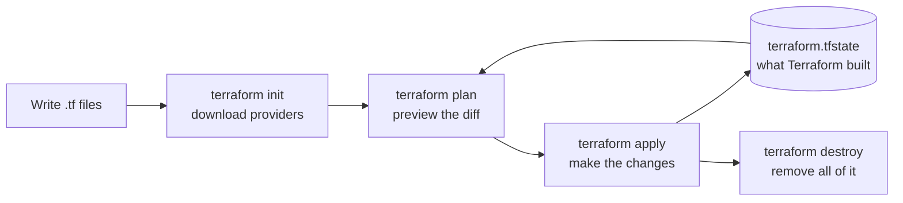
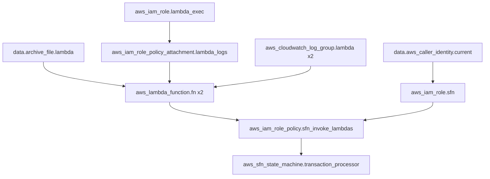

# Transaction Processor with Terraform: Study Notes

This is the same experiment as [02_AWS_Step_Functions_with_Lambda_Study_Notes.md](../tutorial/02_AWS_Step_Functions_with_Lambda_Study_Notes.md): two Lambdas and a state machine that routes purchases and refunds. This time it's built from the code in this folder instead of console clicks.

Read notes 02 first. These notes don't re-explain Step Functions or Lambda. They explain how each console step became Terraform code, and why the code looks the way it does.

What has been checked so far:
- `terraform fmt` and `terraform validate` pass.
- The state machine definition passed `ValidateStateMachineDefinition` (result `OK`, no diagnostics).
- `terraform plan` showed `9 to add, 0 to change, 0 to destroy`.

`apply` had not been run when these notes were written.

---

## Contents

1. [Why do this with Terraform](#1-why-do-this-with-terraform)
2. [Terraform in five minutes](#2-terraform-in-five-minutes)
3. [The folder](#3-the-folder)
4. [Console step to Terraform map](#4-console-step-to-terraform-map)
5. [File by file](#5-file-by-file)
6. [How Terraform decides the build order](#6-how-terraform-decides-the-build-order)
7. [Running the experiment](#7-running-the-experiment)
8. [The state file](#8-the-state-file)
9. [Console build vs Terraform build](#9-console-build-vs-terraform-build)
10. [Gotchas](#10-gotchas)
11. [Exercises](#11-exercises)
12. [Cheat sheet](#12-cheat-sheet)
13. [Review questions](#13-review-questions)

---

## 1. Why do this with Terraform

The console build took about 15 clicks across three services: Lambda, IAM and Step Functions. Cleaning it up meant finding 10 separate things to delete, including IAM roles and policies the console had created with random suffixes.

With Terraform:

- **The whole setup lives in files.** You can read it, diff it, and put it in git.
- **`terraform plan` shows what will change before anything changes.**
- **`terraform apply` builds everything, and `terraform destroy` removes everything** it built, nothing more.
- **Rebuilding is identical every time.** No forgotten "change the handler name" step.

The cost is a bit of upfront learning, which is what these notes are for.

---

## 2. Terraform in five minutes

Just enough to read the files in this folder.

### Building blocks

| Block | What it is | Example in this folder |
|---|---|---|
| `terraform { }` | Settings for Terraform itself: version, which providers to download | `versions.tf` |
| `provider "aws" { }` | Configures a plugin that talks to an API, here AWS | `versions.tf` |
| `resource "TYPE" "NAME" { }` | Something Terraform **creates and owns** | `aws_lambda_function.fn` |
| `data "TYPE" "NAME" { }` | Something Terraform only **reads or computes**, never creates in AWS | `data.archive_file.lambda` |
| `variable "NAME" { }` | An input you can override | `var.region` |
| `locals { }` | Named values for reuse inside the config | `local.functions` |
| `output "NAME" { }` | A value printed after apply | `state_machine_arn` |

Every resource has an **address**: `TYPE.NAME`, for example `aws_iam_role.sfn`. You reference its attributes with `aws_iam_role.sfn.arn`. **Those references are how Terraform learns the build order** (section 6).

All `.tf` files in a folder are merged into one configuration. Splitting them into `versions.tf`, `main.tf` and `outputs.tf` is only for readability.

### The workflow



- **init**: run once per folder, and again after you change providers. It downloads plugins into `.terraform/` and pins their versions in `.terraform.lock.hcl`.
- **plan**: compares three things: your files, the state file, and what actually exists in AWS. Then it prints the difference.
- **apply**: runs a plan, asks `yes/no`, makes the API calls, and records the results in the state file.
- **destroy**: deletes everything listed in the state file.

### Plan symbols

| Symbol | Meaning |
|---|---|
| `+` | create |
| `~` | update in place |
| `-/+` | destroy and recreate (some attributes can't be changed in place) |
| `-` | destroy |

---

## 3. The folder

```
02_terraform/
├── Terraform_Study_Notes.md  these notes
├── versions.tf             Terraform + provider versions, region variable, AWS provider
├── main.tf                 every resource (IAM, log groups, Lambdas, state machine)
├── outputs.tf              ARNs and a ready-to-run start-execution command
├── statemachine.asl.json   the ASL definition, with ${...} placeholders for Lambda ARNs
├── lambda/
│   └── lambda_function.py  both handlers in one file
├── README.md               the four commands
├── .gitignore              keeps .terraform/, state files and build/ out of git
│
│   (generated, not written by hand)
├── .terraform/             downloaded provider plugins (from init)
├── .terraform.lock.hcl     exact provider versions: aws 6.73.0, archive 2.8.1
├── build/lambda.zip        the zipped lambda/ folder (from plan/apply)
└── terraform.tfstate       what Terraform has built (from apply)
```

---

## 4. Console step to Terraform map

| What you did in the console (notes 02) | Where it lives now |
|---|---|
| Create function `ProcessPurchase`, pick Python runtime | `aws_lambda_function.fn["ProcessPurchase"]` in `main.tf` |
| Lambda creates `ProcessPurchase-role-xxxx` for you | `aws_iam_role.lambda_exec` plus `aws_iam_role_policy_attachment.lambda_logs` (one role shared by both functions) |
| Paste code into the editor | `lambda/lambda_function.py`, zipped by `data.archive_file.lambda` |
| Change the handler to `lambda_function.process_purchase` | `handler = each.value` with values from `local.functions` |
| Click **Deploy** | `source_code_hash`, which makes `apply` upload the new code whenever the file changes |
| Repeat everything for `ProcessRefund` | The same resource block, repeated by `for_each` |
| Create `StepFunctionLambdaRole` in IAM | `aws_iam_role.sfn` plus `aws_iam_role_policy.sfn_invoke_lambdas` |
| Drag the Choice and Lambda Invoke states in Workflow Studio | `statemachine.asl.json` |
| Pick each function in the Lambda Invoke panel | `${purchase_arn}` / `${refund_arn}` filled in by `templatefile()` |
| Config tab: choose the execution role | `role_arn = aws_iam_role.sfn.arn` |
| Click **Create** | `terraform apply` |
| Delete 10 things by hand | `terraform destroy` |
| *(no console equivalent)* | `aws_cloudwatch_log_group.lambda` with 7-day retention |

---

## 5. File by file

### 5.1 `versions.tf`

```hcl
terraform {
  required_version = ">= 1.10"

  required_providers {
    aws = {
      source  = "hashicorp/aws"
      version = "~> 6.0"
    }
    archive = {
      source  = "hashicorp/archive"
      version = "~> 2.7"
    }
  }
}
```

- `required_version` stops an older Terraform binary from running this config. You have 1.17.0.
- **Two providers.**
  - `aws` talks to AWS.
  - `archive` builds zip files locally. It never calls AWS.
- `~> 6.0` means "6.anything, never 7.0". Major versions can contain breaking changes, so this allows bug fixes and features but blocks surprises.
  - `init` picked 6.73.0 and wrote it to `.terraform.lock.hcl`. Everyone who uses that lock file gets exactly 6.73.0 until someone runs `terraform init -upgrade`.

```hcl
variable "region" {
  description = "AWS region to deploy into"
  type        = string
  default     = "us-east-1"
}

provider "aws" {
  region = var.region
}
```

- The region is a variable so you can try another region without editing code: `terraform apply -var region=eu-west-1`.
- There are **no credentials in the file.** The AWS provider finds them the same way the AWS CLI does. Here that's `AWS_PROFILE=<your-profile>` from your shell, which reads `~/.aws/config` and `~/.aws/credentials`.

### 5.2 `lambda/lambda_function.py`

The same code as notes 02 sections 3, both functions in one file:

```python
def process_purchase(message, context): ...
def process_refund(message, context): ...
```

Both Lambdas get **the same zip**. Each one's `handler` setting picks which function inside the file to run. This is also the fix for the earlier console error, `Handler 'process_purchase' missing on module 'lambda_function'`: the handler string must name a function that exists in the deployed file.

### 5.3 `main.tf`: shared values and the zip

```hcl
data "aws_caller_identity" "current" {}

locals {
  functions = {
    ProcessPurchase = "lambda_function.process_purchase"
    ProcessRefund   = "lambda_function.process_refund"
  }
}
```

- `aws_caller_identity` asks AWS "who am I?" and returns your account ID. It's used later in the Step Functions trust policy, so the account ID is never hardcoded.
- `local.functions` maps **function name → handler**. It's the single list that drives both Lambdas and both log groups through `for_each`. Adding a third function would mean adding one line here, plus its Python function.

```hcl
data "archive_file" "lambda" {
  type        = "zip"
  source_dir  = "${path.module}/lambda"
  output_path = "${path.module}/build/lambda.zip"
}
```

- This zips the `lambda/` folder. It's a **data** source because it doesn't create anything in AWS; it produces a local file plus a hash of it.
- `path.module` means "the folder this .tf file is in", so the paths work no matter where you run the command from.
- It runs during `plan`, which is why `build/lambda.zip` already exists even though nothing has been applied.

### 5.4 `main.tf`: the Lambda execution role

```hcl
resource "aws_iam_role" "lambda_exec" {
  name = "TransactionProcessorLambdaRole"

  assume_role_policy = jsonencode({
    Version = "2012-10-17"
    Statement = [{
      Effect    = "Allow"
      Principal = { Service = "lambda.amazonaws.com" }
      Action    = "sts:AssumeRole"
    }]
  })
}

resource "aws_iam_role_policy_attachment" "lambda_logs" {
  role       = aws_iam_role.lambda_exec.name
  policy_arn = "arn:aws:iam::aws:policy/service-role/AWSLambdaBasicExecutionRole"
}
```

- **`assume_role_policy` is the trust policy**: *who* can use this role. Here that's the Lambda service.
- `jsonencode()` turns an HCL object into a JSON string. That's nicer than a heredoc of raw JSON because typos become syntax errors, and you can drop in references like `data.aws_caller_identity.current.account_id`.
- The **attachment** says *what* the role can do. `AWSLambdaBasicExecutionRole` is AWS-managed and only allows writing CloudWatch Logs, the same permissions the console gave each function.
- In IAM, the role and the policy attachment are separate things, so they're separate Terraform resources.

### 5.5 `main.tf`: log groups

```hcl
resource "aws_cloudwatch_log_group" "lambda" {
  for_each          = local.functions
  name              = "/aws/lambda/${each.key}"
  retention_in_days = 7
}
```

- If you don't create the log group yourself, Lambda creates `/aws/lambda/<function>` on the first invocation, **with no retention**. Logs then pile up forever.
- Creating it in Terraform lets you set 7-day retention, and `destroy` removes it too.
- `for_each = local.functions` creates one log group per map key. `each.key` is the function name. (`each.value` is the handler, which isn't needed here.)

### 5.6 `main.tf`: the two Lambda functions

```hcl
resource "aws_lambda_function" "fn" {
  for_each = local.functions

  function_name = each.key
  handler       = each.value
  runtime       = "python3.13"
  role          = aws_iam_role.lambda_exec.arn

  filename         = data.archive_file.lambda.output_path
  source_code_hash = data.archive_file.lambda.output_base64sha256

  depends_on = [
    aws_iam_role_policy_attachment.lambda_logs,
    aws_cloudwatch_log_group.lambda,
  ]
}
```

**`for_each`** turns one block into two resources:

| Address | `each.key` (function_name) | `each.value` (handler) |
|---|---|---|
| `aws_lambda_function.fn["ProcessPurchase"]` | `ProcessPurchase` | `lambda_function.process_purchase` |
| `aws_lambda_function.fn["ProcessRefund"]` | `ProcessRefund` | `lambda_function.process_refund` |

**`source_code_hash`** is the important line.
- Terraform only updates a function when one of its attributes changes.
- `filename` is always `build/lambda.zip`, so editing the Python would look like "no change" without it.
- The hash changes whenever the zip's contents change, so Terraform sees a diff and uploads the new code. **This is the Terraform version of the console's Deploy button.** Forgetting it gives the same stale-code problem you hit in the console.

**`depends_on`** adds ordering that Terraform can't infer from references:
- **Log groups first.** If the function existed first and got invoked, Lambda would create the log group itself. Terraform's create would then fail with "already exists".
- **Policy attachment first.** The role should already have its log permissions when the function first runs.

### 5.7 `main.tf`: the Step Functions role

```hcl
resource "aws_iam_role" "sfn" {
  name = "TransactionProcessorStateMachineRole"

  assume_role_policy = jsonencode({
    Version = "2012-10-17"
    Statement = [{
      Effect    = "Allow"
      Principal = { Service = "states.amazonaws.com" }
      Action    = "sts:AssumeRole"
      Condition = {
        StringEquals = { "aws:SourceAccount" = data.aws_caller_identity.current.account_id }
      }
    }]
  })
}
```

- This is the same trust policy as notes 02 section 4, plus a `Condition`.
- `aws:SourceAccount` means Step Functions can only assume this role for a state machine in **your** account. This protects against the "confused deputy" problem, where someone else's resource tricks a service into using your role. The `StepFunctionLambdaRole` you made in IAM has no condition; its trust policy is only the `Principal` and `Action`.
- The name differs from the console's `StepFunctionLambdaRole` on purpose, so it can never clash with leftovers from the console build.

### 5.8 `main.tf`: what the Step Functions role can do

```hcl
resource "aws_iam_role_policy" "sfn_invoke_lambdas" {
  name = "InvokeTransactionLambdas"
  role = aws_iam_role.sfn.id

  policy = jsonencode({
    Version = "2012-10-17"
    Statement = [{
      Effect = "Allow"
      Action = "lambda:InvokeFunction"
      Resource = flatten([
        for f in aws_lambda_function.fn : [f.arn, "${f.arn}:*"]
      ])
    }]
  })
}
```

- `aws_iam_role_policy` is an **inline** policy: it lives inside the role, and deleting the role deletes it. Compare `aws_iam_role_policy_attachment`, which attaches a separate managed policy.
- **The `for` expression** loops over both functions. For each one it makes a two-item list: the plain ARN and the ARN followed by `:*`. That gives `[[a, a:*], [b, b:*]]`. `flatten` turns it into one list. After apply, it evaluates to:

  ```json
  "Resource": [
    "arn:aws:lambda:us-east-1:123456789012:function:ProcessPurchase",
    "arn:aws:lambda:us-east-1:123456789012:function:ProcessPurchase:*",
    "arn:aws:lambda:us-east-1:123456789012:function:ProcessRefund",
    "arn:aws:lambda:us-east-1:123456789012:function:ProcessRefund:*"
  ]
  ```

- **Why `:*`?** The state machine invokes `...:function:ProcessPurchase:$LATEST`, which is a *qualified* ARN (it ends in a version or alias). IAM treats `function:ProcessPurchase` and `function:ProcessPurchase:$LATEST` as different resources, so the policy needs the `:*` form too. The console writes the same pair.
- This is **scoped**: only these two functions. `AWSLambdaRole`, used in the video, allows invoking every function in the account.

### 5.9 `main.tf`: the state machine

```hcl
resource "aws_sfn_state_machine" "transaction_processor" {
  name     = "TransactionProcessorStateMachine"
  type     = "STANDARD"
  role_arn = aws_iam_role.sfn.arn

  definition = templatefile("${path.module}/statemachine.asl.json", {
    purchase_arn = aws_lambda_function.fn["ProcessPurchase"].arn
    refund_arn   = aws_lambda_function.fn["ProcessRefund"].arn
  })

  depends_on = [aws_iam_role_policy.sfn_invoke_lambdas]
}
```

- `templatefile()` reads the JSON file and replaces each `${purchase_arn}` and `${refund_arn}` with the real ARNs. This replaces "copy the ARN from the Lambda page and paste it into the definition".
- Using `aws_lambda_function.fn[...].arn` also tells Terraform that the Lambdas must exist before the state machine.
- `depends_on` on the inline policy: the state machine only references the *role*, not the policy inside it. Without this line, Terraform could create the state machine while the role still has no permissions. On `destroy` it also makes sure the state machine is removed before its permissions are.

### 5.10 `statemachine.asl.json`

This mirrors what Workflow Studio built in the console. It differs from the definition in notes 02 section 5, which follows the 2019 video:

| Field | Notes 02 (video) | This file | Why |
|---|---|---|---|
| `QueryLanguage` | not set | `"JSONPath"` | Workflow Studio sets it explicitly. The other option is JSONata. |
| `TimeoutSeconds` | not set | `600` | From the Workflow config panel in your screenshot. The execution fails with `States.Timeout` after 10 minutes. |
| Choice order | PURCHASE, then REFUND | REFUND, then PURCHASE | Matches the graph you built. Order doesn't matter here because the rules can't both match. |
| Task `Resource` | the Lambda ARN | `arn:aws:states:::lambda:invoke` | The current integration style |
| `Parameters` | none | `FunctionName` plus `"Payload.$": "$"` | Which function to call, and send the whole state input as the event |
| `OutputPath` | none | `"$.Payload"` | Unwraps the result so the output is just what your function returned. See notes 02 section 8. |
| `Retry` | none | Lambda service and throttling errors: 3 attempts, backoff 2, `JitterStrategy: FULL` | Workflow Studio's default. Jitter spreads retries out randomly so many executions don't all retry at the same moment. |

**Placeholders and `$` signs.** `templatefile` only replaces `${name}` (dollar plus braces). `"Payload.$"`, `"$"`, `"$.Payload"` and `:$LATEST` have no braces, so they pass through untouched. If you ever needed a literal `${` in the file, you'd write `$${`.

### 5.11 `outputs.tf`

```hcl
output "lambda_arns" {
  value = { for name, f in aws_lambda_function.fn : name => f.arn }
}

output "state_machine_arn" {
  value = aws_sfn_state_machine.transaction_processor.arn
}

output "start_purchase_command" {
  value = "aws stepfunctions start-execution --state-machine-arn ${aws_sfn_state_machine.transaction_processor.arn} --input '{\"TransactionType\": \"PURCHASE\"}'"
}
```

- Outputs print at the end of `apply`, and you can read them any time with `terraform output`.
- `terraform output -raw state_machine_arn` prints the bare string with no quotes, which is handy in shell commands.
- `lambda_arns` uses a `for` expression that builds a **map** (`name => value`), unlike the list built in 5.8.

---

## 6. How Terraform decides the build order

In the console, **you** had to know the order: Lambdas first for their ARNs, then the role, then the state machine. Terraform works it out from the references in the code and builds a dependency graph. This is the real graph from `terraform graph` (an arrow means "is needed by"):



`terraform graph` hides edges that are already implied, such as state machine → Lambdas, which goes through the policy.

What `apply` does with that graph:

1. **In parallel:** both IAM roles and both log groups. Nothing connects them, so they don't wait on each other.
2. The policy attachment, once the Lambda role exists.
3. Both Lambda functions, in parallel.
4. The Step Functions inline policy, which needs the role and both function ARNs.
5. The state machine.

`destroy` walks the same graph **in reverse**: state machine first, roles last.

---

## 7. Running the experiment

All commands run from the `02_terraform/` folder, with `AWS_PROFILE=<your-profile>` set in your shell.

### 7.1 Before the first apply: clear the console build

Terraform only manages what's in **its own state file**. It doesn't know the console's `ProcessPurchase` exists. If you apply while those resources still exist, AWS rejects the creates:

| Leftover | Error on apply |
|---|---|
| Lambda `ProcessPurchase` / `ProcessRefund` | `ResourceConflictException: Function already exist` |
| Log group `/aws/lambda/ProcessPurchase` / `ProcessRefund` | `ResourceAlreadyExistsException` |
| State machine `TransactionProcessorStateMachine` | `StateMachineAlreadyExists` |

So delete those five first; the IAM roles don't clash because the names differ. Another option is `terraform import`, which adopts existing resources into the state. It's harder here because the console's role names and definition would have to match the code exactly.

### 7.2 Init

```sh
terraform init
```

Downloads the `aws` and `archive` providers into `.terraform/`. You only run it again after changing providers or versions.

### 7.3 Plan

```sh
terraform plan
```

Expected summary:

```
  # aws_cloudwatch_log_group.lambda["ProcessPurchase"] will be created
  # aws_cloudwatch_log_group.lambda["ProcessRefund"] will be created
  # aws_iam_role.lambda_exec will be created
  # aws_iam_role.sfn will be created
  # aws_iam_role_policy.sfn_invoke_lambdas will be created
  # aws_iam_role_policy_attachment.lambda_logs will be created
  # aws_lambda_function.fn["ProcessPurchase"] will be created
  # aws_lambda_function.fn["ProcessRefund"] will be created
  # aws_sfn_state_machine.transaction_processor will be created
Plan: 9 to add, 0 to change, 0 to destroy.
```

Many values show as `(known after apply)`, such as ARNs. AWS only assigns them when the resource is created.

### 7.4 Apply

```sh
terraform apply
```

It shows the same plan and waits for `yes`. When it finishes it prints the outputs, and `terraform.tfstate` now lists 11 entries: 9 resources plus 2 data sources.

### 7.5 Test it

**One Lambda on its own** (the console's **Test** button):

```sh
aws lambda invoke --function-name ProcessPurchase \
  --cli-binary-format raw-in-base64-out \
  --payload '{"TransactionType": "PURCHASE"}' out.json && cat out.json
```

`--cli-binary-format raw-in-base64-out` lets AWS CLI v2 accept plain JSON as the payload.

**The whole state machine:**

```sh
ARN=$(terraform output -raw state_machine_arn)

EXEC=$(aws stepfunctions start-execution --state-machine-arn "$ARN" \
  --input '{"TransactionType": "REFUND"}' --query executionArn --output text)

aws stepfunctions describe-execution --execution-arn "$EXEC" \
  --query '{status: status, output: output}'
```

Expected: `"status": "SUCCEEDED"`, and an output with `TransactionType`, `Timestamp`, and the ProcessRefund message.

The console works too. The state machine appears in Step Functions as usual, and **Start execution** behaves exactly as in notes 02 section 6.

### 7.6 Destroy

```sh
terraform destroy
```

Shows `Plan: 0 to add, 0 to change, 9 to destroy`, then removes everything in reverse order. Afterwards, `terraform plan` shows 9 to add again: the code is unchanged, only the infrastructure is gone.

---

## 8. The state file

`terraform.tfstate` is a JSON file that records **what Terraform built**: each resource address mapped to its real AWS ID and attributes.

```
aws_lambda_function.fn["ProcessPurchase"]  ->  arn:aws:lambda:us-east-1:...:function:ProcessPurchase
aws_iam_role.sfn                           ->  TransactionProcessorStateMachineRole
...
```

- `plan` uses it to know what already exists. With no state, Terraform assumes nothing exists and tries to create everything.
- **If you delete the state file, Terraform forgets the resources.** They keep running in AWS, but `destroy` can't remove them anymore. Don't delete it while resources are up.
- It can contain sensitive values, such as database passwords in other projects. It's in `.gitignore` for that reason.
- **It stays local here.** On a team you'd store it remotely, for example in an S3 bucket with `use_lockfile = true`, so everyone shares one copy and two applies can't run at once.
- Use `terraform state list` to see what's tracked, and `terraform state show <address>` for one resource's details.

---

## 9. Console build vs Terraform build

| | Console build | Terraform build |
|---|---|---|
| Lambda roles | One per function (`ProcessPurchase-role-xxxx`, ...), each with its own customer-managed copy of the logging policy | One shared role with the AWS-managed `AWSLambdaBasicExecutionRole` |
| Step Functions role | `StepFunctionLambdaRole` with `AWSLambdaRole` (invoke **any** function) | Inline policy for these two functions only |
| Trust policy | No `aws:SourceAccount` condition (made by hand in IAM) | `aws:SourceAccount` condition |
| Log retention | Never expires | 7 days |
| Code deploy | Click **Deploy**; forget it and you get `HandlerNotFound` | `source_code_hash` redeploys automatically on apply |
| Lambda ARNs in the definition | Picked from a dropdown | Filled in by `templatefile()` |
| Cleanup | 10 separate deletes across 4 services | `terraform destroy` |
| Rebuild | Repeat every click | `terraform apply` |
| Runtime | Python 3.12 | Python 3.13 |

---

## 10. Gotchas

1. **Same names as existing resources.** Terraform won't adopt resources it didn't create (section 7.1). Delete them or `import` them.
2. **Re-creating a state machine right after deleting it.** State machine deletion is asynchronous. Creating one with the same name while the old one is still deleting fails with `StateMachineDeleting`. Wait a minute and run `apply` again.
3. **IAM is eventually consistent.** A role can take a few seconds to work after creation. The AWS provider already retries Lambda creation when the role "cannot be assumed" yet. If something else fails on a brand-new role, re-running `apply` usually fixes it.
4. **Editing files does nothing until you apply.** This is the same idea as the console's Deploy button, one level up.
5. **Changes made in the console are drift.** If you change the timeout in the console, the next `plan` shows Terraform wants to change it back. The code wins on the next apply.
6. **Both Lambdas share one zip.** Editing only `process_refund` still redeploys **both** functions, because the zip hash changes for both. That's harmless here, but it's why bigger projects give each function its own folder and zip.
7. **`build/` is generated** at plan time. Don't edit `build/lambda.zip`; edit `lambda/lambda_function.py`.
8. **Commit `.terraform.lock.hcl`, not `.terraform/`.** The lock file pins provider versions. The folder holds the large plugin binaries.
9. **Region.** Resources go to `var.region`. If you look for them in another region in the console, they won't be there.
10. **No Default branch.** As in the console build, `{"TransactionType": "TRANSFER"}` fails with `States.NoChoiceMatched`. Exercise 3 fixes this.

---

## 11. Exercises

Each one shows a Terraform idea using a small change.

1. **Code change.** Edit the purchase message in `lambda_function.py` and run `terraform plan`. Expect `0 to add, 2 to change, 0 to destroy`; both functions change because they share the zip. Apply it and run a PURCHASE execution to see the new message.
2. **Drift.** In the console, change the log retention of `/aws/lambda/ProcessRefund` to 30 days. Run `terraform plan` and see it plan a change back to 7. Apply it.
3. **Add a Default branch.**
   - Add `"Default": "UnknownTransactionType"` to the Choice state, plus a `Fail` state, in `statemachine.asl.json`. The hardened definition in notes 02 section 8 shows how.
   - `plan` shows `~ definition` as an in-place update.
   - Run `{"TransactionType": "TRANSFER"}` before and after the change.
4. **Remove `source_code_hash`.** Edit the Python, then `plan`, and see that nothing changes. Put the line back.
5. **Try expressions** in `terraform console`:

   ```
   > local.functions
   > keys(local.functions)
   > [for name, handler in local.functions : upper(name)]
   ```

6. **Full cycle.** Run `terraform destroy`, then `terraform apply`. You get the whole experiment back in about a minute.

---

## 12. Cheat sheet

```
init                 : download providers (.terraform/, .terraform.lock.hcl)
plan                 : diff of files vs state vs AWS; + create, ~ update, -/+ replace, - destroy
apply / destroy      : make it so / remove all of it (asks yes)
output -raw NAME     : print one output without quotes
state list           : what Terraform is tracking
fmt / validate       : tidy formatting / check syntax and references (no AWS calls)

resource vs data     : resource = Terraform creates and owns it; data = read or compute only
reference            : TYPE.NAME.ATTR, e.g. aws_iam_role.sfn.arn (also sets build order)
for_each over a map  : one resource per key; each.key, each.value; address fn["ProcessPurchase"]
depends_on           : only for ordering Terraform can't see from references
jsonencode({...})    : HCL object -> JSON string (IAM policies)
templatefile(f, {})  : read file, replace ${name}; "$" without braces is left alone
source_code_hash     : zip hash; changes trigger a Lambda redeploy (the "Deploy" button)

Two roles            : lambda_exec (trusted by lambda.amazonaws.com, logs)
                       sfn (trusted by states.amazonaws.com + aws:SourceAccount, invoke 2 fns + :*)
State file           : local terraform.tfstate; don't delete with resources up; don't commit
Name clash           : existing same-name resources -> delete first, or terraform import
```

---

## 13. Review questions

<details>
<summary>1. What's the difference between a <code>resource</code> and a <code>data</code> block? Name one of each from this folder.</summary>

A `resource` is created and owned by Terraform, and `destroy` removes it. Example: `aws_lambda_function.fn`. A `data` source only reads or computes something. Examples: `data.aws_caller_identity.current` (your account ID) and `data.archive_file.lambda` (builds a local zip, nothing in AWS).
</details>

<details>
<summary>2. How does Terraform know to create the Lambdas before the state machine?</summary>

The state machine's `definition` uses `aws_lambda_function.fn["ProcessPurchase"].arn`, a reference. Terraform builds a dependency graph from references and creates things in that order.
</details>

<details>
<summary>3. What would happen if you removed <code>source_code_hash</code> and then edited the Python file?</summary>

`plan` would show no changes. `filename` stays `build/lambda.zip`, so no attribute of the function changed. The old code would keep running, the same problem as forgetting **Deploy** in the console.
</details>

<details>
<summary>4. Why does the Step Functions policy list both <code>function:ProcessPurchase</code> and <code>function:ProcessPurchase:*</code>?</summary>

The state machine invokes `ProcessPurchase:$LATEST`, a qualified ARN. IAM treats the plain and qualified ARNs as different resources, so the `:*` form is needed to allow invoking a version or alias like `$LATEST`.
</details>

<details>
<summary>5. What does the <code>aws:SourceAccount</code> condition in the Step Functions trust policy protect against?</summary>

The confused-deputy problem: a state machine in another account getting the Step Functions service to assume your role. With the condition, only state machines in your own account can use it.
</details>

<details>
<summary>6. Why create the log groups in Terraform instead of letting Lambda create them?</summary>

To set a retention period (7 days). Lambda's auto-created groups never expire. It also means `destroy` cleans them up. `depends_on` makes sure the group exists before the function, so Lambda doesn't create it first and cause an "already exists" error.
</details>

<details>
<summary>7. You run <code>terraform apply</code> while the console's <code>ProcessPurchase</code> function still exists. What happens, and why?</summary>

Creating the function fails with `ResourceConflictException`. Terraform only knows about resources in its own state file, so it tries to create `ProcessPurchase` and AWS refuses because the name is taken. Delete the old one, or adopt it with `terraform import`.
</details>

<details>
<summary>8. You delete <code>terraform.tfstate</code> while everything is deployed, then run <code>terraform destroy</code>. What happens?</summary>

Nothing is destroyed. With no state, Terraform thinks it manages nothing. The resources stay in AWS and must be removed by hand or imported back.
</details>

<details>
<summary>9. How does <code>"Payload.$": "$"</code> survive <code>templatefile()</code> unchanged?</summary>

`templatefile` only replaces `${...}` (dollar plus braces). A `$` without braces, as in `"Payload.$"`, `"$"`, `"$.Payload"` and `:$LATEST`, is left as is.
</details>

<details>
<summary>10. You edit only <code>process_refund</code>. How many resources does <code>plan</code> say will change, and why?</summary>

Two: both Lambda functions. They share one zip, so its hash changes for both, and each function's `source_code_hash` differs from what was deployed.
</details>

<details>
<summary>11. Someone changes the state machine's timeout in the console. What does the next <code>terraform plan</code> show?</summary>

An in-place update (`~`) to `aws_sfn_state_machine.transaction_processor`, changing the definition back to what the code says. Changes made outside Terraform are drift, and the code wins on the next apply.
</details>

<details>
<summary>12. In what order does <code>terraform destroy</code> remove things?</summary>

The reverse of the dependency graph. The state machine goes first, then the Step Functions policy, then the Lambdas, then the log groups, the policy attachment and the roles. Nothing is deleted while something else still depends on it.
</details>
