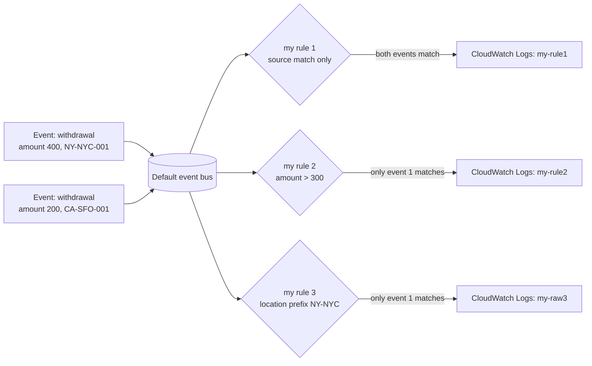

# Amazon EventBridge Rules Deep Dive: Study Notes

Source: [Amazon EventBridge - Learning about rules](https://www.youtube.com/watch?v=S_LZ9yDNNAo), Serverless Land (AWS's own official content hub), 7:11.

A console walkthrough: three rules are built against a fictional ATM-transaction event source, each using a different event-pattern technique (broad source match, a numeric range, and a prefix match), then tested by sending sample events through the console's **Send events** UI and inspecting which rule matched in a CloudWatch Logs target.

What was checked: the rule/target mechanics (single bus per rule, up to 5 targets per rule, targets run in parallel) and the content-filtering operator syntax (numeric, prefix) were checked against AWS's current [Rules in Amazon EventBridge](https://docs.aws.amazon.com/eventbridge/latest/userguide/eb-rules.html) and [Comparison operators for event patterns](https://docs.aws.amazon.com/eventbridge/latest/userguide/eb-event-patterns-content-based-filtering.html) pages. Nothing was run against a live account.

---

## Contents

1. [Corrected/approximated terms](#1-correctedapproximated-terms)
2. [Rules 101](#2-rules-101)
3. [The lab: three rules, one ATM event source](#3-the-lab-three-rules-one-atm-event-source)
4. [The full operator cheat table](#4-the-full-operator-cheat-table)
5. [Testing a rule without touching real infrastructure](#5-testing-a-rule-without-touching-real-infrastructure)
6. [Gotchas](#6-gotchas)
7. [What has changed since the video](#7-what-has-changed-since-the-video)
8. [Cheat sheet](#8-cheat-sheet)
9. [Review questions](#9-review-questions)

---

## 1. Corrected/approximated terms

The auto-captions are lowercase and occasionally compress the test values used in the demo; exact casing on these two couldn't be confirmed from audio alone:

| Caption says | Likely actual value |
|---|---|
| "nymic 001" | `NY-NYC-001` (a location value with the `NY-NYC` prefix used in rule 3) |
| "casf001" | `CA-SFO-001` (the non-matching location used to prove rule 3 does *not* fire for it) |

---

## 2. Rules 101

The video's framing (00:00): "events flow through event buses but **nothing happens until a rule is matched** — rules are really at the heart of how you control events in EventBridge."

| Claim (video) | Confirmed |
|---|---|
| A rule matches incoming events and sends them to targets | Yes |
| A single rule can send an event to multiple targets, which run **in parallel** | Yes, verbatim in AWS's docs — up to **5 targets per rule** |
| A rule is based on either an **event pattern** or a **schedule** | Yes, these are the two rule types; AWS now calls schedule-based rules **legacy** (section 7) |
| One rule can only apply to a single event bus | Yes — a rule is created on, and only evaluates events from, one specific bus |

---

## 3. The lab: three rules, one ATM event source

All three rules share `"source": ["my-atm-app"]`-style matching on the **default event bus**, each adding a different technique, each targeting a CloudWatch Logs group (a convenient, free way to see exactly what matched without wiring up a real downstream service):



| Rule | Pattern technique | Pattern (reconstructed) | Matched event 1 (amount 400, NY-NYC-001)? | Matched event 2 (amount 200, CA-SFO-001)? |
|---|---|---|---|---|
| my rule 1 | Broadest: match on `source` only | `{"source": ["my-atm-app"]}` | Yes | Yes |
| my rule 2 | Numeric range operator | `{"source": ["my-atm-app"], "detail": {"amount": [{"numeric": [">", 300]}]}}` | Yes (400 > 300) | No (200 is not > 300) |
| my rule 3 | Prefix operator | `{"source": ["my-atm-app"], "detail": {"location": [{"prefix": "NY-NYC"}]}}` | Yes | No |

This demonstrates the core evaluation model directly: **every top-level field in a pattern is AND'd together** (source AND amount AND location all have to match for rule 2/3), while **values inside one field's array are OR'd together** (not exercised here, but implied by rule 1 matching either event purely on `source`).

---

## 4. The full operator cheat table

The video only shows two operators (numeric, prefix). AWS's content-based filtering page documents a much larger set — useful beyond this one lab:

| Operator | Example pattern | Matches |
|---|---|---|
| Equals (default) | `"Name": ["Alice"]` | Exact string/number match |
| Or (same field) | `"PaymentType": ["Credit", "Debit"]` | Either value |
| Or (different fields) | `"$or": [{"Location": ["New York"]}, {"Day": ["Monday"]}]` | Either field's condition |
| Prefix (begins with) | `"Region": [{"prefix": "us-"}]` | String starts with `us-` |
| Suffix (ends with) | `"FileName": [{"suffix": ".png"}]` | String ends with `.png` |
| Numeric | `"Price": [{"numeric": [">", 10, "<=", 20]}]` | Range, 64-bit float precision |
| Anything-but | `"state": [{"anything-but": "initializing"}]` | Any value except this one |
| Anything-but + prefix/suffix | `"Region": [{"anything-but": {"prefix": "us-"}}]` | Excludes a whole prefix family |
| Exists / does-not-exist | `"ProductName": [{"exists": true}]` | Field presence, not value |
| Equals-ignore-case | `"Name": [{"equals-ignore-case": "alice"}]` | Case-insensitive match |
| Wildcard | `"FileName": [{"wildcard": "dir/*.png"}]` | Event buses only, not Pipes |
| CIDR (IP matching) | `"sourceIPAddress": [{"cidr": "10.0.0.0/24"}]` | IPv4/IPv6 range |

Rule 2 and rule 3 in the lab could be combined into a single rule using `$or` if the goal were "match either condition" instead of two separate rules each triggering their own target — a useful simplification once you've seen both techniques work independently, as this lab deliberately does.

---

## 5. Testing a rule without touching real infrastructure

The video's testing technique (03:55) is worth calling out as a pattern, not just a one-off demo step: **EventBridge > Event buses > Send events** lets you hand-craft a test event (source, detail-type, and a JSON detail body) and send it through the real bus and real rules, with a disposable **CloudWatch Logs** target to inspect exactly what arrived — no Lambda, SNS, or Step Functions execution needs to exist yet.

This is the EventBridge-side equivalent of what this repo's Step Functions notes do with the `TestState` API ([notes 17](../tutorial/17_AWS_Step_Functions_Introduction_Study_Notes.md), [notes 01](../tutorial/01_AWS_Step_Functions_Overview_Study_Notes.md)): verify the matching/transformation logic in isolation before wiring up the real downstream target.

---

## 6. Gotchas

1. **Prefix matching is case-sensitive by default.** `NY-NYC` as a prefix won't match `ny-nyc`; use the `equals-ignore-case` variant (`{"prefix": {"equals-ignore-case": "ny-nyc"}}`) if casing isn't guaranteed.
2. **A rule belongs to exactly one event bus.** To match the same pattern on multiple buses, create the same rule on each bus separately.
3. **Up to 5 targets per rule, and they run in parallel** — don't assume any ordering between them, and don't rely on one target's success implying another's.
4. **Numeric matching has precision limits**: values are compared as 64-bit floats, exactly matched only within ±2^53. A value outside that range, or one that can't be represented exactly as a double, causes EventBridge to reject the rule (or silently fail to match) rather than approximate.
5. **Repeating a JSON key in the same pattern silently keeps only the last one** — `{"detail": {"location": [...], "location": [...]}}` evaluates only the second `location`, with no warning.
6. **Wildcard matching only works on event bus rules, not on EventBridge Pipes' filters** — see the wildcard row in section 4's table.
7. **CloudWatch Logs is a free, throwaway way to test a rule**, but it's not a substitute for actually wiring up the real target before going to production — a pattern that matches correctly in a log doesn't confirm the real target (e.g. an SNS resource policy, or a Step Functions execution role) is configured correctly too.

---

## 7. What has changed since the video

| Then | Now |
|---|---|
| Schedule-based rules shown as one of the two rule types | AWS now labels **scheduled rules as legacy** and recommends **EventBridge Scheduler** instead — cron/rate expressions, one-time invocations, flexible delivery windows, retry limits, all centrally managed, independent of any event bus |
| Rule builder (implied: JSON/basic form) | The console now offers two modes: **Advanced Builder** (direct JSON, what the video uses) and a newer **Enhanced Builder** (visual drag-and-drop canvas for rule + target construction) |

---

## 8. Cheat sheet

```
Rule            : pattern (event-driven) OR schedule (time-driven, now legacy -> use EventBridge Scheduler)
Scope           : one rule -> exactly one event bus
Targets         : up to 5 per rule, invoked in PARALLEL, no ordering guarantee
Matching logic  : top-level fields = AND; values within one field's array = OR
Key operators   : equals (default) | prefix | suffix | numeric [">",x,"<=",y] | anything-but
                  | exists/does-not-exist | equals-ignore-case | wildcard (bus rules only) | cidr
$or             : cross-field OR, e.g. {"$or":[{"A":[...]},{"B":[...]}]} -- capped at 1000 combinations
Test fast       : EventBridge > Event buses > Send events, target = throwaway CloudWatch Logs group
Gotcha          : prefix/suffix are case-sensitive unless paired with equals-ignore-case
```

---

## 9. Review questions

<details>
<summary>1. A rule has no schedule and no target failures — why might "nothing happen" when an event arrives on the bus?</summary>

Events flowing through a bus don't trigger anything by themselves; a rule has to actually match the event's pattern. If no rule's pattern matches, EventBridge takes no action at all — there's no default "catch-all" behavior.
</details>

<details>
<summary>2. Rule 2 in the lab matches `amount > 300`. Why didn't the 200-amount test event trigger it, while the 400-amount one did?</summary>

The numeric operator `{"numeric": [">", 300]}` only matches values strictly greater than 300. 200 fails that comparison; 400 passes it. This is independent of the `source` match, which both events satisfied.
</details>

<details>
<summary>3. Can one EventBridge rule send a matching event to both an SNS topic and a Step Functions state machine at the same time?</summary>

Yes — a rule supports up to 5 targets, and they're invoked in parallel. This is exactly the setup implied in [tutorial/20](../tutorial/20_Amazon_EventBridge_Overview_Study_Notes.md#9-beyond-the-video-step-functions-as-the-target-instead-of-sns): one rule, one SNS target for a human notification, one Step Functions target for automated remediation.
</details>

<details>
<summary>4. Why does the lab use a CloudWatch Logs target instead of the "real" target (e.g. SNS or Lambda) while building these three rules?</summary>

It's a fast, free way to confirm a rule's pattern matches (or doesn't match) exactly the events you expect, without needing the real downstream resource, its permissions, or its own logic to be ready yet.
</details>

<details>
<summary>5. A pattern repeats the same JSON key twice with different operators for the same field, by mistake. What happens?</summary>

EventBridge doesn't error or merge them — only the **last** occurrence of that key is used to evaluate events; the earlier one is silently ignored.
</details>

<details>
<summary>6. The video calls scheduled rules one of EventBridge's two rule types. What does AWS recommend instead today?</summary>

AWS now documents schedule-based rules as a legacy feature and recommends **EventBridge Scheduler** for anything time-based — it supports cron/rate expressions, one-time invocations, flexible delivery windows, and retry limits, independent of any event bus.
</details>

<details>
<summary>7. You need to match any location except ones starting with "CA-". Which operator combination does that?</summary>

`anything-but` combined with `prefix`: `{"detail": {"location": [{"anything-but": {"prefix": "CA-"}}]}}`.
</details>
