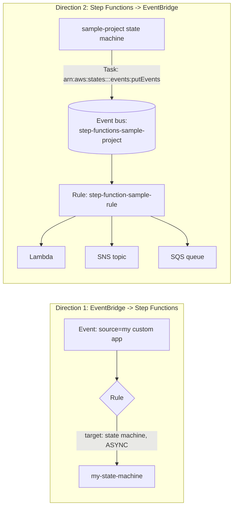

# Amazon EventBridge Integrating with AWS Step Functions: Study Notes

Source: [Amazon EventBridge - Integrating events with AWS Step Functions](https://www.youtube.com/watch?v=ur8D3n_phz4), **Serverless Land** (AWS's own official content hub), 5:58.

This is the flagship note in this folder: it's the first place in this repo that actually **builds** an EventBridge rule targeting a Step Functions state machine, a capability that [`tutorial/19`](../tutorial/19_AWS_Step_Functions_Trigger_from_SQS_Study_Notes.md) and [`tutorial/20`](../tutorial/20_Amazon_EventBridge_Overview_Study_Notes.md) only named as a documented target type without demonstrating. The video is short but covers **both directions** of the integration:

1. **EventBridge → Step Functions**: a rule matches an event and starts an execution, by defining the state machine as the rule's target.
2. **Step Functions → EventBridge**: a state machine *emits* a custom event onto a bus, using a dedicated optimized service integration, which other rules can then route anywhere (the video's demo fans it out to a Lambda function, an SNS topic, and an SQS queue).

What was checked:
- "Step Functions state machine (ASYNC)" as a rule target type, and the generic permissions model for EventBridge targets (console auto-creates an IAM role, or you set `RoleArn` yourself in `PutTargets`), were checked against the [EventBridge targets](https://docs.aws.amazon.com/eventbridge/latest/userguide/eb-targets.html) page.
- The Step Functions-to-EventBridge direction (the `arn:aws:states:::events:putEvents` Task, its auto-generated IAM policy templates, and the `FailedEntryCount`/`EventBridge.FailedEntry` error-handling behavior) was checked against [Add EventBridge events with Step Functions](https://docs.aws.amazon.com/step-functions/latest/dg/connect-eventbridge.html) in the Step Functions Developer Guide.
- `PutEvents`'s own limits (max 10 entries per call, request under 1 MB) come from the [`PutEvents` API reference](https://docs.aws.amazon.com/eventbridge/latest/APIReference/API_PutEvents.html).
- The claim that `waitForTaskToken` (Wait for a Callback) is Standard-workflow-only is **not** independently re-verified against a dedicated AWS page in this session; it's consistent with the same restriction already established and cited in [`tutorial/16`](../tutorial/16_AWS_Step_Functions_Callback_with_Lambda_Study_Notes.md) and [`tutorial/09`](../tutorial/09_AWS_Step_Functions_Standard_vs_Express_Study_Notes.md) for every other callback-style integration in this repo, so it's treated as reliable by consistency rather than re-checked from scratch.
- The exact IAM role EventBridge needs to call `states:StartExecution` on a target state machine is **inferred by analogy**, not pulled from a page that states it explicitly for Step Functions by name: EventBridge's targets page documents the generic mechanism (console creates a role automatically, or you supply `RoleArn`), the same pattern used for Kinesis and Systems Manager Run Command targets, which the IAM/resource-policy pages confirm do **not** support resource-based policies the way Lambda/SNS/SQS do. Step Functions isn't in that resource-based-policy list either, so the same identity-based pattern is the most consistent conclusion — flagged here as inference, not a verbatim-quoted fact.
- Nothing was run against a live AWS account.

---

## Contents

1. [The two directions, at a glance](#1-the-two-directions-at-a-glance)
2. [Direction 1: a rule starts a state machine](#2-direction-1-a-rule-starts-a-state-machine)
3. [Direction 2: a state machine emits an event](#3-direction-2-a-state-machine-emits-an-event)
4. [The sample project's fan-out](#4-the-sample-projects-fan-out)
5. [Same setup with the AWS CLI](#5-same-setup-with-the-aws-cli)
6. [What the video glosses over](#6-what-the-video-glosses-over)
7. [Gotchas](#7-gotchas)
8. [Cheat sheet](#8-cheat-sheet)
9. [Review questions](#9-review-questions)

---

## 1. The two directions, at a glance



| | Direction 1 | Direction 2 |
|---|---|---|
| Who initiates | EventBridge | The state machine itself |
| Mechanism | Rule with the state machine as a **target** | A Task using the optimized `arn:aws:states:::events:putEvents` resource |
| Supported by | Any rule, any event bus | Standard **and** Express workflows (for request/response); **Standard only** for Wait for Callback |
| What arrives at the far end | The matched event (optionally reshaped by an input transformer), becomes the execution's input | A custom event on the bus, which any number of rules can then route elsewhere |

The video's own framing (00:17): "Step Functions integration with EventBridge provides a specific resource type for this purpose. It allows you to publish events to a specified event bus directly from a workflow. It supports both request and response and wait for callback modes."

---

## 2. Direction 1: a rule starts a state machine

### What the video does (01:01-03:30)

1. Create a trivial state machine (`my-state-machine`) in the visual designer — the video is explicit that it "doesn't do very much," since the point is proving the trigger works, not the workflow's logic.
2. In EventBridge, select an existing **custom event bus** (named "step functions sample project" in the video — not the account's default bus) and create a rule.
3. Build a **custom event pattern**: `{"source": ["my custom app"]}` — an arbitrary, made-up source string, chosen only to make the test event easy to fire deliberately.
4. Set the target to **AWS service → Step Functions state machine → `my-state-machine`**. The console shows a note that it "will automatically create the permissions needed for EventBridge to invoke this Step Function state machine" (02:16).
5. **Send a test event** from EventBridge's console (`Event buses → Send events`), matching the rule's source and bus, with an arbitrary detail (`{"message": "hello world"}`).
6. Back in Step Functions, a new **execution appears and succeeds** — the rule fired, the state machine ran, with no code written anywhere in between.

### What's really happening

- "Step Functions state machine" is AWS's own documented [rule target type](https://docs.aws.amazon.com/eventbridge/latest/userguide/eb-targets.html), listed as **ASYNC** — the rule calls `StartExecution` and does not wait for (or report) the execution's eventual success or failure. A failed execution that started successfully is invisible from the EventBridge/rule side; you'd only see it in Step Functions' own execution history.
- "Automatically create the permissions" means the console creates an IAM **role** (not a resource-based policy — Step Functions state machines don't have one) with a trust policy letting `events.amazonaws.com` assume it, and a permission policy scoped to `states:StartExecution` on that one state machine's ARN, then sets it as the target's `RoleArn`. Doing the same thing from the CLI means creating that role yourself (section 5).
- The event the state machine receives as its **execution input** is the full matched EventBridge event envelope (`source`, `detail-type`, `detail`, etc.), the same shape shown for GuardDuty in [`tutorial/20`](../tutorial/20_Amazon_EventBridge_Overview_Study_Notes.md#5-the-core-workflow-source-event-bus-rule-target) — not just the `detail` payload, unless you add an `InputPath`/`InputTransformer` to extract it first.
- Using a **custom bus** instead of the default bus here is just because the demo environment already had one from the sample project (section 3); nothing about targeting a state machine requires a non-default bus.

---

## 3. Direction 2: a state machine emits an event

### What the video does (03:41-05:04)

1. From Step Functions' **Create state machine** screen, choose the built-in **sample project**: "Send a custom event to EventBridge." Selecting it provisions every resource the demo needs — the state machine, an event bus, a rule, and three targets — without further manual setup, then takes a few minutes to deploy.
2. **Start an execution** of the deployed sample state machine with its default input.
3. The execution succeeds, and because the sample project's rule already routes matching events to a Lambda function, that function's **CloudWatch Logs** show the event it received, proving the whole chain fired.

### The real mechanism: the optimized `events:putEvents` integration

Step Functions has a dedicated resource type for this, confirmed in AWS's own Step Functions Developer Guide:

```json
{
  "Type": "Task",
  "Resource": "arn:aws:states:::events:putEvents",
  "Arguments": {
    "Entries": [
      {
        "Detail": { "Message": "MyMessage" },
        "DetailType": "MyDetailType",
        "EventBusName": "MyEventBus",
        "Source": "my.source"
      }
    ]
  },
  "End": true
}
```

Key documented behaviors that the video's five-minute walkthrough never gets into:

| Behavior | Detail |
|---|---|
| **The execution and state machine ARNs are auto-attached** | Step Functions appends the current execution's ARN and the state machine's own ARN to each entry's `Resources` field automatically — useful for a downstream rule or Lambda function to trace an emitted event back to the workflow run that sent it, with no extra code. |
| **Partial failure is still a Task failure** | `PutEvents` can return HTTP 200 with some entries failed (`FailedEntryCount > 0`). Step Functions treats *any* non-zero `FailedEntryCount` as a Task failure with error `EventBridge.FailedEntry` — so your existing `Catch`/`Retry` (as built in [`tutorial/05`](../tutorial/05_AWS_Step_Functions_with_DynamoDB_Study_Notes.md)) handles it like any other Task error, with no extra response-parsing logic needed. |
| **Retries resend the whole batch** | If you retry a `PutEvents` Task after a partial failure, Step Functions resends the **original, full array of entries** — it does not strip out the entries that already succeeded. This only matters, and is only safe to rely on retries for, if your event consumers are idempotent. |
| **Two integration patterns** | **Request Response** (the default: send and continue) works on both Standard and Express. **Wait for a Callback with Task Token** (`.waitForTaskToken`) pauses the execution until something downstream calls `SendTaskSuccess`/`SendTaskFailure` — Standard workflows only, same restriction already established for every other callback integration in this repo (notes 16). |

---

## 4. The sample project's fan-out

The "Send a custom event to EventBridge" sample project deploys a rule (named "step function sample rule" in the video) on its own custom bus, matching events emitted by its state machine, with **three targets at once**: a Lambda function, an SNS topic, and an SQS queue. This is a concrete, working demonstration of a theme already discussed in [`tutorial/17`](../tutorial/17_AWS_Step_Functions_Introduction_Study_Notes.md#11-beyond-the-video-the-alternatives-today) — **orchestration vs. choreography**:

- The state machine doesn't know or care who's listening; it just emits an event.
- Three completely different services independently decide to react to it, with zero coupling between the state machine's definition and those three consumers.
- Adding a fourth consumer later (say, another Step Functions workflow) means adding a fourth target to the rule — **the emitting state machine's definition never changes.**

The video points to **serverlessland.com/patterns** for ready-to-deploy infrastructure-as-code versions of both directions shown here ("the step functions to eventbridge... and then the other way around eventbridge to step functions" — exact phrasing from the video, 05:32-05:50). That's the Serverless Land Patterns catalog in general; no specific pattern URL is claimed here, since none was shown on screen.

---

## 5. Same setup with the AWS CLI

Not run against a live account. Builds Direction 1 (rule → state machine) from scratch, including the IAM role the console creates automatically, then shows the Direction 2 Task definition and its IAM policy.

```bash
ACCOUNT_ID=$(aws sts get-caller-identity --query Account --output text)
REGION=$(aws configure get region)

# --- A trivial state machine, standing in for the video's "my-state-machine" ---
cat > statemachine.json <<'EOF'
{
  "Comment": "Minimal state machine, just to prove an EventBridge rule can start it",
  "StartAt": "Pass",
  "States": { "Pass": { "Type": "Pass", "End": true } }
}
EOF
cat > sfn-trust.json <<EOF
{
  "Version": "2012-10-17",
  "Statement": [{
    "Effect": "Allow",
    "Principal": { "Service": "states.amazonaws.com" },
    "Action": "sts:AssumeRole"
  }]
}
EOF
aws iam create-role --role-name MyStateMachineRole --assume-role-policy-document file://sfn-trust.json
SM_ARN=$(aws stepfunctions create-state-machine --name my-state-machine \
  --definition file://statemachine.json \
  --role-arn "arn:aws:iam::${ACCOUNT_ID}:role/MyStateMachineRole" \
  --query stateMachineArn --output text)

# --- Direction 1: the role EventBridge needs to start THIS state machine ---
# (the console creates this role for you automatically; building it by hand here)
cat > events-trust.json <<'EOF'
{
  "Version": "2012-10-17",
  "Statement": [{
    "Effect": "Allow",
    "Principal": { "Service": "events.amazonaws.com" },
    "Action": "sts:AssumeRole"
  }]
}
EOF
aws iam create-role --role-name EventBridgeInvokeMyStateMachineRole \
  --assume-role-policy-document file://events-trust.json

cat > start-execution-policy.json <<EOF
{
  "Version": "2012-10-17",
  "Statement": [{
    "Effect": "Allow",
    "Action": "states:StartExecution",
    "Resource": "$SM_ARN"
  }]
}
EOF
aws iam put-role-policy --role-name EventBridgeInvokeMyStateMachineRole \
  --policy-name StartMyStateMachine --policy-document file://start-execution-policy.json
EB_ROLE_ARN="arn:aws:iam::${ACCOUNT_ID}:role/EventBridgeInvokeMyStateMachineRole"

# --- The rule, on the default bus, matching the video's made-up custom source ---
aws events put-rule --name start-workflow --event-pattern '{"source":["my custom app"]}'
aws events put-targets --rule start-workflow --targets "[{
  \"Id\": \"1\",
  \"Arn\": \"$SM_ARN\",
  \"RoleArn\": \"$EB_ROLE_ARN\"
}]"

# --- Try it: a test event, same as the video's "Send events" console action ---
aws events put-events --entries '[{
  "Source": "my custom app",
  "DetailType": "test",
  "Detail": "{\"message\": \"hello world\"}",
  "EventBusName": "default"
}]'

# --- Confirm a new execution appeared ---
aws stepfunctions list-executions --state-machine-arn "$SM_ARN" \
  --query 'executions[].[name, status]' --output table

# --- Clean up ---
aws events remove-targets --rule start-workflow --ids 1
aws events delete-rule --name start-workflow
aws iam delete-role-policy --role-name EventBridgeInvokeMyStateMachineRole --policy-name StartMyStateMachine
aws iam delete-role --role-name EventBridgeInvokeMyStateMachineRole
aws stepfunctions delete-state-machine --state-machine-arn "$SM_ARN"
aws iam delete-role --role-name MyStateMachineRole
```

**Direction 2**, as a Task inside a different state machine's definition (not deployed here — the sample project in section 3 does the equivalent, plus the receiving rule and its three targets):

```json
{
  "Type": "Task",
  "Resource": "arn:aws:states:::events:putEvents",
  "Arguments": {
    "Entries": [{
      "Source": "my.source",
      "DetailType": "MyDetailType",
      "EventBusName": "MyEventBus",
      "Detail": { "Message": "MyMessage" }
    }]
  },
  "End": true
}
```

That state machine's **own** execution role needs this policy (AWS's documented static-resource template, scoped to one bus):

```json
{
  "Version": "2012-10-17",
  "Statement": [{
    "Effect": "Allow",
    "Action": ["events:PutEvents"],
    "Resource": ["arn:aws:events:us-east-1:123456789012:event-bus/my-project-eventbus"]
  }]
}
```

---

## 6. What the video glosses over

| Gap | Why it matters |
|---|---|
| **The target is ASYNC** | The rule gets an immediate "I called `StartExecution`" result and nothing else. A `States.Runtime` failure five steps into the workflow is completely invisible from EventBridge's side — there's no retry-from-the-rule for a failed *execution*, only for a failed *StartExecution call itself*. Monitor failures from Step Functions' own side (CloudWatch alarms on `ExecutionsFailed`, or notes 18's redrive), not EventBridge's. |
| **What "automatically create permissions" actually creates** | It's an IAM role with a trust policy for `events.amazonaws.com` and a `states:StartExecution` permission scoped to that one state machine — not a resource-based policy (state machines don't have one, unlike SNS/SQS/Lambda). Worth knowing before you try to replicate this outside the console. |
| **The execution's actual input** | The demo never inspects it, but the full matched event envelope (not just `detail`) becomes the execution's input by default — the same gotcha already flagged for GuardDuty's `region` vs `detail.accountId` placement in [`tutorial/20`](../tutorial/20_Amazon_EventBridge_Overview_Study_Notes.md#10-gotchas). |
| **`PutEvents`'s own batch limits** | Up to 10 entries per call, request under 1 MB — tighter than Step Functions' general 256 KiB state data limit only in the sense that it's a *different* limit on a *different* thing (entries vs. a single Task's I/O); both apply simultaneously if a Task sends a large or multi-entry batch. |
| **Retry semantics on partial failure** | A retried `PutEvents` Task resends the *entire original entry array*, not just the failed ones — fine for idempotent consumers, a real duplicate-event risk otherwise. |

---

## 7. Gotchas

1. **ASYNC means fire-and-forget from the rule's perspective.** A successfully *started* execution that later fails is not something the rule or EventBridge surfaces to you.
2. **Step Functions doesn't support resource-based policies.** Unlike SNS/SQS/Lambda targets, you can't attach a policy to the state machine itself — the permission has to live on an IAM role that EventBridge assumes (`RoleArn`), the same pattern used for Kinesis and SSM Run Command targets.
3. **The execution's input is the whole event envelope by default**, not just `detail` — plan your state machine's first state (or an `InputPath`) around that.
4. **`EventBridge.FailedEntry` is a Task failure, not a silent partial success** — your `Catch`/`Retry` sees it like any other Task error, which is good, but only if you've actually added one.
5. **Retrying `PutEvents` resends every entry, including ones that already succeeded.** Only safe if downstream consumers can handle a duplicate event.
6. **Deploying the "Send a custom event to EventBridge" sample project takes several minutes** — it provisions a state machine, a bus, a rule, and three targets' worth of IAM, not just one resource.
7. **A custom event bus isn't required for Direction 1** — the video uses one because the sample project from Direction 2 happened to create it, not because targeting a state machine demands anything beyond the default bus.

---

## 8. Cheat sheet

```
Direction 1 (EventBridge -> Step Functions)
  Target type   : "Step Functions state machine (ASYNC)" -- fire-and-forget StartExecution
  Permissions   : IAM role (RoleArn), events.amazonaws.com trust + states:StartExecution on
                  the one state machine ARN -- NOT a resource-based policy (unsupported here)
  Input         : full matched event envelope becomes the execution's input, unless reshaped
  Console       : auto-creates the IAM role for you; CLI/IaC must build it explicitly

Direction 2 (Step Functions -> EventBridge)
  Resource      : arn:aws:states:::events:putEvents
  Auto-filled   : execution ARN + state machine ARN appended to each entry's Resources field
  Patterns      : Request Response (Standard + Express) | Wait for Callback (Standard only)
  Failure       : FailedEntryCount > 0 -> Task fails with EventBridge.FailedEntry (Catch/Retry apply)
  Retry caveat  : resends the WHOLE entries array, not just the failed ones
  Limits        : <=10 entries per PutEvents call, request <1 MB (separate from the
                  256 KiB Step Functions state-data limit)

Orchestration vs choreography, live: one state machine emits one event; a rule fans it out
to Lambda + SNS + SQS simultaneously, with zero coupling to the emitter's definition.
```

---

## 9. Review questions

<details>
<summary>1. What are the two directions of EventBridge/Step Functions integration this video demonstrates?</summary>

A rule can target a state machine to start an execution (EventBridge → Step Functions), and a state machine can use the `arn:aws:states:::events:putEvents` resource to publish a custom event onto a bus (Step Functions → EventBridge).
</details>

<details>
<summary>2. Is "Step Functions state machine" a synchronous or asynchronous EventBridge target type? What does that mean practically?</summary>

ASYNC. The rule calls `StartExecution` and doesn't wait for, or report, how the execution eventually finishes — a failure deep inside the workflow is invisible from EventBridge's side.
</details>

<details>
<summary>3. The console says it will "automatically create the permissions needed" when you pick a state machine as a target. What does it actually create?</summary>

An IAM role with a trust policy letting `events.amazonaws.com` assume it, and a permission policy scoped to `states:StartExecution` on that specific state machine's ARN — then it sets that role as the target's `RoleArn`. It's not a resource-based policy, because state machines don't support those.
</details>

<details>
<summary>4. What does a state machine's execution receive as input when started by a matching EventBridge rule, by default?</summary>

The full matched event envelope (`source`, `detail-type`, `detail`, etc.) — not just the `detail` payload — unless an `InputPath` or input transformer extracts a subset first.
</details>

<details>
<summary>5. Which resource does a Step Functions Task use to publish an event to EventBridge, and what two fields does Step Functions automatically add to each entry?</summary>

`arn:aws:states:::events:putEvents`. Step Functions automatically appends the current execution's ARN and the state machine's own ARN to each entry's `Resources` field.
</details>

<details>
<summary>6. `PutEvents` returns HTTP 200 but `FailedEntryCount` is 2. What happens to the Step Functions Task?</summary>

Any non-zero `FailedEntryCount` makes the Task fail with the error `EventBridge.FailedEntry`, even though the underlying API call itself succeeded — so ordinary `Catch`/`Retry` handles it like any other Task error.
</details>

<details>
<summary>7. You retry a `PutEvents` Task after three of five entries failed. Which entries get resent?</summary>

All five — the original, complete array, not just the three that failed. This is only safe if your downstream consumers can tolerate receiving the two already-successful entries again.
</details>

<details>
<summary>8. Which integration pattern for the `events:putEvents` Task is restricted to Standard workflows, and which works on both Standard and Express?</summary>

Wait for a Callback with Task Token (`.waitForTaskToken`) is Standard-only. Request Response (the default, send-and-continue) works on both Standard and Express — the same split already established for every other callback-style integration in this repo.
</details>

<details>
<summary>9. The sample project's rule routes one emitted event to a Lambda function, an SNS topic, and an SQS queue simultaneously. What architectural concept does this demonstrate, and how is it different from the emitting state machine calling all three directly?</summary>

Choreography via one-to-many event routing. The state machine has zero knowledge of, or coupling to, any of the three consumers — adding a fourth later means adding a fourth rule target, with no change to the state machine's own definition.
</details>

<details>
<summary>10. What two numeric limits apply if a Task tries to `PutEvents` with many large entries, and are they the same limit?</summary>

No — they're separate limits that both apply. `PutEvents` itself caps a single call at 10 entries and the whole request under 1 MB. Separately, a Step Functions Task's own input/output is capped at 256 KiB, regardless of what EventBridge would otherwise accept.
</details>

<details>
<summary>11. Why does the video's Direction 1 demo use a custom event bus instead of the account's default bus?</summary>

Only because that custom bus already existed from deploying the Direction 2 sample project first. Targeting a state machine from a rule works the same way on the default bus — nothing about it requires a custom bus.
</details>
