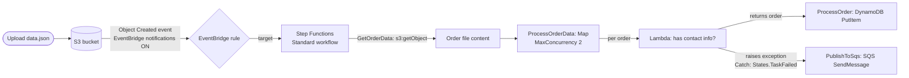

# Hands-On: S3 → EventBridge → Step Functions → Lambda/DynamoDB/SQS: Study Notes

Source: [AWS Hands-On: Integrate AWS Step Functions with EventBridge](https://www.youtube.com/watch?v=f_uNbo2cunk), channel Cumulus Cycles, about 15 minutes. The presenter recommends watching his prior "EventBridge with S3 and Lambda" and "AWS Step Functions" videos first; those aren't available to cross-check here, so these notes stand on their own and verify everything against current AWS documentation instead.

This is the flagship "build it yourself" companion to [`02_EventBridge_Integrating_With_Step_Functions_Study_Notes.md`](02_EventBridge_Integrating_With_Step_Functions_Study_Notes.md) (AWS's own, more conceptual overview of the same pairing) — where that note explains the integration, this one walks through building a complete, realistic pipeline end to end: upload a JSON file to S3, have EventBridge invoke a state machine, and branch the workflow based on the data, writing to either DynamoDB or SQS depending on what's in it.

**Architecture built in the video:**
1. A JSON file of orders is uploaded to an S3 bucket.
2. The bucket has **EventBridge notifications** enabled, so the upload fires an `Object Created` event.
3. An EventBridge rule matches that event and starts a Step Functions **Standard** workflow, passing the event as input.
4. The workflow reads the object back out of S3, then **maps** over each order, calling a Lambda function per order.
5. The Lambda function checks whether the order has contact info. If yes, it returns the order; if no, it raises an exception.
6. Back in the workflow: orders that came back successfully are written to **DynamoDB**; orders whose Lambda call failed are sent to an **SQS** queue for manual review.

What was checked:
- Whether `s3:GetObject` is actually callable from a Step Functions Task state (it is — only `SelectObjectContent` is listed as unsupported) comes from the [AWS SDK service integrations](https://docs.aws.amazon.com/step-functions/latest/dg/supported-services-awssdk.html) page.
- The S3-to-EventBridge event types (`Object Created`, etc.) and the "one toggle, not per-event-type" way of enabling them come from [Using EventBridge](https://docs.aws.amazon.com/AmazonS3/latest/userguide/EventBridge.html) in the S3 User Guide.
- Why the console's auto-generated execution role came up short on S3 permissions (requiring the manual "attach S3 full access" step at 09:48) is explained by [How Step Functions generates IAM policies for integrated services](https://docs.aws.amazon.com/step-functions/latest/dg/service-integration-iam-templates.html) — this is expected console behavior, not a mistake in the video.
- Standard/Express integration-pattern support, and the two-tier "optimized vs. AWS SDK" integration model, come from the [Step Functions overview](https://docs.aws.amazon.com/step-functions/latest/dg/welcome.html).
- **Not verified**: there's no AWS account available in this environment, so the reconstructed state machine below was **not** run through `ValidateStateMachineDefinition` or `TestState`. It's built to be structurally consistent with the Amazon States Language and with what the narration describes, not a byte-for-byte transcription of code the video never fully displays in a way the transcript captures.

---

## Contents

1. [Corrected terms](#1-corrected-terms)
2. [Architecture](#2-architecture)
3. [Building the supporting resources](#3-building-the-supporting-resources)
4. [The Lambda function](#4-the-lambda-function)
5. [The state machine, reconstructed](#5-the-state-machine-reconstructed)
6. [Why the auto-generated role needed a manual S3 permission](#6-why-the-auto-generated-role-needed-a-manual-s3-permission)
7. [The EventBridge rule](#7-the-eventbridge-rule)
8. [Testing: what the video's walkthrough shows](#8-testing-what-the-videos-walkthrough-shows)
9. [Same setup with the AWS CLI](#9-same-setup-with-the-aws-cli)
10. [What the video gets wrong or leaves out](#10-what-the-video-gets-wrong-or-leaves-out)
11. [What has changed since the video](#11-what-has-changed-since-the-video)
12. [Cheat sheet](#12-cheat-sheet)
13. [Review questions](#13-review-questions)

---

## 1. Corrected terms

| Caption says | Actually means |
|---|---|
| "vent Bridge" / "a vent Bridge" | **EventBridge** |
| "I am rule" | **IAM role** |
| "sqsq" | **SQS queue** (a transcription artifact, repeated throughout) |
| "dynomodb" | **DynamoDB** |
| "event Branch partner events" | **EventBridge partner events** |
| "the iterator will start at process data" | The Map state's **`Iterator`** sub-field (older ASL key name — see section 11) |

---

## 2. Architecture



| Stage | AWS service | Role |
|---|---|---|
| Trigger | S3 + EventBridge | Detects the upload, starts the workflow |
| Orchestration | Step Functions (Standard) | Reads the file, fans out over orders, branches on success/failure |
| Per-order decision | Lambda | The only custom code: does this order have contact info? |
| "Good" path | DynamoDB | Persist the complete order |
| "Needs review" path | SQS | Queue the incomplete order for a human to look at later |

---

## 3. Building the supporting resources

In the order the video builds them (00:29–04:20):

1. **S3 bucket** — created with defaults, then under **Properties > Amazon EventBridge**, toggle **Send notifications to Amazon EventBridge for all events in this bucket**, and save. This single toggle, not a per-event-type picklist, is how S3-to-EventBridge works: AWS's own docs are explicit that "unlike other destinations, you don't need to select which event types you want to deliver... all events below are sent to EventBridge" once it's turned on.
2. **Lambda function** — Python 3.10 (see section 11 for what's changed), default code replaced with the handler in section 4.
3. **SQS standard queue** — default settings, to hold orders missing contact info.
4. **DynamoDB table** — partition key `order id` (string, section 5 treats it as `orderId` for readability).

---

## 4. The Lambda function

Reconstructed from the narration (01:28–02:59, 07:02–07:14):

```python
def lambda_handler(event, context):
    print(event)
    if "contactInfo" in event:
        print("processing order")
        return event
    else:
        print("error: contact info not found")
        raise Exception("ContactInfoNotFoundException")
```

The logic is deliberately minimal: this is the *only* piece of custom code in the whole pipeline. Everything else — reading from S3, looping over orders, writing to DynamoDB or SQS — is handled by Step Functions' direct service integrations, with no glue code.

---

## 5. The state machine, reconstructed

The video pastes a pre-written definition rather than building it click-by-click; this reconstruction follows the narration (04:49–09:00) field by field. It uses the generic **AWS SDK integration** syntax for S3 (`arn:aws:states:::aws-sdk:s3:getObject`), since S3 doesn't appear in Step Functions' table of services with purpose-built **optimized** integrations (DynamoDB, Lambda, SQS, SNS, and others do).

```json
{
  "Comment": "Reconstructed from the video's narration — not run against AWS",
  "StartAt": "GetOrderData",
  "States": {
    "GetOrderData": {
      "Type": "Task",
      "Resource": "arn:aws:states:::aws-sdk:s3:getObject",
      "Parameters": {
        "Bucket.$": "$.detail.bucket.name",
        "Key.$": "$.detail.object.key"
      },
      "ResultSelector": {
        "detail.$": "$.Body"
      },
      "Next": "ProcessOrderData"
    },
    "ProcessOrderData": {
      "Type": "Map",
      "ItemsPath": "$.detail.orders",
      "MaxConcurrency": 2,
      "Iterator": {
        "StartAt": "ProcessData",
        "States": {
          "ProcessData": {
            "Type": "Task",
            "Resource": "arn:aws:lambda:us-east-1:123456789012:function:ContactInfoCheck",
            "Next": "ProcessOrder",
            "Catch": [
              {
                "ErrorEquals": ["States.TaskFailed"],
                "Next": "PublishToSqs"
              }
            ]
          },
          "ProcessOrder": {
            "Type": "Task",
            "Resource": "arn:aws:states:::dynamodb:putItem",
            "Parameters": {
              "TableName": "Orders",
              "Item": {
                "orderId": { "S.$": "$.orderInfo.orderId" },
                "itemId": { "S.$": "$.orderInfo.itemId" },
                "quantity": { "N.$": "States.Format('{}', $.orderInfo.quantity)" },
                "contactName": { "S.$": "$.contactInfo.name" },
                "contactEmail": { "S.$": "$.contactInfo.email" }
              }
            },
            "End": true
          },
          "PublishToSqs": {
            "Type": "Task",
            "Resource": "arn:aws:states:::sqs:sendMessage",
            "Parameters": {
              "QueueUrl": "https://sqs.us-east-1.amazonaws.com/123456789012/OrdersNeedingReview",
              "MessageBody.$": "$"
            },
            "End": true
          }
        }
      },
      "End": true
    }
  }
}
```

| Narrated detail | Where it lands |
|---|---|
| "`get order data`... `type` is a task and the `resource` is the `get object` method on the S3 bucket" | `GetOrderData`, `arn:aws:states:::aws-sdk:s3:getObject` |
| "parameters for the bucket name and the key... passed in when EventBridge invokes the step function" | `Bucket.$`/`Key.$` read from the EventBridge event, under `$.detail.bucket.name` / `$.detail.object.key` (verified shape — section 7) |
| "the property will be `detail`... the value will be the body of the data" | `ResultSelector: {"detail.$": "$.Body"}` — reshapes the raw `GetObject` response down to just the file's parsed content |
| "items path which is orders... Max concurrency of 2" | `ItemsPath: "$.detail.orders"`, `MaxConcurrency: 2` |
| "the iterator will start at process data" | `Iterator.StartAt: "ProcessData"` (section 11: now usually written as `ItemProcessor`) |
| "if the error is equal to `task failed` on the state... invoke the publish to sqs state" | `Catch: [{"ErrorEquals": ["States.TaskFailed"], "Next": "PublishToSqs"}]` — a **generic** catch, not one scoped to the specific exception (flagged in section 10) |
| "process order... put item method on dynamodb... order ID... item ID... quantity... contact name... contact email" | `ProcessOrder`'s `dynamodb:putItem` parameters |
| "the Q URL... the message body is equal to the message that's passed in" | `PublishToSqs`'s `sqs:sendMessage` parameters, `MessageBody.$: "$"` |

---

## 6. Why the auto-generated role needed a manual S3 permission

At 09:34 the video lets Step Functions auto-create the execution role, then has to go back and manually attach S3 full access, because "we need to be able to read from the S3 bucket" and the role only came with DynamoDB, Lambda invoke, SQS, and X-Ray permissions.

This isn't a mistake — it's documented Step Functions console behavior. AWS's own page on how the console generates these policies draws a distinction:

> For **optimized integrations**, Step Functions will create a policy with all the necessary permissions... For **standard integrations**, Step Functions will create an IAM role with **partial permissions**. You must add any missing role policies that your state machine needs.

DynamoDB, Lambda, and SQS all have **optimized** integrations (hence the role covered them automatically), but S3 only has the **generic AWS SDK integration** used here — which falls into the "standard integrations, partial permissions" bucket. The manual fix the video applies (granting full S3 access) works, but is far broader than needed; section 9's CLI version scopes it down to just this bucket and `GetObject`.

---

## 7. The EventBridge rule

Steps from the video (10:03–11:06):

1. **EventBridge > Rules > Create rule**, on the **default event bus**.
2. Rule type: **Rule with an event pattern**.
3. Event source: **AWS events or EventBridge partner events**.
4. A custom JSON event pattern naming the bucket, matching S3's real event shape:

```json
{
  "source": ["aws.s3"],
  "detail-type": ["Object Created"],
  "detail": {
    "bucket": { "name": ["my-orders-bucket"] }
  }
}
```

5. **Target**: **Step Functions state machine**, selecting the state machine built in section 5. For the execution role, the video again lets EventBridge **create** it — the same "auto-generate" pattern used for the SNS targets in [notes 19](../tutorial/19_AWS_Step_Functions_Trigger_from_SQS_Study_Notes.md) and [notes 20](../tutorial/20_Amazon_EventBridge_Overview_Study_Notes.md), scoped by EventBridge to `states:StartExecution` on just this one state machine.

Confirmed against S3's own EventBridge docs: `Object Created` is a real, documented event type (fired by `PutObject`, `POST Object`, `CopyObject`, or `CompleteMultipartUpload`), which is why the event's `detail.reason` field can tell you *which* API call created the object — not used in this workflow, but available if you needed it.

---

## 8. Testing: what the video's walkthrough shows

Uploading `data.json` (one order with contact info, one without) and then inspecting each service (11:21–14:44):

| Where | What it shows |
|---|---|
| Step Functions execution view | One execution, succeeded. `GetOrderData`'s input has `source: "aws.s3"`; its output is the parsed file contents. |
| `ProcessOrderData` Map, iteration 0 | Input has both `contactInfo` and `orderInfo`; output is the DynamoDB `PutItem` response (HTTP 200) |
| `ProcessOrderData` Map, iteration 1 | Input is missing `contactInfo`; the path taken is `PublishToSqs`, output is the SQS `SendMessage` response (HTTP 200) |
| DynamoDB table | One item, for the order **with** contact info |
| SQS queue | One message, body equal to the order **without** contact info |
| Lambda CloudWatch Logs | **Two** log streams — one per concurrent Map iteration (`MaxConcurrency: 2` means up to two Lambda invocations run at once) |
| EventBridge rule monitoring | One invocation, one triggered rule |

---

## 9. Same setup with the AWS CLI

A from-scratch rebuild with the least-privilege S3 permission this lesson's console path skips. Not run against a live account.

```bash
ACCOUNT_ID=$(aws sts get-caller-identity --query Account --output text)
REGION=$(aws configure get region)
BUCKET=my-orders-bucket-$ACCOUNT_ID

# --- S3 bucket, with EventBridge notifications turned on ---
aws s3api create-bucket --bucket "$BUCKET" --region "$REGION"
aws s3api put-bucket-notification-configuration --bucket "$BUCKET" \
  --notification-configuration '{"EventBridgeConfiguration": {}}'

# --- SQS queue for orders needing review ---
QUEUE_URL=$(aws sqs create-queue --queue-name OrdersNeedingReview --query QueueUrl --output text)
QUEUE_ARN=$(aws sqs get-queue-attributes --queue-url "$QUEUE_URL" \
  --attribute-names QueueArn --query Attributes.QueueArn --output text)

# --- DynamoDB table ---
aws dynamodb create-table --table-name Orders \
  --attribute-definitions AttributeName=orderId,AttributeType=S \
  --key-schema AttributeName=orderId,KeyType=HASH \
  --billing-mode PAY_PER_REQUEST

# --- Lambda function ---
cat > lambda_function.py <<'EOF'
def lambda_handler(event, context):
    print(event)
    if "contactInfo" in event:
        print("processing order")
        return event
    print("error: contact info not found")
    raise Exception("ContactInfoNotFoundException")
EOF
zip function.zip lambda_function.py

cat > lambda-trust.json <<'EOF'
{"Version":"2012-10-17","Statement":[{"Effect":"Allow","Principal":{"Service":"lambda.amazonaws.com"},"Action":"sts:AssumeRole"}]}
EOF
aws iam create-role --role-name ContactInfoCheckRole --assume-role-policy-document file://lambda-trust.json
aws iam attach-role-policy --role-name ContactInfoCheckRole \
  --policy-arn arn:aws:iam::aws:policy/service-role/AWSLambdaBasicExecutionRole
FUNC_ARN=$(aws lambda create-function --function-name ContactInfoCheck \
  --runtime python3.13 --handler lambda_function.lambda_handler \
  --role "arn:aws:iam::${ACCOUNT_ID}:role/ContactInfoCheckRole" \
  --zip-file fileb://function.zip --query FunctionArn --output text)
aws lambda wait function-active-v2 --function-name ContactInfoCheck

# --- State machine's role: scoped to exactly what section 6 said was missing ---
cat > sfn-trust.json <<EOF
{"Version":"2012-10-17","Statement":[{"Effect":"Allow","Principal":{"Service":"states.amazonaws.com"},
  "Action":"sts:AssumeRole","Condition":{"StringEquals":{"aws:SourceAccount":"$ACCOUNT_ID"}}}]}
EOF
aws iam create-role --role-name OrdersWorkflowRole --assume-role-policy-document file://sfn-trust.json

cat > sfn-policy.json <<EOF
{
  "Version": "2012-10-17",
  "Statement": [
    { "Effect": "Allow", "Action": "s3:GetObject", "Resource": "arn:aws:s3:::$BUCKET/*" },
    { "Effect": "Allow", "Action": "lambda:InvokeFunction", "Resource": "$FUNC_ARN" },
    { "Effect": "Allow", "Action": "dynamodb:PutItem", "Resource": "arn:aws:dynamodb:$REGION:$ACCOUNT_ID:table/Orders" },
    { "Effect": "Allow", "Action": "sqs:SendMessage", "Resource": "$QUEUE_ARN" }
  ]
}
EOF
aws iam put-role-policy --role-name OrdersWorkflowRole \
  --policy-name OrdersWorkflowPermissions --policy-document file://sfn-policy.json

SM_ARN=$(aws stepfunctions create-state-machine --name OrdersDemo \
  --definition file://statemachine.json \
  --role-arn "arn:aws:iam::${ACCOUNT_ID}:role/OrdersWorkflowRole" \
  --query stateMachineArn --output text)

# --- EventBridge rule: matches Object Created on this bucket only ---
cat > rule-pattern.json <<EOF
{"source": ["aws.s3"], "detail-type": ["Object Created"], "detail": {"bucket": {"name": ["$BUCKET"]}}}
EOF
aws events put-rule --name OrdersUploadRule --event-pattern file://rule-pattern.json
RULE_ARN=$(aws events describe-rule --name OrdersUploadRule --query Arn --output text)

# --- EventBridge's own role to start the execution (scoped to this one state machine) ---
cat > eb-trust.json <<'EOF'
{"Version":"2012-10-17","Statement":[{"Effect":"Allow","Principal":{"Service":"events.amazonaws.com"},"Action":"sts:AssumeRole"}]}
EOF
aws iam create-role --role-name EventBridgeStartOrdersRole --assume-role-policy-document file://eb-trust.json
cat > eb-policy.json <<EOF
{"Version":"2012-10-17","Statement":[{"Effect":"Allow","Action":"states:StartExecution","Resource":"$SM_ARN"}]}
EOF
aws iam put-role-policy --role-name EventBridgeStartOrdersRole \
  --policy-name StartOrdersWorkflow --policy-document file://eb-policy.json

aws events put-targets --rule OrdersUploadRule --targets "[{
  \"Id\": \"1\", \"Arn\": \"$SM_ARN\",
  \"RoleArn\": \"arn:aws:iam::${ACCOUNT_ID}:role/EventBridgeStartOrdersRole\"
}]"

# --- Try it ---
aws s3 cp data.json "s3://$BUCKET/data.json"
aws stepfunctions list-executions --state-machine-arn "$SM_ARN" --query 'executions[].[name,status]' --output table

# --- Clean up ---
aws events remove-targets --rule OrdersUploadRule --ids 1
aws events delete-rule --name OrdersUploadRule
aws stepfunctions delete-state-machine --state-machine-arn "$SM_ARN"
aws lambda delete-function --function-name ContactInfoCheck
aws dynamodb delete-table --table-name Orders
aws sqs delete-queue --queue-url "$QUEUE_URL"
aws s3 rb "s3://$BUCKET" --force
```

---

## 10. What the video gets wrong or leaves out

| Issue | Why it matters | Fix |
|---|---|---|
| **`Catch` matches `States.TaskFailed`, not the specific exception** | `States.TaskFailed` fires for *any* unhandled Lambda failure — a real bug, a timeout, or a throttling error looks identical to "this order has no contact info." All of them silently land in the "needs review" SQS queue instead of being retried or alerted on. | `ErrorEquals: ["ContactInfoNotFoundException"]` for the expected case, with a separate `Retry`/`Catch States.ALL` for genuine failures |
| **The auto-created role, fixed with "S3 full access"** | Section 6 explains *why* the role came up short, but granting full S3 access (every bucket, every action) to fix a missing `GetObject` on one bucket is far broader than needed | Scope to `s3:GetObject` on `arn:aws:s3:::<bucket>/*`, as section 9 does |
| **The rule matches every upload to the bucket** | The event pattern only checks the bucket name, so uploading *any* file (a stray screenshot, a `.DS_Store`) starts a new execution | Add `detail.object.key` suffix/prefix matching, e.g. restrict to `orders/` and `.json` |
| **No idempotency** | Re-uploading the same `data.json` (overwrite) starts a brand-new execution with a random name, processing the same orders again — there's no equivalent of [notes 19](../tutorial/19_AWS_Step_Functions_Trigger_from_SQS_Study_Notes.md)'s `name=messageId` dedup | Derive the execution name from the object's S3 version ID or an ETag if overwrites must be deduplicated |
| **Object size isn't addressed** | Reading the whole file into the state's data via `GetObject` only works while the result stays under Step Functions' per-state payload limit; it doesn't scale to large files | For large objects, pass just the S3 key through the workflow and have Lambda (or Distributed Map, [notes 15](../tutorial/15_AWS_Step_Functions_Distributed_Map_S3_Study_Notes.md)) stream/read it instead of loading the whole body into state data |
| **`MaxConcurrency: 2` is unexplained** | It's a concurrency cap on the Map's iterations, not a batch size or a limit on total orders — with only 2 orders in the demo file it's indistinguishable from "no limit," which may give a false impression of what the setting does | For a dataset with more than a couple of items, `MaxConcurrency` is what actually throttles how many Lambda invocations run at once |

---

## 11. What has changed since the video

| Then | Now |
|---|---|
| Map state's sub-workflow written under the `Iterator` key | AWS now documents the **`ItemProcessor`** key (with `ProcessorConfig: {"Mode": "INLINE"}`) as the current name for the same thing; `Iterator` still works for backward compatibility, but new state machines should use `ItemProcessor` |
| Lambda runtime: Python 3.10 | Still supported, but prefer a current runtime (e.g. Python 3.13) for new functions |
| Console lets you grant a quick, broad fix ("S3 full access") | Same console behavior today — the "standard integrations get partial permissions" model in section 6 hasn't changed |

---

## 12. Cheat sheet

```
Pipeline  : S3 upload -> (bucket EventBridge notifications: ON) -> Object Created event
            -> EventBridge rule (source aws.s3, detail-type "Object Created", bucket name filter)
            -> Step Functions target -> GetObject -> Map over orders -> Lambda per order
            -> success: DynamoDB PutItem | Lambda raises: Catch -> SQS SendMessage
S3 trigger: ONE toggle enables ALL S3 event types to EventBridge (no per-type picklist)
S3 in SFN : arn:aws:states:::aws-sdk:s3:getObject (generic AWS SDK integration;
            only SelectObjectContent is unsupported for S3 via this integration)
Console   : optimized integrations (DynamoDB/Lambda/SQS/SNS/...) -> full auto-generated role
            standard/SDK integrations (S3 GetObject here) -> PARTIAL role; you add what's missing
Map state : Iterator (legacy key) == ItemProcessor (current key) -- same thing
Catch     : States.TaskFailed = ANY task failure, not just your expected exception -- be specific
EventBridge role for a SFN target: auto-creatable, scoped to states:StartExecution on one state machine
```

---

## 13. Review questions

<details>
<summary>1. What single setting makes an S3 bucket send events to EventBridge, and does it let you pick which event types to send?</summary>

A single toggle under the bucket's **Properties > Amazon EventBridge**. There's no per-event-type picklist — once enabled, every supported S3 event type (Object Created, Object Deleted, etc.) is sent.
</details>

<details>
<summary>2. Which Step Functions integration type is `arn:aws:states:::aws-sdk:s3:getObject`, and is `GetObject` actually supported?</summary>

It's the generic **AWS SDK integration** (S3 has no purpose-built "optimized" integration in Step Functions). `GetObject` is supported — the only S3 operation Step Functions' SDK integration documents as unsupported is `SelectObjectContent`.
</details>

<details>
<summary>3. Why did the auto-generated execution role cover DynamoDB, Lambda, SQS, and X-Ray, but not S3?</summary>

DynamoDB, Lambda, and SQS all have **optimized** integrations in Step Functions, so the console generates a full policy for them automatically. S3's `GetObject` here is a **standard (AWS SDK) integration**, and AWS's own docs state that for standard integrations the console only creates **partial permissions** — missing policies must be added manually.
</details>

<details>
<summary>4. What's the practical risk of the `Catch` block matching `States.TaskFailed`?</summary>

`States.TaskFailed` matches *any* unhandled failure from that Task, not specifically "contact info missing." A genuine bug, a Lambda timeout, or throttling would be caught the same way and routed to the "needs review" SQS queue, rather than being retried or surfaced as a real error.
</details>

<details>
<summary>5. The EventBridge rule's pattern only checks the bucket name. What uploads would start the workflow that probably shouldn't?</summary>

Any object uploaded to that bucket — not just `data.json` — since there's no filter on the object key (prefix/suffix). A stray file placed anywhere in the bucket would trigger an execution.
</details>

<details>
<summary>6. What does `MaxConcurrency: 2` actually control in the Map state?</summary>

How many of the Map's iterations (one per order, here) run at the same time — a concurrency throttle, not a limit on the total number of orders processed or a batch size.
</details>

<details>
<summary>7. Why did the Lambda function's CloudWatch Logs show two separate log streams for a two-order file?</summary>

Because `MaxConcurrency: 2` let both Map iterations invoke Lambda at (up to) the same time, and each concurrent Lambda execution environment gets its own log stream.
</details>

<details>
<summary>8. Re-uploading the exact same `data.json` a second time — what happens, and why might that be undesirable?</summary>

A brand-new execution starts (S3 still fires a fresh `Object Created` event, and the rule has no object-key filter or dedup), reprocessing both orders again — including re-inserting the same DynamoDB item and re-queuing the same SQS message. There's no equivalent of using the object's version/ETag as an idempotent execution name.
</details>

<details>
<summary>9. What's the ASL key the video calls "the iterator," and what's its current documented name?</summary>

`Iterator`, the Map state's embedded sub-workflow. AWS's current documentation refers to this as `ItemProcessor` (with a `ProcessorConfig`); `Iterator` still works for backward compatibility.
</details>

<details>
<summary>10. Why doesn't this `GetObject`-into-the-workflow pattern scale to very large S3 objects?</summary>

The object's content becomes part of the state's data (via `ResultSelector`), which is subject to Step Functions' per-state data size limit. Large files need a different approach: pass only the S3 key through the workflow and have a Task (Lambda, or Distributed Map for very large datasets) read the object directly, instead of loading its full contents into the state's JSON.
</details>

<details>
<summary>11. Name one way to make the "attach S3 full access" step from the video least-privilege instead.</summary>

Grant only `s3:GetObject` scoped to `arn:aws:s3:::<bucket-name>/*`, rather than the `AmazonS3FullAccess` managed policy across every bucket in the account.
</details>
