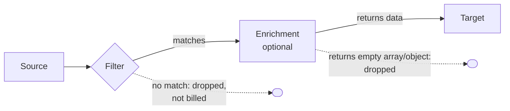

# AWS EventBridge Pipes Explained: Study Notes

Source: [AWS EventBridge Pipes Explained: The Glue Your AWS Architecture Was Missing](https://www.youtube.com/watch?v=rhQviqhoQ5Q), System Design Lab, 37:28. A conceptual deep dive (why Pipes exists, its four-stage pipeline, sources, filtering, enrichment, targets, failure handling) followed by a console demo: a DynamoDB Streams source routes support tickets to an SQS queue, filtered to `critical`/`high` priority only, with a Lambda enrichment step adding routing metadata in between.

This goes considerably further than [tutorial/19 section 12](../tutorial/19_AWS_Step_Functions_Trigger_from_SQS_Study_Notes.md#12-beyond-the-video-no-lambda-with-eventbridge-pipes), which builds one SQS→Step Functions pipe with the CLI but doesn't cover sources beyond SQS, enrichment, filtering cost, or failure handling. See [eventbridge/05](05_EventBridge_Pipes_SQS_StepFunctions_CDK_Study_Notes.md) for the CDK-based SQS+Step Functions build. This note focuses on the broader mechanics those two don't cover.

What was checked: sources/ordering/concurrency against [Pipes sources](https://docs.aws.amazon.com/eventbridge/latest/userguide/eb-pipes-event-source.html) and [batching and concurrency](https://docs.aws.amazon.com/eventbridge/latest/userguide/eb-pipes-batching-concurrency.html); enrichment against [event enrichment](https://docs.aws.amazon.com/eventbridge/latest/userguide/pipes-enrichment.html); targets and payload limits against [Pipes targets](https://docs.aws.amazon.com/eventbridge/latest/userguide/eb-pipes-event-target.html); retry/DLQ settings against [Creating a pipe](https://docs.aws.amazon.com/eventbridge/latest/userguide/eb-pipes-create.html#pipes-configure-pipe-settings); the filter-based pricing claim against the [EventBridge pricing page](https://aws.amazon.com/eventbridge/pricing/); and the Kinesis fan-out claim against [Kinesis quotas and limits](https://docs.aws.amazon.com/streams/latest/dev/service-sizes-and-limits.html). The console demo wasn't rebuilt or run here.

---

## Contents

1. [Corrected/approximated terms](#1-correctedapproximated-terms)
2. [The four-stage pipeline](#2-the-four-stage-pipeline)
3. [Pipes vs. rules, recapped](#3-pipes-vs-rules-recapped)
4. [Sources: types, ordering, and scaling (corrected)](#4-sources-types-ordering-and-scaling-corrected)
5. [Filtering, and its real cost model](#5-filtering-and-its-real-cost-model)
6. [Enrichment](#6-enrichment)
7. [Targets, batching, and payload limits (corrected)](#7-targets-batching-and-payload-limits-corrected)
8. [Retry and dead-letter queue (corrected)](#8-retry-and-dead-letter-queue-corrected)
9. [Getting past "one target" without Lambda glue](#9-getting-past-one-target-without-lambda-glue)
10. [Gotchas](#10-gotchas)
11. [Cheat sheet](#11-cheat-sheet)
12. [Review questions](#12-review-questions)

---

## 1. Corrected/approximated terms

| Caption says | Actually means |
|---|---|
| "CFKA" | **Kafka** (Amazon MSK / self-managed Apache Kafka) |
| "polar" / "pullers" | **Poller** — the process that reads from the source |
| "patch" | **Batch** |
| "chart" | **Shard** |
| "upward targets" | **One target** (the point of the sentence was that a pipe has only one) |
| "berg this item" | **Purge** (the SQS console action that empties a queue) |
| "zero to 1000,000" (retry attempts) | **0 to 185** — confirmed against the console's documented range (section 8) |

---

## 2. The four-stage pipeline

The video's core model (00:55), confirmed structurally by AWS's own pipe-creation flow:



| Stage | Required? | What it does |
|---|---|---|
| **Source** | Yes | Where events come from (section 4) |
| **Filter** | No | A JSON event pattern; non-matching events are dropped silently, before you're billed for them (section 5) |
| **Enrichment** | No | Adds context or reshapes the event — can itself drop events (section 6) |
| **Target** | Yes | Where the (possibly enriched) event is delivered (section 7) |

AWS's own pipe-creation wizard walks through exactly these four stages in this order (source → filtering → enrichment → target), confirming the video's framing isn't a simplification — it's the actual configuration flow.

---

## 3. Pipes vs. rules, recapped

The video's distinction (04:02) matches the fan-out comparison already built into [tutorial/19 section 12](../tutorial/19_AWS_Step_Functions_Trigger_from_SQS_Study_Notes.md#12-beyond-the-video-no-lambda-with-eventbridge-pipes):

| | EventBridge rules (on a bus) | EventBridge Pipes |
|---|---|---|
| Shape | Many sources → one bus → many targets (fan-out) | One source → one target (point-to-point) |
| Delivery model | **Passive** — events land on the bus, rules react | **Active** — the pipe polls/pulls from the source |
| Transform in transit | Route only (plus input transformer) | Filter, **enrich**, and transform |
| Compose together | A pipe's target *can be* an event bus, which then fans out via rules — "best of both worlds," per the video |

---

## 4. Sources: types, ordering, and scaling (corrected)

The video names six source types (05:34); AWS's docs confirm the same six, with "Apache Kafka stream" covering both MSK and self-managed/third-party (Confluent Cloud, CloudKarafka, Redpanda) as one category:

| Source | Ordering | Default concurrency model |
|---|---|---|
| DynamoDB Streams | Ordered (preserved end to end) | `ParallelizationFactor × number of shards` |
| Kinesis stream | Ordered | `ParallelizationFactor × number of shards` |
| Amazon MSK / self-managed Kafka | Ordered (per partition) | Up to the number of partitions, **capped at 1000** |
| Amazon MQ | — | Fixed at **5** |
| SQS (standard) | **Not** ordered | Up to **1250** concurrent executions |
| SQS FIFO | Ordered (per message group) | Bounded by number of message group IDs |

**Correction to the video:** it states DynamoDB Streams scaling as "one shard, one poller" (06:49). That's the *minimum*, not the rule — AWS's own docs describe concurrency as `ParallelizationFactor` (a number you configure, console label "Concurrent batches per shard") **multiplied by** the shard count, so a single shard can have more than one concurrent batch in flight. Every pipe execution (one event or one batch) is also hard-capped at **5 minutes**, including enrichment and target time — a limit the video never mentions and that can't be increased.

---

## 5. Filtering, and its real cost model

The video's filter-pattern examples (07:52) — exact match, prefix, numeric comparison (`> 50`), and combinations — match EventBridge's general [content-based filtering](../tutorial/19_AWS_Step_Functions_Trigger_from_SQS_Study_Notes.md) syntax (see [eventbridge/01 section 4](01_EventBridge_Rules_Deep_Dive_Study_Notes.md#4-the-full-operator-cheat-table) for the full operator table — pipes share the same pattern language as rules, minus the `wildcard` operator, which is bus-rules-only).

**The pricing claim checks out.** The video says "filter out 80% of your events, save 80% of the cost" (09:16). AWS's own pricing page confirms Pipes charges per event **after filtering**, not per event ingested — its own worked example: 10,000,000 ingested events at a 25% match rate bills as 500,000 requests, at $0.40 per million requests (with payload size rounded up in 64 KB chunks). Events that don't match the filter are dropped before they're counted.

---

## 6. Enrichment

The video names four enrichment types (09:52) and AWS's docs confirm exactly these four, with one important restriction the video omits:

| Enrichment | Notes |
|---|---|
| Lambda function | Most flexible — any code, any downstream call |
| **Step Functions state machine** | **Express workflows only** — AWS explicitly disallows Standard workflows here, because enrichment must respond synchronously and only Express supports that |
| API Gateway | For internal HTTP APIs |
| API destination | For external HTTP endpoints |

Confirmed facts from the video:
- Enrichment is always invoked **synchronously** (`REQUEST_RESPONSE`) — the pipe waits for a response before continuing.
- An enrichment can **drop the event** by returning an empty response (`""`, `{}`, or `[]`) instead of data — "the hidden power of enrichment" the video calls out (10:20). (To deliver an *empty* payload to the target rather than dropping, you return `[{}]` specifically — a nuance not in the video.)

Not in the video: enrichment responses are capped at **6 MB**, and for batched sources, batching through to enrichment is only supported for Lambda and Step Functions (not API Gateway/API destination, which are restricted to a batch size of 1).

---

## 7. Targets, batching, and payload limits (corrected)

The video lists eight targets (10:47): Lambda, SQS, SNS, Step Functions, an event bus, API Gateway, Kinesis, CloudWatch Logs. AWS's docs list more:

| Target | In the video? |
|---|---|
| Lambda (SYNC or ASYNC) | Yes |
| Step Functions — **Express** (SYNC or ASYNC), **Standard** (ASYNC only) | Yes, but without the Standard/Express distinction |
| SQS | Yes |
| SNS (**FIFO topics not supported**) | Yes, without the FIFO caveat |
| Event bus in the **same account and Region** (a newer Custom Event Bus isn't supported as a pipe target) | Yes, without the scope caveat |
| API Gateway, API destination | Yes (API Gateway only — API destination is missing from the video's list) |
| Kinesis stream, Firehose delivery stream | Yes |
| CloudWatch Logs | Yes |
| **AWS Batch job queue, ECS task, Redshift Data API, SageMaker Pipeline, Timestream for LiveAnalytics** | **Not mentioned** |

**Correction to the video's payload claim.** It states (12:18) "pipes handle up to 256 kilobytes per event... Step Functions support the same and event bus the same. Kinesis and Firehose support up to 1 megabyte." This is wrong for two of those three. AWS's documented model: **the pipe itself supports up to 6 MB**, and the *effective* limit is whichever is smaller between that and the target's own limit:

| Target | Effective payload limit |
|---|---|
| Lambda | 6 MB |
| EventBridge event bus | **1 MB** (not 256 KB) |
| Step Functions | 262,144 characters (~256 KB) — this part the video got right |

### Batching per target (not in the video)

| Target | Max batch size |
|---|---|
| CloudWatch Logs | 10,000 |
| EventBridge event bus | 10 |
| Firehose, Kinesis | 500 |
| SNS, SQS | 10 |
| Lambda, Step Functions | No fixed batch cap — instead bound by the payload-size limits above, since the whole batch is sent as one JSON array (no native batch API) |

### Partial batch failure — richer than the video implies

The video says a Lambda target can return a partial-batch-failure response so only failed items retry (13:46), which is correct as far as it goes. What it leaves out: for **SQS, Kinesis, and DynamoDB** sources specifically, a partial failure causes EventBridge to retry **the remainder of the payload through the entire pipe** — including **re-invoking enrichment** for those items, not just re-delivering to the target. The failure payload format matches the familiar Lambda/SQS convention:

```json
{ "batchItemFailures": [ { "itemIdentifier": "id2" }, { "itemIdentifier": "id4" } ] }
```

`itemIdentifier` is the SQS `messageId` or the Kinesis/DynamoDB `eventID`. Partial failure handling of the *enrichment* step itself (as opposed to the target) is **not** supported — an enrichment failure is all-or-nothing for that batch.

---

## 8. Retry and dead-letter queue (corrected)

The video (12:46) frames retry/DLQ as a general feature you configure on any pipe: exponential backoff starting at 1 second, configurable max retries, a max event age, and a DLQ as "not optional in production." Two things it gets wrong or omits entirely:

1. **The retry-policy-and-DLQ settings panel is only available when the pipe's source is Kinesis or DynamoDB Streams.** Other sources (SQS, Kafka, Amazon MQ) don't expose this setting the same way — for SQS in particular, failure handling instead falls to the queue's own visibility timeout and redrive policy, the same mechanism covered for the Lambda-trigger case in [tutorial/19 section 7](../tutorial/19_AWS_Step_Functions_Trigger_from_SQS_Study_Notes.md#7-do-you-have-to-delete-the-message-yourself).
2. **Retry is off by default, and so is the DLQ** — the video's "not optional in production" framing is good advice, but it's not the out-of-the-box behavior.

The actual configurable ranges, for Kinesis/DynamoDB-sourced pipes:

| Setting | Range | Default |
|---|---|---|
| Maximum age of event | 1 minute to 24 hours | — |
| Retry attempts | **0 to 185** | — |
| Retry | On/off | **Off** |
| Dead-letter queue | An SQS queue **or** an SNS topic | **Off** |

Without a DLQ, an event that exhausts its retries is simply lost, exactly as the video states.

---

## 9. Getting past "one target" without Lambda glue

The video's closing section (33:37) addresses a real limitation — a pipe has exactly one target — with three patterns, all of which avoid writing a Lambda just to fan out:

| Pattern | How it works |
|---|---|
| **Pipe → SNS → multiple SQS queues** | SNS itself fans out, and each subscription can carry its own filter policy, so different queues receive different subsets of the same event |
| **Pipe → EventBridge bus → rules** | The bus's rules do the fan-out, up to **5 targets per rule** (consistent with [eventbridge/01](01_EventBridge_Rules_Deep_Dive_Study_Notes.md)) |
| **Pipe → Kinesis stream → multiple consumers** | Multiple readers can consume the same stream independently |

The video's specific numbers for the Kinesis option ("up to 5" classic, "up to 20" with enhanced fan-out, 36:44) are **outdated**: current Kinesis quotas allow **up to 20 registered consumers per stream** (standard On-demand/provisioned), or **up to 50** on the newer On-demand Advantage tier — there's no current "5 vs 20" split by consumer type. The "5" in older material likely traces back to a different, unrelated limit: classic (non-enhanced-fan-out) reads are capped at 5 `GetRecords` calls per second **per shard**, which is a throughput limit, not a consumer-count limit.

---

## 10. Gotchas

1. **A dropped (filtered-out) event isn't logged anywhere by default** — "drop silently" is accurate; don't expect a trace of what didn't match without your own CloudWatch Logs target or pipe logging turned on.
2. **Step Functions as an *enrichment* must be Express; as a *target* it can be Standard, but only invoked asynchronously.** Mixing these up (e.g. assuming a Standard workflow can enrich) will fail at pipe-creation time.
3. **Retry/DLQ settings don't exist for every source type** — don't assume an SQS- or Kafka-sourced pipe has the same failure-recovery knobs as a DynamoDB/Kinesis-sourced one.
4. **A pipe execution has a hard 5-minute ceiling**, covering enrichment and target time combined — a slow enrichment call eats into the same budget as the target call.
5. **Payload size is bounded by the tightest link**: a 6 MB event heading to a Step Functions target still fails past ~256 KB, even though Pipes itself would have allowed up to 6 MB.
6. **A pipe can't target the newer Custom Event Bus** (only a same-account/Region "Classic" bus) — the ARN is rejected outright if it's the newer bus type.
7. **SNS FIFO topics aren't supported as a pipe target**, even though SNS standard topics are.

---

## 11. Cheat sheet

```
Pipeline        : source -> filter (optional) -> enrichment (optional) -> target
Sources         : DynamoDB Streams, Kinesis, SQS, Amazon MQ, MSK, self-managed/3rd-party Kafka
Ordering        : preserved end-to-end IF the source itself is ordered (not SQS standard)
Concurrency     : DynamoDB/Kinesis = ParallelizationFactor x shards | Kafka <= 1000 partitions
                  | Amazon MQ = 5 | SQS = up to 1250 | execution hard-capped at 5 minutes
Filter cost     : billed only for events that PASS the filter (confirmed: AWS pricing page)
Enrichment      : Lambda | Step Functions (EXPRESS ONLY) | API Gateway | API destination
                  always synchronous; empty response ([], {}, "") drops the event
Targets         : Lambda, SQS, SNS (no FIFO), Step Functions (Standard=ASYNC only,
                  Express=SYNC/ASYNC), same-account event bus, API GW/destination,
                  Kinesis, Firehose, CloudWatch Logs, Batch, ECS task, Redshift, SageMaker,
                  Timestream
Payload         : pipe limit 6 MB, but capped further by target: Lambda 6MB | bus 1MB |
                  Step Functions ~256 KB (262,144 chars)
Partial failure : SQS/Kinesis/DynamoDB only; retries re-run the WHOLE pipe (incl. enrichment)
                  for the failed items; return {"batchItemFailures":[{"itemIdentifier":...}]}
Retry/DLQ       : Kinesis/DynamoDB sources only; OFF by default; retries 0-185; max event age
                  1 min-24h; DLQ = SQS queue or SNS topic
One target?     : fan out via SNS (per-subscription filters), an event bus (5 targets/rule),
                  or multiple Kinesis consumers -- no Lambda glue needed
```

---

## 12. Review questions

<details>
<summary>1. A DynamoDB Streams source has 4 shards and a `ParallelizationFactor` of 3. What's the maximum concurrency, and why is "one poller per shard" an oversimplification?</summary>

Up to 12 (4 shards × 3). `ParallelizationFactor` lets more than one concurrent batch be read per shard, so concurrency isn't capped at one-per-shard the way a simpler mental model suggests.
</details>

<details>
<summary>2. An event fails the pipe's filter pattern. Are you billed for it?</summary>

No — EventBridge Pipes bills per event only after filtering, confirmed by AWS's own pricing example (10M ingested, 25% match rate, billed as 500K requests). Filtered-out events are dropped before billing.
</details>

<details>
<summary>3. Can a Standard Step Functions workflow be used as a pipe's enrichment step?</summary>

No. Enrichment must respond synchronously, and AWS only supports Express workflows as enrichments for exactly that reason. A Standard workflow can still be the pipe's *target* (invoked asynchronously), just not its enrichment.
</details>

<details>
<summary>4. A pipe targets an EventBridge event bus with a 2 MB event. What happens, even though the pipe itself allows up to 6 MB?</summary>

It fails. The effective payload limit is the smaller of the pipe's 6 MB cap and the target's own limit — an event bus target's effective limit is 1 MB, so a 2 MB event exceeds it regardless of the pipe-level ceiling.
</details>

<details>
<summary>5. An SQS-sourced pipe's target fails repeatedly. Does the pipe's own retry-policy-and-DLQ settings panel help here?</summary>

No — that settings panel is only available for Kinesis- and DynamoDB-Streams-sourced pipes. For an SQS source, failure recovery instead relies on the source queue's own visibility timeout and redrive policy.
</details>

<details>
<summary>6. For a Kinesis-sourced pipe, a batch partially fails at the target and you return `batchItemFailures`. What gets retried, and does enrichment run again for those items?</summary>

Only the identified failed items are retried, and yes — the retry runs back through the entire pipe, which means enrichment is re-invoked for those items, not just the target delivery.
</details>

<details>
<summary>7. Why can't you reliably say a pipe is "fire and forget" the way a Standard Step Functions target implies?</summary>

Invocation mode depends on the target and source ordering: ordered sources default to synchronous target invocation (a response is needed before the next event), while Lambda and Step Functions targets let you explicitly configure SYNC vs ASYNC — "fire and forget" is one configurable mode, not a universal default.
</details>
