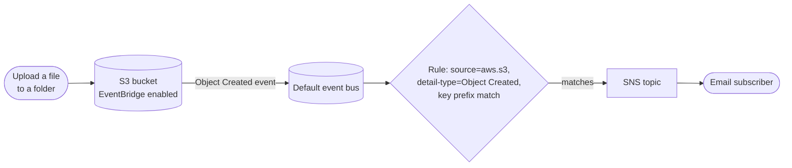

# Amazon S3 Event Notifications with EventBridge: Study Notes

Source: [Amazon S3 Event Notifications with Amazon EventBridge - Step By Step Tutorial](https://www.youtube.com/watch?v=k-jEuNb_KBM), DataEng Uncomplicated (the same channel as [tutorial/19](../tutorial/19_AWS_Step_Functions_Trigger_from_SQS_Study_Notes.md) in this repo), about 10 minutes.

The video builds: upload a file to a specific folder in an S3 bucket → an EventBridge rule matches it → an email goes out via SNS, first with a plain SNS topic, then repeated with an **encrypted** SNS topic to show the extra KMS permission that requires.

This is the missing first half of the sketch in [S3 note 00 §8](../s3-multipart-upload/00_S3_Multipart_Upload_Study_Notes.md#8-beyond-the-video-orchestrating-the-missing-scan-step-with-step-functions), which assumed "S3 ObjectCreated event → EventBridge rule → Step Functions" already works and only detailed the Step Functions side. This note covers how the S3-to-EventBridge half is actually configured and shaped. See also [eventbridge/02](02_EventBridge_Integrating_With_Step_Functions_Study_Notes.md) for the core rule/target workflow this reuses with a different source.

What was checked:
- Enabling EventBridge on a bucket, the full list of S3 event types it sends, and the exact event envelope/`detail` shape were checked against AWS's [Using EventBridge](https://docs.aws.amazon.com/AmazonS3/latest/userguide/EventBridge.html), [Enabling Amazon EventBridge](https://docs.aws.amazon.com/AmazonS3/latest/userguide/enable-event-notifications-eventbridge.html), and [EventBridge event message structure](https://docs.aws.amazon.com/AmazonS3/latest/userguide/ev-events.html) pages.
- The `prefix` content-filtering operator used on `detail.object.key` was checked against [Comparison operators for event patterns](https://docs.aws.amazon.com/eventbridge/latest/userguide/eb-event-patterns-content-based-filtering.html).
- The KMS permissions needed for an encrypted SNS target were checked against [EventBridge targets permissions](https://docs.aws.amazon.com/eventbridge/latest/userguide/eb-targets.html), already used for the same purpose in [tutorial/19](../tutorial/19_AWS_Step_Functions_Trigger_from_SQS_Study_Notes.md).
- Nothing was run against a live account.

---

## Contents

1. [The architecture](#1-the-architecture)
2. [Step 1: Enable EventBridge on the bucket — and a correction](#2-step-1-enable-eventbridge-on-the-bucket--and-a-correction)
3. [The real event shape](#3-the-real-event-shape)
4. [Step 2: The rule, with a key-prefix filter](#4-step-2-the-rule-with-a-key-prefix-filter)
5. [Step 3: SNS, plain and encrypted](#5-step-3-sns-plain-and-encrypted)
6. [Gotchas](#6-gotchas)
7. [Cheat sheet](#7-cheat-sheet)
8. [Review questions](#8-review-questions)

---

## 1. The architecture



| Piece | Role |
|---|---|
| S3 bucket | Event source, once EventBridge is turned on for it |
| Default event bus | Receives the event automatically, same as any other AWS service |
| Rule | Filters to one bucket and one folder (key prefix) |
| SNS topic + email subscription | The target and the human-facing notification |

---

## 2. Step 1: Enable EventBridge on the bucket — and a correction

Console path (confirmed): **S3 bucket > Properties > Event Notifications > Amazon EventBridge > Edit > On**. Off by default, as the video shows. AWS notes it takes about **5 minutes** to take effect after enabling.

The video frames the next step — choosing "Object is created" as the event type while building the rule — as if that choice controls what S3 delivers to EventBridge. It doesn't. AWS's own docs are explicit about this:

> "Unlike other destinations, you don't need to select which event types you want to deliver. After EventBridge is enabled, **all** events... are sent to EventBridge."

So once the toggle is on, S3 sends *every* event type (object created, deleted, restored, tagged, ACL changed, retention updated, and more — the full list is in section 3) to the default bus unconditionally. The "event type" dropdown the video uses when building the rule is a **rule-side filter** (`detail-type`), not a delivery-side setting. This matters if you ever wonder "did I only turn on notifications for uploads?" — no, you turned on everything; the rule is what narrows it down.

---

## 3. The real event shape

The event source is `aws.s3`. AWS documents thirteen `detail-type` values; the ones most relevant to this repo:

| `detail-type` | Fires on |
|---|---|
| `Object Created` | `PutObject`, `POST Object`, `CopyObject`, or **`CompleteMultipartUpload`** (the `detail.reason` field tells you which) |
| `Object Deleted` | A `DeleteObject` call, or a Lifecycle expiration rule |
| `Object Restore Initiated` / `Completed` / `Expired` | Glacier/Intelligent-Tiering archive retrieval lifecycle |
| `Object Storage Class Changed`, `Object Access Tier Changed` | Lifecycle transitions |
| `Object Tags Added` / `Deleted`, `Object ACL Updated`, `Object Retention Updated` | Metadata-only changes, no new bytes |

A real `Object Created` envelope:

```json
{
  "version": "0",
  "id": "17793124-05d4-b198-2fde-7ededc63b103",
  "detail-type": "Object Created",
  "source": "aws.s3",
  "account": "111122223333",
  "time": "2021-11-12T00:00:00Z",
  "region": "ca-central-1",
  "resources": ["arn:aws:s3:::amzn-s3-demo-bucket1"],
  "detail": {
    "bucket": { "name": "amzn-s3-demo-bucket1" },
    "object": { "key": "example-key", "size": 5, "etag": "b1946ac92492d2347c6235b4d2611184" },
    "request-id": "N4N7GDK58NMKJ12R",
    "requester": "123456789012",
    "reason": "PutObject"
  }
}
```

The direct tie to [S3 note 00](../s3-multipart-upload/00_S3_Multipart_Upload_Study_Notes.md): when a multipart upload finishes, S3 emits this exact same `Object Created` event, with `detail.reason` set to **`CompleteMultipartUpload`** instead of `PutObject`. A rule can filter on that field specifically if you only want to react to large, chunked uploads rather than small single-request ones.

---

## 4. Step 2: The rule, with a key-prefix filter

The console's pattern-form flow only gets you `source` + `detail-type` + bucket name. To scope the rule to one folder, the video hand-edits the generated JSON to add an `object.key` filter — verified as a general EventBridge content-filtering operator, not an S3-specific feature:

```json
{
  "source": ["aws.s3"],
  "detail-type": ["Object Created"],
  "detail": {
    "bucket": { "name": ["data-upload-bucket"] },
    "object": { "key": [{ "prefix": "uploads/" }] }
  }
}
```

`{"prefix": "..."}` matches any string value starting with that prefix — the same operator works on any field in any event pattern (it's how [eventbridge/02](02_EventBridge_Integrating_With_Step_Functions_Study_Notes.md) or any other rule could filter by key suffix, wildcard, numeric range, or CIDR instead).

---

## 5. Step 3: SNS, plain and encrypted

**Plain SNS topic**: Standard type (required for email subscriptions — FIFO only supports SQS), a resource policy scoped to the account, an email subscription that must be confirmed before anything arrives. This matches the least-privilege pattern already used in [eventbridge/02](02_EventBridge_Integrating_With_Step_Functions_Study_Notes.md) and [tutorial/19](../tutorial/19_AWS_Step_Functions_Trigger_from_SQS_Study_Notes.md).

**Encrypted SNS topic**: the video's core extra point. If the topic uses the **default AWS-managed key** (`aws/sns`), EventBridge can't write to it — that key's policy doesn't grant other services access. The fix is a **customer-managed KMS key** whose key policy explicitly allows EventBridge:

```json
{
  "Sid": "AllowEventBridgeToUseKey",
  "Effect": "Allow",
  "Principal": { "Service": "events.amazonaws.com" },
  "Action": ["kms:Decrypt", "kms:GenerateDataKey"],
  "Resource": "*"
}
```

This matches AWS's general target-permissions guidance verbatim: *"If your target... uses AWS KMS encryption, you must include the following section in your KMS key policy"* — the same statement already used for an SQS target in tutorial/19. **Both** actions are required: `kms:GenerateDataKey` to encrypt the message on the way in, `kms:Decrypt` for anything that later needs to read it back.

---

## 6. Gotchas

1. **Enabling EventBridge on a bucket does not let you choose which event types get sent.** Everything goes to the bus; filtering happens entirely in the rule's `detail-type`/`detail` pattern.
2. **Allow ~5 minutes after enabling** before events start flowing — a quiet failure if you test immediately.
3. **Object key filtering is a general EventBridge operator (`prefix`/`suffix`/`wildcard`), not an S3-specific setting** — the console's pattern-form UI doesn't expose it; you add it by hand-editing the generated JSON, exactly as the video does.
4. **The default SNS-managed key silently blocks EventBridge.** There's no error until you notice no notifications ever arrive for an encrypted topic using `aws/sns`; switch to a customer-managed key with an explicit policy statement for `events.amazonaws.com`.
5. **A `CompleteMultipartUpload` finish and a plain `PutObject` produce the identical `detail-type` (`Object Created`)** — distinguish them with `detail.reason`, not `detail-type`, if you need multipart-specific handling (relevant to S3 note 00).
6. **FIFO SNS topics can't have email subscribers.** Use Standard if a human needs to read the notification directly.

---

## 7. Cheat sheet

```
Enable          : S3 bucket > Properties > Event Notifications > Amazon EventBridge > On
                  (~5 min to take effect; ALL event types are sent once on, no per-type opt-in)
Source          : aws.s3
Common types    : Object Created (reason: PutObject|POST Object|CopyObject|CompleteMultipartUpload)
                  Object Deleted (reason: DeleteObject|Lifecycle Expiration)
                  + Restore Initiated/Completed/Expired, Storage/Access Tier Changed,
                    Tags Added/Deleted, ACL Updated, Retention Updated
Key fields      : detail.bucket.name, detail.object.key, detail.object.size, detail.reason
Folder filter   : "object": {"key": [{"prefix": "folder/"}]}  -- general EventBridge operator
Encrypted SNS   : default aws/sns key blocks EventBridge -- use a CMK, grant events.amazonaws.com
                  both kms:Decrypt and kms:GenerateDataKey on it
```

---

## 8. Review questions

<details>
<summary>1. You enable EventBridge on a bucket and choose "Object is created" as the event type while building a rule. Does this restrict what S3 sends to EventBridge?</summary>

No. Once enabled, S3 sends every event type to the default bus unconditionally. "Object is created" only sets the rule's `detail-type` filter — it decides what the *rule* reacts to, not what the *bucket* delivers.
</details>

<details>
<summary>2. How would a rule match only uploads into a specific folder, e.g. `uploads/`?</summary>

Add a `detail.object.key` filter using the `prefix` content-filtering operator: `"object": {"key": [{"prefix": "uploads/"}]}`. This is edited into the pattern JSON by hand since the console's pattern-form UI doesn't expose it.
</details>

<details>
<summary>3. An SNS topic encrypted with the default `aws/sns` key never receives EventBridge notifications, with no error shown. Why, and what's the fix?</summary>

The AWS-managed `aws/sns` key's policy doesn't grant other services access to it. Switch to a customer-managed KMS key and add a policy statement granting `events.amazonaws.com` both `kms:Decrypt` and `kms:GenerateDataKey`.
</details>

<details>
<summary>4. A multipart upload (per S3 note 00) completes. What `detail-type` does EventBridge see, and how do you distinguish it from a simple single-request upload?</summary>

Both produce `detail-type: "Object Created"`. The difference is in `detail.reason`: `CompleteMultipartUpload` for the multipart finish, versus `PutObject`/`POST Object`/`CopyObject` for other creation paths.
</details>

<details>
<summary>5. Why does the video use a Standard SNS topic instead of FIFO?</summary>

FIFO topics only support SQS as a subscription protocol; email subscriptions require a Standard topic.
</details>

<details>
<summary>6. Besides `prefix`, name another EventBridge content-filtering operator that could scope a rule to file type.</summary>

`suffix` — e.g. `{"key": [{"suffix": ".csv"}]}` to match only CSV files, the same operator family used for the key-prefix folder filter in this lab.
</details>
