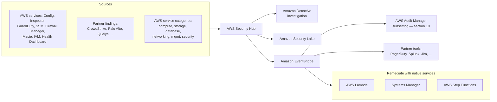
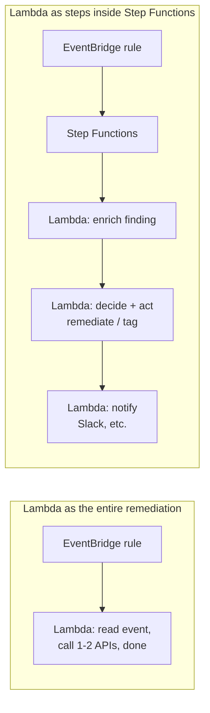

# Automated Incident Remediation with EventBridge, Security Hub, and Step Functions: Study Notes

Source: [Automatically remediating incidents](https://www.youtube.com/watch?v=rG18VXcT218), a lesson from the same Cybr AWS Certified Security – Specialty (SCS-C03) course as [`tutorial/20`](../tutorial/20_Amazon_EventBridge_Overview_Study_Notes.md), about 15 minutes.

This is the thematic sequel to `tutorial/20`, though not the literal next lesson — the course covers several other services (Config, EC2 Image Builder, SSM OpsCenter) in between that aren't captured in this repo. Where `tutorial/20` ended at "notify a human" (GuardDuty finding → EventBridge rule → SNS email), this lesson picks the thread back up and goes to "automatically **act**": GuardDuty/Config/Security Hub findings → EventBridge → Lambda and/or **Step Functions**. Unlike the GuardDuty video, this lesson is not a console lab — it's a walkthrough of two real AWS reference diagrams (no clicking, no CLI), so these notes verify and rebuild those diagrams instead of console steps.

What the video covers:
1. The Security Hub findings pipeline: many AWS/partner/service-category sources feed Security Hub, which feeds EventBridge, which fans out to Audit Manager, partner tools, and remediation (Lambda, Systems Manager, Step Functions).
2. A deep dive into AWS's own **Automated Forensics Orchestrator for EC2 and EKS** guidance: a cross-account, Step-Functions-orchestrated pipeline that isolates a compromised EC2 instance, captures memory/disk evidence, and automates the investigation.
3. Two remediation shapes with Lambda: Lambda as the *entire* remediation (one function, a couple of API calls), versus Lambda as *steps inside* a Step Functions workflow (enrich → decide/remediate → notify).
4. An exam-oriented recap: which service to reach for, given a scenario.

What was checked:
- The Security Hub → EventBridge pipeline, its default behavior, and the documented target action types (including "Activating an AWS Step Functions state machine") were checked against [Using EventBridge for automated response and remediation](https://docs.aws.amazon.com/securityhub/latest/userguide/securityhub-cloudwatch-events.html) in the Security Hub User Guide.
- The forensics architecture (steps 1–10, 6a–6e) was checked against AWS's current [Guidance for Automated Forensics Orchestrator for Amazon EC2 and EKS](https://docs.aws.amazon.com/solutions/automated-forensics-orchestrator-for-amazon-ec2/) solutions page, and the sample code repo it links to ([`aws-solutions-library-samples/automated-forensic-orchestrator-for-amazon-ec2`](https://github.com/aws-solutions-library-samples/automated-forensic-orchestrator-for-amazon-ec2)) was identified but not cloned or run.
- The existence and purpose of the "AWS Security Services Best Practices" site the lesson references was confirmed at [aws.github.io/aws-security-services-best-practices](https://aws.github.io/aws-security-services-best-practices/); its Security Hub diagram itself is an image the fetch tooling used here couldn't read pixel-by-pixel, so the findings-sources list is cross-checked against the lesson's narration plus the written Security Hub docs instead.
- AWS Audit Manager's discontinuation, Amazon Application Recovery Controller's purpose, and the separate **Automated Security Response on AWS** solution were each checked against their own current AWS pages (cited inline).
- No AWS account was used — this lesson builds no console state and runs no CLI, so there's nothing to reproduce. The ASL skeleton in section 7 follows the same syntax already validated via `ValidateStateMachineDefinition`/`TestState` in [notes 05](../tutorial/05_AWS_Step_Functions_with_DynamoDB_Study_Notes.md) and [notes 12](../tutorial/12_AWS_Step_Functions_Serverless_Order_Workflow_Study_Notes.md), but wasn't independently re-validated in this session (no live AWS credentials available here).

---

## Contents

1. [Corrected terms](#1-corrected-terms)
2. [The big picture: findings in, action out](#2-the-big-picture-findings-in-action-out)
3. [Security Hub → EventBridge, specifically](#3-security-hub--eventbridge-specifically)
4. [Two shapes of Lambda remediation](#4-two-shapes-of-lambda-remediation)
5. [Deep dive: the Automated Forensics Orchestrator for EC2 and EKS](#5-deep-dive-the-automated-forensics-orchestrator-for-ec2-and-eks)
6. [Corrections to the video's framing of the forensics flow](#6-corrections-to-the-videos-framing-of-the-forensics-flow)
7. [Beyond the video: a minimal ASL skeleton for the enrich → decide → notify pattern](#7-beyond-the-video-a-minimal-asl-skeleton-for-the-enrich--decide--notify-pattern)
8. [Exam-style decision table](#8-exam-style-decision-table)
9. [Gotchas](#9-gotchas)
10. [What has changed / numbers worth double-checking](#10-what-has-changed--numbers-worth-double-checking)
11. [Cheat sheet](#11-cheat-sheet)
12. [Review questions](#12-review-questions)

---

## 1. Corrected terms

| Caption/video says | Actually means |
|---|---|
| "Qualtrics" (as a Security Hub partner, alongside CrowdStrike and Palo Alto Networks) | Almost certainly **Qualys** — a vulnerability-management vendor and real Security Hub partner integration. Qualtrics is survey software and has no Security Hub integration; this is an auto-caption mishearing. |
| "AWS AWS Security Services Best Practices" | [aws.github.io/aws-security-services-best-practices](https://aws.github.io/aws-security-services-best-practices/) — real, AWS-maintained, open-sourced on GitHub as the lesson says |
| "the AWS Solutions Library... Automated Forensics Orchestrator for EC2 and EKS" | Real: now published as [Guidance for Automated Forensics Orchestrator for Amazon EC2 and EKS](https://docs.aws.amazon.com/solutions/automated-forensics-orchestrator-for-amazon-ec2/) |

---

## 2. The big picture: findings in, action out



The lesson's framing: Security Hub is the **aggregation point** — it doesn't itself decide what to do about a finding. Once a finding lands in Security Hub, it's automatically forwarded to EventBridge (section 3), and EventBridge is where routing decisions and automated reactions actually happen — the same rule → target model already built around GuardDuty in `tutorial/20`, just with Security Hub as the common upstream source instead of GuardDuty alone.

---

## 3. Security Hub → EventBridge, specifically

AWS's own docs confirm the lesson's claim directly, and extend it:

> "Security Hub CSPM automatically sends all new findings and all updates to existing findings to EventBridge as EventBridge events."

No rule or subscription is required to get findings *into* EventBridge — exactly the same "no setup needed to reach the default bus" behavior `tutorial/20` section 4 described for GuardDuty. The documented list of actions an EventBridge rule can trigger from a Security Hub finding is broader than what the lesson shows on screen:

| Action | Mentioned in the lesson? |
|---|---|
| Invoke a Lambda function | Yes |
| Invoke the EC2 Run Command | Yes (as "Systems Manager") |
| Relay to Kinesis Data Streams | No |
| **Activate a Step Functions state machine** | Yes |
| Notify an SNS topic or SQS queue | Partially (SNS, in the forensics flow) |
| Send to a third-party ticketing/chat/SIEM/IR tool | Yes (PagerDuty, Splunk, Jira named) |

This is the second independent AWS doc (after GuardDuty's, in `tutorial/20` section 9) that explicitly lists Step Functions as a documented EventBridge target for a security finding — reinforcing that the Step Functions tie-in here is a real, named capability, not a stretch.

### A simpler, official alternative the lesson doesn't name

AWS also publishes a lighter-weight solution for exactly this pattern: **[Automated Security Response on AWS](https://aws.amazon.com/solutions/implementations/aws-security-hub-automated-response-and-remediation/)** — EventBridge rules plus Lambda functions (no Step Functions), deployed via CloudFormation and Systems Manager, with Security Hub custom actions for human-triggered remediation. Worth knowing as the "I don't need the full forensics pipeline" option, versus the heavier Automated Forensics Orchestrator in section 5.

---

## 4. Two shapes of Lambda remediation

The lesson draws a clear line between two levels of complexity (11:14 onward):



| | Lambda-only | Lambda inside Step Functions |
|---|---|---|
| Example from the lesson | Revoke or add a security-group rule for quarantine, then stop — a human decides the next step | Enrich → decide/remediate/tag → notify, as three separate Lambda functions |
| When it fits | A single, idempotent action with no branching or multi-step state to track | Multiple steps, decisions based on severity/context, or steps that can fail and need a retry/resume path |
| What you give up by staying Lambda-only | Nothing, for a genuinely single-step action | No built-in retry/resume if a step fails partway, no native audit trail of which sub-steps ran |

This is the same distinction `tutorial/20` section 9 made speculatively (SNS vs. a hypothetical Step Functions target); here the lesson makes it explicit and names the concrete reason: Step Functions "can run complex orchestration, pick up where you left off, continue when there's been errors" (13:48).

---

## 5. Deep dive: the Automated Forensics Orchestrator for EC2 and EKS

The lesson's main example is a real, deployable AWS Solutions Guidance, not a hypothetical. AWS's current documentation gives a precise, numbered walkthrough that both confirms and sharpens what the lesson narrates:

```mermaid
sequenceDiagram
    participant App as Application account
    participant Sec as Security account
    participant For as Forensics account
    participant S3 as Amazon S3
    participant DDB as DynamoDB

    Note over For: Step 1-2 (prerequisite): EC2 Image Builder builds a forensic AMI;<br/>Step Functions will later use it for investigation
    App->>App: Step 3: Config rules / GuardDuty / 3rd-party detect malicious EC2 activity
    App->>Sec: Step 3: finding sent to Security Hub (native integration)
    Sec->>Sec: Step 4: Security Hub -> EventBridge (default, automatic)
    Sec->>For: Step 5: EventBridge provides instance ID, starts Step Functions in the forensics account
    For->>For: Step 6: Triage -- get instance info, is isolation needed?, is acquisition needed (by tag)?
    For->>DDB: Step 6a: store triage details
    par Step 6b: two parallel acquisition flows
        For->>S3: Memory Forensics Flow: capture memory -> S3, then isolate via new security group
    and
        For->>For: Disk Forensics Flow: EBS snapshot, shared to forensics account
    end
    For->>DDB: Step 6c: store acquisition details
    For->>For: Step 6d: notify the Investigation state machine
    For->>DDB: Step 6e: store final task state/results
    For->>For: Step 7: Investigation Step Functions starts a forensic instance from the AMI,<br/>loads memory from S3, creates+attaches an EBS volume from the snapshot
    For->>For: Step 8: SSM documents run the forensic investigation (Run Command)
    For->>App: Step 9: SNS shares investigation details
    Note over For: Step 10: AppSync can query the forensic timeline (reads DynamoDB)
```

| Step | What it does |
|---|---|
| 1–2 | A forensic AMI (built via **EC2 Image Builder**) is the prerequisite; Step Functions later boots an instance from it for investigation |
| 3 | In the **application account**, Config managed rules, GuardDuty, and/or third-party tools detect something EC2-specific; the finding reaches **Security Hub in the security account** via Security Hub's native cross-account aggregation |
| 4 | Security Hub automatically forwards to **EventBridge** — no setup, per section 3 |
| 5 | EventBridge extracts the instance ID and starts the **Step Functions** workflow in a separate **forensics account** |
| 6 | **Triage**: look up the instance, decide if isolation is needed (from the Security Hub action) and if acquisition is needed (from the instance's tags) |
| 6a, 6c, 6e | **DynamoDB** is written at each stage — triage, acquisition, and final results |
| 6b | Two flows run **in parallel**: a **Memory Forensics Flow** (capture memory → S3, *then* isolate the instance with a fresh, access-stripped security group) and a **Disk Forensics Flow** (EBS snapshot, shared to the forensics account) |
| 6d | Once acquisition finishes, it notifies the **Investigation** state machine |
| 7 | Investigation starts a forensic instance from the AMI, pulls the captured memory from S3, and attaches an EBS volume built from the snapshot |
| 8 | **SSM documents** (via Run Command) actually run the forensic tooling against that instance |
| 9 | **SNS** delivers the investigation results to a human |
| 10 | **AppSync** provides a query interface over the DynamoDB data for the whole timeline |

---

## 6. Corrections to the video's framing of the forensics flow

| Lesson says | What AWS's current docs actually show |
|---|---|
| "6B is an acquisition **and isolation** flow... but simultaneously... it's also going to use a step function to capture memory data" — framed as two separate, simultaneous 6B flows (one for isolation, one for memory capture) | AWS's docs name exactly **two** parallel flows under step 6b — the **Memory Forensics Flow** and the **Disk Forensics Flow** — and isolation happens *inside* the Memory Forensics Flow, right after memory capture completes, not as an independent third flow |
| "This Step Function... is actually going to send information to Amazon DynamoDB **and AWS AppSync**" (implying both are written to at every stage) | Only **DynamoDB** is written to, at three specific points (6a, 6c, 6e). **AppSync** is a read/query layer over that DynamoDB data (step 10), used afterward to query the forensic timeline — it isn't invoked mid-workflow |
| "6D... is our investigation **and notification** flow" (implying one combined state machine) | The current docs number investigation (step 7), SSM-driven investigation execution (step 8), and SNS notification (step 9) as **separate** numbered steps. They likely still live inside one Investigation workflow end-to-end, but AWS's own current numbering doesn't present "investigation" and "notification" as a single fused unit the way the lesson's diagram labeling suggests — a sign the solution's docs/diagram have been revised since the video was recorded (see section 10) |
| Step Functions "can also create an OpsItem in SSM... not shown in this diagram" | Correct as a *general* Step Functions capability (there's a direct `aws-sdk:ssm:createOpsItem` style service integration), but it isn't part of this specific Guidance's documented 10 steps — a reasonable enhancement suggestion, not something to expect if you deploy the solution as-is |

None of these are large errors — the lesson's job is exam-level conceptual understanding, not a byte-for-byte reproduction of the reference architecture, and it says so explicitly ("you don't have to memorize this... I just want you to understand the role that Step Functions plays"). Worth knowing the precise version if you ever actually deploy this Guidance.

---

## 7. Beyond the video: a minimal ASL skeleton for the enrich → decide → notify pattern

The lesson describes, but never shows, the simpler "Lambda inside Step Functions" pattern from section 4 (enrich → decide/remediate/tag → notify). Built here as a small, concrete state machine, reusing the Retry/Catch and Choice patterns already validated in [notes 05](../tutorial/05_AWS_Step_Functions_with_DynamoDB_Study_Notes.md) and [notes 12](../tutorial/12_AWS_Step_Functions_Serverless_Order_Workflow_Study_Notes.md):

```json
{
  "Comment": "Enrich a security finding, decide on remediation, notify -- the lesson's 'Lambda inside Step Functions' pattern, built out",
  "StartAt": "EnrichFinding",
  "States": {
    "EnrichFinding": {
      "Type": "Task",
      "Resource": "arn:aws:states:::lambda:invoke",
      "Parameters": {
        "FunctionName": "arn:aws:lambda:us-east-1:123456789012:function:EnrichFinding",
        "Payload.$": "$"
      },
      "ResultSelector": { "enriched.$": "$.Payload" },
      "ResultPath": "$.enrichment",
      "Retry": [
        { "ErrorEquals": ["Lambda.TooManyRequestsException"], "IntervalSeconds": 2, "MaxAttempts": 3, "BackoffRate": 2.0 }
      ],
      "Catch": [
        { "ErrorEquals": ["States.ALL"], "ResultPath": "$.error", "Next": "NotifyOnly" }
      ],
      "Next": "SeverityDecision"
    },
    "SeverityDecision": {
      "Type": "Choice",
      "Choices": [
        { "Variable": "$.enrichment.enriched.severity", "NumericGreaterThanEquals": 7, "Next": "RemediateAndTag" }
      ],
      "Default": "NotifyOnly"
    },
    "RemediateAndTag": {
      "Type": "Task",
      "Resource": "arn:aws:states:::lambda:invoke",
      "Parameters": {
        "FunctionName": "arn:aws:lambda:us-east-1:123456789012:function:RemediateAndTag",
        "Payload.$": "$"
      },
      "ResultPath": "$.remediation",
      "Retry": [
        { "ErrorEquals": ["Lambda.TooManyRequestsException"], "IntervalSeconds": 2, "MaxAttempts": 3, "BackoffRate": 2.0 }
      ],
      "Catch": [
        { "ErrorEquals": ["States.ALL"], "ResultPath": "$.error", "Next": "NotifyOnly" }
      ],
      "Next": "NotifyOnly"
    },
    "NotifyOnly": {
      "Type": "Task",
      "Resource": "arn:aws:states:::sns:publish",
      "Parameters": {
        "TopicArn": "arn:aws:sns:us-east-1:123456789012:SecurityFindingNotifications",
        "Message.$": "$"
      },
      "End": true
    }
  }
}
```

| Lesson's step (12:09) | State |
|---|---|
| Lambda that enriches findings | `EnrichFinding` |
| Lambda that makes decisions and acts (remediate/tag) | `SeverityDecision` (Choice) → `RemediateAndTag` |
| Lambda that sends notifications | `NotifyOnly` — reached either after remediation, or directly if severity doesn't warrant it, or if an earlier step errors |

This follows the same ASL syntax as the already-validated definitions in notes 05/12/17 (`lambda:invoke`, `Retry`/`Catch` shape, `ResultPath`/`ResultSelector`), but — per the disclaimer at the top of this note — wasn't independently re-run through `ValidateStateMachineDefinition` or `TestState` in this session.

---

## 8. Exam-style decision table

The lesson's own closing recap (14:46), turned into a lookup table:

| Scenario keyword | Reach for |
|---|---|
| Build/deploy a forensic AMI in a forensics account | **EC2 Image Builder** |
| Detect a compromised EC2 instance or EKS cluster | **GuardDuty** and/or **AWS Config** (often together) |
| Centralize findings from many sources | **Security Hub** |
| Automatically route a finding to a workflow | **EventBridge rules** |
| A single, simple remediation action | **Lambda** alone |
| Multi-step, stateful, retryable orchestration | **Step Functions** |
| Isolate a potentially compromised resource | **Security groups** |
| Automate a forensic investigation on an instance | **Systems Manager** (SSM documents + Run Command) |
| Log/track every step of an automated response | **DynamoDB** (+ **AppSync** to query it), or **SSM OpsCenter** (OpsItems) |
| Shift traffic away from an impacted Region/AZ during an incident | **Amazon Application Recovery Controller** (ARC) — a fully managed failover/traffic-shifting service, not covered in depth by the lesson but named as existing |

---

## 9. Gotchas

1. **Security Hub forwards findings to EventBridge automatically** — same "no setup required" behavior as GuardDuty (`tutorial/20`), but it's easy to assume you need to configure this forwarding yourself.
2. **AppSync queries DynamoDB; it doesn't get written to by the state machine.** If you're tracing where forensic workflow state actually gets persisted, look at the DynamoDB writes (6a/6c/6e), not AppSync.
3. **The two acquisition flows (memory, disk) run in parallel, and isolation is nested inside the memory flow**, not a separate third flow — a subtlety worth getting right if you're reading the actual sample code.
4. **This Guidance is multi-account and multi-region by design**: application account (where the compromise happens) → security account (Security Hub) → forensics account (Step Functions, the forensic AMI, captured evidence). Deploying it into a single account defeats part of its purpose (keeping forensic tooling and evidence out of a potentially compromised account).
5. **Lambda-only remediation has no resume path.** If the single Lambda function fails partway through its API calls, there's no built-in retry/resume — that's exactly the gap Step Functions closes.
6. **Audit Manager is being wound down for new customers** (section 10) — don't plan new audit-evidence pipelines around it going forward.
7. **The lesson's diagram may not exactly match the current AWS docs** — AWS revises Solutions Guidance architecture over time; section 6 lists the specific places this lesson's narration and the current docs diverge slightly.

---

## 10. What has changed / numbers worth double-checking

| Point | Detail |
|---|---|
| AWS Audit Manager | No longer open to new customers as of **April 30, 2026** — already in effect as of this note. Existing customers are presumably still served; don't build a *new* pipeline that depends on it. |
| "Automated Forensics Orchestrator" docs structure | Now presented as a clean 10-step (plus 6a–6e) numbered list on AWS's Solutions/Guidance page — more granular than what the lesson's single diagram shows, suggesting a documentation refresh since recording |
| Related solution not named in the lesson | **Automated Security Response on AWS** — a separate, Lambda-only (no Step Functions) official solution for the simpler remediation case |

---

## 11. Cheat sheet

```
Pipeline        : (AWS services + partners + service categories) -> Security Hub -> EventBridge
                  -> {Audit Manager (sunsetting), partner tools, Lambda/SSM/Step Functions}
Security Hub    : auto-forwards ALL new findings + updates to EventBridge, no setup needed
EB targets      : Lambda, EC2 Run Command, Kinesis, Step Functions (documented!), SNS/SQS,
                  third-party ticketing/chat/SIEM
Two shapes      : Lambda-only = single idempotent action, no resume path
                  Lambda-in-Step-Functions = multi-step, branching, retryable, auditable
Forensics flow  : app account (detect) -> security account (Security Hub) -> forensics account
                  (Step Functions: triage -> [memory+isolate | disk snapshot] in parallel
                  -> investigation using a forensic AMI + SSM documents -> SNS notify)
Tracking        : DynamoDB written during the workflow; AppSync queries it afterward
Isolation       : new, access-stripped security group attached to the compromised instance
Exam mapping    : detect=GuardDuty/Config | aggregate=Security Hub | route=EventBridge
                  simple fix=Lambda | complex/stateful=Step Functions | contain=security groups
                  investigate=SSM Run Command | audit trail=DynamoDB+AppSync or SSM OpsCenter
                  regional failover=Application Recovery Controller
```

---

## 12. Review questions

<details>
<summary>1. Does Security Hub require an EventBridge rule to be configured before findings start flowing to EventBridge?</summary>

No. Security Hub automatically sends all new findings and all updates to existing findings to EventBridge — the same "lands on the default bus with no setup" behavior GuardDuty has.
</details>

<details>
<summary>2. Name a documented EventBridge target action for a Security Hub finding that isn't Lambda or SNS.</summary>

Activating an AWS Step Functions state machine (also: EC2 Run Command, Kinesis Data Streams, SQS, or a third-party ticketing/chat/SIEM tool).
</details>

<details>
<summary>3. When is a single Lambda function enough for remediation, and when do you need Step Functions instead?</summary>

A single Lambda function is enough for one idempotent action with no branching (e.g. adding a security-group rule to quarantine an instance). Step Functions is needed once there are multiple steps, decisions based on context (like severity), or steps that need to resume after a failure.
</details>

<details>
<summary>4. In the Automated Forensics Orchestrator architecture, what are the three AWS accounts involved, and what happens in each?</summary>

The **application account** (where the compromised resource lives and detection happens via Config/GuardDuty/third-party tools), the **security account** (where Security Hub aggregates the finding and forwards it to EventBridge), and the **forensics account** (where Step Functions, the forensic AMI, and the captured evidence all live).
</details>

<details>
<summary>5. What are the two parallel flows under "acquisition," and what does each capture?</summary>

The Memory Forensics Flow (captures memory, stores it in S3, then isolates the instance with a fresh security group) and the Disk Forensics Flow (takes an EBS snapshot and shares it with the forensics account).
</details>

<details>
<summary>6. Is isolation its own separate flow, or part of one of the acquisition flows?</summary>

It's part of the Memory Forensics Flow — the instance is isolated right after memory acquisition completes, not as an independent third parallel flow.
</details>

<details>
<summary>7. What does AppSync actually do in this architecture: write workflow state, or something else?</summary>

It queries the forensic timeline — it's a read interface over the DynamoDB data that the Step Functions workflow writes during triage, acquisition, and completion. AppSync itself isn't written to mid-workflow.
</details>

<details>
<summary>8. How does the Investigation phase get the evidence to analyze?</summary>

It starts a forensic instance from the pre-built forensic AMI, loads the captured memory data from S3, creates a new EBS volume from the disk snapshot, and attaches that volume to the forensic instance for analysis.
</details>

<details>
<summary>9. What runs the actual forensic tooling against the evidence, once it's attached to the forensic instance?</summary>

AWS Systems Manager documents, executed via Run Command, using the tools pre-installed on the forensic AMI.
</details>

<details>
<summary>10. Why might you deploy "Automated Security Response on AWS" instead of the Automated Forensics Orchestrator?</summary>

It's a lighter-weight official solution for simpler remediation needs — EventBridge rules plus Lambda functions, no Step Functions, no multi-account forensics pipeline. Appropriate when you need automated/semi-automated remediation but not a full forensic evidence-capture workflow.
</details>

<details>
<summary>11. As of this note, can a new customer still sign up for AWS Audit Manager?</summary>

No — AWS Audit Manager stopped accepting new customers as of April 30, 2026.
</details>
