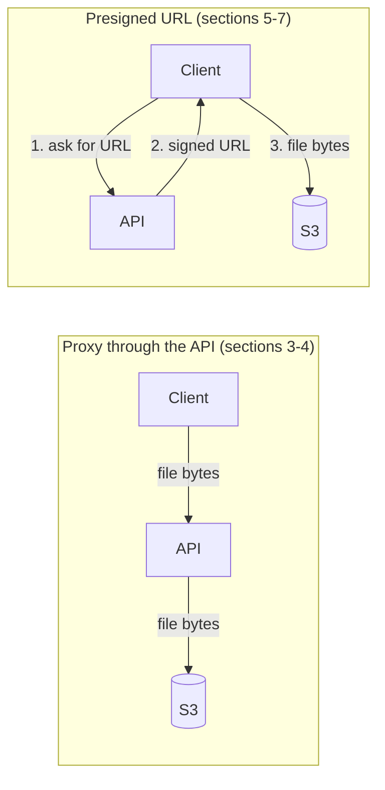
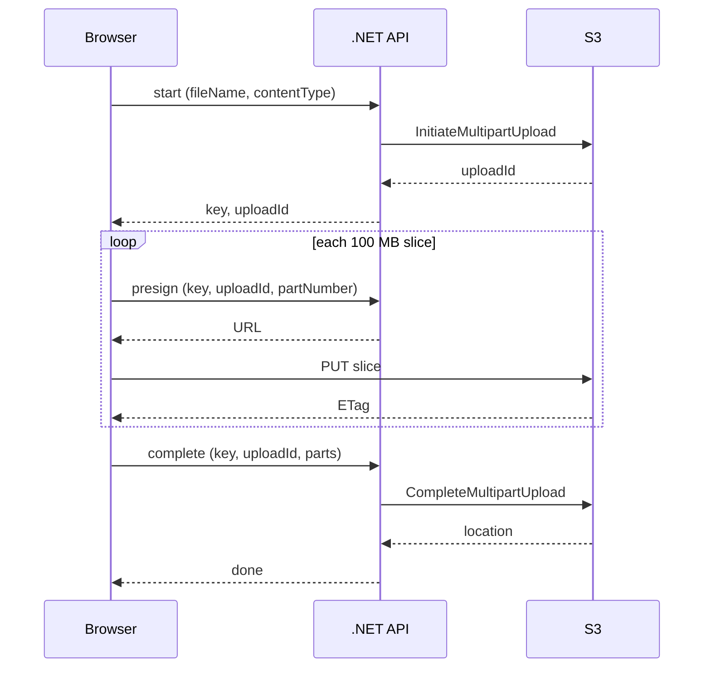

# S3 from .NET: SDK Basics, Presigned URLs and Multipart Upload: Study Notes

Source: [The Last Amazon S3 Video You'll Need To Watch (Presigned URLs, Multipart Upload)](https://www.youtube.com/watch?v=yAoKmP76oL4), Milan Jovanović, 30:24. The presenter says AWS sponsored the video (00:31).

This is the full-depth cross-check for [note 00](00_S3_Multipart_Upload_Study_Notes.md). That note describes a six-step resumable upload design. This video builds most of it with a .NET minimal API and a plain HTML/JavaScript client, so the two can be compared piece by piece (section 9).

What the video covers:
1. Bucket creation in the console, and why the object URL returns access denied.
2. Upload, download and delete through the API with the .NET SDK.
3. Presigned `GET` and `PUT` URLs, so file bytes skip the API.
4. The CORS rule a browser needs.
5. Multipart upload: start, presign each part, complete.

What was checked:
- Multipart limits: [Amazon S3 multipart upload limits](https://docs.aws.amazon.com/AmazonS3/latest/userguide/qfacts.html).
- Multipart flow, permissions, pricing and the 100 MB recommendation: [Uploading and copying objects using multipart upload](https://docs.aws.amazon.com/AmazonS3/latest/userguide/mpuoverview.html).
- Presigned URL reuse, expiry and signer permissions: [Download and upload objects with presigned URLs](https://docs.aws.amazon.com/AmazonS3/latest/userguide/using-presigned-url.html).
- Signed headers on presigned requests: [Presigned URL signature mismatch](https://repost.aws/knowledge-center/s3-presigned-url-signature-mismatch).
- Delete behavior: [`DeleteObject`](https://docs.aws.amazon.com/AmazonS3/latest/API/API_DeleteObject.html). Missing-key errors: [Handle Amazon S3 errors](https://docs.aws.amazon.com/sdk-for-python/v4/guide/s3-errors.html).
- Bucket defaults: [Creating a general purpose bucket](https://docs.aws.amazon.com/AmazonS3/latest/userguide/create-bucket-overview.html).
- Checksum part numbering: [Checking object integrity for uploads](https://docs.aws.amazon.com/AmazonS3/latest/userguide/checking-object-integrity-upload.html).
- The C# and JavaScript below are reconstructed from the spoken walkthrough. Names the narration doesn't give (routes, record types, function names) are mine. The C# was not compiled. The video links its source code, which these notes did not use.
- Nothing was run against a live AWS account. The Python script in section 8 was run against a local S3 mock ([moto](https://github.com/getmoto/moto)).

---

## Contents

1. [The two data paths](#1-the-two-data-paths)
2. [Bucket setup](#2-bucket-setup)
3. [SDK setup in .NET](#3-sdk-setup-in-net)
4. [Upload, download and delete through the API](#4-upload-download-and-delete-through-the-api)
5. [Presigned URLs](#5-presigned-urls)
6. [CORS](#6-cors)
7. [Multipart upload](#7-multipart-upload)
8. [Same flow with the AWS CLI and Python](#8-same-flow-with-the-aws-cli-and-python)
9. [Cross-check against note 00](#9-cross-check-against-note-00)
10. [Corrections and gaps](#10-corrections-and-gaps)
11. [Gotchas](#11-gotchas)
12. [Cheat sheet](#12-cheat-sheet)
13. [Review questions](#13-review-questions)

---

## 1. The two data paths



| | Through the API | Presigned URL |
|---|---|---|
| Bytes cross the network | Twice (client to API, API to S3) | Once |
| API bandwidth and memory | Grows with file size | Only small JSON requests |
| Client needs AWS credentials | No | No |
| API can inspect the file | Yes | No |
| Browser CORS rule on the bucket | Not needed | Needed |

The video's reason for moving to presigned URLs (14:39): the file travels twice, and "it's going to quickly make our API the bottleneck".

---

## 2. Bucket setup

### What the video does (00:38-04:41)

| Step | Video's choice | Note |
|---|---|---|
| Bucket name | `mjtech test` as captioned (spaces aren't allowed in real names) | See below on uniqueness |
| Object Ownership | ACLs disabled | Default for new buckets: the bucket owner owns every object |
| Block Public Access | All public access blocked | Default for new buckets |
| Versioning | Disabled | |
| Everything else | Defaults | SSE-S3 encryption is applied as the base level |
| Upload a file | Console, Standard storage class | |
| Open the object URL | Access denied | The object is private |
| Share with a presigned URL | Console, 1 minute expiry | The console allows 1 minute to 12 hours |

A bucket is a flat key space. "Folders" such as `images/` are part of the object key.

Bucket names in the shared global namespace must be globally unique. Since March 2026 AWS also offers [account regional namespaces](https://aws.amazon.com/about-aws/whats-new/2026/03/amazon-s3-account-regional-namespaces/), where the name ends in a suffix built from your account ID and Region (`-<account-id>-<region>-an`) that only your account can use. The video doesn't cover this.

---

## 3. SDK setup in .NET

Package: `AWSSDK.S3` from NuGet.

```csharp
internal sealed class S3Settings
{
    public string Region { get; init; } = "us-east-1";
    public string BucketName { get; init; } = string.Empty;
}
```

```json
{
  "S3Settings": {
    "Region": "us-east-1",
    "BucketName": "my-study-bucket"
  }
}
```

```csharp
builder.Services.Configure<S3Settings>(builder.Configuration.GetSection("S3Settings"));

builder.Services.AddSingleton<IAmazonS3>(serviceProvider =>
{
    var settings = serviceProvider.GetRequiredService<IOptions<S3Settings>>().Value;
    var config = new AmazonS3Config
    {
        RegionEndpoint = RegionEndpoint.GetBySystemName(settings.Region)
    };
    return new AmazonS3Client(config);
});
```

No access keys appear in the code. The client takes credentials from the SDK's default credential chain (a local profile in development, a role in AWS).

---

## 4. Upload, download and delete through the API

### Upload (07:25-11:10)

```csharp
app.MapPost("images", async (
    [FromForm] IFormFile file,
    IAmazonS3 s3Client,
    IOptions<S3Settings> settings) =>
{
    if (file.Length == 0)
    {
        return Results.BadRequest();
    }

    using var stream = file.OpenReadStream();
    var key = Guid.NewGuid();

    var request = new PutObjectRequest
    {
        BucketName = settings.Value.BucketName,
        Key = $"images/{key}",
        InputStream = stream,
        ContentType = file.ContentType,
        Metadata = { ["file-name"] = file.FileName }
    };

    await s3Client.PutObjectAsync(request);

    return Results.Ok(key);
})
.DisableAntiforgery();
```

- The key is a random GUID, so two uploads of `photo.jpg` don't overwrite each other.
- The original file name is kept as user metadata. It is stored with the `x-amz-meta-` prefix, which the SDK adds if you leave it out (09:47).
- `DisableAntiforgery()` is what the presenter calls "a small hack" (10:24) so a minimal API accepts the form without a token. Don't copy it into a cookie-authenticated app without another CSRF defence.

### Download (11:40-12:50)

```csharp
app.MapGet("images/{key}", async (
    string key,
    IAmazonS3 s3Client,
    IOptions<S3Settings> settings) =>
{
    var response = await s3Client.GetObjectAsync(new GetObjectRequest
    {
        BucketName = settings.Value.BucketName,
        Key = $"images/{key}"
    });

    return Results.File(
        response.ResponseStream,
        response.Headers.ContentType,
        response.Metadata["file-name"]);
});
```

### Delete (13:27-14:35)

```csharp
app.MapDelete("images/{key}", async (
    string key,
    IAmazonS3 s3Client,
    IOptions<S3Settings> settings) =>
{
    await s3Client.DeleteObjectAsync(new DeleteObjectRequest
    {
        BucketName = settings.Value.BucketName,
        Key = $"images/{key}"
    });

    return Results.Ok();
});
```

| Behavior | Detail |
|---|---|
| Deleting a key that doesn't exist | Succeeds, as the video says (13:54) |
| Deleting in a versioned bucket | Adds a delete marker. Older versions stay, and stay billed, until deleted by version ID |
| Getting a missing key | Throws `AmazonS3Exception`. S3 reports "no such key" only to a caller with `s3:ListBucket`; other callers get access denied |

The video says the download endpoint should handle that exception and leaves it out (12:52).

---

## 5. Presigned URLs

A presigned URL carries a signature made with the backend's credentials. Whoever holds the URL can perform that one operation on that one key until it expires.

### Download URL (15:28-17:48)

```csharp
app.MapGet("images/{key}/presigned", (
    string key,
    IAmazonS3 s3Client,
    IOptions<S3Settings> settings) =>
{
    try
    {
        var request = new GetPreSignedUrlRequest
        {
            BucketName = settings.Value.BucketName,
            Key = $"images/{key}",
            Verb = HttpVerb.GET,
            Expires = DateTime.UtcNow.AddMinutes(15)
        };

        var url = s3Client.GetPreSignedURL(request);

        return Results.Ok(new { key, url });
    }
    catch (AmazonS3Exception ex)
    {
        Console.WriteLine(ex.Message);
        return Results.BadRequest();
    }
});
```

The `try`/`catch` doesn't do what it appears to. [Creating a presigned URL happens locally](https://docs.aws.amazon.com/AmazonS3/latest/userguide/using-presigned-url.html), so S3 is never asked whether the key exists. A URL for a missing key is created without complaint, and the error shows up when the client uses it. If you need to fail early, call `GetObjectMetadataAsync` first.

### Upload URL (18:08-18:55)

```csharp
app.MapPost("images/presigned", (
    string fileName,
    string contentType,
    IAmazonS3 s3Client,
    IOptions<S3Settings> settings) =>
{
    var key = Guid.NewGuid();

    var request = new GetPreSignedUrlRequest
    {
        BucketName = settings.Value.BucketName,
        Key = $"images/{key}",
        Verb = HttpVerb.PUT,
        Expires = DateTime.UtcNow.AddMinutes(15),
        ContentType = contentType,
        Metadata = { ["file-name"] = fileName }
    };

    return Results.Ok(new { key, url = s3Client.GetPreSignedURL(request) });
});
```

Anything you put into the signature that travels as a header (here `Content-Type` and the metadata) must be sent by the client with the same value. Otherwise S3 answers `SignatureDoesNotMatch`.

### Expiry rules

| Signed with | Longest life |
|---|---|
| S3 console | 12 hours |
| IAM user keys (CLI or SDK) | 7 days |
| Temporary credentials (a role, STS) | Ends when the credentials expire, even if you asked for longer |

- A URL can be used **many times** until it expires.
- S3 checks expiry when the request starts. A transfer already running is not cut off.
- To cap how old a signature may be, whatever the signer asked for, use the `s3:signatureAge` condition key in a bucket policy.

---

## 6. CORS

The first browser upload fails (20:27) because the page (`http://localhost:5000`) and S3 are different origins. The video adds a rule under **bucket > Permissions > CORS**.

The narration gives: all headers; `GET`, `PUT`, `POST`, `DELETE`; origin `http://localhost:5000`; and "a few headers" to expose for the multipart step (20:59). It doesn't read those header names aloud. `ETag` is the one the multipart client cannot work without.

```json
[
  {
    "AllowedHeaders": ["*"],
    "AllowedMethods": ["GET", "PUT", "POST", "DELETE"],
    "AllowedOrigins": ["http://localhost:5000"],
    "ExposeHeaders": ["ETag"]
  }
]
```

For production, list only the methods and headers the page sends. This design needs no browser `DELETE`.

CORS only controls what a browser lets a page do. It grants no access: the request still needs a valid signature.

---

## 7. Multipart upload

### Why (21:41-22:15)

The single presigned `PUT` does work for the presenter's 3.7 GB file, but one request means one failure loses everything. The video quotes the recommendation to use multipart above 100 MB, which matches AWS's guidance.

A single `PUT` has a hard ceiling of 5 GB. Beyond that, multipart is the only option.

### The flow



### Endpoint 1: start

```csharp
app.MapPost("images/multipart/start", async (
    string fileName,
    string contentType,
    IAmazonS3 s3Client,
    IOptions<S3Settings> settings) =>
{
    var key = $"images/{Guid.NewGuid()}";

    var response = await s3Client.InitiateMultipartUploadAsync(new InitiateMultipartUploadRequest
    {
        BucketName = settings.Value.BucketName,
        Key = key,
        ContentType = contentType,
        Metadata = { ["file-name"] = fileName }
    });

    return Results.Ok(new { key, uploadId = response.UploadId });
});
```

Content type and metadata are set **here**, once. The part uploads don't carry them.

### Endpoint 2: presign one part

```csharp
app.MapPost("images/multipart/presign", (
    string key,
    string uploadId,
    int partNumber,
    IAmazonS3 s3Client,
    IOptions<S3Settings> settings) =>
{
    var request = new GetPreSignedUrlRequest
    {
        BucketName = settings.Value.BucketName,
        Key = key,
        Verb = HttpVerb.PUT,
        Expires = DateTime.UtcNow.AddMinutes(15),
        UploadId = uploadId,
        PartNumber = partNumber
    };

    return Results.Ok(new { url = s3Client.GetPreSignedURL(request) });
});
```

The only difference from an ordinary upload URL is `UploadId` and `PartNumber`.

### Endpoint 3: complete

```csharp
public sealed record UploadedPart(int PartNumber, string ETag);
public sealed record CompleteUpload(string Key, string UploadId, List<UploadedPart> Parts);

app.MapPost("images/multipart/complete", async (
    CompleteUpload body,
    IAmazonS3 s3Client,
    IOptions<S3Settings> settings) =>
{
    var response = await s3Client.CompleteMultipartUploadAsync(new CompleteMultipartUploadRequest
    {
        BucketName = settings.Value.BucketName,
        Key = body.Key,
        UploadId = body.UploadId,
        PartETags = body.Parts.Select(p => new PartETag(p.PartNumber, p.ETag)).ToList()
    });

    return Results.Ok(new { location = response.Location });
});
```

### The client (26:20-27:25)

The video splits the file into 100 MB parts, uploads them one by one, keeps each `ETag`, and offers pause and resume. The presenter says the front end was written with the Cursor AI editor (28:21). A minimal version of the same logic:

```javascript
const PART_SIZE = 100 * 1024 * 1024;

async function postJson(url, body) {
  const response = await fetch(url, {
    method: "POST",
    headers: { "Content-Type": "application/json" },
    body: body ? JSON.stringify(body) : undefined,
  });
  if (!response.ok) throw new Error(`${url} returned ${response.status}`);
  return response.json();
}

async function uploadMultipart(file, waitWhilePaused = async () => {}) {
  const start = new URLSearchParams({ fileName: file.name, contentType: file.type });
  const { key, uploadId } = await postJson(`/images/multipart/start?${start}`);
  const parts = [];

  for (let offset = 0, partNumber = 1; offset < file.size; offset += PART_SIZE, partNumber++) {
    await waitWhilePaused();

    const query = new URLSearchParams({ key, uploadId, partNumber });
    const { url } = await postJson(`/images/multipart/presign?${query}`);

    const response = await fetch(url, {
      method: "PUT",
      body: file.slice(offset, offset + PART_SIZE),
    });
    if (!response.ok) throw new Error(`part ${partNumber} failed: ${response.status}`);

    const eTag = response.headers.get("ETag");
    if (!eTag) throw new Error("ETag not readable: add it to the CORS ExposeHeaders");
    parts.push({ partNumber, eTag });
  }

  return postJson("/images/multipart/complete", { key, uploadId, parts });
}
```

### Choosing the part size

| Rule | Value |
|---|---|
| Part size | 5 MiB to 5 GiB; the last part can be smaller |
| Parts per upload | At most 10,000 |
| Largest object | 48.8 TiB |

A fixed 100 MiB part size stops at 10,000 x 100 MiB, about 976 GiB. For bigger files, compute the part size from the file size.

---

## 8. Same flow with the AWS CLI and Python

`aws s3 presign` only makes `GET` URLs ([CLI reference](https://docs.aws.amazon.com/cli/latest/reference/s3/presign.html)), so part URLs come from an SDK. This script plays both roles: it signs each part URL (the backend's job) and sends the `PUT` with plain HTTP (the browser's job). It aborts the upload if anything fails.

Save as `presigned_multipart.py`:

```python
# /// script
# requires-python = ">=3.10"
# dependencies = ["boto3"]
# ///
"""Upload a file with one presigned URL per part."""

import sys
import urllib.request
from pathlib import Path

import boto3
from botocore.config import Config

PART_SIZE = 5 * 1024 * 1024


def put_part(url: str, chunk: bytes) -> str:
    request = urllib.request.Request(
        url, data=chunk, method="PUT", headers={"Content-Type": "application/octet-stream"}
    )
    with urllib.request.urlopen(request) as response:
        return response.headers["ETag"]


def upload(bucket: str, path: Path) -> None:
    # SigV4, with the bucket name in the host so the URL targets the bucket's Region
    config = Config(signature_version="s3v4", s3={"addressing_style": "virtual"})
    s3 = boto3.client("s3", config=config)
    key = path.name
    upload_id = s3.create_multipart_upload(Bucket=bucket, Key=key)["UploadId"]
    parts = []
    try:
        with path.open("rb") as source:
            part_number = 1
            while chunk := source.read(PART_SIZE):
                url = s3.generate_presigned_url(
                    "upload_part",
                    Params={
                        "Bucket": bucket,
                        "Key": key,
                        "UploadId": upload_id,
                        "PartNumber": part_number,
                    },
                    ExpiresIn=900,
                )
                parts.append({"PartNumber": part_number, "ETag": put_part(url, chunk)})
                print(f"part {part_number}: {len(chunk)} bytes")
                part_number += 1
        result = s3.complete_multipart_upload(
            Bucket=bucket, Key=key, UploadId=upload_id, MultipartUpload={"Parts": parts}
        )
    except BaseException:
        s3.abort_multipart_upload(Bucket=bucket, Key=key, UploadId=upload_id)
        raise
    print(f"completed s3://{bucket}/{key} ETag {result['ETag']}")


if __name__ == "__main__":
    upload(sys.argv[1], Path(sys.argv[2]))
```

Run it, then clean up. These commands create a real bucket and incur small charges.

```bash
# The CLI reads AWS_REGION; boto3 only reads AWS_DEFAULT_REGION. Set both.
export AWS_REGION=us-east-1 AWS_DEFAULT_REGION=us-east-1
ACCOUNT_ID=$(aws sts get-caller-identity --query Account --output text)
BUCKET="mpu-study-${ACCOUNT_ID}"

# us-east-1 needs no --create-bucket-configuration; other Regions do
aws s3api create-bucket --bucket "$BUCKET"

# CORS, needed only when a browser calls the URLs
cat > cors.json <<'EOF'
{
  "CORSRules": [{
    "AllowedHeaders": ["*"],
    "AllowedMethods": ["GET", "PUT"],
    "AllowedOrigins": ["http://localhost:5000"],
    "ExposeHeaders": ["ETag"]
  }]
}
EOF
aws s3api put-bucket-cors --bucket "$BUCKET" --cors-configuration file://cors.json

# 12 MiB test file: two 5 MiB parts and one 2 MiB part
dd if=/dev/urandom of=big.bin bs=1M count=12
uv run presigned_multipart.py "$BUCKET" big.bin

aws s3api head-object --bucket "$BUCKET" --key big.bin
aws s3 presign "s3://$BUCKET/big.bin" --expires-in 900

# Clean up
aws s3api list-multipart-uploads --bucket "$BUCKET"
aws s3 rm "s3://$BUCKET/big.bin"
aws s3api delete-bucket --bucket "$BUCKET"
rm -f big.bin cors.json
```

---

## 9. Cross-check against note 00

| Topic | Note 00 | This video | Verdict from AWS docs |
|---|---|---|---|
| Three-call flow plus presigned part URLs | Described | Built | Agree |
| CORS needs `PUT` and the app's origin | Section 6 | Shown failing, then fixed | Agree |
| `ETag` must be exposed to the browser | Section 6 | Exposes unnamed headers and reads `ETag` | Consistent |
| Part size | 10 MiB example | 100 MB | Both valid |
| Resume after a page reload | `localStorage` plus `ListParts` | Pause and resume on the open page; no reload recovery shown | The note's design goes further |
| Cleanup of abandoned uploads | Lifecycle rule and abort | Not covered | The note is right to add it |
| Final ETag as checksum | Warns against it | Not covered | Agree with the note |
| Presigned URL reuse | Called it "single-use-scoped" (since fixed) | Not covered | Reusable until expiry |
| Presigning from the CLI | Used `aws s3 presign`, then `PUT` to it (since fixed) | Uses the SDK | The command makes `GET` URLs only |
| Consecutive part numbers | Tied the rule to full object checksums only (since fixed) | Not covered | Stated for composite (part-level) checksums, and on the overview page for multipart uploads with checksums generally |

The last three rows were errors in note 00 that this comparison turned up. They have been corrected there. For part numbers, numbering 1, 2, 3 with no gaps is safe in every case.

---

## 10. Corrections and gaps

| In the video | What to know |
|---|---|
| "If your bucket can be owned by other AWS accounts" (01:38) | The setting is Object Ownership. It decides who owns **objects** and whether ACLs apply |
| Standard price heard as "023 cents per gigabyte" (22:57) | The figure is dollars: $0.023 per GB-month for the first 50 TB in US East ([pricing](https://aws.amazon.com/s3/pricing/)) |
| Deep Archive "restored within 12 hours" (23:31) | True for a Standard restore. [Bulk restores take longer](https://docs.aws.amazon.com/AmazonS3/latest/userguide/restoring-objects-retrieval-options.html), typically up to 48 hours |
| `catch` around presigning | Never sees a missing object (section 5) |
| "S3 knows based on the upload ID what are all of the individual parts" (27:08) | S3 holds them, but `CompleteMultipartUpload` must still list every part number and ETag |
| Three multipart endpoints | No abort and no `ListParts`, so a closed tab leaves billed parts behind. Add both, plus an `AbortIncompleteMultipartUpload` lifecycle rule |
| Parts uploaded one at a time | Safe and simple. Uploading a few in parallel is how multipart improves throughput |
| No authentication or ownership check | Anyone who can reach the API can get an upload URL. The presign endpoint also trusts the `key` and `uploadId` sent by the client; check they belong to the caller |
| No size limit on uploads | A presigned `PUT` URL has no size range. A presigned **POST** policy can set [`content-length-range`](https://docs.aws.amazon.com/AmazonS3/latest/developerguide/sigv4-HTTPPOSTConstructPolicy.html) |

---

## 11. Gotchas

1. **Parts are billed until you complete or abort.** A multipart upload has no expiry.
2. **`ETag` must be in `ExposeHeaders`**, or the browser code can't read it.
3. **Signed headers must match.** Sending a different `Content-Type` than the one signed breaks the signature.
4. **A role-signed URL can die early**, when the role session ends.
5. **A presigned URL is a bearer token.** Don't log it, and keep expiry short.
6. **A presigned `PUT` overwrites** an existing object with the same key.
7. **Part URLs expire one by one.** Sign each part just before sending it, so a long upload doesn't outlive its URLs.
8. **`CompleteMultipartUpload` can return `200 OK` with an error inside** and can take minutes. AWS SDKs handle this; hand-written HTTP clients must parse the body.

---

## 12. Cheat sheet

```
Proxy upload      : PutObjectAsync(PutObjectRequest)           single PUT <= 5 GB
Download / delete : GetObjectAsync / DeleteObjectAsync         delete succeeds on missing keys
Presign           : GetPreSignedURL(GetPreSignedUrlRequest{Verb, Expires})   local, no S3 call
Multipart         : InitiateMultipartUploadAsync        -> UploadId
                    GetPreSignedURL(+UploadId,+PartNumber) -> one URL per part
                    PUT slice                           -> ETag header
                    CompleteMultipartUploadAsync(PartETags)
CORS              : AllowedOrigins=<app>, AllowedMethods=PUT/GET, ExposeHeaders=ETag
Limits            : 5 MiB-5 GiB per part, 10,000 parts, 48.8 TiB object
Expiry            : console 12 h, SDK/CLI 7 days, role credentials end sooner
Not in the video  : abort, ListParts, lifecycle cleanup, auth, size limits
```

---

## 13. Review questions

<details>
<summary>1. Why is routing uploads and downloads through the API a problem for large files?</summary>

The bytes cross the network twice and use the API's bandwidth and memory, so the API becomes the bottleneck. Presigned URLs let the client talk to S3 directly.
</details>

<details>
<summary>2. Does generating a presigned URL contact S3?</summary>

No. Signing happens locally with the caller's credentials. A URL for a missing object or a forbidden action is still produced, and fails when used.
</details>

<details>
<summary>3. A presigned PUT URL was signed with Content-Type image/png. The client sends image/jpeg. What happens?</summary>

The signature no longer matches and S3 rejects the request with SignatureDoesNotMatch.
</details>

<details>
<summary>4. A Lambda function signs a URL with a 7 day expiry. It stops working after a few hours. Why?</summary>

It was signed with temporary role credentials. The URL expires when those credentials expire.
</details>

<details>
<summary>5. Can a presigned URL be used twice?</summary>

Yes, as often as wanted until it expires.
</details>

<details>
<summary>6. Which three API calls make up a multipart upload, and what extra values does each part URL need?</summary>

CreateMultipartUpload (InitiateMultipartUpload in .NET), UploadPart, and CompleteMultipartUpload. A part URL needs the upload ID and the part number.
</details>

<details>
<summary>7. Where do you set the content type and metadata of a multipart object?</summary>

On the call that starts the upload.
</details>

<details>
<summary>8. The browser PUT returns 200 but the code reads a null ETag. What is missing?</summary>

ETag in the bucket CORS rule's ExposeHeaders.
</details>

<details>
<summary>9. What is the largest file a fixed 100 MiB part size can handle?</summary>

10,000 parts times 100 MiB, about 976 GiB.
</details>

<details>
<summary>10. A user closes the tab halfway through. What is left in S3, and what removes it?</summary>

The uploaded parts, which keep costing money. An explicit AbortMultipartUpload or an AbortIncompleteMultipartUpload lifecycle rule removes them.
</details>

<details>
<summary>11. A caller without s3:ListBucket requests a key that doesn't exist. What error do they get?</summary>

Access denied, so the response doesn't reveal whether the key exists.
</details>

<details>
<summary>12. How can you limit the size of a browser upload?</summary>

Use a presigned POST with a content-length-range condition. A presigned PUT URL has no size range.
</details>
