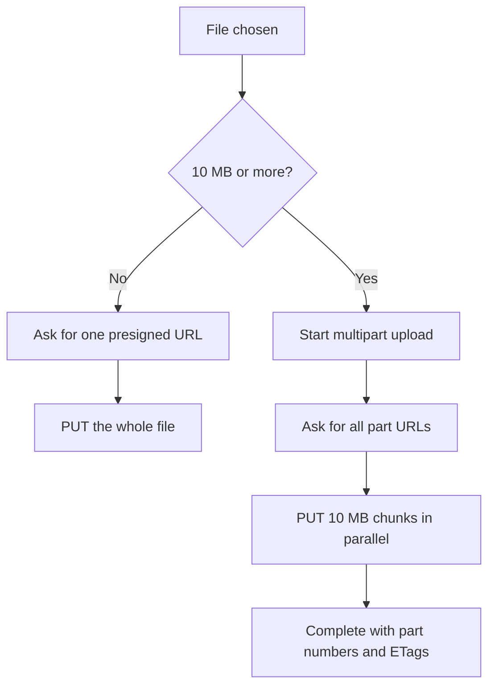

# Multipart and Presigned Uploads with Express and a Plain Front End: Study Notes

Source: [Upload Large file on AWS S3 using Multipart and Pre-signed URL](https://www.youtube.com/watch?v=dfxXEQxJPzI), Chandan Maurya, 20:24.

The design is the one in [note 00](00_S3_Multipart_Upload_Study_Notes.md#2-the-six-step-design): start, sign, upload parts, complete. It isn't repeated here. This note covers what is different in this build: a Node.js (Express) backend, a size switch between single and multipart upload, all part URLs signed at once, parallel uploads, and a deployment to AWS App Runner.

What was checked:
- Part limits: [multipart limits](https://docs.aws.amazon.com/AmazonS3/latest/userguide/qfacts.html). Expiry rules: [presigned URLs](https://docs.aws.amazon.com/AmazonS3/latest/userguide/using-presigned-url.html).
- App Runner status: [availability notice](https://aws.amazon.com/apprunner/). Node.js runtime support: [runtime releases](https://docs.aws.amazon.com/apprunner/latest/dg/service-source-code-nodejs-releases.html).
- SDK version support: [JavaScript v2 end of support](https://aws.amazon.com/blogs/developer/announcing-end-of-support-for-aws-sdk-for-javascript-v2/).
- The code is reconstructed from the narration, which doesn't make the SDK version clear. It is written for **SDK v3**. Route and function names are mine. The video links its repositories, which these notes did not use.
- Both code blocks were run in Node.js against a local S3 mock (moto), with SDK 3.1178.0. Nothing was run against AWS.

---

## Contents

1. [What happens by file size](#1-what-happens-by-file-size)
2. [Backend](#2-backend)
3. [Front end](#3-front-end)
4. [Bucket settings and permissions](#4-bucket-settings-and-permissions)
5. [The App Runner deployment, and why not to copy it](#5-the-app-runner-deployment-and-why-not-to-copy-it)
6. [Corrections and gotchas](#6-corrections-and-gotchas)
7. [Cheat sheet](#7-cheat-sheet)
8. [Review questions](#8-review-questions)

---

## 1. What happens by file size



| Demo (01:30-03:52) | Size | Requests |
|---|---|---|
| Small file | 600 KB | One signing call, one `PUT` |
| Large file | 16 MB | Start, sign, two `PUT`s (10 MB + 6 MB), complete |

The 10 MB switch and chunk size are the author's choice. S3 only requires 5 MiB or more for every part except the last.

---

## 2. Backend

Four endpoints (04:44-08:57): one for small files, three for multipart.

```javascript
// server.js
import express from "express";
import {
  S3Client,
  PutObjectCommand,
  CreateMultipartUploadCommand,
  UploadPartCommand,
  CompleteMultipartUploadCommand,
} from "@aws-sdk/client-s3";
import { getSignedUrl } from "@aws-sdk/s3-request-presigner";

const BUCKET = process.env.BUCKET_NAME;
const EXPIRES_IN = 900;
const s3 = new S3Client({
  region: process.env.AWS_REGION,
  // Without this, presigned upload URLs carry the checksum of an empty body.
  requestChecksumCalculation: "WHEN_REQUIRED",
});

const target = (fileName) => ({ Bucket: BUCKET, Key: `uploads/${fileName}` });
const sign = (command) => getSignedUrl(s3, command, { expiresIn: EXPIRES_IN });

const app = express();
app.use(express.json());

app.post("/single-url", async (req, res) => {
  res.json({ url: await sign(new PutObjectCommand(target(req.body.fileName))) });
});

app.post("/multipart/start", async (req, res) => {
  const { fileName, contentType } = req.body;
  const { UploadId } = await s3.send(
    new CreateMultipartUploadCommand({ ...target(fileName), ContentType: contentType }),
  );
  res.json({ uploadId: UploadId });
});

app.post("/multipart/urls", async (req, res) => {
  const { fileName, uploadId, totalParts } = req.body;
  if (!Number.isInteger(totalParts) || totalParts < 1 || totalParts > 10000) {
    return res.status(400).json({ error: "totalParts must be 1 to 10000" });
  }
  const urls = await Promise.all(
    Array.from({ length: totalParts }, (_, index) =>
      sign(new UploadPartCommand({ ...target(fileName), UploadId: uploadId, PartNumber: index + 1 })),
    ),
  );
  res.json({ urls });
});

app.post("/multipart/complete", async (req, res) => {
  const { fileName, uploadId, parts } = req.body;
  await s3.send(
    new CompleteMultipartUploadCommand({
      ...target(fileName),
      UploadId: uploadId,
      MultipartUpload: { Parts: parts },
    }),
  );
  res.json({ ok: true });
});

app.listen(process.env.PORT ?? 8080);
```

### The checksum setting

With default settings, SDK 3.1178.0 puts `x-amz-checksum-crc32=AAAAAA==` into presigned `PutObject` and `UploadPart` URLs. That value is the CRC32 of zero bytes, because the signer has no body to hash, and it won't match the file the browser sends. With `requestChecksumCalculation: "WHEN_REQUIRED"` the parameter is gone. Both URL forms were generated and compared for this note.

The video expires its single-file URL after 60 seconds (05:27). The code above uses 15 minutes.

---

## 3. Front end

```javascript
// upload.js
export const PART_SIZE = 10 * 1024 * 1024;
const CONCURRENCY = 4;

export async function uploadFile(file, apiBase = "") {
  const post = async (path, body) => {
    const response = await fetch(apiBase + path, {
      method: "POST",
      headers: { "Content-Type": "application/json" },
      body: JSON.stringify(body),
    });
    if (!response.ok) throw new Error(`${path} returned ${response.status}`);
    return response.json();
  };
  const put = async (url, body) => {
    const response = await fetch(url, { method: "PUT", body });
    if (!response.ok) throw new Error(`upload returned ${response.status}`);
    return response;
  };

  const fileName = file.name;
  if (file.size < PART_SIZE) {
    const { url } = await post("/single-url", { fileName });
    await put(url, file);
    return 1;
  }

  const totalParts = Math.ceil(file.size / PART_SIZE);
  const { uploadId } = await post("/multipart/start", { fileName, contentType: file.type });
  const { urls } = await post("/multipart/urls", { fileName, uploadId, totalParts });

  const parts = new Array(totalParts);
  let next = 0;
  async function worker() {
    while (next < totalParts) {
      const index = next++;
      const chunk = file.slice(index * PART_SIZE, (index + 1) * PART_SIZE);
      const response = await put(urls[index], chunk);
      parts[index] = { PartNumber: index + 1, ETag: response.headers.get("ETag") };
    }
  }
  await Promise.all(Array.from({ length: Math.min(CONCURRENCY, totalParts) }, worker));

  await post("/multipart/complete", { fileName, uploadId, parts });
  return totalParts;
}
```

The video starts every chunk at once (10:56-11:14). This version runs four at a time. `parts` is filled by index, so it ends up in part-number order even when uploads finish out of order.

---

## 4. Bucket settings and permissions

- Block all public access stays on (16:25). Presigned URLs work with a private bucket.
- The video updates the CORS rule (17:34) without reading it aloud. This design needs at least:

```json
[
  {
    "AllowedOrigins": ["http://localhost:3000"],
    "AllowedMethods": ["PUT"],
    "AllowedHeaders": ["*"],
    "ExposeHeaders": ["ETag"]
  }
]
```

- The video creates an IAM user with full S3 access and notes you can narrow it (14:31). This backend needs only:

```json
{
  "Version": "2012-10-17",
  "Statement": [{
    "Effect": "Allow",
    "Action": ["s3:PutObject", "s3:AbortMultipartUpload"],
    "Resource": "arn:aws:s3:::my-upload-bucket/uploads/*"
  }]
}
```

`s3:PutObject` covers starting, uploading parts and completing. The abort action is there for the cleanup endpoint you should add.

---

## 5. The App Runner deployment, and why not to copy it

| Video's setting (11:45-17:18) | Today |
|---|---|
| AWS App Runner, source from GitHub, manual deployment | App Runner has been **closed to new customers since April 30, 2026**. Existing customers can keep using it. AWS points new users to Amazon ECS Express Mode |
| Node.js 18 managed runtime | App Runner ended Node.js 18 support on December 1, 2025 |
| `npm install`, `node index.js`, port 8080 | Still the usual shape of a Node service |
| IAM user access keys in environment variables | Use a role attached to the compute (App Runner instance role, ECS task role). The SDK picks it up with no keys in configuration |
| Region `ap-south-1` and bucket name as variables | Fine |

A role has one side effect: URLs it signs stop working when its session credentials expire, even if the URL's own expiry is later.

---

## 6. Corrections and gotchas

| Point | Detail |
|---|---|
| "Combine all the chunks into single file using these ETag" (08:48) | S3 assembles in **part number** order. The `ETag` values confirm which uploaded data you mean |
| File name used as the key | Two users uploading `video.mp4` overwrite each other, and a client controls the key. Generate the key on the server and remember it per upload |
| `fileName` and `uploadId` trusted at completion | Check the upload belongs to the caller. There is no authentication in the demo |
| All URLs signed up front | A queued part must **start** before its URL expires. For long uploads, sign in batches |
| Every chunk started at once | Browsers limit connections per host, so extra requests only queue. Cap concurrency |
| 10 MB parts | 10,000 parts stops at about 97 GiB. Size parts from the file size for bigger files |
| No abort, retry or resume | A failed part leaves billed parts behind. Add retry, an abort endpoint and a [lifecycle rule](06_S3_Multipart_Lifecycle_Cleanup_Study_Notes.md) |
| `ETag` read in the browser | Needs `ExposeHeaders: ["ETag"]` |

---

## 7. Cheat sheet

```
< 10 MB   : sign PutObject -> PUT file
>= 10 MB  : CreateMultipartUpload -> sign UploadPart x N -> PUT chunks -> Complete(Parts)
SDK v3    : requestChecksumCalculation: "WHEN_REQUIRED" on the presigning client
Parts     : keep in PartNumber order; read ETag (CORS ExposeHeaders)
IAM       : s3:PutObject + s3:AbortMultipartUpload on uploads/*; use a role, not user keys
App Runner: closed to new customers (2026-04-30); Node 18 runtime ended 2025-12-01
```

---

## 8. Review questions

<details>
<summary>1. Why does the app use a single presigned URL for small files?</summary>

Multipart adds start and complete calls with no benefit for a small file, so one signed PUT is enough.
</details>

<details>
<summary>2. A 16 MB file with 10 MB parts: how many parts, and is the second one valid?</summary>

Two, of 10 MB and 6 MB. The last part has no minimum, and this one is above 5 MiB anyway.
</details>

<details>
<summary>3. Why set requestChecksumCalculation to WHEN_REQUIRED on the presigning client?</summary>

Otherwise the SDK adds a CRC32 of an empty body to the presigned URL, which doesn't match the uploaded bytes.
</details>

<details>
<summary>4. Parts finish in the order 2, 3, 1. What must the completion list look like?</summary>

Ascending by part number: 1, 2, 3, each with its own ETag.
</details>

<details>
<summary>5. All URLs are signed with a short expiry and uploads queue behind each other. What goes wrong?</summary>

Parts that start after the expiry are rejected. Sign in batches or use a longer expiry.
</details>

<details>
<summary>6. What should replace IAM user access keys on the server?</summary>

An IAM role attached to the compute service, with permission limited to the upload prefix.
</details>

<details>
<summary>7. Can a new AWS customer follow the video's deployment steps today?</summary>

No. App Runner stopped accepting new customers on April 30, 2026, and the Node.js 18 runtime it uses is no longer supported.
</details>
