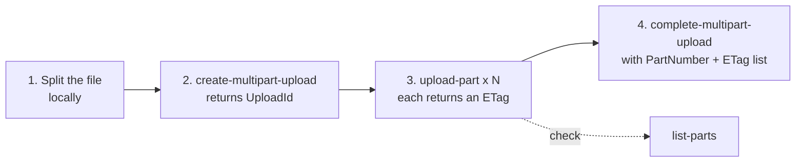

# S3 Multipart Upload with the AWS CLI: Study Notes

Source: [AWS S3 Tutorial: Multi-part upload with the AWS CLI](https://www.youtube.com/watch?v=G4NrNGhfim8), CloudYeti / Practical AI Engineering, 22:12.

The video does a multipart upload by hand: split an 86 MB file into nine pieces, start the upload, send each part with `aws s3api upload-part`, check them with `list-parts`, and complete. It follows an AWS how-to page for the command shapes. It is the closest thing in this repo to a real run of the commands in [note 00 section 7](00_S3_Multipart_Upload_Study_Notes.md#7-same-idea-with-the-aws-cli) (checked in section 8 below).

What was checked:
- Part limits: [multipart upload limits](https://docs.aws.amazon.com/AmazonS3/latest/userguide/qfacts.html).
- Completion rules, `ListParts` warning and billing: [multipart upload overview](https://docs.aws.amazon.com/AmazonS3/latest/userguide/mpuoverview.html).
- Completion errors and the "200 OK with an error" case: [`complete-multipart-upload`](https://docs.aws.amazon.com/cli/latest/reference/s3api/complete-multipart-upload.html).
- High-level command defaults: [AWS CLI S3 configuration](https://docs.aws.amazon.com/cli/latest/topic/s3-config.html). Failure behavior: [high-level (s3) commands](https://docs.aws.amazon.com/cli/latest/userguide/cli-services-s3-commands.html).
- Default checksums: [AWS CLI S3 FAQ](https://docs.aws.amazon.com/cli/latest/topic/s3-faq.html).
- `aws s3 presign`: [CLI reference](https://docs.aws.amazon.com/cli/latest/reference/s3/presign.html).
- The transcript gives the spoken walkthrough only. On-screen output could not be read, so sample output here is illustrative.
- Nothing was run against a live AWS account. The shell logic in section 6 was run with a stand-in `aws` command that imitates the responses, which tests the script's loop and JSON, not AWS.

---

## Contents

1. [The four steps](#1-the-four-steps)
2. [Split the file](#2-split-the-file)
3. [Start the upload](#3-start-the-upload)
4. [Upload and check the parts](#4-upload-and-check-the-parts)
5. [Complete the upload](#5-complete-the-upload)
6. [The whole run as one script](#6-the-whole-run-as-one-script)
7. [The shortcut: aws s3 cp](#7-the-shortcut-aws-s3-cp)
8. [Checking note 00 section 7](#8-checking-note-00-section-7)
9. [Corrections and gaps](#9-corrections-and-gaps)
10. [Gotchas](#10-gotchas)
11. [Cheat sheet](#11-cheat-sheet)
12. [Review questions](#12-review-questions)

---

## 1. The four steps



Only steps 2 to 4 talk to S3. AWS describes multipart upload as three API steps; splitting is your own job.

| Why multipart (01:09-02:19) | Detail |
|---|---|
| Speed | Parts can upload in parallel |
| Retry cost | Only the failed part is sent again |
| Threshold | Recommended for files of about 100 MB and up |

The demo file is below that threshold. That is allowed: the hard rule is the 5 MiB minimum for every part except the last.

---

## 2. Split the file

The video uses the `split` command on macOS (02:40-05:18) and mentions HJSplit as a Windows option.

```bash
# Linux (GNU split): M means MiB
split -b 10M video.mp4

# macOS (BSD split)
split -b 10m video.mp4
```

Output files are named `xaa`, `xab`, ... `xai`: eight of 10 MB and a last one of about 6 MB. The names sort in the right order, which matters because you assign part numbers by that order.

| Part size choice | Result |
|---|---|
| Under 5 MiB | Each `upload-part` succeeds, then completion fails with `EntityTooSmall` |
| 5 MiB to 5 GiB | Valid |
| So small that you need more than 10,000 parts | Not possible; part numbers stop at 10,000 |

---

## 3. Start the upload

```bash
aws s3api create-multipart-upload --bucket my-bucket --key video.mp4
```

Illustrative response:

```json
{
  "Bucket": "my-bucket",
  "Key": "video.mp4",
  "UploadId": "EXAMPLEUploadId"
}
```

The presenter pastes the `UploadId` into a text file (07:57). Every later call needs it. If you lose it:

```bash
aws s3api list-multipart-uploads --bucket my-bucket
```

---

## 4. Upload and check the parts

### One command per part (08:25-13:21)

```bash
aws s3api upload-part --bucket my-bucket --key video.mp4 \
  --part-number 1 --body xaa --upload-id "$UPLOAD_ID"
```

Change `--part-number` and `--body` for each piece. The response carries an `ETag`, and may also carry checksum fields.

| File | `--part-number` |
|---|---|
| `xaa` | 1 |
| `xab` | 2 |
| ... | ... |
| `xai` | 9 |

The video types a wrong bucket name once and fixes it (10:05). It sends parts one at a time, and notes that separate terminals could send them in parallel (10:32).

### Check what arrived (13:29-14:41)

```bash
aws s3api list-parts --bucket my-bucket --key video.mp4 --upload-id "$UPLOAD_ID"
```

```json
{
  "Parts": [
    {
      "PartNumber": 1,
      "LastModified": "2026-11-26T12:00:00+00:00",
      "ETag": "\"0123456789abcdef0123456789abcdef\"",
      "Size": 10485760
    }
  ]
}
```

This is also how you **resume**: list what S3 has, then upload only the missing numbers. `ListParts` returns at most 1,000 parts per response. The CLI pages through larger lists for you.

---

## 5. Complete the upload

Completion needs a JSON file with each part's number and `ETag`:

```json
{
  "Parts": [
    { "PartNumber": 1, "ETag": "\"0123456789abcdef0123456789abcdef\"" },
    { "PartNumber": 2, "ETag": "\"fedcba9876543210fedcba9876543210\"" }
  ]
}
```

```bash
aws s3api complete-multipart-upload --bucket my-bucket --key video.mp4 \
  --upload-id "$UPLOAD_ID" --multipart-upload file://parts.json
```

### What the video does (15:38-19:23)

It copies the `list-parts` output into a file, deletes `LastModified` and `Size` by hand, and leaves trailing commas behind. The first completion attempt fails. After removing the commas it works, and the console shows one 86 MB object with no separate parts.

Two lessons:

1. A malformed file fails the command, and the upload stays open. Fix the file and run it again.
2. Don't build the list from `list-parts`. [AWS says](https://docs.aws.amazon.com/AmazonS3/latest/userguide/mpuoverview.html) to keep your own record of the numbers and `ETag` values returned by `upload-part`, and to use the listing only for verification. A listing shows only parts that finished, so a completion built from it can silently leave one out.

For a one-off recovery where the saved values are gone, a query avoids the hand editing. Compare the part count and sizes with your local files before using it:

```bash
aws s3api list-parts --bucket my-bucket --key video.mp4 --upload-id "$UPLOAD_ID" \
  --query '{Parts: Parts[].{PartNumber: PartNumber, ETag: ETag}}' > parts.json
```

### Completion errors

| Error | Cause |
|---|---|
| `EntityTooSmall` | A part other than the last is under 5 MiB |
| `InvalidPart` | A listed part is missing or its `ETag` doesn't match |
| `InvalidPartOrder` | The list isn't in ascending part-number order |
| `NoSuchUpload` | Wrong ID, or the upload was already completed or aborted |

---

## 6. The whole run as one script

Linux, `us-east-1`. It creates a real bucket and incurs small charges. It records each `ETag` as it goes and aborts the upload if a step fails.

```bash
#!/usr/bin/env bash
set -euo pipefail
export AWS_REGION=us-east-1

ACCOUNT_ID=$(aws sts get-caller-identity --query Account --output text)
BUCKET="mpu-cli-study-${ACCOUNT_ID}"
KEY=video.mp4

aws s3api create-bucket --bucket "$BUCKET"
dd if=/dev/urandom of="$KEY" bs=1M count=86
split -b 10M "$KEY" part_

UPLOAD_ID=$(aws s3api create-multipart-upload --bucket "$BUCKET" --key "$KEY" \
  --query UploadId --output text)
trap 'aws s3api abort-multipart-upload --bucket "$BUCKET" --key "$KEY" --upload-id "$UPLOAD_ID"' ERR

parts=""
number=0
for file in part_*; do
  number=$((number + 1))
  # --output text keeps the quotes around the ETag; they become the JSON string quotes below
  etag=$(aws s3api upload-part --bucket "$BUCKET" --key "$KEY" \
    --upload-id "$UPLOAD_ID" --part-number "$number" --body "$file" \
    --query ETag --output text)
  parts+="${parts:+,}{\"PartNumber\":${number},\"ETag\":${etag}}"
done
printf '{"Parts":[%s]}\n' "$parts" > parts.json

aws s3api list-parts --bucket "$BUCKET" --key "$KEY" --upload-id "$UPLOAD_ID" \
  --query 'Parts[].[PartNumber, Size]' --output table

aws s3api complete-multipart-upload --bucket "$BUCKET" --key "$KEY" \
  --upload-id "$UPLOAD_ID" --multipart-upload file://parts.json
trap - ERR

aws s3 cp "s3://$BUCKET/$KEY" downloaded.mp4
cmp "$KEY" downloaded.mp4 && echo "files match"

# Clean up
aws s3 rm "s3://$BUCKET/$KEY"
aws s3api delete-bucket --bucket "$BUCKET"
rm -f part_* parts.json "$KEY" downloaded.mp4
```

Run it in an empty directory, since it uses and deletes every file matching `part_*`.

---

## 7. The shortcut: aws s3 cp

The video closes by saying the process can be automated with the CLI or an SDK (21:03). The high-level command already does it:

```bash
aws s3 cp video.mp4 "s3://my-bucket/video.mp4"
```

| Setting | Default |
|---|---|
| `multipart_threshold` | 8 MB |
| `multipart_chunksize` | 8 MB (minimum 5 MB for uploads) |
| `max_concurrent_requests` | 10 |

So the 86 MB demo file would go up as about 11 parts, several at a time. Change the values per profile:

```bash
aws configure set default.s3.multipart_threshold 64MB
aws configure set default.s3.multipart_chunksize 16MB
```

| | `aws s3 cp` | `aws s3api` steps |
|---|---|---|
| Effort | One command | Split, start, N uploads, complete |
| Parallel parts | Automatic | Your script's job |
| Resume after failure | **Not possible**; it starts again | Possible with the upload ID and `list-parts` |
| Cleanup on failure | Aborts on timeout or manual cancel. A killed process or system failure leaves parts behind | Your script's job |

AWS CLI v2 also calculates a checksum for uploads by default (CRC64NVME), which didn't exist in the form the video describes with its optional MD5 check (06:01). Pick another algorithm on high-level commands with `--checksum-algorithm`.

---

## 8. Checking note 00 section 7

| Command in note 00 | Against this video and the docs |
|---|---|
| `create-multipart-upload ... --query UploadId` | Same call as the video |
| `list-parts` | Same call as the video |
| Presigned part URL, then `curl -X PUT` | **Fixed.** It used `aws s3 presign`, which creates `GET` URLs only and has no option for a method or part number. It now signs `upload_part` with boto3. The video doesn't use presigned URLs |
| `{"ETag": $ETAG, ...}` without added quotes | Valid JSON, because the `ETag` header value arrives wrapped in quotes. [AWS's CLI example](https://docs.aws.amazon.com/cli/latest/reference/s3api/complete-multipart-upload.html) passes the value the same way |
| `complete-multipart-upload --multipart-upload file://parts.json` | Same call as the video |
| `abort-multipart-upload` | Not shown in the video. It is an alternative to completing, not a step after it |
| Lifecycle rule | Not shown in the video |

For a script that signs and uploads every part of a file, see [note 01 section 8](01_S3_Multipart_Comprehensive_Study_Notes.md#8-same-flow-with-the-aws-cli-and-python).

---

## 9. Corrections and gaps

| In the video | What to know |
|---|---|
| Completion list copied from `list-parts` | Record `ETag` values from `upload-part` instead |
| MD5 check skipped (06:08) | `--content-md5` is still available per part. Current CLI versions also add a checksum by default |
| No abort shown | Parts of an unfinished upload are billed until you complete or abort it |
| Upload ID kept in a text file | `list-multipart-uploads` can recover it |
| No lifecycle rule | Add `AbortIncompleteMultipartUpload` to catch uploads a script forgets |
| "One line of Python" for an SDK (21:19) | boto3's `upload_file` does multipart automatically |

---

## 10. Gotchas

1. **Parts under 5 MiB are accepted at upload time** and only rejected at completion.
2. **`split -b 10MB` and `split -b 10M` differ** on GNU split: 10,000,000 bytes against 10,485,760.
3. **Re-sending a part number overwrites it** without any warning.
4. **File order is part order.** A wrong mapping between files and numbers still completes, and produces a corrupt object. Compare the download with the source.
5. **A completion response can be `200 OK` and still contain an error.** The CLI and SDKs handle it; raw HTTP clients must check the body.
6. **Parts don't appear in a normal object listing**, so forgotten uploads are easy to miss.
7. **Aborting while parts are still uploading** can leave some behind. Abort again and confirm with `list-parts`.

---

## 11. Cheat sheet

```
split -b 10M FILE part_
aws s3api create-multipart-upload  --bucket B --key K                      -> UploadId
aws s3api upload-part              ... --upload-id U --part-number N --body F  -> ETag
aws s3api list-parts               ... --upload-id U                       verify / resume
aws s3api complete-multipart-upload ... --upload-id U --multipart-upload file://parts.json
aws s3api abort-multipart-upload   ... --upload-id U                       free the storage
aws s3api list-multipart-uploads   --bucket B                              find open uploads
aws s3 cp FILE s3://B/K            multipart above 8 MB, 8 MB chunks, 10 concurrent
```

---

## 12. Review questions

<details>
<summary>1. Which of the four steps happens without calling S3?</summary>

Splitting the file. Starting, uploading parts and completing are API calls.
</details>

<details>
<summary>2. What identifies a multipart upload, and how can you recover it if lost?</summary>

The UploadId returned by create-multipart-upload. list-multipart-uploads shows open uploads and their IDs.
</details>

<details>
<summary>3. You split a file into 4 MiB pieces. At which step does it fail?</summary>

At completion, with EntityTooSmall. The individual part uploads succeed.
</details>

<details>
<summary>4. What must the completion JSON contain for each part?</summary>

The PartNumber and the ETag returned when that part was uploaded.
</details>

<details>
<summary>5. Why not generate the completion list from list-parts?</summary>

AWS says to use it only for verification. It lists only parts that finished uploading, so a missing part could go unnoticed.
</details>

<details>
<summary>6. The first completion call fails because parts.json has a trailing comma. Do you need to upload the parts again?</summary>

No. The upload is still open. Fix the file and run the command again.
</details>

<details>
<summary>7. What are the default threshold, chunk size and concurrency of aws s3 cp?</summary>

8 MB, 8 MB and 10 concurrent requests.
</details>

<details>
<summary>8. Can a failed aws s3 cp upload be resumed?</summary>

No. Use the s3api commands if you need to resume.
</details>

<details>
<summary>9. Can aws s3 presign create a URL for uploading a part?</summary>

No. It creates GET URLs only. Use an SDK to sign UploadPart.
</details>

<details>
<summary>10. A script is killed halfway through its part uploads. What is the cost impact and the fix?</summary>

The stored parts keep being billed. Abort the upload, and set an AbortIncompleteMultipartUpload lifecycle rule as a safety net.
</details>

<details>
<summary>11. Why does the script avoid adding quotes around the ETag in the JSON?</summary>

The value returned by the API already includes double quotes and text output preserves them, so they serve as the JSON string quotes. Adding more would produce invalid JSON.
</details>
