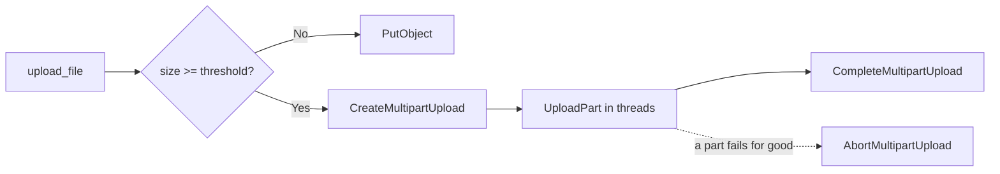

# Multipart Upload with boto3: Study Notes

Source: [S3 multipart upload using boto3 vs simple upload](https://www.youtube.com/watch?v=na192OdpiEM), Saadi AWS, 10:06.

The video uploads two files with a boto3 script configured for multipart, times them, and compares with a console upload. [`tutorial/21`](../tutorial/21_S3_Multipart_Upload_Study_Notes.md#3-mapping-the-design-onto-real-s3-apis) documents the **low-level** calls. This video uses boto3's **high-level** transfer, which makes those calls for you.

What was checked:
- Limits: [multipart limits](https://docs.aws.amazon.com/AmazonS3/latest/userguide/qfacts.html).
- Console multipart behavior: [Checking object integrity](https://docs.aws.amazon.com/AmazonS3/latest/userguide/checking-object-integrity-upload.html).
- boto3 defaults, the requests it sends for the video's settings, and abort on failure were **observed** with boto3 1.44.12 and s3transfer 0.19.3 against a local S3 mock (moto). The mock shows which requests the library makes. It says nothing about speed.
- The script in section 5 was run against the same mock. Nothing was run against AWS.

---

## Contents

1. [Two levels of API](#1-two-levels-of-api)
2. [TransferConfig](#2-transferconfig)
3. [The video's experiment](#3-the-videos-experiment)
4. [What the settings actually did](#4-what-the-settings-actually-did)
5. [A fairer comparison](#5-a-fairer-comparison)
6. [Corrections and gotchas](#6-corrections-and-gotchas)
7. [Cheat sheet](#7-cheat-sheet)
8. [Review questions](#8-review-questions)

---

## 1. Two levels of API

| | High-level: `upload_file`, `upload_fileobj` | Low-level: `create_multipart_upload`, `upload_part`, `complete_multipart_upload` | `put_object` |
|---|---|---|---|
| Chooses single or multipart | Yes, by size | You | Always single |
| Splits the file | Yes | You | No |
| Parallel parts | Threads | You | No |
| Tracks `ETag` values | Yes | You | No |
| On failure | Aborts the upload | You abort | Nothing to clean up |
| Resume a broken upload | No | Yes, with the upload ID and `list_parts` | No |
| Presigned part URLs for a browser | No | Yes | Single `PUT` only |
| Size limit | 48.8 TiB | 48.8 TiB | 5 GB |

---

## 2. TransferConfig

```python
from boto3.s3.transfer import TransferConfig

config = TransferConfig()  # the defaults
```

| Parameter | Default | Meaning |
|---|---|---|
| `multipart_threshold` | 8 MiB (8,388,608) | Files at or above this size use multipart |
| `multipart_chunksize` | 8 MiB | Part size |
| `max_concurrency` | 10 | Threads sending parts |
| `use_threads` | `True` | `False` sends everything from one thread |



---

## 3. The video's experiment

| Step | What happened |
|---|---|
| Settings (01:30-02:21) | Threshold 1 MB, chunk size 1 MB, default concurrency of 10. The presenter says chunks should be larger, but the files are small |
| 4.8 MB presentation file | About 19.8 s with boto3, about 5 s through the console |
| About 40 MB video | First attempt sent the old file because the script wasn't saved (07:38). The narration then gives about 22 s with boto3 and about 12 s through the console |
| Network | The presenter reads a slow upload speed from the system monitor (06:47) |
| Conclusion (09:42-09:58) | Multipart only pays off for larger files |

---

## 4. What the settings actually did

The same settings, replayed against the mock:

| Settings and file | Requests observed | Part sizes |
|---|---|---|
| Video's 1 MB settings, 4.8 MiB | Create, **one** `UploadPart`, Complete | 4.8 MiB |
| Video's 1 MB settings, 40 MiB | Create, **eight** `UploadPart`, Complete | 5 MiB each |
| Defaults, 4.8 MiB | One `PutObject` | 4.8 MiB |
| Defaults, 40 MiB | Create, five `UploadPart`, Complete | 8 MiB each |

- **The 1 MB chunk size was never used.** boto3 raised it to the 5 MiB minimum, without a warning.
- So the small file went up as a "multipart" upload with a single part. There was nothing to run in parallel, and in requests it differed from a plain upload only by two extra API calls. Those are unlikely to explain a gap of about 15 seconds.
- **The console is probably not a "simple upload" for the larger file.** AWS documents that the console uses multipart upload for some operations on objects over 16 MB. At about 40 MB the video was very likely comparing multipart with multipart.
- The two methods ran one after the other, once each, by hand and by stopwatch.

The conclusion (small files don't benefit) is reasonable, but these timings don't demonstrate it.

---

## 5. A fairer comparison

Same code path for timing, same machine, alternating runs, median reported.

Save as `compare_uploads.py`:

```python
# /// script
# requires-python = ">=3.10"
# dependencies = ["boto3"]
# ///
"""Time put_object against upload_file on the same file, alternating runs."""

import statistics
import sys
import time

import boto3
from boto3.s3.transfer import TransferConfig

MIB = 1024 * 1024
RUNS = 3


def timed(action) -> float:
    start = time.perf_counter()
    action()
    return time.perf_counter() - start


def main(bucket: str, path: str) -> None:
    s3 = boto3.client("s3")
    config = TransferConfig(
        multipart_threshold=8 * MIB, multipart_chunksize=8 * MIB, max_concurrency=10
    )

    def single() -> None:
        with open(path, "rb") as body:
            s3.put_object(Bucket=bucket, Key="bench/single", Body=body)

    def managed() -> None:
        s3.upload_file(path, bucket, "bench/managed", Config=config)

    results = {"put_object": [], "upload_file": []}
    for _ in range(RUNS):
        results["put_object"].append(timed(single))
        results["upload_file"].append(timed(managed))

    for name, seconds in results.items():
        runs = ", ".join(f"{value:.2f}" for value in seconds)
        print(f"{name:12} median {statistics.median(seconds):.2f}s  (runs: {runs})")


if __name__ == "__main__":
    main(sys.argv[1], sys.argv[2])
```

```bash
dd if=/dev/urandom of=big.bin bs=1M count=200
uv run compare_uploads.py my-bucket big.bin

# Clean up (transfer and storage are billed)
aws s3 rm s3://my-bucket/bench/ --recursive
rm -f big.bin
```

Try 4 MiB, 40 MiB and 400 MiB files. On a link that one connection already fills, expect little difference; parallel parts help when a single connection can't use the available bandwidth.

---

## 6. Corrections and gotchas

| Point | Detail |
|---|---|
| Largest object "5 TB" (00:22) | The current figure is 48.8 TiB. The single `PUT` limit of 5 GB is right |
| Chunk sizes under 5 MiB | Silently raised by boto3. In the low-level API, completion fails with `EntityTooSmall` instead |
| `max_concurrency` | Threads share your bandwidth and memory. Lower it on a constrained machine |
| `use_threads=False` | `max_concurrency` then has no effect |
| Huge files | The part count is capped at 10,000, so larger files need larger parts |
| Killed process | The automatic abort can't run. Keep a [lifecycle rule](06_S3_Multipart_Lifecycle_Cleanup_Study_Notes.md) |
| Metadata and content type | Pass them through `ExtraArgs={"ContentType": "video/mp4"}` |
| Progress | Pass a `Callback` that receives the number of bytes sent in each step |
| `ETag` | A multipart object's `ETag` ends in `-<part count>` and isn't a file MD5, so single and multipart uploads of one file get different values |

---

## 7. Cheat sheet

```
upload_file(path, bucket, key, ExtraArgs=..., Callback=..., Config=...)
Defaults    : threshold 8 MiB, chunk 8 MiB, concurrency 10, threads on
Below       : PutObject
At or above : Create -> UploadPart x N (threaded) -> Complete, abort on failure
Floor       : chunk size is raised to 5 MiB
Resume      : not offered; use the low-level API
Console     : can use multipart above 16 MB
```

---

## 8. Review questions

<details>
<summary>1. What are boto3's default multipart threshold, chunk size and concurrency?</summary>

8 MiB, 8 MiB and 10.
</details>

<details>
<summary>2. You set multipart_chunksize to 1 MiB and upload a 4.8 MiB file with a 1 MiB threshold. How many parts are sent?</summary>

One. The chunk size is raised to 5 MiB, which is larger than the file.
</details>

<details>
<summary>3. A part fails permanently during upload_file. What happens to the parts already sent?</summary>

boto3 aborts the multipart upload, which removes them. That can't happen if the process is killed.
</details>

<details>
<summary>4. Which API would you use to let a browser upload parts directly to S3?</summary>

The low-level calls: create the upload, presign upload_part for each part, then complete.
</details>

<details>
<summary>5. Why wasn't the video's console upload of a 40 MB file a single-request baseline?</summary>

The console can use multipart upload for objects over 16 MB, so it was very likely not a single request.
</details>

<details>
<summary>6. Can upload_file resume yesterday's half-finished upload?</summary>

No. It starts a new upload. Resuming needs the upload ID and list_parts with the low-level API.
</details>

<details>
<summary>7. Name two things you would change to compare upload methods fairly.</summary>

Use the same tool and timer for both, and run them several times in alternating order, reporting the median.
</details>
