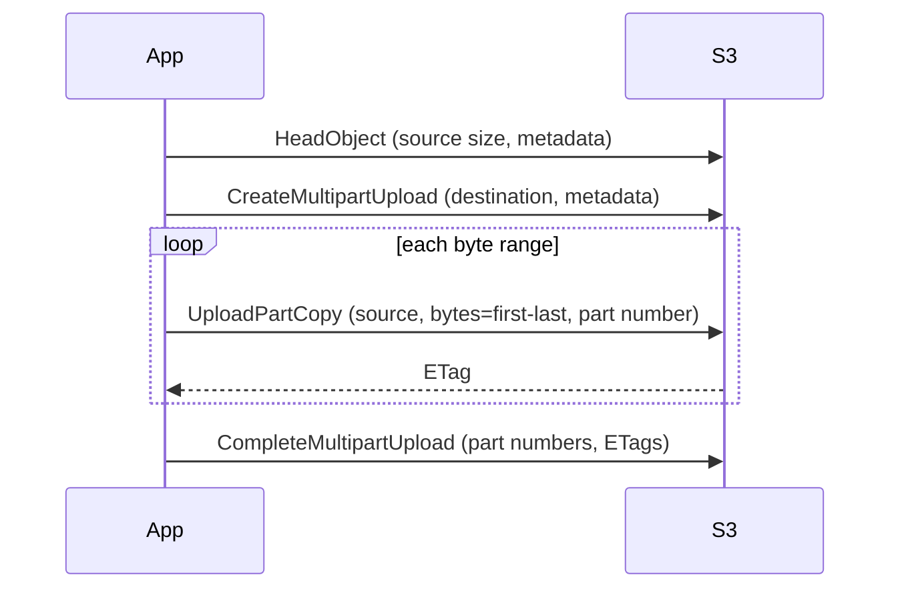

# Multipart Upload and Copy in Java: Study Notes

Source: [AWS S3 | Multipart Upload & Copy | Java](https://www.youtube.com/watch?v=_pm7yyyV3dA), Dev Problems, 7:33.

> **The transcript for this video is poor.** There are no English captions. The only track is auto-generated Hindi, which renders what sounds like English speech as Devanagari text, much of it meaningless. Only the technical terms and some phrases can be recovered. "What the video covers" below is limited to those, and details such as exact method calls, bucket names and the on-screen results are missing. Check the video itself before relying on any detail attributed to it. All code here comes from AWS material or was written for this note, not from the video.

[Note 00](00_S3_Multipart_Upload_Study_Notes.md) never covers copying with multipart. The video does, so section 3 treats `UploadPartCopy` properly.

What was checked:
- Limits: [multipart limits](https://docs.aws.amazon.com/AmazonS3/latest/userguide/qfacts.html).
- Copy limits and requests: [Copying an object using multipart upload](https://docs.aws.amazon.com/AmazonS3/latest/userguide/CopyingObjectsMPUapi.html), [`UploadPartCopy`](https://docs.aws.amazon.com/AmazonS3/latest/API/API_UploadPartCopy.html), [`upload_part_copy` range rule](https://docs.aws.amazon.com/sdk-for-python/v4/reference/clients/s3/operations/upload_part_copy/).
- Java: [SDK 1.x end of support](https://aws.amazon.com/blogs/developer/announcing-end-of-support-for-aws-sdk-for-java-v1-x-on-december-31-2025/), [S3 Transfer Manager](https://docs.aws.amazon.com/sdk-for-java/latest/developer-guide/transfer-manager.html), [`MultipartConfiguration`](https://docs.aws.amazon.com/java/api/latest/software/amazon/awssdk/services/s3/multipart/MultipartConfiguration.html).
- The Java code was not compiled. The Python script in section 4 was run against a local S3 mock (moto). Nothing was run against AWS.

---

## Contents

1. [What the video covers](#1-what-the-video-covers)
2. [The same thing in SDK for Java 2.x](#2-the-same-thing-in-sdk-for-java-2x)
3. [How multipart copy works](#3-how-multipart-copy-works)
4. [Multipart copy by hand](#4-multipart-copy-by-hand)
5. [Corrections and gotchas](#5-corrections-and-gotchas)
6. [Cheat sheet](#6-cheat-sheet)
7. [Review questions](#7-review-questions)

---

## 1. What the video covers

Approximate times. Only points that could be made out are listed.

| Time | Point |
|---|---|
| 00:00-00:35 | Multipart upload splits an object into parts uploaded independently; use it for large objects |
| 00:36-01:13 | Limits: part numbers 1 to 10,000, parts from 5 MB to 5 GB, no minimum for the last part |
| 01:35-02:25 | Java code using an S3 client and `TransferManager`, created with a builder. The presenter recommends it because it uses multiple threads internally |
| 02:45-02:57 | A 100 MB figure is used for the multipart threshold and the part size |
| 03:00-03:45 | The upload call takes a bucket name and file path, runs in the background, and the code waits for completion |
| 04:00-04:15 | The demo file is a video of a bit over 100 MB, so it goes as a 100 MB part plus the rest |
| 04:36-05:30 | Multipart **copy** works much like upload: give source and destination bucket and key, set a copy part size, add a progress listener to track bytes, wait for completion |
| 05:59-07:25 | The upload and then the copy are run |

The builder-style `TransferManager` is the SDK for Java **1.x** class.

---

## 2. The same thing in SDK for Java 2.x

SDK 1.x reached end of support on December 31, 2025. Use 2.x, with the `s3-transfer-manager` dependency (and optionally `aws-crt`).

```java
long partSize = 100L * 1024 * 1024;

S3AsyncClient s3 = S3AsyncClient.builder()
        .multipartEnabled(true)
        .multipartConfiguration(c -> c
                .thresholdInBytes(partSize)
                .minimumPartSizeInBytes(partSize))
        .build();

try (S3TransferManager transferManager = S3TransferManager.builder().s3Client(s3).build()) {
    // Upload
    UploadFileRequest upload = UploadFileRequest.builder()
            .putObjectRequest(r -> r.bucket("source-bucket").key("video.mp4"))
            .source(Paths.get("video.mp4"))
            .addTransferListener(LoggingTransferListener.create())
            .build();
    transferManager.uploadFile(upload).completionFuture().join();

    // Copy
    CopyObjectRequest copyObject = CopyObjectRequest.builder()
            .sourceBucket("source-bucket")
            .sourceKey("video.mp4")
            .destinationBucket("destination-bucket")
            .destinationKey("video.mp4")
            .build();
    CopyRequest copy = CopyRequest.builder()
            .copyObjectRequest(copyObject)
            .addTransferListener(LoggingTransferListener.create())
            .build();
    transferManager.copy(copy).completionFuture().join();
}
s3.close();
```

| 1.x | 2.x |
|---|---|
| `TransferManagerBuilder` | `S3TransferManager.builder()` |
| `upload(...)`, `copy(...)` returning handles | `uploadFile(...)`, `copy(...)` returning objects with a `completionFuture()` |
| `waitForCompletion()` | `completionFuture().join()` |
| Part size and threshold set on the transfer manager | Set on the S3 async client |

Defaults in 2.x: minimum part size 8 MiB, and the threshold equals the part size. Multipart copy copies the source's tags only when the request sets the tagging directive to `COPY`.

---

## 3. How multipart copy works

A copy never sends the data through your machine. S3 reads the source itself.



| Rule | Detail |
|---|---|
| When it is required | `CopyObject` handles up to 5 GB in one request; larger objects need multipart copy |
| Range format | `bytes=first-last`, zero based and inclusive: `bytes=0-104857599` is the first 100 MiB |
| Ranges and small sources | A range can be copied only if the source is larger than 5 MB |
| Part limits | Same as upload: 5 MiB to 5 GiB except the last, at most 10,000 |
| Permissions | `s3:GetObject` on the source and `s3:PutObject` on the destination, plus KMS permissions for encrypted objects |
| Metadata | Set it when you create the destination upload; the part copies carry data only |
| Errors | `NoSuchUpload` for a bad upload ID; `InvalidRequest` if the source can't be copied by range |

---

## 4. Multipart copy by hand

Save as `multipart_copy.py`. It carries over content type and metadata (not tags), and fails if the source changes during the copy.

```python
# /// script
# requires-python = ">=3.10"
# dependencies = ["boto3"]
# ///
"""Copy a large object with UploadPartCopy."""

import sys

import boto3

MIB = 1024 * 1024


def copy(source_bucket: str, key: str, target_bucket: str, part_size: int) -> int:
    s3 = boto3.client("s3")
    head = s3.head_object(Bucket=source_bucket, Key=key)
    size = head["ContentLength"]
    if size <= part_size:
        raise SystemExit("source fits in one part: use copy_object instead")

    upload_id = s3.create_multipart_upload(
        Bucket=target_bucket,
        Key=key,
        ContentType=head["ContentType"],
        Metadata=head["Metadata"],
    )["UploadId"]
    parts = []
    try:
        for number, first in enumerate(range(0, size, part_size), start=1):
            last = min(first + part_size, size) - 1
            result = s3.upload_part_copy(
                Bucket=target_bucket,
                Key=key,
                UploadId=upload_id,
                PartNumber=number,
                CopySource={"Bucket": source_bucket, "Key": key},
                CopySourceRange=f"bytes={first}-{last}",
                CopySourceIfMatch=head["ETag"],
            )
            parts.append({"PartNumber": number, "ETag": result["CopyPartResult"]["ETag"]})
        s3.complete_multipart_upload(
            Bucket=target_bucket, Key=key, UploadId=upload_id, MultipartUpload={"Parts": parts}
        )
    except BaseException:
        s3.abort_multipart_upload(Bucket=target_bucket, Key=key, UploadId=upload_id)
        raise
    return len(parts)


if __name__ == "__main__":
    part_mib = int(sys.argv[4]) if len(sys.argv) > 4 else 100
    count = copy(sys.argv[1], sys.argv[2], sys.argv[3], part_mib * MIB)
    print(f"copied in {count} parts")
```

```bash
uv run multipart_copy.py source-bucket video.mp4 destination-bucket
aws s3api head-object --bucket destination-bucket --key video.mp4

# Clean up the copy
aws s3 rm s3://destination-bucket/video.mp4
```

---

## 5. Corrections and gotchas

| Point | Detail |
|---|---|
| SDK version | The 1.x `TransferManager` is past end of support. New code should use 2.x |
| 100 MB threshold | A reasonable choice that matches AWS's guidance, but not the library default |
| Waiting for completion | The transfer runs in the background. Without waiting, the program can exit first, and failures go unseen |
| Killed process | Leaves an open upload in the destination bucket. Keep a [lifecycle rule](06_S3_Multipart_Lifecycle_Cleanup_Study_Notes.md) there |
| Copy changes the `ETag` | A different part layout gives a different multipart `ETag` for identical data. Don't use `ETag` equality to verify a copy; see [note 08](08_S3_Upload_Service_Resumable_Verified_Study_Notes.md#7-verification-with-s3-checksums) |
| Source changed mid-copy | Use the copy-source-if-match condition, as in the script |

---

## 6. Cheat sheet

```
Upload (2.x) : S3TransferManager.uploadFile(UploadFileRequest).completionFuture().join()
Copy (2.x)   : S3TransferManager.copy(CopyRequest).completionFuture().join()
Tuning       : S3AsyncClient multipartConfiguration: thresholdInBytes, minimumPartSizeInBytes
API copy     : HeadObject -> CreateMultipartUpload -> UploadPartCopy(range) x N -> Complete
CopyObject   : single request up to 5 GB
Range        : bytes=first-last, inclusive; source must be > 5 MB
Permissions  : s3:GetObject (source) + s3:PutObject (destination)
```

---

## 7. Review questions

<details>
<summary>1. When is multipart copy mandatory?</summary>

When the source object is larger than 5 GB, the limit of a single CopyObject request.
</details>

<details>
<summary>2. Which API call copies one part, and what identifies the data to copy?</summary>

UploadPartCopy, with the copy source and an optional byte range.
</details>

<details>
<summary>3. Write the range for the second 100 MiB part.</summary>

bytes=104857600-209715199.
</details>

<details>
<summary>4. Does the data pass through the machine running the copy?</summary>

No. S3 reads the source and writes the part itself.
</details>

<details>
<summary>5. What permissions does the caller need?</summary>

s3:GetObject on the source and s3:PutObject on the destination, plus KMS permissions where encryption requires them.
</details>

<details>
<summary>6. Why wait on the completion future?</summary>

Transfers run asynchronously, so without waiting the program may end early and miss failures.
</details>

<details>
<summary>7. Which Java SDK should a new project use, and why?</summary>

2.x. Version 1.x reached end of support on December 31, 2025.
</details>
