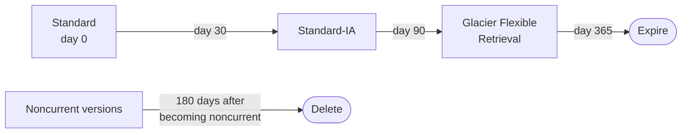
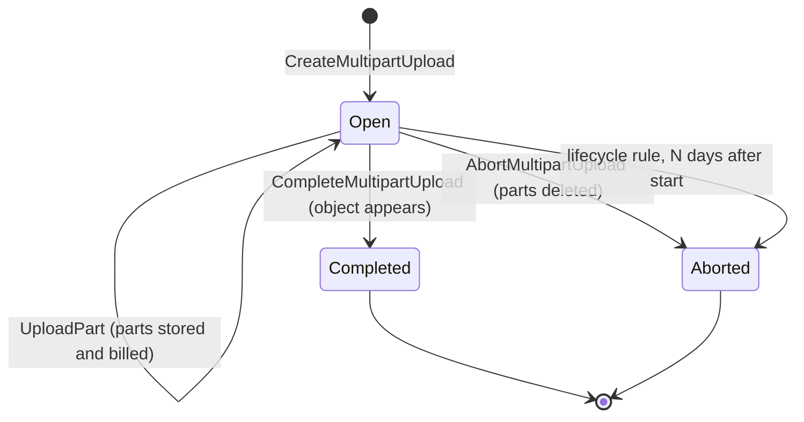

# S3 Lifecycle Rules and Cleaning Up Incomplete Multipart Uploads: Study Notes

Source: [Amazon S3 Lifecycle Management Tutorial | Clean Up Multipart Uploads & Reduce Costs](https://www.youtube.com/watch?v=PnZkMXj8SBI), IAAS Academy, 16:13.

[`tutorial/21`](../tutorial/21_S3_Multipart_Upload_Study_Notes.md#6-what-the-video-leaves-out) warns that abandoned multipart uploads keep billing and suggests an `AbortIncompleteMultipartUpload` rule, but never builds one. This video does, in the console, after a longer introduction to lifecycle rules in general.

What the video covers:
1. Transition and expiration actions, current and noncurrent versions, filters (00:00-04:44).
2. A worked tiering timeline (04:44-06:23).
3. Which transitions are allowed, and their constraints (06:24-12:27).
4. A console demo that deletes incomplete multipart uploads after 7 days (12:34-16:13).

What was checked:
- The abort action: [Deleting incomplete multipart uploads](https://docs.aws.amazon.com/AmazonS3/latest/userguide/mpu-abort-incomplete-mpu-lifecycle-config.html), and the tag-filter restriction in [lifecycle configuration examples](https://docs.aws.amazon.com/AmazonS3/latest/userguide/lifecycle-configuration-examples.html).
- Supported transitions and constraints: [Transitioning objects](https://docs.aws.amazon.com/AmazonS3/latest/userguide/lifecycle-transition-general-considerations.html). The 30-day rule for the IA classes: [lifecycle troubleshooting](https://repost.aws/knowledge-center/s3-lifecycle-configuration-rule).
- Expiration in versioned buckets: [Expiring objects](https://docs.aws.amazon.com/AmazonS3/latest/userguide/lifecycle-expire-general-considerations.html).
- Filters: [Adding filters to lifecycle rules](https://docs.aws.amazon.com/AmazonS3/latest/userguide/intro-lifecycle-filters.html).
- Timing: [why a rule hasn't run yet](https://repost.aws/knowledge-center/s3-lifecycle-rule-delay).
- The abort date headers: [`CreateMultipartUpload`](https://docs.aws.amazon.com/AmazonS3/latest/API/API_CreateMultipartUpload.html).
- Replace behavior: [`put_bucket_lifecycle_configuration`](https://docs.aws.amazon.com/boto3/latest/reference/services/s3/client/put_bucket_lifecycle_configuration.html).
- The JSON configurations were validated against the S3 request model in botocore. Nothing was run against a live AWS account, so no abort was observed.

---

## Contents

1. [Lifecycle rules in one page](#1-lifecycle-rules-in-one-page)
2. [The video's timeline](#2-the-videos-timeline)
3. [Allowed transitions and constraints](#3-allowed-transitions-and-constraints)
4. [Incomplete multipart uploads](#4-incomplete-multipart-uploads)
5. [The rule, in console and JSON](#5-the-rule-in-console-and-json)
6. [Same setup with the AWS CLI](#6-same-setup-with-the-aws-cli)
7. [Checking tutorial/21's lifecycle example](#7-checking-tutorial21s-lifecycle-example)
8. [Corrections and gaps](#8-corrections-and-gaps)
9. [Gotchas](#9-gotchas)
10. [Cheat sheet](#10-cheat-sheet)
11. [Review questions](#11-review-questions)

---

## 1. Lifecycle rules in one page

A lifecycle configuration belongs to a bucket and holds rules. Each rule has a scope, a status and one or more actions.

| Part | Options |
|---|---|
| Scope | Whole bucket, key prefix, object tags, object size, or a combination |
| Transition action | Move objects to another storage class after N days |
| Expiration action | Delete objects after N days |
| Noncurrent version actions | Separate transition and expiry for old versions |
| Abort action | Stop multipart uploads not completed N days after they started |

Rules apply to objects already in the bucket as well as new ones.

---

## 2. The video's timeline



The video says the data moves to Glacier "after say another 60 days", which is day 90. For old versions it says they may be needed for 30 days and can be discarded after about 180.

```json
{
  "Rules": [
    {
      "ID": "tier-and-expire-reports",
      "Status": "Enabled",
      "Filter": { "Prefix": "reports/" },
      "Transitions": [
        { "Days": 30, "StorageClass": "STANDARD_IA" },
        { "Days": 90, "StorageClass": "GLACIER" }
      ],
      "Expiration": { "Days": 365 },
      "NoncurrentVersionExpiration": { "NoncurrentDays": 180 }
    }
  ]
}
```

`GLACIER` is the API name for Glacier Flexible Retrieval. The prefix `reports/` is my example.

**"Expire" doesn't always delete.** In a versioning-enabled bucket, expiring the current version adds a delete marker and the data becomes a noncurrent version. Only the noncurrent expiry removes it, so in this configuration the bytes can stay up to 180 days past day 365.

---

## 3. Allowed transitions and constraints

Transitions only go "down the waterfall" (06:29-08:05).

| From | Can move to |
|---|---|
| Standard | Standard-IA, Intelligent-Tiering, One Zone-IA, Glacier Instant, Glacier Flexible, Deep Archive |
| Standard-IA | Intelligent-Tiering, One Zone-IA, Glacier Instant, Glacier Flexible, Deep Archive |
| Intelligent-Tiering, frequent or infrequent access tier | One Zone-IA, Glacier Instant, Glacier Flexible, Deep Archive |
| Intelligent-Tiering, archive instant access tier | Glacier Instant, Glacier Flexible, Deep Archive |
| Intelligent-Tiering, archive access tier | Glacier Flexible, Deep Archive |
| Intelligent-Tiering, deep archive access tier | Deep Archive |
| One Zone-IA | Glacier Flexible, Deep Archive |
| Glacier Instant | Glacier Flexible, Deep Archive |
| Glacier Flexible | Deep Archive |

Nothing transitions into Reduced Redundancy.

| Constraint | Detail |
|---|---|
| Small objects | Since September 2024, objects under 128 KB aren't transitioned by default. An object size filter overrides this. Configurations made earlier keep the old behavior until edited |
| Standard to an IA class | Objects must be at least 30 days old |
| Chained transitions | One rule can't move an object again before the current class's minimum storage duration has passed |
| Leaving a class early | Allowed through two rules, but you pay for the rest of the minimum duration |
| Minimum durations | Standard-IA 30 days, Glacier Instant 90, Glacier Flexible 90, Deep Archive 180 |
| Archive transitions | Asynchronous, so the move can lag the rule date |

---

## 4. Incomplete multipart uploads

A multipart upload has three possible ends: completed, aborted, or still open. An open one has no expiry.



The video's points (12:34-14:33):
- A failed or forgotten upload leaves parts that can't become an object.
- They take storage and cost money.
- They tend not to show up in the console, so people forget them.

### Finding them

```bash
aws s3api list-multipart-uploads --bucket my-bucket
aws s3api list-parts --bucket my-bucket --key big.bin --upload-id "$UPLOAD_ID"
```

Across many buckets, [S3 Storage Lens](https://docs.aws.amazon.com/AmazonS3/latest/userguide/storage-lens-optimize-storage.html) has an "incomplete multipart upload bytes greater than 7 days old" metric.

---

## 5. The rule, in console and JSON

### Console (15:01-16:02)

1. Bucket > **Management** > **Create lifecycle rule**.
2. Name it (the video: "delete incomplete uploads").
3. Apply to all objects and tick the acknowledgement.
4. Select **Delete expired object delete markers or incomplete multipart uploads**.
5. Select **Delete incomplete multipart uploads**, 7 days.
6. Create the rule.

### JSON

```json
{
  "Rules": [
    {
      "ID": "abort-incomplete-mpu",
      "Status": "Enabled",
      "Filter": {},
      "AbortIncompleteMultipartUpload": { "DaysAfterInitiation": 7 }
    }
  ]
}
```

An empty filter means the whole bucket. To limit it, use `{ "Prefix": "uploads/" }`.

### How the timing works

| Question | Answer |
|---|---|
| When does the clock start? | When the upload is **started**, not when the last part arrived |
| Is it aborted exactly at day 7? | It becomes eligible. Lifecycle runs once a day, rounds to midnight UTC and acts asynchronously |
| Does it affect uploads started before the rule? | Yes |
| Does it touch completed objects? | No |
| Early deletion fees? | None for removing incomplete parts |
| Can it be limited by tag? | No. The rule can't have a tag filter. A prefix works |

So a healthy but very slow upload that runs past the limit gets aborted, and its next call fails with `NoSuchUpload`. Choose N longer than your slowest legitimate upload, including paused and resumed ones.

---

## 6. Same setup with the AWS CLI

Creates a real bucket (small charges). It confirms the rule is attached **without waiting days**: when a rule matches, `create-multipart-upload` reports `AbortDate` and `AbortRuleId`.

```bash
export AWS_REGION=us-east-1
BUCKET="lifecycle-study-$(aws sts get-caller-identity --query Account --output text)"
aws s3api create-bucket --bucket "$BUCKET"

cat > lifecycle.json <<'EOF'
{
  "Rules": [
    {
      "ID": "abort-incomplete-mpu",
      "Status": "Enabled",
      "Filter": {},
      "AbortIncompleteMultipartUpload": { "DaysAfterInitiation": 7 }
    }
  ]
}
EOF
aws s3api put-bucket-lifecycle-configuration --bucket "$BUCKET" \
  --lifecycle-configuration file://lifecycle.json
aws s3api get-bucket-lifecycle-configuration --bucket "$BUCKET"

# Leave an upload unfinished on purpose. Look for AbortDate and AbortRuleId.
# Rule changes can take a few minutes to apply; if they are missing, try again shortly.
aws s3api create-multipart-upload --bucket "$BUCKET" --key big.bin

UPLOAD_ID=$(aws s3api list-multipart-uploads --bucket "$BUCKET" \
  --query 'Uploads[0].UploadId' --output text)
dd if=/dev/urandom of=part1.bin bs=1M count=5
aws s3api upload-part --bucket "$BUCKET" --key big.bin --upload-id "$UPLOAD_ID" \
  --part-number 1 --body part1.bin
aws s3api list-parts --bucket "$BUCKET" --key big.bin --upload-id "$UPLOAD_ID"

# Clean up: abort every open upload, then delete the bucket
aws s3api list-multipart-uploads --bucket "$BUCKET" \
  --query 'Uploads[].[Key, UploadId]' --output text |
while IFS=$'\t' read -r key upload_id; do
  [ -n "$upload_id" ] || continue   # the CLI prints "None" when there are no uploads
  aws s3api abort-multipart-upload --bucket "$BUCKET" --key "$key" --upload-id "$upload_id"
done
aws s3api delete-bucket --bucket "$BUCKET"
rm -f lifecycle.json part1.bin
```

### Adding to a bucket that already has rules

`put-bucket-lifecycle-configuration` **replaces the whole configuration**. Read the current one, add your rule to its `Rules` array, and put the full result back:

```bash
aws s3api get-bucket-lifecycle-configuration --bucket my-bucket > lifecycle.json
# edit lifecycle.json: append the new rule to "Rules"
aws s3api put-bucket-lifecycle-configuration --bucket my-bucket \
  --lifecycle-configuration file://lifecycle.json
```

The read fails with an error if the bucket has no configuration yet; in that case there is nothing to preserve.

---

## 7. Checking tutorial/21's lifecycle example

`tutorial/21` section 7 uses this rule: ID `AbortStaleMultipartUploads`, `"Filter": {}`, `DaysAfterInitiation: 3`.

| Claim | Result |
|---|---|
| `"Filter": {}` applies to the whole bucket | Confirmed by the filters page. AWS's CLI example writes `{"Prefix": ""}`, which has the same effect |
| JSON field names and types | Pass validation against the S3 request model |
| `put-bucket-lifecycle-configuration` command | Correct, with the caveat that it replaces any existing rules, which the note doesn't mention |
| Stopping an upload has no early-delete fee (section 6) | Confirmed |
| Open uploads bill until completed or aborted (section 9) | Confirmed |
| Live behavior | Still not observed. It takes at least a day |

---

## 8. Corrections and gaps

| In the video | What to know |
|---|---|
| Intelligent-Tiering can transition "into IA" (as captioned, 07:15) | Standard-IA isn't a target from Intelligent-Tiering. One Zone-IA is |
| Expedited retrieval when you need "instant access" (05:22) | Expedited is typically 1-5 minutes. Millisecond access needs Glacier Instant Retrieval or a warmer class |
| Glacier Instant data must stay 90 days before moving down (11:58) | True within a single rule. Otherwise it's a billing minimum: you can move earlier and pay the remainder |
| Parts are deleted "after 7 days" (15:56) | Eligible after 7 days from the start; removal happens on a later daily run |
| Apply by "prefix and tags" (04:16) | Fine for transitions and expiry, but the abort action can't use tags |
| No mention of versioning when expiring | Expiry on a versioned bucket adds a delete marker |
| No mention of existing configurations | The CLI and API replace the whole configuration |

---

## 9. Gotchas

1. **The days count from initiation.** Long-running uploads can be aborted mid-flight.
2. **Nothing happens the moment you create the rule.** Allow for the daily run.
3. **A prefix with a leading slash doesn't match** the way you expect. Use `uploads/`, not `/uploads/`.
4. **Writing a new configuration can erase old rules.**
5. **A bucket policy can't block lifecycle actions.** A deny-all policy doesn't stop expiry or transitions.
6. **Transitions cost a request per object.** Many small objects can cost more to move than they save.
7. **A rule is per bucket.** New upload buckets need their own, ideally from your infrastructure template.

---

## 10. Cheat sheet

```
Actions        : Transitions, Expiration, NoncurrentVersion*, AbortIncompleteMultipartUpload
Scope          : {} (all) | Prefix | Tag | ObjectSizeGreaterThan/LessThan | And
Abort rule     : "AbortIncompleteMultipartUpload": { "DaysAfterInitiation": N }, no tag filter
Clock          : from CreateMultipartUpload; daily run, midnight UTC rounding, asynchronous
Verify now     : create-multipart-upload shows AbortDate + AbortRuleId
Apply          : put-bucket-lifecycle-configuration (replaces everything)
Find leftovers : list-multipart-uploads, list-parts, Storage Lens
Transitions    : one way, down the waterfall; <128 KB skipped by default
Minimum days   : Standard-IA 30, Glacier Instant 90, Flexible 90, Deep Archive 180
Versioned      : expiry adds a delete marker; use noncurrent expiry to free space
```

---

## 11. Review questions

<details>
<summary>1. Why do incomplete multipart uploads cost money without being noticed?</summary>

Their parts are stored and billed until the upload is completed or aborted, and they don't appear as objects in a normal listing or in the console's object view.
</details>

<details>
<summary>2. Which lifecycle action removes them, and what is its one setting?</summary>

AbortIncompleteMultipartUpload, with DaysAfterInitiation.
</details>

<details>
<summary>3. A rule says 7 days. An upload started 8 days ago and received a part an hour ago. Is it safe?</summary>

No. The clock runs from initiation, so it is eligible to be aborted.
</details>

<details>
<summary>4. How can you confirm the rule applies to new uploads without waiting?</summary>

Start an upload and look for AbortDate and AbortRuleId in the response.
</details>

<details>
<summary>5. What does "Filter": {} mean?</summary>

The rule applies to the whole bucket.
</details>

<details>
<summary>6. Can the abort action be limited to objects with a particular tag?</summary>

No. A rule with this action can't use a tag filter. A key prefix can limit it.
</details>

<details>
<summary>7. You put a configuration containing only the abort rule onto a bucket that already expired old logs. What happens?</summary>

The new configuration replaces the old one, so the log expiry rule is gone.
</details>

<details>
<summary>8. What does expiring the current version do in a versioning-enabled bucket?</summary>

It adds a delete marker. The previous data remains as a noncurrent version until a noncurrent version expiry removes it.
</details>

<details>
<summary>9. Can a lifecycle rule move an object from Standard-IA back to Standard?</summary>

No. Lifecycle transitions only go down the waterfall.
</details>

<details>
<summary>10. Will a rule transition a 50 KB object by default?</summary>

No. Objects under 128 KB are skipped unless the rule sets an object size filter that allows them.
</details>

<details>
<summary>11. One rule moves objects to Glacier Instant Retrieval at day 4 and to Deep Archive at day 20. Valid?</summary>

No. Glacier Instant Retrieval has a 90 day minimum, so the second transition in the same rule must be at day 94 or later.
</details>

<details>
<summary>12. Is there a charge for aborting an incomplete upload that was stored in an archive class?</summary>

There are no early deletion charges for removing incomplete multipart upload parts.
</details>
