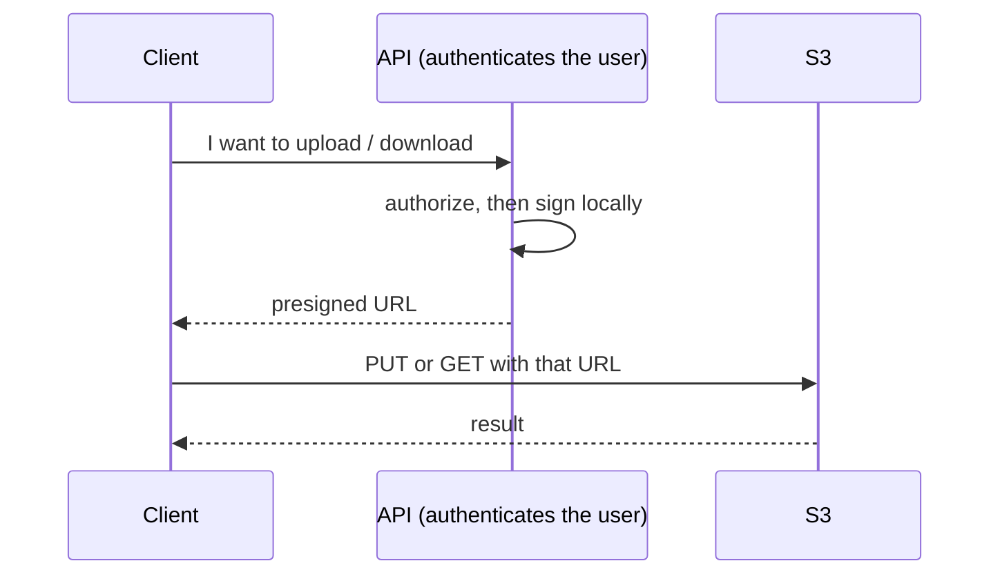

# S3 Presigned URLs for Uploads and Downloads: Study Notes

Source: [Amazon S3 Presigned URLs Uploads and Downloads Tutorial](https://www.youtube.com/watch?v=V2arOZ72d6M), 14:46. The presenter gives the name Milan, and the `mjtech` bucket prefix matches [note 01](01_S3_Multipart_Comprehensive_Study_Notes.md)'s video. The video says AWS sponsored it (00:35).

[`tutorial/21`](../tutorial/21_S3_Multipart_Upload_Study_Notes.md) only covers presigned URLs for uploading parts. This video covers the basic single-object case in both directions, **upload (`PUT`) and download (`GET`)**, from a .NET 9 web API. No multipart.

What was checked:
- Signing, reuse, expiry and failure causes: [Download and upload objects with presigned URLs](https://docs.aws.amazon.com/AmazonS3/latest/userguide/using-presigned-url.html).
- Response header overrides on downloads: [`GetObject`](https://docs.aws.amazon.com/AmazonS3/latest/API/API_GetObject.html).
- Signed header mismatch: [troubleshooting presigned URLs](https://repost.aws/knowledge-center/s3-presigned-url-signature-mismatch).
- CORS: [Using CORS](https://docs.aws.amazon.com/AmazonS3/latest/userguide/cors.html).
- The C# is reconstructed from the narration and was not compiled. The Python script in section 5 was run against a local S3 mock (moto), which checks the flow but not S3's signature enforcement. Nothing was run against AWS.

---

## Contents

1. [Why presigned URLs](#1-why-presigned-urls)
2. [Console demo](#2-console-demo)
3. [Upload URL](#3-upload-url)
4. [Download URL](#4-download-url)
5. [Both directions in Python](#5-both-directions-in-python)
6. [What about CORS?](#6-what-about-cors)
7. [Corrections and gotchas](#7-corrections-and-gotchas)
8. [Cheat sheet](#8-cheat-sheet)
9. [Review questions](#9-review-questions)

---

## 1. Why presigned URLs

| Server in the middle (00:51-01:51) | Presigned URL (01:51-03:19) |
|---|---|
| Bucket stays private | Bucket stays private |
| File crosses the network twice | File goes straight between client and S3 |
| Slow for large files | Server only signs |
| Server controls access on every byte | Server controls access when it issues the URL |



---

## 2. Console demo

- New general purpose buckets block all public access (03:41).
- Opening the object URL gives access denied (04:20).
- Opening the object from the console works, because the console's request is authenticated.
- **Share with a presigned URL**, for example for 1 minute, and the link works in any browser until it expires.

---

## 3. Upload URL

```csharp
app.MapPost("pre-signed", (
    string contentType,
    IAmazonS3 s3Client,
    IOptions<S3Settings> s3Options) =>
{
    try
    {
        var request = new GetPreSignedUrlRequest
        {
            BucketName = s3Options.Value.BucketName,
            Key = $"invoices/{Guid.NewGuid()}",
            Verb = HttpVerb.PUT,
            ContentType = contentType,
            Expires = DateTime.UtcNow.AddMinutes(1)
        };

        var url = s3Client.GetPreSignedURL(request);

        return Results.Ok(new { key = request.Key, url });
    }
    catch (AmazonS3Exception)
    {
        return Results.BadRequest("Error generating pre-signed URL");
    }
});
```

The client side, which the video simulates inside the same endpoint (08:55-11:00):

```csharp
using var httpClient = new HttpClient();
await using var file = File.OpenRead(invoicePath);
using var content = new StreamContent(file);
content.Headers.ContentType = new MediaTypeHeaderValue("application/pdf");

var response = await httpClient.PutAsync(url, content);
```

The `Content-Type` must be the one the URL was signed with, or the request fails (11:50-12:01).

One minute is enough because S3 checks expiry when the request **starts**. An upload that begins in time is not cut off.

---

## 4. Download URL

```csharp
app.MapGet("pre-signed", (
    string key,
    IAmazonS3 s3Client,
    IOptions<S3Settings> s3Options) =>
{
    var request = new GetPreSignedUrlRequest
    {
        BucketName = s3Options.Value.BucketName,
        Key = $"invoices/{key}",
        Verb = HttpVerb.GET,
        Expires = DateTime.UtcNow.AddMinutes(1)
    };

    return Results.Ok(s3Client.GetPreSignedURL(request));
});
```

The PDF opens in the browser (13:56-14:09). Beyond the video, two things are useful on downloads:

| Need | How |
|---|---|
| Force a download with a chosen file name | Sign `response-content-disposition`. S3 returns it as the `Content-Disposition` header. Only signed requests may override response headers |
| Resume or seek | The client sends a `Range` header and gets only those bytes |

---

## 5. Both directions in Python

Save as `presigned_both.py`:

```python
# /// script
# requires-python = ">=3.10"
# dependencies = ["boto3"]
# ///
"""Upload with a presigned PUT, then download part of the object with a presigned GET."""

import sys
import urllib.request

import boto3
from botocore.config import Config


def main(bucket: str) -> None:
    # SigV4, with the bucket name in the host so the URL targets the bucket's Region
    config = Config(signature_version="s3v4", s3={"addressing_style": "virtual"})
    s3 = boto3.client("s3", config=config)
    key = "invoices/demo.pdf"
    body = b"%PDF-1.4 demo invoice bytes"

    put_url = s3.generate_presigned_url(
        "put_object",
        Params={"Bucket": bucket, "Key": key, "ContentType": "application/pdf"},
        ExpiresIn=60,
    )
    upload = urllib.request.Request(
        put_url, data=body, method="PUT", headers={"Content-Type": "application/pdf"}
    )
    with urllib.request.urlopen(upload) as response:
        print("PUT", response.status)

    get_url = s3.generate_presigned_url(
        "get_object",
        Params={
            "Bucket": bucket,
            "Key": key,
            "ResponseContentDisposition": 'attachment; filename="invoice.pdf"',
        },
        ExpiresIn=60,
    )
    download = urllib.request.Request(get_url, headers={"Range": "bytes=0-7"})
    with urllib.request.urlopen(download) as response:
        print("GET", response.status, response.headers["Content-Disposition"])
        print(response.read())


if __name__ == "__main__":
    main(sys.argv[1])
```

```bash
# The bucket's Region. boto3 reads AWS_DEFAULT_REGION, not AWS_REGION.
export AWS_DEFAULT_REGION=us-east-1
uv run presigned_both.py my-bucket

# The CLI can make download URLs only
aws s3 presign s3://my-bucket/invoices/demo.pdf --expires-in 60

# Clean up
aws s3 rm s3://my-bucket/invoices/demo.pdf
```

---

## 6. What about CORS?

The video never mentions CORS, and its demo can't run into it: uploads come from .NET's `HttpClient`, and the download is opened directly in the browser. CORS applies when **script on a web page** calls S3 from another origin.

| Case | Bucket CORS rule needed? |
|---|---|
| Server or command-line client | No |
| User follows a download link | No |
| Page uses `fetch` to download | Yes: `GET`, the page's origin |
| Page uses `fetch` or XHR to upload | Yes: `PUT`, the page's origin, the headers it sends |
| Page needs to read `ETag` (multipart) | Also `ExposeHeaders: ["ETag"]` |

So the video neither handles nor mishandles the `ExposeHeaders` problem that `tutorial/21` warns about. For a browser version of this app you would add the rule shown in [note 01 section 6](01_S3_Multipart_Comprehensive_Study_Notes.md#6-cors).

---

## 7. Corrections and gotchas

| Point | Detail |
|---|---|
| "The server is typically going to access S3 to obtain the pre-signed URL, validate the bucket" (02:33) | It doesn't. Signing is local. No request reaches S3 and nothing is validated until the URL is used |
| The URL "contains the required credentials" (02:00) | It carries the signer's access key ID, a signature and, for temporary credentials, a session token. The secret key is never in it |
| `catch (AmazonS3Exception)` around signing | Won't report a missing bucket or a lack of permission |
| Download endpoint accepts any key | Anyone who can call it gets any invoice. Check that the caller owns the key. The video says clients must be authenticated (03:05), but the demo code doesn't show it |
| Upload to an existing key | Overwrites it |
| URL reuse | Works repeatedly until expiry |
| Signed with a role | Expires with the role session if that comes first. An assumed role defaults to 1 hour |
| `SignatureDoesNotMatch` | Check method, headers and query string against what was signed, and the machine's clock |
| `403` on a correct URL | The signer lacks permission, or a bucket policy denies it |

---

## 8. Cheat sheet

```
Sign      : GetPreSignedURL(Verb=PUT|GET, Key, Expires, ContentType)   local operation
Upload    : PUT url, same Content-Type as signed
Download  : GET url; Range allowed; response-content-disposition to name the file
Expiry    : checked when the request starts; ends early with the signing credentials
CLI       : aws s3 presign = GET only
CORS      : only for browser script; ExposeHeaders only to read response headers
Authorize : in your API, before signing
```

---

## 9. Review questions

<details>
<summary>1. When does S3 first learn about a presigned URL?</summary>

When someone uses it. Signing happens locally.
</details>

<details>
<summary>2. A URL expires after 60 seconds and the upload takes 5 minutes. Does it fail?</summary>

Not if it starts within the 60 seconds. A retry after expiry would fail.
</details>

<details>
<summary>3. What makes an upload with a correct URL fail with a signature error?</summary>

A method, signed header or query value that differs from what was signed, such as another Content-Type. Clock drift can also cause it.
</details>

<details>
<summary>4. How can a download link make the browser save the file as invoice.pdf?</summary>

Sign the URL with response-content-disposition set to an attachment with that file name.
</details>

<details>
<summary>5. Where must authorization happen in this design?</summary>

In the API, before it signs. Whoever holds the URL can use it.
</details>

<details>
<summary>6. Why did the video's demo work without any CORS rule?</summary>

No script on a web page called S3. A .NET client uploaded and the browser opened the download directly.
</details>

<details>
<summary>7. Can aws s3 presign create the upload URL?</summary>

No. It creates GET URLs only.
</details>
