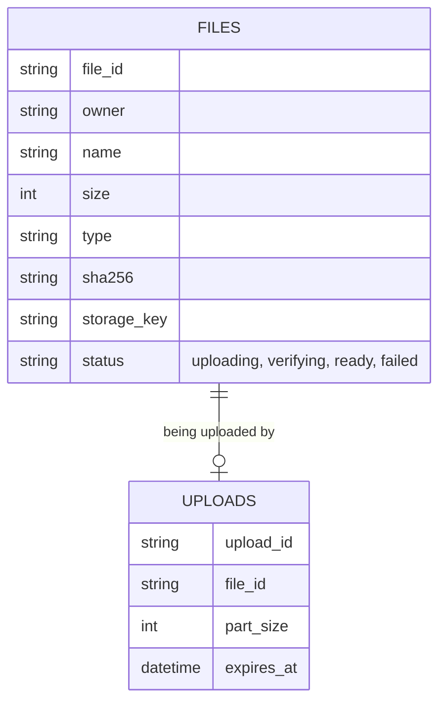
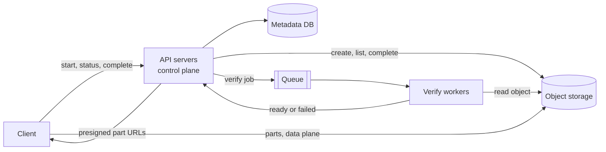

# Designing a Resumable, Presigned, Verified Upload Service: Study Notes

Source: [Design a File Upload Service: Resumable, Presigned, Verified](https://www.youtube.com/watch?v=z6OPj6Ostto), Prateek Goel / GrowAsEngineers, 39:17.

A system design walkthrough that starts with one upload server and breaks it with numbers. It fills the main gap in [note 00](00_S3_Multipart_Upload_Study_Notes.md#4-etag-what-it-actually-is): that note says the final multipart `ETag` is no whole-file checksum and stops there.

The video talks about checksums in general (MD5, CRC32C, SHA-256) and says storage checks them. It never names S3's checksum headers or checksum types. That mapping, in section 7, is added here, and it changes one of the video's design decisions.

What was checked:
- Checksum algorithms, full object and composite types: [Checking object integrity for uploads](https://docs.aws.amazon.com/AmazonS3/latest/userguide/checking-object-integrity-upload.html).
- Declared object size at completion: [`complete_multipart_upload`](https://docs.aws.amazon.com/sdk-for-python/v4/reference/clients/s3/operations/complete_multipart_upload/).
- Limits and completion behavior: [multipart limits](https://docs.aws.amazon.com/AmazonS3/latest/userguide/qfacts.html), [multipart overview](https://docs.aws.amazon.com/AmazonS3/latest/userguide/mpuoverview.html), [`CompleteMultipartUpload` errors](https://docs.aws.amazon.com/cli/latest/reference/s3api/complete-multipart-upload.html).
- Request rates and prefixes: [Performance design patterns](https://docs.aws.amazon.com/AmazonS3/latest/userguide/optimizing-performance-design-patterns.html).
- Lifecycle timing: [lifecycle delays](https://repost.aws/knowledge-center/s3-lifecycle-rule-delay).
- Presigned URLs: [using presigned URLs](https://docs.aws.amazon.com/AmazonS3/latest/userguide/using-presigned-url.html). Which headers a part URL signs was checked offline with boto3.
- The video's arithmetic was recalculated. Its server and database capacities are its own stated simulator assumptions, not AWS figures.
- The script in section 8 was run against a local S3 mock (moto): it completed and the read-back hash matched. The mock accepted a deliberately wrong checksum and a wrong object size, so the **rejection** behavior described here comes from AWS documentation only. Nothing was run against AWS.

---

## Contents

1. [Requirements and assumptions](#1-requirements-and-assumptions)
2. [Why it is hard: the numbers](#2-why-it-is-hard-the-numbers)
3. [API and data model](#3-api-and-data-model)
4. [From version one to the final design](#4-from-version-one-to-the-final-design)
5. [Failure handling](#5-failure-handling)
6. [Speed and scale](#6-speed-and-scale)
7. [Verification with S3 checksums](#7-verification-with-s3-checksums)
8. [Hands-on: S3 checks the whole object](#8-hands-on-s3-checks-the-whole-object)
9. [Variations](#9-variations)
10. [Corrections and gaps](#10-corrections-and-gaps)
11. [Gotchas](#11-gotchas)
12. [Cheat sheet](#12-cheat-sheet)
13. [Review questions](#13-review-questions)

---

## 1. Requirements and assumptions

| Functional | Non-functional |
|---|---|
| Files up to 5 GB | 100,000 uploads in progress at once |
| Split into parts, resume after a break | 99.9% of uploads succeed |
| Show progress, confirm the stored file matches | No corruption |
| Keep metadata: name, size, type, owner | Speed limited only by the network |
| Download (including byte ranges), share with access control | Clean up unfinished uploads |

Assumptions (02:55-03:44):

| Item | Value |
|---|---|
| Average file | 100 MB |
| One user's upload speed | 1.25 MB/s (10 Mbit/s) |
| Connection drops | About once per hour of uploading |
| One server's network link | 1.25 GB/s (10 Gbit/s) |
| Daily average load | Half of peak |
| Capacity (simulator defaults) | Database 10,000 queries/s, app server 8,000 requests/s, each kept under 80% |

---

## 2. Why it is hard: the numbers

| Challenge | Calculation | Result |
|---|---|---|
| Throughput | 100,000 x 1.25 MB/s | 125 GB/s, about 1 Tbit/s |
| Relay servers at 80% | 125 / (1.25 x 0.8) | 125 servers just moving bytes |
| Longest upload | 5,000 MB / 1.25 MB/s | 4,000 s, about 67 minutes |
| Chance of no drop | e^(-4000/3600) | About 33% |
| Finished uploads at peak | 100,000 / 80 s | 1,250/s |
| Uploads per day | 625/s x 86,400 | 54 million |
| Bytes per day | 54 million x 100 MB | 5.4 PB |
| Metadata per day | 54 million x 500 B | 27 GB |

The point: request counts are small, but the bytes are huge and each upload is exposed to a broken connection for a long time.

---

## 3. API and data model

| Call (10:38-11:14) | Purpose |
|---|---|
| `POST /uploads` with name, size, type, SHA-256 | Returns upload ID and part size (5 MB) |
| `PUT` part N with its checksum | Sends one part (later: straight to storage) |
| `GET /uploads/{id}` | Confirmed part numbers, used to resume |
| `POST /uploads/{id}/complete` with parts and checksums | Returns the file ID |
| `GET /files/{id}`, `POST /files/{id}/share` | Download (with ranges) and sharing links |



Bytes go to object storage. Rows go to the database, and each row stores the object key.

---

## 4. From version one to the final design

### Version one (12:42-13:41)

Load balancer, upload servers that stream the whole file into object storage, then a metadata row. The row is written **after** the bytes, so it never points at a missing file. For a team wiki with a few small uploads an hour, the video says to stop here.

### Problem 1: broken connections

Send 5 MB parts. A drop costs one part (about 4 seconds of work) instead of tens of minutes. Parts are independent, so several can go at once, and re-sending a part number replaces it, so retries are safe.

### Problem 2: the database

Recording one row per confirmed part means 25,000 writes a second, 250% of the database. **Let storage track the parts**: S3 multipart upload already knows them (`ListParts`). The database then sees only starts and finishes: 2,500/s, or 25%.

### Problem 3: the bytes

An upload server only decides "may this user put these bytes under this key". Split the **control plane** (decides) from the **data plane** (carries bytes) with presigned part URLs. The video signs URLs in batches covering about half an hour of parts, valid for an hour, and hands out fresh ones on resume.

### Problem 4: integrity

Each part carries a checksum that storage recomputes. A whole-file SHA-256, sent at the start, catches wrong part lists. The video verifies it **asynchronously**: `complete` sets the row to `verifying` and queues a job; workers read the object and set `ready` or `failed`. At peak that is 125 GB/s of reading, or 625 workers at 250 MB/s each and 80% load.

### Problem 5: abandoned uploads

If 1 in 100 uploads is abandoned halfway: 540,000 a day, about 27 TB of parts a day, about 9.9 PB after a year. Expire uploads after 24 hours with a lifecycle rule, plus a job that marks the database rows failed.

### Final design



### Downloads and sharing (24:49-25:36)

The API checks access, then returns a short-lived presigned `GET`. Range requests let a broken download resume and a video player seek. A sharing link points at the **API**, not at storage, so deleting the link stops new access at once; an already issued storage URL dies within minutes.

---

## 5. Failure handling

| What breaks (27:39-29:26) | Design's answer |
|---|---|
| An API server dies mid-upload | Parts go straight to storage; any server can handle `complete` |
| The database dies | In-flight parts continue; a replica takes over; clients retry `complete` |
| `complete` succeeds but the reply is lost | Make `complete` idempotent: a finished upload ID returns the same file ID |
| A client declares 1 MB and sends 5 GB | Sign each part URL with its exact length; check total size at completion; check quota at start |
| A presigned URL leaks | It covers one part of one upload for at most an hour |

Two S3 details for building this:

- **Length can be signed.** Passing `ContentLength` when presigning `upload_part` adds `content-length` to the signed headers, so a different size breaks the signature.
- **S3 can check the total.** `CompleteMultipartUpload` accepts the expected object size (`MpuObjectSize`) and rejects a mismatch with `400 InvalidRequest`.

For the lost reply, S3 itself may answer a repeated completion with `NoSuchUpload`, which is also what an aborted upload returns. Your service must check its own row, or the object, before reporting failure.

---

## 6. Speed and scale

**One connection has a ceiling** (25:38-26:50). With about 1 MB in flight and a 250 ms round trip, it moves about 4 MB/s. On a 50 MB/s line, either run about 13 parts in parallel, or shorten the round trip with [S3 Transfer Acceleration](https://docs.aws.amazon.com/AmazonS3/latest/userguide/transfer-acceleration.html). In the example, 5 GB then takes about 100 s instead of about 21 minutes.

**Request rate.** S3 supports at least 3,500 writes per second per partitioned prefix. 25,000 part writes at 80% need about nine prefixes, so the video starts keys with random-looking characters. AWS's advice is to use a stable set, such as one hash character (16 prefixes). Scaling is gradual and can return `503 Slow Down` meanwhile, so retry with backoff.

**Ten times the load** (29:29-30:56):

| Part of the system | At 10x | Change needed |
|---|---|---|
| Bytes | 1.25 TB/s | None on your side; it goes to storage |
| API | 37,500 requests/s | About 7 servers |
| Database | 375% of one | Shard by file ID into 5 |
| Part writes | 250,000/s | About 90 prefixes |
| Verify workers | 6,250 | Scale on queue length |

Sharding by owner would keep one user's files together, but a huge account would make one shard hot.

---

## 7. Verification with S3 checksums

S3 has two kinds of checksum for a multipart object:

| Type | What it covers | Algorithms |
|---|---|---|
| **Full object** | All bytes, first to last; you can supply the expected value at completion and S3 rejects a mismatch with `BadDigest` | CRC64NVME, CRC32, CRC32C only |
| **Composite** | A checksum of the part checksums | CRC32, CRC32C, SHA-1, SHA-256, MD5, SHA-512, XXHash variants |

So:

- S3 **cannot** compute a whole-file SHA-256 for a multipart upload. The video's worker pool is a real requirement if you need exactly that.
- S3 **can** verify a whole-file CRC at completion, with no workers. For detecting accidental damage and wrong or missing parts, that covers the video's goal immediately.

| Need | Use |
|---|---|
| Detect corruption in transit | Per-part checksum header |
| Detect a wrong or missing part | Full object CRC at completion, plus expected size |
| Resist deliberate tampering, deduplicate by content | SHA-256 computed by your own worker (or an S3 Batch Operations [compute checksum](https://aws.amazon.com/blogs/storage/efficiently-verify-amazon-s3-data-at-scale-with-compute-checksum-operation/) job if delay is acceptable) |
| Scan for viruses, make thumbnails | The queue and workers anyway |

A CRC is easy to forge on purpose. Don't treat it as a security control.

With presigned URLs, pass the checksum when signing (`ChecksumCRC32` or `ChecksumSHA256`). The header becomes part of the signature, the client must send it, and the bucket's CORS rule must allow it. With a SHA-256 part checksum signed this way, a leaked URL can't be used to upload different bytes.

---

## 8. Hands-on: S3 checks the whole object

Uploads with a full object CRC32 (from Python's standard library) and the expected size, then does the worker's SHA-256 check by reading the object back. It needs a bucket you own; it creates one object.

Save as `verified_upload.py`:

```python
# /// script
# requires-python = ">=3.10"
# dependencies = ["boto3"]
# ///
"""Multipart upload that S3 validates as a whole, plus a SHA-256 read-back check."""

import base64
import hashlib
import sys
import zlib
from pathlib import Path

import boto3

PART_SIZE = 5 * 1024 * 1024  # 5 MiB, the S3 minimum for all parts but the last


def crc32_base64(value: int) -> str:
    return base64.b64encode(value.to_bytes(4, "big")).decode()


def upload(s3, bucket: str, path: Path) -> str:
    key = path.name
    upload_id = s3.create_multipart_upload(
        Bucket=bucket, Key=key, ChecksumAlgorithm="CRC32", ChecksumType="FULL_OBJECT"
    )["UploadId"]
    parts, whole_crc, size, sha256 = [], 0, 0, hashlib.sha256()
    try:
        with path.open("rb") as source:
            number = 1
            while chunk := source.read(PART_SIZE):
                response = s3.upload_part(
                    Bucket=bucket,
                    Key=key,
                    UploadId=upload_id,
                    PartNumber=number,
                    Body=chunk,
                    ChecksumCRC32=crc32_base64(zlib.crc32(chunk)),
                )
                parts.append({"PartNumber": number, "ETag": response["ETag"]})
                whole_crc = zlib.crc32(chunk, whole_crc)
                sha256.update(chunk)
                size += len(chunk)
                number += 1
        s3.complete_multipart_upload(
            Bucket=bucket,
            Key=key,
            UploadId=upload_id,
            MultipartUpload={"Parts": parts},
            ChecksumType="FULL_OBJECT",
            ChecksumCRC32=crc32_base64(whole_crc),
            MpuObjectSize=size,
        )
    except BaseException:
        s3.abort_multipart_upload(Bucket=bucket, Key=key, UploadId=upload_id)
        raise
    return sha256.hexdigest()


def stored_sha256(s3, bucket: str, key: str) -> str:
    digest = hashlib.sha256()
    for chunk in s3.get_object(Bucket=bucket, Key=key)["Body"].iter_chunks(1024 * 1024):
        digest.update(chunk)
    return digest.hexdigest()


if __name__ == "__main__":
    bucket_name, file_path = sys.argv[1], Path(sys.argv[2])
    client = boto3.client("s3")
    expected = upload(client, bucket_name, file_path)
    actual = stored_sha256(client, bucket_name, file_path.name)
    print("ready" if actual == expected else "failed", actual)
```

```bash
dd if=/dev/urandom of=video.bin bs=1M count=12
uv run verified_upload.py my-bucket video.bin

aws s3api head-object --bucket my-bucket --key video.bin --checksum-mode ENABLED

# Clean up
aws s3 rm s3://my-bucket/video.bin
rm -f video.bin
```

---

## 9. Variations

| Change (32:18-34:42) | What moves |
|---|---|
| Only 200 KB profile pictures | No parts. One presigned URL, verify inline. The control plane grows (625,000 uploads/s for the same bytes), storage doesn't |
| Storage must never see plaintext, and phones can't hold keys | Bytes must pass through servers you control again |
| Many users upload the same file | Deduplicate by checksum. A checksum is not proof of possession, so limit it to one user, or deduplicate after upload (saves storage, not upload time) |
| Files up to 100 GB | 5 MB parts would need 20,000, over the 10,000 limit. Use at least 10 MB, choose part size from file size, and extend the expiry (about 22 hours at 1.25 MB/s) |

The video's four reusable patterns (31:11-31:48): separate the control and data planes; cut long jobs into small numbered, confirmable pieces; make every step safe to repeat; check end to end and do slow work after responding.

---

## 10. Corrections and gaps

| In the video | What to know |
|---|---|
| Parts of "5 MB" | The S3 minimum is 5 **MiB** (5,242,880 bytes). Parts of 5,000,000 bytes fail at completion |
| A drop lands halfway and loses 33 minutes (06:05) | With its own random-drop model, uploads that drop do so after about 27 minutes on average |
| Whole-file check needs a worker fleet | Needed for SHA-256. For accidental corruption, a full object CRC at completion does it in S3 (section 7) |
| A 24 hour lifecycle expiry means "at most a day of orphans" (24:44) | Rules run daily, round to midnight UTC and act asynchronously, so parts can last close to two days or more |
| Expiry of 24 hours | Counted from the start of the upload. Slow large uploads get cut off |
| Compare the size at completion yourself | S3 can enforce it with the expected object size |
| `complete` returns the same file ID on retry | Your API must provide that; S3 alone may report `NoSuchUpload` |
| `ListParts` for status | It returns 1,000 parts per page. A 5 GiB file in 5 MiB parts has 1,024 |

---

## 11. Gotchas

1. **MB and MiB differ** right at the minimum part size.
2. **Checksum type is set when the upload starts.** Declare algorithm and type on `CreateMultipartUpload`.
3. **Composite checksums need consecutive part numbers** starting at 1.
4. **A composite value is not the hash of the file.** Don't compare it with a local SHA-256.
5. **Batches of URLs expire together.** Hand out new ones on resume.
6. **URLs signed with role credentials** can expire before the hour you asked for.
7. **A verify queue needs idempotent workers**: a crashed worker's job is delivered again.
8. **Never serve a file until its status is `ready`.** The object exists in S3 while still `verifying`.

---

## 12. Cheat sheet

```
Planes        : API signs (control), client sends parts straight to S3 (data)
Parts         : >= 5 MiB except last, <= 10,000; pick size from file size
Resume        : ListParts (1,000 per page), send what is missing
Part check    : x-amz-checksum-*  -> mismatch rejected
Whole check   : FULL_OBJECT CRC64NVME/CRC32/CRC32C at completion -> BadDigest
Size check    : MpuObjectSize -> InvalidRequest on mismatch
SHA-256       : composite only in multipart; whole-file needs your own read
Idempotency   : part number replaces; handle repeated complete yourself
Cleanup       : lifecycle abort rule (days from start) + mark DB rows failed
Scale         : 3,500 writes/s per partitioned prefix; back off on 503
```

---

## 13. Review questions

<details>
<summary>1. Why does proxying uploads fail at 100,000 concurrent users in this design?</summary>

125 GB/s would pass through the upload servers twice, needing about 125 servers only to carry bytes they never inspect.
</details>

<details>
<summary>2. Why not store one database row per uploaded part?</summary>

It adds 25,000 writes a second, 2.5 times the assumed database capacity. S3 already tracks parts and can list them.
</details>

<details>
<summary>3. What is the difference between the control plane and the data plane here?</summary>

The API authorizes and signs (control). The file bytes go from the client directly to storage (data).
</details>

<details>
<summary>4. Which checksum algorithms can S3 validate as a full object checksum for a multipart upload?</summary>

CRC64NVME, CRC32 and CRC32C.
</details>

<details>
<summary>5. Your product requires a SHA-256 of the whole file. Can S3 produce it during a multipart upload?</summary>

No. SHA-256 is composite only for multipart. Compute it by reading the object afterwards.
</details>

<details>
<summary>6. Why verify asynchronously?</summary>

Reading a 5 GB file takes about 20 seconds at 250 MB/s. Holding the request open ties up the API and invites timeouts and retries.
</details>

<details>
<summary>7. How do you stop a client from uploading more than it declared?</summary>

Sign the exact content length into each part URL, check quota at the start, and pass the expected object size at completion.
</details>

<details>
<summary>8. A retry of complete returns NoSuchUpload. Does that mean the upload failed?</summary>

Not necessarily. It may already have completed. Check your status row or the object.
</details>

<details>
<summary>9. Files of 100 GB must be supported. What happens to a 5 MB part size?</summary>

It needs about 20,000 parts, over the 10,000 limit, so parts must be at least about 10 MB.
</details>

<details>
<summary>10. Why is a checksum not enough to deduplicate across users?</summary>

Knowing a checksum doesn't prove someone holds the file, so a user could claim another person's content.
</details>

<details>
<summary>11. Why should a sharing link point at the API and not at storage?</summary>

The API can check expiry and revocation on every click and issue a short-lived URL, so deleting the link takes effect at once.
</details>

<details>
<summary>12. Two ways to make a fast, distant user's upload reach full speed?</summary>

Send several parts in parallel, or shorten the round trip with an edge entry point such as S3 Transfer Acceleration.
</details>
