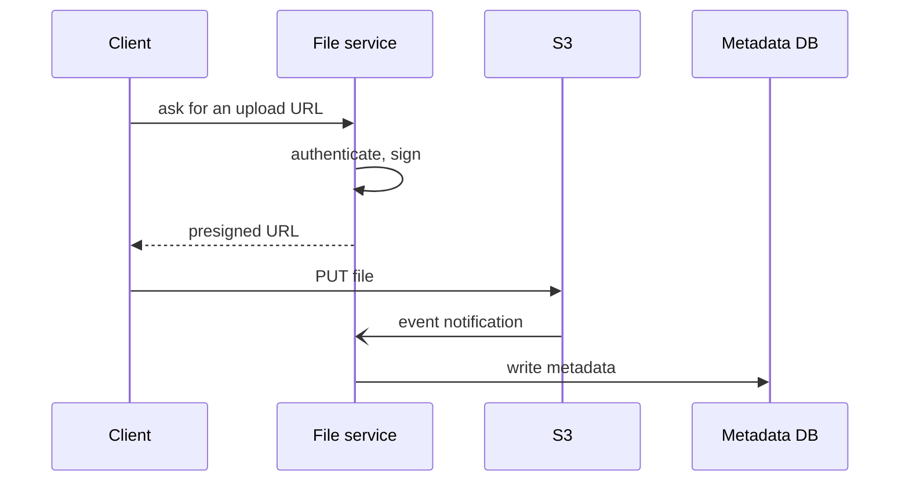
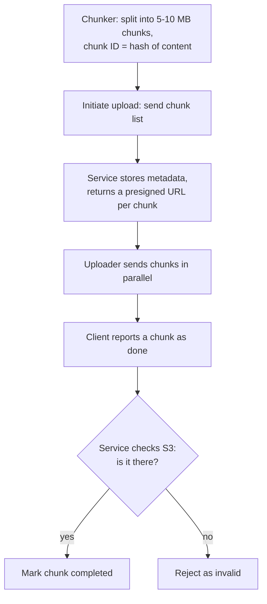

# Dropbox System Design: File Chunking and Resumable Uploads: Study Notes

Source: [Dropbox System Design Interview | File Chunking & Resumable Uploads (Ex-Amazon SDE)](https://www.youtube.com/watch?v=YalpMqop-wA), Avantika's Notes, 35:47.

A system design interview walkthrough, not an S3 tutorial. These notes take the **upload and chunking** parts. Sharing, sync and general scaling are listed as out of scope in section 6.

Read [`tutorial/21`](../tutorial/21_S3_Multipart_Upload_Study_Notes.md#2-the-six-step-design) first: it covers the S3 version of prepare, sign, upload, complete and resume.

Each point is marked as one of two kinds:

- **AWS fact**: checked against AWS documentation.
- **Design view**: the presenter's judgement (or mine, where stated). It isn't something documentation can confirm.

Sources: [multipart limits](https://docs.aws.amazon.com/AmazonS3/latest/userguide/qfacts.html), [multipart overview](https://docs.aws.amazon.com/AmazonS3/latest/userguide/mpuoverview.html), [uploading objects](https://docs.aws.amazon.com/AmazonS3/latest/userguide/upload-objects.html), [presigned URLs](https://docs.aws.amazon.com/AmazonS3/latest/userguide/using-presigned-url.html), [event notifications](https://docs.aws.amazon.com/AmazonS3/latest/userguide/EventNotifications.html) and [event types](https://docs.aws.amazon.com/AmazonS3/latest/userguide/notification-how-to-event-types-and-destinations.html), [strong consistency](https://docs.aws.amazon.com/AmazonS3/latest/userguide/Welcome.html), [DynamoDB item size](https://docs.aws.amazon.com/amazondynamodb/latest/developerguide/CheatSheet.html). Nothing was run against AWS.

---

## Contents

1. [Context](#1-context)
2. [The upload design in three steps](#2-the-upload-design-in-three-steps)
3. [Chunking and resume](#3-chunking-and-resume)
4. [Separate objects or S3 multipart?](#4-separate-objects-or-s3-multipart)
5. [Corrections and gaps](#5-corrections-and-gaps)
6. [Out of scope here](#6-out-of-scope-here)
7. [Cheat sheet](#7-cheat-sheet)
8. [Review questions](#8-review-questions)

---

## 1. Context

| Item | The video's choice (design view) |
|---|---|
| Large files | Tens of GB (02:16) |
| Consistency | Availability matters more; another device may see a change a few seconds later (02:26-02:59) |
| Raw bytes | S3, though any large-object store would do (07:14-07:46) |
| Metadata | DynamoDB, because lookups are by file ID and user ID (07:54-08:30) |
| Identity | Taken from a token in the request headers, never from the body (05:51-06:27) |

---

## 2. The upload design in three steps

### Step 1: through the file service (09:12-10:21)

The client sends the whole file to the service, which writes it to S3 and then writes the metadata.

| Problem raised | Kind |
|---|---|
| The bytes travel twice | Design view |
| Two independent writes: if the metadata write fails, the object is orphaned | Design view |

### Step 2: presigned URL plus an S3 notification (10:26-12:04)



### Step 3: chunks (12:07-20:42)

Step 2 is still bad for big files. The video's example: 100 GB at 100 Mbit/s (12.5 MB/s) takes about 8,000 seconds, 2 hours 13 minutes. A break means starting again, and there is no progress report.

**AWS fact:** it is worse than slow. A single `PUT` accepts at most 5 GB, so step 2 can't upload a 100 GB file at all.

---

## 3. Chunking and resume



| Chunk status | Meaning |
|---|---|
| Not started | Created by the chunker |
| In progress | Being uploaded |
| Completed | Stored in S3 and confirmed by the service |

**Resume (17:53-18:40).** With 100 chunks, 30 completed, 20 in progress and 50 not started, a recovered client skips the 30 and sends the other 70.

**Why check the client's report (16:48-17:46):** a bug or malicious client could claim a chunk that was never uploaded.

- **AWS fact:** S3 reads are strongly consistent after a successful write, so checking immediately is reliable.
- **My addition:** existence doesn't prove content. If the chunk ID is a SHA-256, sign it into the part URL as the SHA-256 checksum header. S3 then rejects different bytes.

**Why the video drops the S3 notification (18:42-19:30):** the client already reports each chunk, and updating metadata from two paths could leave client and server disagreeing (design view). **AWS facts** that bear on the choice:

| Fact about S3 event notifications | Consequence |
|---|---|
| Delivered at least once | A handler must tolerate duplicates |
| Usually seconds, sometimes a minute or longer | Not a good progress signal |
| For multipart uploads, the creation event is `CompleteMultipartUpload`; there is no per-part event | Notifications can't track part progress |

A reasonable middle ground (design view, mine): the client reports progress, and notifications or a periodic job reconcile what the client never reported.

**Claimed benefits (19:39-20:42):** resumable, faster through parallel uploads, trackable progress, consistent metadata, and little load on the backend.

---

## 4. Separate objects or S3 multipart?

The video uploads "chunks" with one URL each and says a downloader later stitches them together (21:40-21:57). It names S3 multipart upload only at the end, as a deeper topic for staff-level interviews (35:31). So its chunks behave like **separate objects**. That differs from multipart upload:

| | One object per chunk (video) | S3 multipart upload |
|---|---|---|
| Result in S3 | Many objects | One object after completion |
| Who reassembles | Your client | S3 |
| Part size rules | None from multipart | 5 MiB to 5 GiB, last part exempt |
| Maximum pieces | No multipart limit | 10,000 |
| Reusing unchanged data | Skip chunks with a known hash | Possible with [`UploadPartCopy`](05_S3_Multipart_Java_SDK_Study_Notes.md#3-how-multipart-copy-works) ranges |
| Listing what arrived | Your metadata, or object listing | `ListParts` |
| Cleaning abandoned data | Your own job or expiry rule; the abort rule doesn't apply | [`AbortIncompleteMultipartUpload`](06_S3_Multipart_Lifecycle_Cleanup_Study_Notes.md) |
| Download | Many requests, then stitch | One `GET`, or ranges |

If you map this design onto multipart, check the part size:

| 100 GB with | Parts | Fits in 10,000? |
|---|---|---|
| 5 MiB parts | 19,074 | No |
| 10 MiB parts | 9,537 | Yes (100 **GiB** would need 10,240) |

---

## 5. Corrections and gaps

| In the video | Kind | What to know |
|---|---|---|
| 100 GB upload presented as slow with one URL | AWS fact | Impossible with a single `PUT` (5 GB limit) |
| 5 MB chunks | AWS fact | As multipart parts, the minimum is 5 MiB, and 5 MiB parts can't hold 100 GB |
| Chunk list stored in the file's DynamoDB item (13:57, 23:25) | AWS fact | An item is at most 400 KB. 10,000 SHA-256 IDs in hex are already 640,000 bytes. Store chunks as separate items |
| "S3 sends back a notification saying upload complete" (16:14) | AWS fact | What the uploader receives is the HTTP response to its `PUT`. S3 Event Notifications are a different, server-side feature |
| Presigned URLs for every chunk at once | AWS fact | They expire. For a two hour upload, sign in batches |
| Hash as chunk ID | Design view (mine) | Identical chunks share an ID, so keep an ordered list of positions |
| Fixed-size chunks and change detection (27:34-28:06) | Design view (mine) | Inserting bytes near the start shifts every later chunk, changing all their hashes. Content-defined chunking addresses this |

---

## 6. Out of scope here

| Part of the video | Time |
|---|---|
| Interview technique, requirements and APIs in general | 00:00-06:30 |
| Download optimization with a CDN | 21:57-22:57 |
| Sharing, its tables and caching | 22:58-26:18 |
| Multi-device sync, polling and server-sent events | 26:20-32:12 (change detection by chunk hash is noted in section 5) |
| Scale estimates and service scaling | 33:25-35:10 |

None of these were checked.

---

## 7. Cheat sheet

```
Step 1  client -> service -> S3, then metadata        double transfer, orphan risk
Step 2  presigned PUT + event to write metadata       still one request, 5 GB cap
Step 3  chunks: hash IDs, URL per chunk, parallel     status per chunk, resume the rest
Verify  service checks S3 before marking complete     add a signed checksum to check content
Events  at least once, no per-part events
Mapping multipart: 10,000 parts max -> size parts from file size
Metadata one item per chunk (DynamoDB item <= 400 KB)
```

---

## 8. Review questions

<details>
<summary>1. What two problems does the first upload design have?</summary>

The file is transferred twice, and the S3 write and metadata write can diverge, leaving an orphaned object.
</details>

<details>
<summary>2. Can a 100 GB file be uploaded with one presigned PUT URL?</summary>

No. A single PUT is limited to 5 GB.
</details>

<details>
<summary>3. After an interruption with 30 chunks completed, 20 in progress and 50 not started, which are sent?</summary>

The 20 in progress and the 50 not started.
</details>

<details>
<summary>4. Why does the service check S3 before marking a chunk completed?</summary>

The client's report can be wrong or dishonest.
</details>

<details>
<summary>5. Do S3 event notifications report each uploaded part?</summary>

No. A multipart upload produces a creation event when it is completed.
</details>

<details>
<summary>6. Why is storing the whole chunk list in one DynamoDB item a problem?</summary>

Items are limited to 400 KB, and a large file's chunk list exceeds that.
</details>

<details>
<summary>7. Name two differences between one object per chunk and S3 multipart upload.</summary>

With separate objects your client reassembles the file and you clean up leftovers yourself. With multipart, S3 assembles one object, limits you to 10,000 parts and can abort incomplete uploads by lifecycle rule.
</details>
