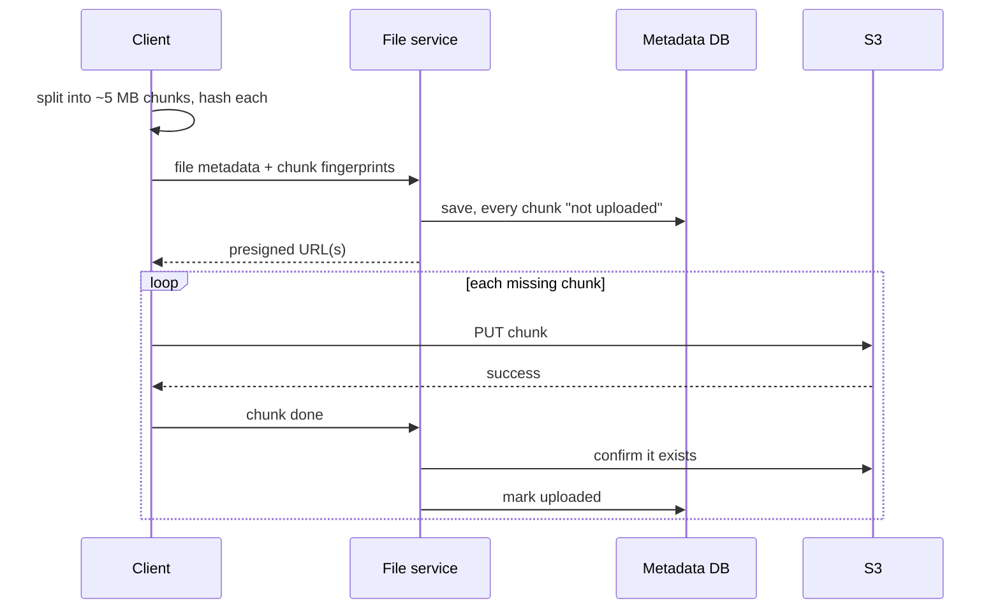

# Design Dropbox or Google Drive: the Upload and Chunking Part: Study Notes

Source: [Design Dropbox or Google Drive w/ an Ex-Meta Staff Engineer](https://www.youtube.com/watch?v=_UZ1ngy-kOI), Evan, Hello Interview, 58:08.

Scoped tightly to **uploading and chunking** (mainly 29:02-45:36). Everything else is listed in section 7 and was not checked. The design is close to [note 09](09_Dropbox_File_Chunking_Resumable_Study_Notes.md); this note concentrates on what is different or goes further. For the S3 version of the flow, read [`tutorial/21`](../tutorial/21_S3_Multipart_Upload_Study_Notes.md#2-the-six-step-design) first.

Each correction is marked **AWS fact** (checked against documentation) or **design view** (judgement that documentation can't confirm).

Sources: [multipart limits](https://docs.aws.amazon.com/AmazonS3/latest/userguide/qfacts.html), [API Gateway HTTP API quotas](https://docs.aws.amazon.com/apigateway/latest/developerguide/http-api-quotas.html) and [service quotas](https://docs.aws.amazon.com/general/latest/gr/apigateway.html), [presigned URLs](https://docs.aws.amazon.com/AmazonS3/latest/userguide/using-presigned-url.html), [event types](https://docs.aws.amazon.com/AmazonS3/latest/userguide/notification-how-to-event-types-and-destinations.html), [checksums](https://docs.aws.amazon.com/AmazonS3/latest/userguide/checking-object-integrity-upload.html), [DynamoDB item size](https://docs.aws.amazon.com/amazondynamodb/latest/developerguide/CheatSheet.html). Which headers a presigned URL signs was checked offline with boto3. Nothing was run against AWS.

---

## Contents

1. [Requirements that drive the upload design](#1-requirements-that-drive-the-upload-design)
2. [The simple version and its two limits](#2-the-simple-version-and-its-two-limits)
3. [Direct upload with a presigned URL](#3-direct-upload-with-a-presigned-url)
4. [Chunking, fingerprints and resume](#4-chunking-fingerprints-and-resume)
5. [Faster uploads](#5-faster-uploads)
6. [Corrections](#6-corrections)
7. [Out of scope here](#7-out-of-scope-here)
8. [Cheat sheet](#8-cheat-sheet)
9. [Review questions](#9-review-questions)

---

## 1. Requirements that drive the upload design

- Files up to **50 GB** (07:03-07:14).
- **Resumable** uploads (07:14-07:30).
- Uploads and downloads as fast as possible.
- High data integrity: once things settle, local and remote match (07:30-07:59).

---

## 2. The simple version and its two limits

The client posts the file to a file service, which stores it in S3 and writes metadata: ID, name, MIME type, size, owner, S3 link (16:27-18:49). The presenter says this only works for files of about 5-10 MB (29:28).

| Limit | Detail |
|---|---|
| Redundant transfer | Client to service, then service to S3 |
| Request body size | "AWS managed API Gateway has a limit of 10 megabytes" (30:29). **AWS fact:** confirmed, 10 MB, and not adjustable |

---

## 3. Direct upload with a presigned URL

The client sends only metadata. The service records it with a status such as "started", returns a presigned URL, and the client uploads straight to S3 (31:03-32:57).

Two statements here need correcting:

- **AWS fact:** S3 doesn't issue or sign the URL (31:51-32:09). Your service signs it **locally** with its own credentials. S3 checks the signature when the URL is used.
- **AWS fact:** the URL restricts type and size **only if** you sign those headers (`Content-Type`, `Content-Length`). An unsigned value isn't enforced.

The presenter isn't sure of the default lifetime (32:20). There is no single S3 default: it depends on the tool that signs (the AWS CLI uses 1 hour). Set it explicitly. The upload itself is a `PUT` to the URL; a `POST` form needs a presigned POST instead.

---

## 4. Chunking, fingerprints and resume

The video's example: 50 GB at 100 Mbit/s takes about 1 hour 12 minutes (33:13-33:31), which matches 50 GiB. Losing the connection halfway must not mean starting again.



| Idea | Detail |
|---|---|
| Fingerprint (37:00-37:23) | A hash of the chunk's bytes, used as the chunk ID. Preferred over tracking positions by index, which the video calls error-prone |
| Resume (36:12-36:27) | Fetch the metadata, compare fingerprints with the local file, upload what is missing |
| Trust but verify (39:28-39:54) | The client reports success; the service confirms with storage before updating status |
| Alternative (39:56-40:40) | Storage notifications tell the service about new objects, with no reliance on the client. More moving parts. The presenter would pick trust but verify |

### Multipart upload (40:43-41:23)

The presenter points to S3 multipart upload as doing this job, and notes that S3 sends no notification for each part.

| Claim | Verdict |
|---|---|
| No per-part S3 notification | **AWS fact:** correct. The event is for the completed upload |
| Multipart upload "handles the chunking on the client, the uploading, the fingerprinting, the comparing" | **AWS fact:** S3 itself doesn't split your file or find which chunks changed. An SDK or your client splits and uploads. S3 stores the parts, can list them, and validates any checksums you send |

How the video's ideas map onto multipart:

| Design idea | Multipart equivalent |
|---|---|
| Chunk list and status | `ListParts` is the record of what arrived |
| Verify a client's report | `ListParts`, comparing size and checksum |
| Fingerprint | Part checksum (`x-amz-checksum-sha256`), signed into the part URL |
| Mark the file complete | `CompleteMultipartUpload` |
| Clean up abandoned chunks | [Abort lifecycle rule](06_S3_Multipart_Lifecycle_Cleanup_Study_Notes.md) |

---

## 5. Faster uploads

| Technique | Detail | Kind |
|---|---|---|
| Parallel chunks (41:47-42:10) | Bandwidth is fixed, but several chunks in flight make better use of it | Design view, consistent with AWS's multipart guidance |
| Adaptive chunk size | Size chunks to network conditions | Design view. In multipart, stay within 5 MiB and 10,000 parts |
| Client-side compression (44:02-45:20) | Worth it for text-like files, little gain for JPEG, PNG or MP4. Record the algorithm in metadata | Design view |

If you compress, do it before computing checksums and splitting into parts, since S3 stores and verifies the bytes you send (mine).

---

## 6. Corrections

| In the video | Kind | What to know |
|---|---|---|
| 5 MB chunks for 50 GB (33:56-34:07) | AWS fact | 10,000 parts of 5 MiB hold 48.8 GiB (52.4 GB). That fits 50 GB narrowly but not 50 GiB. Pick the part size from the file size |
| Chunk list on the DynamoDB file item (35:17-35:47) | AWS fact | An item is at most 400 KB. A 50 GB file in 5 MiB chunks has over 9,500 entries; the SHA-256 hex IDs alone exceed 600,000 bytes. Use one item per chunk |
| "S3 link" per chunk, then multipart as an option | AWS fact | Pick one model. Multipart parts have no object link of their own until completion creates a single object |
| Confirming the chunk exists | Design view (mine) | Compare a checksum too, or a wrong chunk passes |
| Fixed-size chunks for change detection (48:48-49:48) | Design view (mine) | An insertion shifts later boundaries; content-defined chunking handles that better |

---

## 7. Out of scope here

| Part of the video | Time |
|---|---|
| Introduction and interview approach | 00:00-03:19 |
| General requirements, entities and download API | 03:19-15:04 (upload endpoint noted: it changes to metadata, presigned URL, chunk upload, status update, 55:54-56:38) |
| Download path and sync design | 19:33-27:30 |
| CDN discussion | 42:17-43:52 |
| Sync speed, delta sync, consistency, event bus, reconciliation | 45:41-55:48 |

---

## 8. Cheat sheet

```
Limits that shape it : API Gateway body 10 MB; single PUT 5 GB; 10,000 parts
Direct upload        : metadata -> service signs locally -> client PUTs to S3
Enforce type/size    : sign Content-Type and Content-Length
Chunking             : fingerprint = hash of bytes; resume = upload what is missing
Trust but verify     : client reports, service confirms with S3 (check checksum too)
Multipart            : ListParts, part checksums, Complete; no per-part events
Chunk metadata       : separate items, not one list (400 KB item limit)
Speed                : parallel, size by network and file; compress only what shrinks
```

---

## 9. Review questions

<details>
<summary>1. Why can't a 50 GB file be posted through API Gateway?</summary>

The request payload limit is 10 MB and can't be raised.
</details>

<details>
<summary>2. Who signs a presigned URL, and when does S3 check it?</summary>

Your service signs it locally with its credentials. S3 checks it when the URL is used.
</details>

<details>
<summary>3. How do you stop a client uploading a different type or size through the URL?</summary>

Include Content-Type and Content-Length in the signed headers.
</details>

<details>
<summary>4. How does fingerprinting support resume?</summary>

The client compares hashes of its chunks with those recorded as uploaded and sends only the missing ones.
</details>

<details>
<summary>5. What is "trust but verify"?</summary>

Accepting the client's report of an uploaded chunk only after the service confirms it with storage.
</details>

<details>
<summary>6. What is the largest object you can build from 5 MiB parts?</summary>

About 48.8 GiB, since there can be at most 10,000 parts.
</details>

<details>
<summary>7. Which parts of the video's chunking logic does S3 multipart upload not do for you?</summary>

Splitting the file, deciding what changed, and tracking your application's own file status. A client or SDK splits and uploads.
</details>
