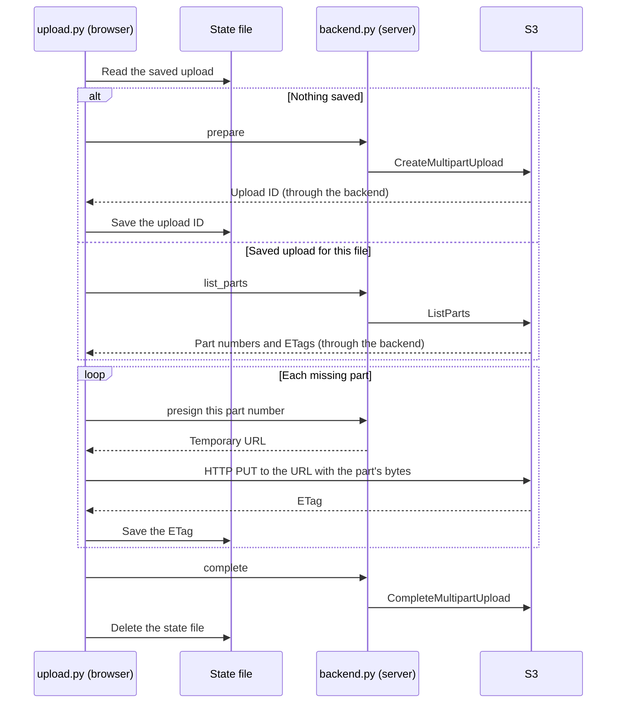
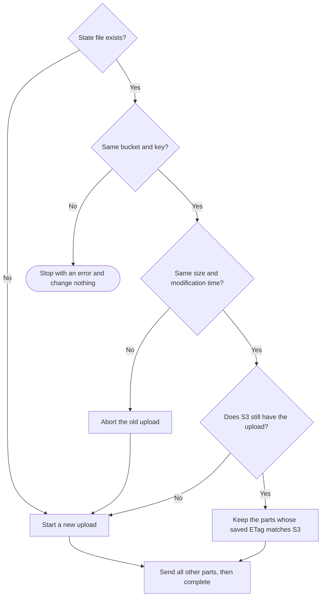

# Resumable S3 multipart upload in Python

Upload a large file to Amazon S3 in parts, through temporary URLs, and continue where you left off after a failure. This is a Python version of the design in [note 00](../00_S3_Multipart_Upload_Study_Notes.md). You can follow this page without reading it.

## Contents

1. [The problem and the two ideas](#1-the-problem-and-the-two-ideas)
2. [Terms](#2-terms)
3. [How the pieces fit](#3-how-the-pieces-fit)
4. [Before you run](#4-before-you-run)
5. [Try it](#5-try-it)
6. [The six steps in the code](#6-the-six-steps-in-the-code)
7. [How resume decides](#7-how-resume-decides)
8. [Command options](#8-command-options)
9. [Messages and what to do](#9-messages-and-what-to-do)
10. [Costs and cleanup](#10-costs-and-cleanup)
11. [Limits and what a real service would add](#11-limits-and-what-a-real-service-would-add)
12. [Test and run on the AWS Emulator](#12-test-and-run-on-the-aws-emulator)
13. [Testing status and references](#13-testing-status-and-references)

## 1. The problem and the two ideas

If you send a large file as one request and the connection drops at 95%, you start again from zero. A single `PUT` also can't exceed 5 GB.

| Idea | What you gain |
|---|---|
| **Multipart upload:** send the file as numbered parts, then ask S3 to join them | A failure only costs the part that was being sent |
| **Presigned URLs:** a server signs a temporary URL, and the client sends the bytes straight to S3 | The client needs no AWS credentials, and the file never passes through the server |

## 2. Terms

| Term | Meaning |
|---|---|
| Multipart upload | Three stages: create the upload, upload the parts, complete it. The object doesn't exist until you complete it |
| Upload ID | Returned by S3 when you create the upload. Every later call needs it |
| Part | A slice of the file, numbered 1 to 10,000. Each is 5 MiB to 5 GiB, except the last, which can be smaller. Uploading the same number again replaces that part |
| ETag | S3's receipt for a part. Completing the upload takes the number and ETag of every part. The finished object gets a different kind of ETag (ending in `-3` for three parts) that is not an MD5 of the file |
| Presigned URL | A URL with a signature that allows one specific request. Anyone who has it can use it, more than once, until it expires. It has the signer's permissions |
| State file | `<file>.upload.json`, the script's memory between runs. It stands in for the browser's `localStorage` |

## 3. How the pieces fit

| File | Plays | Job | Uses AWS credentials |
|---|---|---|---|
| [`upload.py`](upload.py) | The browser | Reads the file, tracks progress, sends the parts | Not to send parts |
| [`backend.py`](backend.py) | The server | Creates, lists, signs, completes and aborts uploads | Yes |
| [`tests/`](tests/) | | [End-to-end tests](#12-test-and-run-on-the-aws-emulator) on a local emulator | No |

Both run in **one Python process** on your machine. `upload.py` calls the `Backend` methods directly, where a web app would send HTTP requests to a server. The split shows which work belongs on which side, but the whole process has access to your credentials.



## 4. Before you run

**Tools.** Install [uv](https://docs.astral.sh/uv/). On the first run it installs boto3, which is listed at the top of `upload.py`. The cleanup and check commands also use the AWS CLI.

**Credentials.** Set them up in any way boto3 understands, for example `aws configure`, or a named profile selected with `export AWS_PROFILE=name`.

If you sign in with `aws login`, boto3 needs an [extra package](https://docs.aws.amazon.com/boto3/latest/guide/credentials.html). In every command below, replace `uv run upload.py` with:

```bash
uv run --with "boto3[crt]" upload.py
```

**Bucket and Region.** Run these in the terminal you'll use for the rest of this page.

```bash
export BUCKET=my-bucket               # replace with your bucket name (no dots)
export AWS_DEFAULT_REGION=us-east-1   # the bucket's Region; boto3 ignores AWS_REGION
aws s3 mb "s3://$BUCKET"              # only if the bucket doesn't exist yet
```

**Permissions.** The script needs these three actions:

```json
{
  "Version": "2012-10-17",
  "Statement": [
    {
      "Effect": "Allow",
      "Action": ["s3:PutObject", "s3:ListMultipartUploadParts", "s3:AbortMultipartUpload"],
      "Resource": "arn:aws:s3:::my-bucket/*"
    }
  ]
}
```

- `s3:PutObject` covers creating the upload, uploading parts and completing it.
- The check and cleanup in section 5 also need `s3:GetObject` and `s3:DeleteObject`.
- Creating a bucket and the bucket commands in section 10 need further permissions.
- A bucket encrypted with a KMS key (SSE-KMS) also needs [KMS permissions](https://docs.aws.amazon.com/AmazonS3/latest/API/API_ListParts.html), including `kms:Decrypt`.

## 5. Try it

Run these from this folder (`s3-multipart-upload/code`). They use a 25 MiB test file, which makes parts of 10, 10 and 5 MiB. Real S3 charges apply, though they are very small at this size; to avoid them, use the [emulator](#12-test-and-run-on-the-aws-emulator). The sample output comes from a local run, not from real AWS.

**1. Make a test file.**

```bash
head -c 25M /dev/urandom > /tmp/video.mp4
```

**2. Send two parts, then stop.** This imitates a dropped connection.

```bash
uv run upload.py "$BUCKET" /tmp/video.mp4 --stop-after 2
```

```text
Part 1/3: sent 10485760 bytes
Part 2/3: sent 10485760 bytes
Stopped early. Run again to send the remaining parts.
```

**3. See what was saved.**

```bash
cat /tmp/video.mp4.upload.json
```

```json
{
  "bucket": "my-bucket",
  "key": "video.mp4",
  "upload_id": "qzlqVTyUp8vW2MfzsNbGbwAdkmBWpOdl...",
  "size": 26214400,
  "mtime_ns": 1795760894350035194,
  "part_size": 10485760,
  "parts": {
    "1": "\"2779999e8abfc275b04d0c82d9190617\"",
    "2": "\"00e1660f1a1610de8a9aa7403c2c5d62\""
  }
}
```

`size` and `mtime_ns` (modification time) are used to notice a changed file. `parts` maps each sent part number to its ETag; the quotes are part of the ETag.

**4. Ask S3 what it has.** There is no `video.mp4` object yet, only two stored parts.

```bash
UPLOAD_ID=$(grep -o '"upload_id": "[^"]*' /tmp/video.mp4.upload.json | cut -d'"' -f4)
aws s3api list-parts --bucket "$BUCKET" --key video.mp4 --upload-id "$UPLOAD_ID"
```

**5. Resume** with the same command, without `--stop-after`.

```bash
uv run upload.py "$BUCKET" /tmp/video.mp4
```

```text
Resuming. Parts already in S3: 2
Part 3/3: sent 5242880 bytes
Completed s3://my-bucket/video.mp4
```

The state file is now gone.

**6. Check the result, then clean up.**

```bash
aws s3 cp "s3://$BUCKET/video.mp4" /tmp/downloaded.mp4
cmp /tmp/video.mp4 /tmp/downloaded.mp4 && echo identical

aws s3 rm "s3://$BUCKET/video.mp4"
rm /tmp/video.mp4 /tmp/downloaded.mp4
```

To try a real interruption, make a larger file (`head -c 500M`), press Ctrl+C during the upload, and run the command again.

## 6. The six steps in the code

| Step | S3 operation | Code |
|---|---|---|
| 1. Prepare | `CreateMultipartUpload` | `Backend.prepare` |
| 2. Find the missing parts | `ListParts` | `Backend.list_parts` |
| 3. Get permission | None; signing is local | `Backend.presign` |
| 4. Upload a part | `UploadPart`, as an HTTP `PUT` | `put_part` |
| 5. Complete | `CompleteMultipartUpload` | `Backend.complete` |
| 6. Resume | Steps 2 to 5 again | `resume_or_prepare` |

The function to read first is `upload` in `upload.py`. It calls the others in order.

### Step 1: prepare

S3 creates the upload and returns the upload ID. The script saves it to the state file at once, so a failure during the first part can still be resumed.

The part size is chosen here and saved, so that every run cuts the file in the same places. It is 10 MiB, or larger when that would need more than 10,000 parts (files over about 97 GiB).

### Step 2: find the missing parts

On a resumed run, the script asks S3 which parts it holds. A new upload has none, so it skips the question. S3 returns up to 1,000 parts per response, and the boto3 paginator fetches the rest.

Whatever isn't confirmed gets sent:

```python
missing = [number for number in range(1, total + 1) if str(number) not in state["parts"]]
```

### Step 3: get permission

The backend signs a URL for one part. This happens on your machine, without a request to S3.

```python
self.s3.generate_presigned_url(
    "upload_part",
    Params={"Bucket": self.bucket, "Key": key, "UploadId": upload_id, "PartNumber": part_number},
    ExpiresIn=URL_LIFETIME_SECONDS,  # 900 seconds
)
```

The result looks like this (one line, split here; in other Regions the host includes the Region):

```text
https://my-bucket.s3.amazonaws.com/video.mp4
  ?uploadId=...&partNumber=1                  which upload and which part
  &X-Amz-Algorithm=AWS4-HMAC-SHA256           Signature Version 4
  &X-Amz-Credential=...&X-Amz-Date=...        who signed, and when
  &X-Amz-Expires=900                          lifetime in seconds
  &X-Amz-SignedHeaders=host
  &X-Amz-Signature=...                        proof that the signer approved this request
```

The secret key is never in the URL. With temporary credentials the URL also carries a session token, and stops working when those credentials expire, even if that is sooner than 15 minutes.

### Step 4: upload the part

This is a plain HTTP request, with no AWS SDK and no credentials. A browser would do the same with `fetch`.

```python
request = urllib.request.Request(
    url, data=data, method="PUT", headers={"Content-Type": "application/octet-stream"}
)
with urllib.request.urlopen(request, timeout=PUT_TIMEOUT_SECONDS) as response:
    return response.headers["ETag"]
```

The loop around it reads one slice at a time and records each success before moving on:

```python
for number in missing[:stop_after]:
    source.seek((number - 1) * part_size)  # jump to this part's slice
    data = source.read(part_size)
    url = backend.presign(key, upload_id, number)
    state["parts"][str(number)] = put_part(url, data)
    save_state(state_file, state)
```

`save_state` writes a temporary file and then renames it, so an interruption can't leave a half-written state file.

### Step 5: complete

Having every part in S3 is not enough: without this call the object never appears.

1. The script checks that the file hasn't changed during the upload.
2. The backend sends every part number and ETag, in order. The ETags come from the state file, because AWS advises against building this request from `ListParts` output.
3. It also sends the expected size (`MpuObjectSize`), so S3 rejects the request if the object would be a different size.
4. The script deletes the state file.

### Step 6: resume

There is no separate resume command. Run the same command again, and the next section describes what happens.

## 7. How resume decides

`resume_or_prepare` makes these checks in order:



A part is skipped only when **both** the state file and S3 have it, with the same ETag.

| Situation | Result |
|---|---|
| The script died after S3 stored a part, before saving its ETag | The part is sent again, replacing the first copy |
| S3 holds a different ETag for a saved part | The part is sent again |
| The file was edited, or only its modification time changed | Everything starts over, so old and new content can't be mixed |
| S3 no longer has the upload, for example after a lifecycle rule removed it | Everything starts over |

## 8. Command options

```text
uv run upload.py BUCKET FILE [--key KEY] [--stop-after N | --abort]
```

| Argument | Meaning |
|---|---|
| `BUCKET` | An existing bucket |
| `FILE` | The file to upload. It must not be empty |
| `--key KEY` | Object key. The default is the file's name without its folders |
| `--stop-after N` | Send N of the missing parts, then stop. If N covers all of them, the upload completes |
| `--abort` | Discard the unfinished upload and delete the state file. Repeat `--key` if you used it. Works even if the file was deleted |

Exit codes: `0` completed, stopped early or aborted; `1` error; `2` wrong arguments; `130` Ctrl+C.

## 9. Messages and what to do

| Message contains | Meaning | What to do |
|---|---|---|
| `Resuming. Parts already in S3` | Normal resume | Nothing |
| `Stopped early` | You used `--stop-after` | Run again without it |
| `Interrupted` | You pressed Ctrl+C | Run again |
| `CERTIFICATE_VERIFY_FAILED` | The server's certificate isn't trusted. Running again won't help | On the emulator, add `SSL_CERT_FILE` ([section 12](#12-test-and-run-on-the-aws-emulator)) |
| `Run the same command again to resume` | Network or file problem | Run again. If it repeats, read the error above that line |
| `Could not connect to the endpoint URL` | S3 couldn't be reached | Check the network and Region, then run again |
| `The file changed since the last run` | Size or modification time differs | Nothing; it starts over |
| `The file changed during the upload` | The file was modified while being sent | Run again once the file is stable |
| `The saved upload no longer exists in S3` | It was removed or already finished | Nothing; it starts over |
| `belongs to an upload to s3://...` | The state file is for another bucket or key | Use that bucket and key to finish it, or to `--abort` it |
| `Nothing to abort` | No state file next to that path | Check the path, or see section 10 |
| `The file is empty` | Multipart upload isn't used for empty files | Use `aws s3 cp` |
| `no such file` | Wrong path | Check it |
| `Unable to locate credentials` | boto3 found no credentials | See section 4 |
| `Missing Dependency` and `botocore[crt]` | You signed in with `aws login` | Add `--with "boto3[crt]"` (section 4) |
| `NoSuchBucket` | Wrong bucket name | Check `BUCKET` |
| `AccessDenied` | A permission is missing | Check the policy in section 4 |
| `S3 rejected a part` | S3 refused the presigned URL; its reason follows | Check that `AWS_DEFAULT_REGION` is the bucket's Region, the computer's clock is right and your credentials haven't expired |

## 10. Costs and cleanup

S3 keeps, and bills for, the parts of an unfinished upload until it is completed or aborted. They don't appear in the normal object list.

To discard one upload, use the script, or find it in S3 and abort it by hand:

```bash
uv run upload.py "$BUCKET" /path/to/file --abort

aws s3api list-multipart-uploads --bucket "$BUCKET"
aws s3api abort-multipart-upload --bucket "$BUCKET" --key KEY --upload-id UPLOAD_ID
```

A lifecycle rule can abort forgotten uploads automatically. This one does so 3 days after an upload starts, so you can't resume after that.

> **Warning:** the `put` command replaces the bucket's whole lifecycle configuration. Run the `get` command first. If the bucket already has rules, add this one to them. An error saying there is no lifecycle configuration means it's safe to continue.

```bash
aws s3api get-bucket-lifecycle-configuration --bucket "$BUCKET"

cat > /tmp/lifecycle.json <<'EOF'
{
  "Rules": [
    {
      "ID": "AbortStaleMultipartUploads",
      "Status": "Enabled",
      "Filter": {},
      "AbortIncompleteMultipartUpload": { "DaysAfterInitiation": 3 }
    }
  ]
}
EOF
aws s3api put-bucket-lifecycle-configuration --bucket "$BUCKET" \
  --lifecycle-configuration file:///tmp/lifecycle.json
```

These bucket commands need `s3:ListBucketMultipartUploads`, `s3:GetLifecycleConfiguration` and `s3:PutLifecycleConfiguration`.

## 11. Limits and what a real service would add

**Limits of this code**

- Parts are sent one at a time, and each is held in memory while it is sent.
- A failed part isn't retried within the same run. Run the command again.
- Run only one copy per file at a time, because copies would share a state file.
- Files with the same name in different folders get the same default key. Use `--key`.
- It doesn't verify a checksum of the whole file. Compare a download, as in section 5.
- Bucket names with dots fail the HTTPS certificate check with the [virtual-hosted URLs](https://docs.aws.amazon.com/AmazonS3/latest/userguide/VirtualHosting.html) used here.

**For a real web application**

- Run the `Backend` methods behind HTTP endpoints, so credentials stay on the server.
- Check who is calling, and which object keys and upload IDs they may use. This code does neither.
- Add a bucket CORS rule that allows `PUT` from your site and includes `"ExposeHeaders": ["ETag"]`. Without the second part, browser code can't read the ETag.
- Add the lifecycle rule above.
- Decide whether uploaded files need scanning before others can use them ([note 00, section 8](../00_S3_Multipart_Upload_Study_Notes.md#8-beyond-the-video-orchestrating-the-missing-scan-step-with-step-functions)).

## 12. Test and run on the AWS Emulator

[AWS Emulator](https://docs.aws.amazon.com/emulator/latest/userguide/getting-started-linux.html) serves AWS APIs on your own machine, so no AWS account or charges are involved. Install it first, then check with `aws-emulator -v`. These steps were tried with version 1.0.611.

### End-to-end tests

From this folder:

```bash
uv run pytest -v
```

You don't need to start the emulator. Each test starts its own on a free port, with a temporary home folder, and stops it afterwards. All `AWS_*` variables are removed first, and a test stops unless it is connected to the emulator account `000000000000`, so it can't reach real AWS. The run takes about 15 seconds.

| The tests run `upload.py` and check | Cases |
|---|---|
| The stored object matches the file | A full upload of 25 MiB |
| Only the missing parts are sent after an interruption | `--stop-after`, a dropped connection, a killed process, Ctrl+C |
| Saved progress is checked before it is trusted | Changed file, upload removed from S3, differing part, part without a saved ETag |
| Cleanup and mistakes | `--abort`, a different `--key` |
| The part URL allows only what was signed | Reuse, altered part number or key, expired URL |
| Large uploads | `list_parts` reads past the first 1,000 parts |

| File in `tests/` | Contents |
|---|---|
| `test_end_to_end.py` | The tests |
| `conftest.py` | Starts and checks the emulator for each test |
| `fault_proxy.py` | Relays the connection to the emulator, and cuts or stalls a part upload on request |

### Try it by hand

This runs section 5 against an emulator that keeps running. Run these from this folder.

**1. Start the emulator.** A `.env` file doesn't start it; it only tells commands where to find it. Start it again after a reboot. If the check below already prints `ok`, it is running.

```bash
mkdir -p ~/.aws/emulator
nohup aws-emulator -p 9297 -t off > ~/.aws/emulator/9297.log 2>&1 &
```

After a second, check that it is up. This prints `ok`. If it fails, look in `~/.aws/emulator/9297.log`.

```bash
curl --cacert ~/.aws/emulator/9297/ca.pem https://127.0.0.1:9297/__admin/health
```

**2. Set up `.env`** in this folder, which git ignores. Choose one of these.

*You have no `.env` yet:* create it. This command overwrites an existing file.

```bash
E=$HOME/.aws/emulator/9297
cat > .env <<EOF
AWS_ENDPOINT_URL=https://127.0.0.1:9297
AWS_CONFIG_FILE=$E/config
AWS_SHARED_CREDENTIALS_FILE=$E/emulator_credentials
AWS_REGION=us-east-1
AWS_DEFAULT_REGION=us-east-1
AWS_EC2_METADATA_DISABLED=true
SSL_CERT_FILE=$E/ca.pem
EOF
```

*You already have a `.env` for the emulator,* for example from another project: keep it and add this line once. Change `9297` if you use another port.

```bash
printf '\nSSL_CERT_FILE=%s\n' "$HOME/.aws/emulator/9297/ca.pem" >> .env
```

Without `SSL_CERT_FILE`, uploading a part fails with `CERTIFICATE_VERIFY_FAILED`. boto3 finds the emulator's certificate through the emulator's config file, so creating a bucket or starting an upload still works. The plain HTTP `PUT` in `upload.py` doesn't read that file. `REQUESTS_CA_BUNDLE` doesn't help either, because it is for the `requests` library.

Pass `.env` with `--env-file` instead of exporting it in your shell: with `SSL_CERT_FILE` exported, uv can't download packages.

**3. Check the target.** It must print `000000000000`. Any other number means you are on real AWS, so stop.

```bash
uv run --env-file .env python -c 'import boto3; print(boto3.client("sts").get_caller_identity()["Account"])'
```

**4. Create a bucket and upload.**

```bash
uv run --env-file .env python -c 'import boto3; boto3.client("s3").create_bucket(Bucket="my-bucket")'
head -c 25M /dev/urandom > /tmp/video.mp4

uv run --env-file .env upload.py my-bucket /tmp/video.mp4 --stop-after 2
uv run --env-file .env upload.py my-bucket /tmp/video.mp4
```

To run an `aws` command from this page against the emulator, load the file in a subshell, for example `(set -a; . ./.env; aws s3 ls s3://my-bucket)`.

Stop with `pkill -x aws-emulator`. This stops every emulator on the machine and deletes what it held.

## 13. Testing status and references

The end-to-end tests above passed on AWS Emulator 1.0.611, which checks request signatures. **Nothing has been run on real AWS**, and an emulator can differ from it. The `aws` commands on this page have not been run.

- [Note 00](../00_S3_Multipart_Upload_Study_Notes.md), the design this follows
- [Multipart upload overview and permissions](https://docs.aws.amazon.com/AmazonS3/latest/userguide/mpuoverview.html)
- [Multipart upload limits](https://docs.aws.amazon.com/AmazonS3/latest/userguide/qfacts.html)
- [Presigned URLs](https://docs.aws.amazon.com/AmazonS3/latest/userguide/using-presigned-url.html)
- [Lifecycle rule for incomplete uploads](https://docs.aws.amazon.com/AmazonS3/latest/userguide/mpu-abort-incomplete-mpu-lifecycle-config.html)
