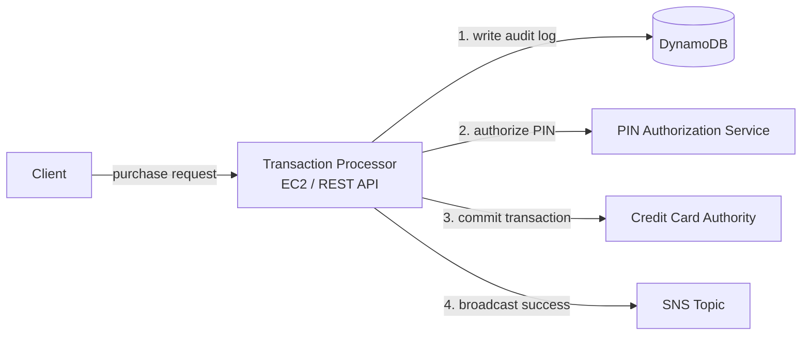
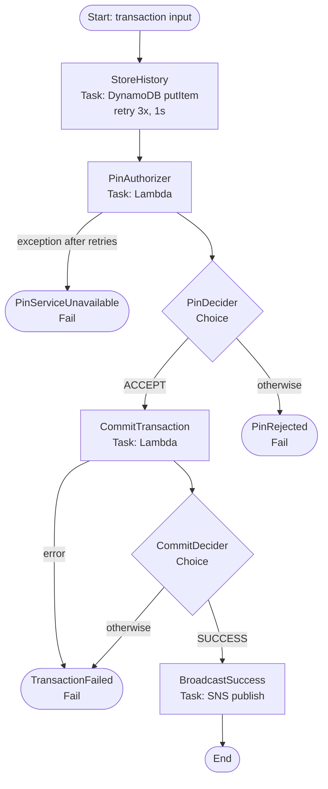

# AWS Step Functions Overview: Study Notes

Source: [AWS Step Functions overview (AWS Simplified)](https://youtu.be/zCIpWFYDJ8s?list=PL9nWRykSBSFgQrO66TmO1vHFP6yuPF5G-), about 13.5 minutes.

The video covers what Step Functions are, why they are useful, and walks through a hypothetical credit card processing workflow. It compares a "traditional" server-based version with a Step Functions version.

The hands-on companion video, which builds a state machine with two Lambdas in the console, is covered in [02_AWS_Step_Functions_with_Lambda_Study_Notes.md](02_AWS_Step_Functions_with_Lambda_Study_Notes.md).

Code below marked **reconstructed** was rebuilt from what the video describes on screen. The full state machine definition passed `ValidateStateMachineDefinition` (result `OK`, no diagnostics). The section "Beyond the video" adds current facts that the video (recorded around 2019) does not cover.

---

## Contents

1. [Corrected terms](#1-corrected-terms)
2. [What Step Functions are](#2-what-step-functions-are)
3. [Five key benefits](#3-five-key-benefits)
4. [Pricing and a worked example](#4-pricing-and-a-worked-example)
5. [Example: credit card processing the traditional way](#5-example-credit-card-processing-the-traditional-way)
6. [Why the traditional approach breaks down](#6-why-the-traditional-approach-breaks-down)
7. [The same example as a state machine](#7-the-same-example-as-a-state-machine)
8. [ASL walkthrough, state by state](#8-asl-walkthrough-state-by-state)
9. [Full reconstructed definition](#9-full-reconstructed-definition)
10. [Supporting Lambda functions](#10-supporting-lambda-functions)
11. [Gotchas the video skips](#11-gotchas-the-video-skips)
12. [Beyond the video: current facts worth knowing](#12-beyond-the-video-current-facts-worth-knowing)
13. [Cheat sheet](#13-cheat-sheet)
14. [Review questions](#14-review-questions)

---

## 1. Corrected terms

The auto-captions mangle several names:

| Caption says | Actually means |
|---|---|
| ADSL / adsl | **ASL**: Amazon States Language |
| "pipe task" | `"Type": "Task"` |
| Dino and DB / dynamo dB | Amazon **DynamoDB** |
| SMS topic / SMS message | Amazon **SNS** topic / message |
| AR end | **ARN** (Amazon Resource Name) |
| AWS done functions | AWS Step Functions |

---

## 2. What Step Functions are

- A service for building **workflows** that follow a **fixed or dynamic sequence of steps**. The name comes from these steps.
- You model an application as **small, independent units** (states/tasks) chained together.
- Each task can **reach directly into AWS services** (DynamoDB, SNS, Lambda, SQS, and others), do a job, and return the result to the workflow.
- Think of it as an **orchestrator** for your application. Step Functions decides what runs next, handles retries, and carries data between steps.

### Core vocabulary

| Term | Meaning |
|---|---|
| **State machine** | The workflow definition: a set of states and the transitions between them |
| **State** | One step in the workflow (Task, Choice, Fail, and others) |
| **Task state** | A state that does work: calls a Lambda function, writes to DynamoDB, publishes to SNS, and so on |
| **State transition** | Moving from one state to the next. This is the billing unit (Standard workflows). |
| **Execution** | One run of a state machine with a specific JSON input |
| **ASL** | Amazon States Language: the JSON-based language used to define state machines |

### A typical flow the video uses to motivate it

1. Receive an API request.
2. Write something to a database.
3. Depending on what was already there, continue to the next step or return early.
4. If the database call fails, return immediately.

Step Functions lets you express each of these as its own state instead of burying the branching and error handling inside one block of code.

---

## 3. Five key benefits

### 3.1 Built-in retry

- Retries are configured per state, so you don't write retry loops yourself.
- Options:
  - **No retry policy**: fail on the first error.
  - **Fixed number of attempts**, for example retry 3 times on a DynamoDB or SNS write.
  - **Back-off behavior**: constant interval or exponential back-off.
- You can also add a **wait** before retrying, for example wait 30 seconds, a minute, or 5 minutes for a downstream service to recover.

### 3.2 Native AWS service integrations

- This is the **biggest benefit** according to the video.
- Integrates directly with Lambda, SNS, SQS, DynamoDB, and many more (the list keeps growing).
- **Traditional approach**: write data access classes, set up SDK clients, wire up credentials, and make sure it all works in code.
- **Step Functions approach**: declare the integration in ASL. A Task state names the service and action, and Step Functions makes the call.

### 3.3 Visual auditing and debugging

- The console gives a **graphical view** of each execution:
  - Where the execution currently is in the flow (for example: DynamoDB written, then SNS, then S3).
  - **Input and output** of every step.
  - **Which step failed**, highlighted, so you can quickly find gaps when executions start failing.

### 3.4 Scalability

- Highly scalable, fully managed. There are no servers to run.

### 3.5 Low cost

- Covered in the next section.

---

## 4. Pricing and a worked example

From the video: **$0.025 per 1,000 state transitions** ($25 per million).

### Formula

```
monthly cost = (transitions per execution x executions per month) / 1,000 x $0.025
```

### Video's example

- State machine with **5 transitions** per execution
- **100,000 executions** per month

```
5 x 100,000          = 500,000 transitions
500,000 / 1,000      = 500 units
500 x $0.025         = $12.50 per month
```

### Practice example

- 12 transitions per execution, 2 million executions per month
- 12 x 2,000,000 = 24,000,000 transitions, so 24,000 x $0.025 = **$600 per month**

> Note: this price is for **Standard** workflows. Retries also count as transitions, and the free tier covers 4,000 transitions a month. Express workflows are priced differently (see section 12).

---

## 5. Example: credit card processing the traditional way

### The setup

- A **Transaction Processor Service** (on EC2, Lambda, or anything else) exposes a REST API.
- It orchestrates calls to several services:
  - **PIN Authorization Service**: confirms the PIN is valid before committing (on-site, or an external Visa-style endpoint).
  - **Credit Card Authority Service**: actually commits the transaction with the card provider (Visa, Mastercard, and so on).
  - **SNS topic**: broadcasts successful transactions so other customers or teams can react.

### Request payload

```json
{
  "transactionId": "txn-0001",
  "customerId": "cust-8812",
  "creditCardNumber": "4111111111111111",
  "pin": "1234",
  "amount": 42.50
}
```

(The video's request has customer ID, card number, PIN, and amount. The transaction ID is referenced later as the DynamoDB primary key, so it is included here.)

### Steps



1. **Store an audit log** in DynamoDB: who submitted a transaction request and when. Requires setting up a DynamoDB client and writing to the table.
2. **Authorize the PIN**: call the PIN service. If it **accepts**, continue. If it **rejects**, return a response to the caller.
3. **Commit the transaction** with the credit card authority (only if step 2 succeeded).
4. **Broadcast success** to an SNS topic you own (only if step 3 succeeded).

### Sketch of the traditional code (reconstructed)

```python
def handle_purchase(request):
    # Step 1: audit log
    dynamodb.put_item(TableName="TransactionHistory", Item={...})

    # Step 2: PIN authorization
    try:
        decision = pin_service.authorize(request["creditCardNumber"], request["pin"])
    except ServiceUnavailable:
        # Whole request fails here. Client has to resubmit.
        raise

    if decision == "REJECT":
        return {"status": "REJECTED"}

    # Step 3: commit
    result = card_authority.commit(request)
    if result != "SUCCESS":
        return {"status": "FAILED"}

    # Step 4: broadcast
    sns.publish(TopicArn=TOPIC_ARN, Message=...)
    return {"status": "SUCCESS"}
```

---

## 6. Why the traditional approach breaks down

The PIN service can do **three** things, not two:

| Outcome | Handling | Interesting? |
|---|---|---|
| Accept | Continue to commit | No |
| Reject | Return to client | No |
| **Throw an exception** (service is hard down) | ??? | **Yes** |

When the PIN service is down:

1. The purchase request **fails** at step 2.
2. The client must **come back later and resubmit** the whole request.
3. The resubmission **writes a new audit row** to DynamoDB, which is wasted and duplicated work.
4. The whole sequence runs again from the start. The PIN service may still be down.
5. You've **lost the context** of the original request and have to **retry the entire sequence of events**, not only the step that failed.

This doesn't scale. Every partial failure costs a full replay plus a client round trip.

### What Step Functions changes

- The workflow **remembers where it is**. A failure at step 2 retries **step 2 only**.
- You attach a **retry policy** to the failing step, for example wait 30 to 40 seconds, a minute, or 5 minutes before retrying.
- The workflow logic (sequence, branching, retries) lives in the **state machine definition**, not in hand-written sequential code.

---

## 7. The same example as a state machine



Flow in words (matches the video's console diagram):

1. **StoreHistory**: write the audit record to DynamoDB, with a retry policy.
2. **PinAuthorizer**: Lambda calls the PIN service. It returns accept, reject, or throws.
3. **PinDecider**: branches on the authorizer's output.
   - Rejected: go to a rejection step and **end**. Nothing more to do.
   - Accepted: continue.
4. **CommitTransaction**: Lambda calls the credit card authority with the amount and transaction details.
   - Failed: the transaction is failed and the workflow ends.
   - Succeeded: continue.
5. **BroadcastSuccess**: publish to SNS so other clients can consume it.

The **output of one state becomes the input of the next**. For example, the PinAuthorizer's "ACCEPT" result is fed into PinDecider.

---

## 8. ASL walkthrough, state by state

### 8.1 Anatomy of a state machine

```json
{
  "Comment": "Optional description",
  "StartAt": "FirstStateName",
  "States": {
    "FirstStateName": { "Type": "Task", "...": "...", "Next": "SecondStateName" },
    "SecondStateName": { "Type": "Task", "...": "...", "End": true }
  }
}
```

- `StartAt`: the name of the first state.
- `States`: a map of state name to state definition.
- Each state has a `Type` and either `Next` (the following state) or `End: true` (terminal). Fail and Succeed states are terminal by nature.

### 8.2 StoreHistory: direct DynamoDB integration

The video shows this as "brain-dead simple" compared to writing a DynamoDB client yourself.

```json
"StoreHistory": {
  "Type": "Task",
  "Resource": "arn:aws:states:::dynamodb:putItem",
  "Parameters": {
    "TableName": "TransactionHistory",
    "Item": {
      "transactionId": { "S.$": "$.transactionId" },
      "customerId":    { "S.$": "$.customerId" },
      "amount":        { "N.$": "States.JsonToString($.amount)" },
      "requestedAt":   { "S.$": "$$.Execution.StartTime" }
    }
  },
  "ResultPath": null,
  "Retry": [
    {
      "ErrorEquals": ["States.ALL"],
      "IntervalSeconds": 1,
      "MaxAttempts": 3,
      "BackoffRate": 1.0
    }
  ],
  "Next": "PinAuthorizer"
}
```

Field by field:

| Field | Meaning |
|---|---|
| `"Type": "Task"` | This state does work |
| `"Resource": "arn:aws:states:::dynamodb:putItem"` | Service integration ARN: DynamoDB `PutItem` |
| `Parameters.TableName` | Target table |
| `Parameters.Item` | The item, in DynamoDB attribute-value format (`S` = string, `N` = number, sent as a string) |
| `"S.$": "$.transactionId"` | The `.$` suffix means "the value is a path, resolve it". `$.transactionId` reads `transactionId` from the **state input** (here, the original execution input). The video uses `transactionId` as the table's primary key. |
| `$$.Execution.StartTime` | `$$` is the **context object** (execution metadata), handy for timestamps |
| `States.JsonToString(...)` | An intrinsic function. Converts the number into the string form DynamoDB expects for `N`. |
| `ResultPath: null` | Discard the PutItem response and pass the original input through (see section 11) |
| `Retry` | The retry policy |

The video's advice: you can include more context (timestamps and so on) easily, but **don't store sensitive data like the PIN**.

### 8.3 Retry policy

The video's policy: catch any error, **3 max attempts**, **1 second** between attempts.

| Retry field | Meaning | Default |
|---|---|---|
| `ErrorEquals` | Which errors this retrier handles. `States.ALL` matches everything. | required |
| `IntervalSeconds` | Wait before the first retry | 1 |
| `MaxAttempts` | Max **retries** (not counting the first attempt). `0` means never retry. | 3 |
| `BackoffRate` | Multiplier on the interval after each retry. `1.0` keeps it constant, `2.0` doubles it. | 2.0 |
| `MaxDelaySeconds` | Caps the wait between retries (added after the video) | none |
| `JitterStrategy` | `FULL` randomizes waits to avoid thundering herds (added after the video) | `NONE` |

Exponential back-off example: `IntervalSeconds: 30, BackoffRate: 2.0, MaxAttempts: 3` waits 30s, 60s, 120s.

> Exam point: `MaxAttempts: 3` means **up to 4 total tries** (1 original + 3 retries).

### 8.4 PinAuthorizer: Lambda task

The video calls Lambda integration "even more brain-dead simple": give the state a name, set `Type: Task`, set `Resource` to the Lambda function's ARN, and set `Next`.

Minimal form (as in the video):

```json
"PinAuthorizer": {
  "Type": "Task",
  "Resource": "arn:aws:lambda:us-east-1:123456789012:function:PinAuthorizer",
  "Next": "PinDecider"
}
```

Hardened form (used in the full definition), adding the retry and wait behavior the video motivates in section 6:

```json
"PinAuthorizer": {
  "Type": "Task",
  "Resource": "arn:aws:lambda:us-east-1:123456789012:function:PinAuthorizer",
  "ResultPath": "$.pinResult",
  "Retry": [
    {
      "ErrorEquals": ["States.TaskFailed"],
      "IntervalSeconds": 30,
      "MaxAttempts": 3,
      "BackoffRate": 2.0
    }
  ],
  "Catch": [
    {
      "ErrorEquals": ["States.ALL"],
      "ResultPath": "$.error",
      "Next": "PinServiceUnavailable"
    }
  ],
  "Next": "PinDecider"
}
```

- `Retry`: if the PIN service is down, wait 30s, 60s, 120s before giving up. This is the fix for the "service is hard down" problem.
- `Catch`: after retries run out, route to a failure state instead of crashing the execution. The video notes that on an exception you can "move to end immediately or do something more dynamic like a rejection step".
- `ResultPath: "$.pinResult"`: put the Lambda's output under `pinResult` and keep the rest of the input.

### 8.5 PinDecider: Choice state

```json
"PinDecider": {
  "Type": "Choice",
  "Choices": [
    {
      "Variable": "$.pinResult.status",
      "StringEquals": "ACCEPT",
      "Next": "CommitTransaction"
    }
  ],
  "Default": "PinRejected"
}
```

- Branches based on input data. It has no `Next` or `End` of its own. It routes through `Choices` or `Default`.
- `Default` handles anything that doesn't match. Always include one, or the execution fails with `States.NoChoiceMatched`.
- Other comparison operators: `NumericEquals`, `NumericGreaterThan`, `BooleanEquals`, `StringMatches` (wildcards), `IsPresent`, and combinators `And`, `Or`, `Not`.

### 8.6 Terminal states

```json
"PinRejected": {
  "Type": "Fail",
  "Error": "PinRejected",
  "Cause": "The PIN authorization service rejected the PIN."
}
```

- `Fail` ends the execution as **failed** with an error name and cause. Easy to spot in the console.
- `Succeed` ends it as successful.
- Alternative: a `Pass` state with `End: true` that returns a "rejected" result to the caller, if you treat rejection as a normal business outcome.

### 8.7 CommitTransaction: Lambda via the optimized integration

```json
"CommitTransaction": {
  "Type": "Task",
  "Resource": "arn:aws:states:::lambda:invoke",
  "Parameters": {
    "FunctionName": "arn:aws:lambda:us-east-1:123456789012:function:CommitTransaction",
    "Payload": {
      "transactionId.$": "$.transactionId",
      "customerId.$": "$.customerId",
      "creditCardNumber.$": "$.creditCardNumber",
      "amount.$": "$.amount"
    }
  },
  "ResultSelector": { "status.$": "$.Payload.status" },
  "ResultPath": "$.commitResult",
  "Retry": [
    {
      "ErrorEquals": [
        "Lambda.ServiceException",
        "Lambda.TooManyRequestsException",
        "Lambda.SdkClientException"
      ],
      "IntervalSeconds": 2,
      "MaxAttempts": 3,
      "BackoffRate": 2.0
    }
  ],
  "Catch": [
    { "ErrorEquals": ["States.ALL"], "ResultPath": "$.error", "Next": "TransactionFailed" }
  ],
  "Next": "CommitDecider"
}
```

- This uses `arn:aws:states:::lambda:invoke` instead of the raw function ARN. You pick exactly which fields go into `Payload`, so the PIN isn't sent to this function.
- The response is wrapped (`Payload`, `StatusCode`, ...). `ResultSelector` pulls out just `Payload.status`.
- Retries only on transient Lambda service errors. Business failures come back as `status` and are handled by the next Choice.

### 8.8 BroadcastSuccess: direct SNS integration

```json
"BroadcastSuccess": {
  "Type": "Task",
  "Resource": "arn:aws:states:::sns:publish",
  "Parameters": {
    "TopicArn": "arn:aws:sns:us-east-1:123456789012:TransactionEvents",
    "Message.$": "States.Format('Transaction {} approved for customer {}', $.transactionId, $.customerId)"
  },
  "ResultPath": null,
  "End": true
}
```

- No Lambda needed to publish to SNS.
- `States.Format` builds the message string from input fields.
- `End: true` marks the last state.

---

## 9. Full reconstructed definition

Validated with the Step Functions `ValidateStateMachineDefinition` API (result `OK`, no diagnostics). ARNs use a placeholder account `123456789012`.

```json
{
  "Comment": "Credit card transaction processor (reconstructed from the video)",
  "StartAt": "StoreHistory",
  "States": {
    "StoreHistory": {
      "Type": "Task",
      "Resource": "arn:aws:states:::dynamodb:putItem",
      "Parameters": {
        "TableName": "TransactionHistory",
        "Item": {
          "transactionId": { "S.$": "$.transactionId" },
          "customerId":    { "S.$": "$.customerId" },
          "amount":        { "N.$": "States.JsonToString($.amount)" },
          "requestedAt":   { "S.$": "$$.Execution.StartTime" }
        }
      },
      "ResultPath": null,
      "Retry": [
        { "ErrorEquals": ["States.ALL"], "IntervalSeconds": 1, "MaxAttempts": 3, "BackoffRate": 1.0 }
      ],
      "Next": "PinAuthorizer"
    },
    "PinAuthorizer": {
      "Type": "Task",
      "Resource": "arn:aws:lambda:us-east-1:123456789012:function:PinAuthorizer",
      "ResultPath": "$.pinResult",
      "Retry": [
        { "ErrorEquals": ["States.TaskFailed"], "IntervalSeconds": 30, "MaxAttempts": 3, "BackoffRate": 2.0 }
      ],
      "Catch": [
        { "ErrorEquals": ["States.ALL"], "ResultPath": "$.error", "Next": "PinServiceUnavailable" }
      ],
      "Next": "PinDecider"
    },
    "PinDecider": {
      "Type": "Choice",
      "Choices": [
        { "Variable": "$.pinResult.status", "StringEquals": "ACCEPT", "Next": "CommitTransaction" }
      ],
      "Default": "PinRejected"
    },
    "PinRejected": {
      "Type": "Fail",
      "Error": "PinRejected",
      "Cause": "The PIN authorization service rejected the PIN."
    },
    "PinServiceUnavailable": {
      "Type": "Fail",
      "Error": "PinServiceUnavailable",
      "Cause": "PIN authorization kept failing after all retries."
    },
    "CommitTransaction": {
      "Type": "Task",
      "Resource": "arn:aws:states:::lambda:invoke",
      "Parameters": {
        "FunctionName": "arn:aws:lambda:us-east-1:123456789012:function:CommitTransaction",
        "Payload": {
          "transactionId.$": "$.transactionId",
          "customerId.$": "$.customerId",
          "creditCardNumber.$": "$.creditCardNumber",
          "amount.$": "$.amount"
        }
      },
      "ResultSelector": { "status.$": "$.Payload.status" },
      "ResultPath": "$.commitResult",
      "Retry": [
        {
          "ErrorEquals": ["Lambda.ServiceException", "Lambda.TooManyRequestsException", "Lambda.SdkClientException"],
          "IntervalSeconds": 2,
          "MaxAttempts": 3,
          "BackoffRate": 2.0
        }
      ],
      "Catch": [
        { "ErrorEquals": ["States.ALL"], "ResultPath": "$.error", "Next": "TransactionFailed" }
      ],
      "Next": "CommitDecider"
    },
    "CommitDecider": {
      "Type": "Choice",
      "Choices": [
        { "Variable": "$.commitResult.status", "StringEquals": "SUCCESS", "Next": "BroadcastSuccess" }
      ],
      "Default": "TransactionFailed"
    },
    "TransactionFailed": {
      "Type": "Fail",
      "Error": "TransactionFailed",
      "Cause": "The credit card authority did not commit the transaction."
    },
    "BroadcastSuccess": {
      "Type": "Task",
      "Resource": "arn:aws:states:::sns:publish",
      "Parameters": {
        "TopicArn": "arn:aws:sns:us-east-1:123456789012:TransactionEvents",
        "Message.$": "States.Format('Transaction {} approved for customer {}', $.transactionId, $.customerId)"
      },
      "ResultPath": null,
      "End": true
    }
  }
}
```

### How the data evolves through a successful run

| After state | State data (abbreviated) |
|---|---|
| Input | `{transactionId, customerId, creditCardNumber, pin, amount}` |
| StoreHistory | unchanged (`ResultPath: null`) |
| PinAuthorizer | `{..., pinResult: {status: "ACCEPT"}}` |
| PinDecider | unchanged (Choice states pass data through) |
| CommitTransaction | `{..., pinResult: {...}, commitResult: {status: "SUCCESS"}}` |
| CommitDecider | unchanged |
| BroadcastSuccess | unchanged (`ResultPath: null`), execution ends |

---

## 10. Supporting Lambda functions

The video describes these two Lambdas but doesn't show their code. These are minimal **reconstructed** stubs that match the definition above.

```python
# pin_authorizer.py
# Direct-ARN Lambda task: receives the full state input as `event`.

class PinServiceUnavailable(Exception):
    pass


def handler(event, context):
    card = event["creditCardNumber"]
    pin = event["pin"]

    # Replace with a real call to the PIN authorization service.
    # Raising an exception here triggers the state's Retry/Catch.
    accepted = check_pin(card, pin)

    return {"status": "ACCEPT" if accepted else "REJECT"}


def check_pin(card, pin):
    return pin == "1234"  # stand-in logic
```

```python
# commit_transaction.py
# Invoked via arn:aws:states:::lambda:invoke; `event` is the Payload block.

def handler(event, context):
    # Replace with a real call to the credit card authority.
    ok = commit_with_authority(
        event["transactionId"], event["creditCardNumber"], event["amount"]
    )
    return {"status": "SUCCESS" if ok else "FAILED"}


def commit_with_authority(transaction_id, card_number, amount):
    return amount < 10_000  # stand-in logic
```

The video says the next video in the series builds this end to end with real resources: the DynamoDB table, Lambdas, and SNS topic.

---

## 11. Gotchas the video skips

1. **A task's result replaces its input by default.** Without `ResultPath`, the DynamoDB `PutItem` response would replace the transaction data, and `PinAuthorizer` would receive the PutItem response metadata instead of the card and PIN. Use:
   - `"ResultPath": null` to discard the result and pass the input through.
   - `"ResultPath": "$.someKey"` to merge the result into the input.
2. **IAM is still needed**, just in a different place. The video says integrations save you from IAM setup in code. That's true for application code, but the state machine's **execution role** must allow `dynamodb:PutItem`, `lambda:InvokeFunction`, and `sns:Publish` on the specific resources.
3. **Sensitive data shows up in execution history.** Inputs and outputs of every state are visible in the console. Passing a raw card number and PIN through the workflow (as the video's example does) would expose them. In real systems, pass a token or reference instead.
4. **Retries must be safe to repeat (idempotent).** `PutItem` with the same `transactionId` overwrites the same item, so retrying is safe. A downstream "commit" call must also tolerate being retried, for example by using `transactionId` as an idempotency key, or you risk double charges.
5. **`MaxAttempts` counts retries, not total tries.** See section 8.3.
6. **Retries count as billable state transitions** in Standard workflows.
7. **The direct-ARN Lambda style vs `lambda:invoke`:** the raw ARN returns the function's output as-is. `arn:aws:states:::lambda:invoke` wraps it in `{Payload, StatusCode, ...}`, so you need `ResultSelector` or `OutputPath` to unwrap it.

---

## 12. Beyond the video: current facts worth knowing

The video was recorded around 2019. These points are useful for exams and real work.

### Standard vs Express workflows

| | Standard | Express |
|---|---|---|
| Max duration | 1 year | 5 minutes |
| Execution semantics | Exactly-once | At-least-once (async) / at-most-once (sync) |
| Pricing | Per state transition ($0.025 / 1,000) | Per request + duration and memory |
| Execution history | Kept by Step Functions, visible in the console | Sent to CloudWatch Logs if enabled |
| Good for | Long-running, auditable business flows (like the card example) | High-volume, short event processing |

### Integration types

- **Optimized integrations**: purpose-built ARNs like `arn:aws:states:::dynamodb:putItem`, `arn:aws:states:::sns:publish`, `arn:aws:states:::lambda:invoke`.
- **AWS SDK integrations** (added 2021): call almost any AWS API with `arn:aws:states:::aws-sdk:<service>:<action>`.

### Service integration patterns

| Pattern | ARN suffix | Behavior |
|---|---|---|
| Request/Response | none | Call the service and move on as soon as it responds |
| Run a Job | `.sync` | Wait for the job (for example ECS task, Glue job) to finish |
| Wait for Callback | `.waitForTaskToken` | Pause until something calls `SendTaskSuccess` / `SendTaskFailure` with the token |

### Other state types not used in the video

| Type | Purpose |
|---|---|
| `Pass` | Pass input to output, optionally injecting fixed data |
| `Wait` | Pause for a duration or until a timestamp |
| `Succeed` | End successfully |
| `Parallel` | Run branches at the same time, then join |
| `Map` | Run the same steps for each item in an array (Distributed Map handles very large datasets from S3) |

### JSONata

- Since late 2024, a state machine can set `"QueryLanguage": "JSONata"` instead of the default JSONPath. That swaps `Parameters`/`ResultPath`/`ResultSelector`/`OutputPath` for `Arguments` and `Output`, with `` expressions. Variables (`Assign`) also reduce the need for `ResultPath` juggling.
- The video and these notes use the JSONPath style, which is still supported.

### Limits worth remembering

- Max payload per state input/output: **256 KB**.
- Standard execution history: up to **25,000 events** per execution.
- Free tier: **4,000 state transitions per month** (Standard).

---

## 13. Cheat sheet

```
Step Functions = serverless orchestrator for multi-step workflows
Defined in      = ASL (Amazon States Language), JSON
Billing unit    = state transition ($0.025 per 1,000, Standard; retries count)

Key states      = Task (do work), Choice (branch), Fail/Succeed (terminal),
                  Pass, Wait, Parallel, Map
Task resource   = Lambda ARN | arn:aws:states:::<service>:<action>
Paths           = $ (state input), $$ (context object), "key.$" = resolve path
Data flow       = InputPath -> Parameters -> [task] -> ResultSelector -> ResultPath -> OutputPath
Retry           = ErrorEquals, IntervalSeconds, MaxAttempts (retries), BackoffRate,
                  MaxDelaySeconds, JitterStrategy
Catch           = ErrorEquals, Next, ResultPath  (runs after retries are exhausted)
Wildcard errors = States.ALL (anything), States.TaskFailed (any task failure except timeout)
Keep input      = "ResultPath": null
```

---

## 14. Review questions

<details>
<summary>1. What problem does the traditional "one server orchestrates everything" design have when a downstream service throws an exception?</summary>

The whole request fails. The client has to resubmit, which writes a duplicate audit row and replays every step from the start. The original context is lost, and only the failed step needed retrying.
</details>

<details>
<summary>2. What language are state machines written in, and what format is it?</summary>

Amazon States Language (ASL), a JSON-based language.
</details>

<details>
<summary>3. A state machine has 5 transitions per run and runs 100,000 times a month. What does it cost on Standard pricing?</summary>

500,000 transitions / 1,000 x $0.025 = $12.50 per month (before the free tier).
</details>

<details>
<summary>4. A Retry block has MaxAttempts: 3, IntervalSeconds: 30, BackoffRate: 2.0. How many total tries and what waits?</summary>

Up to 4 tries (1 original + 3 retries). Waits of 30s, 60s, 120s.
</details>

<details>
<summary>5. What does "S.$": "$.transactionId" mean inside Parameters?</summary>

The `.$` suffix tells Step Functions the value is a path to resolve. It reads `transactionId` from the state input and uses it as a DynamoDB string (`S`) attribute.
</details>

<details>
<summary>6. Which state type implements the "PIN decider"?</summary>

A `Choice` state, branching on the authorizer's output (`ACCEPT` goes to commit, anything else to rejection via `Default`).
</details>

<details>
<summary>7. After a DynamoDB putItem task, the next state no longer sees the original input. Why, and how do you fix it?</summary>

By default the task result replaces the state data. Set `"ResultPath": null` to discard the result, or `"ResultPath": "$.someKey"` to merge it in.
</details>

<details>
<summary>8. What's the difference between Retry and Catch?</summary>

Retry re-runs the same state on matching errors. Catch routes to a different state, and only after retries are exhausted (or when there is no matching retrier).
</details>

<details>
<summary>9. Do you still need IAM when using native integrations?</summary>

Yes. The state machine's execution role needs permission for each action it calls (for example `dynamodb:PutItem`, `lambda:InvokeFunction`, `sns:Publish`). You just don't manage credentials in app code.
</details>

<details>
<summary>10. Name three ways the Step Functions console helps with auditing.</summary>

It shows where an execution currently is in the flow, the input and output of every step, and which step failed.
</details>

<details>
<summary>11. Why is passing a card number and PIN through the workflow a bad idea in production?</summary>

State inputs and outputs are recorded in execution history and visible in the console. Pass a token or reference instead.
</details>

<details>
<summary>12. When would you pick Express over Standard?</summary>

High-volume, short-lived (under 5 minutes) event processing where at-least-once semantics are acceptable and per-transition pricing would be too expensive.
</details>

<details>
<summary>13. What's the difference between a raw Lambda ARN as Resource and arn:aws:states:::lambda:invoke?</summary>

The raw ARN sends the state input as the event and returns the function's output directly. `lambda:invoke` lets you build the `Payload` explicitly and wraps the response in metadata (`Payload`, `StatusCode`), which you unwrap with `ResultSelector` or `OutputPath`.
</details>
