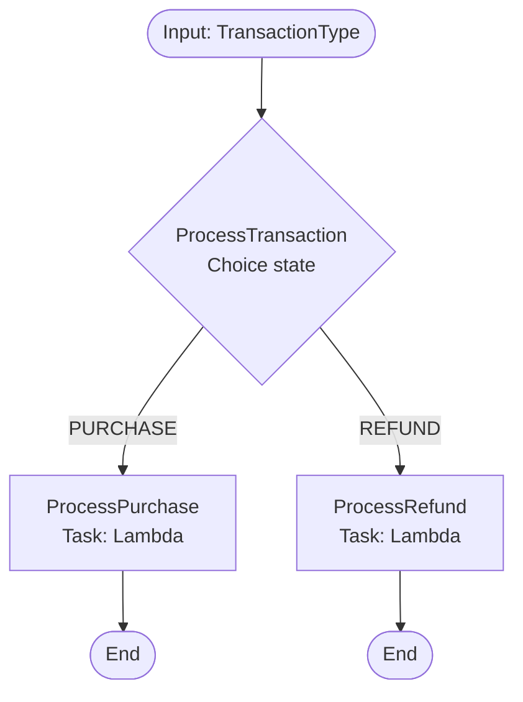
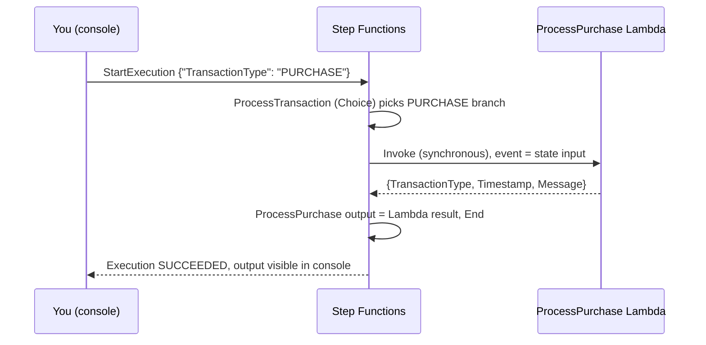

# AWS Step Functions with Lambda: Study Notes

Source: [Step Functions with Lambda tutorial (AWS Simplified)](https://youtu.be/s0XFX3WHg0w?list=PL9nWRykSBSFgQrO66TmO1vHFP6yuPF5G-), about 16 minutes.

A hands-on walkthrough. You build a **transaction processor** state machine that sends credit card **purchases** and **refunds** to two separate Lambda functions, then run it from the console and inspect each step.

The companion video, "AWS Step Functions overview", covers concepts and pricing. Notes for it are in [01_AWS_Step_Functions_Overview_Study_Notes.md](01_AWS_Step_Functions_Overview_Study_Notes.md).

Code marked **reconstructed** was rebuilt from what the video describes. Both state machine definitions below passed `ValidateStateMachineDefinition` (result `OK`, no diagnostics). The Lambda handler was run locally and gave the output shown.

---

## Contents

1. [Corrected terms](#1-corrected-terms)
2. [What you build](#2-what-you-build)
3. [Step 1: Create the two Lambda functions](#3-step-1-create-the-two-lambda-functions)
4. [Step 2: Create an IAM role for Step Functions](#4-step-2-create-an-iam-role-for-step-functions)
5. [Step 3: Create the state machine](#5-step-3-create-the-state-machine)
6. [Step 4: Run and inspect executions](#6-step-4-run-and-inspect-executions)
7. [Same setup with the AWS CLI](#7-same-setup-with-the-aws-cli)
8. [Gotchas and a hardened version](#8-gotchas-and-a-hardened-version)
9. [What has changed since the video](#9-what-has-changed-since-the-video)
10. [Cheat sheet](#10-cheat-sheet)
11. [Review questions](#11-review-questions)

---

## 1. Corrected terms

| Caption says | Actually means |
|---|---|
| AM | **IAM** (Identity and Access Management) |
| RO / roll | IAM **role** |
| RN / ARN | **ARN** (Amazon Resource Name) |
| UYU ID | **UUID** |
| decision task / choice task | **Choice state** |
| Amazon states language | **Amazon States Language (ASL)** |

---

## 2. What you build

### Architecture



- **Theme**: credit card transactions, which come in two kinds: **purchase** or **refund**.
- **ProcessTransaction** (Choice state) reads the transaction type and picks a branch.
- **ProcessPurchase** and **ProcessRefund** are Task states, each backed by its **own Lambda function**.
- Each Lambda reads the input, processes it, and returns a result to the state machine.
- After either Lambda returns, the execution reaches its **terminal state** and ends.

### Input event

```json
{
  "TransactionType": "PURCHASE"
}
```

or

```json
{
  "TransactionType": "REFUND"
}
```

### Build order

The order matters because each step needs something from the one before it:

1. **Lambda functions** first, so you have their **ARNs**.
2. **IAM role** so Step Functions is allowed to invoke those functions.
3. **State machine**, which references the Lambda ARNs and uses the role.
4. **Executions** to test both branches.

---

## 3. Step 1: Create the two Lambda functions

### Console steps

1. Open **Lambda**, then **Create function**.
2. Choose **Author from scratch**.
3. Function name: `ProcessPurchase`.
4. Runtime: the video uses **Python 3.6**. That runtime is retired, so pick a currently supported one (for example Python 3.13).
5. Permissions: keep the default, **Create a new role with basic Lambda permissions**. This gives the function permission to write CloudWatch Logs, and nothing else.
6. Click **Create function** (takes about a minute).
7. Paste the code below into the editor.
8. **Change the handler name** to match your function (see below).
9. **Save / Deploy**. Leave every other option at its default.
10. Repeat for `ProcessRefund`.

### ProcessPurchase code (reconstructed)

The function does three things:

1. **Logs** the incoming message, for debugging.
2. **Builds a response** that copies the transaction type and adds a timestamp and a message, to prove the result came from Lambda.
3. **Returns** the response to Step Functions.

```python
import datetime


def process_purchase(message, context):
    # 1. Log the input from Step Functions
    print("Received message from Step Functions:")
    print(message)

    # 2. Build the response
    response = {}
    response["TransactionType"] = message["TransactionType"]
    response["Timestamp"] = datetime.datetime.now().strftime("%Y-%m-%d %H:%M:%S")
    response["Message"] = "Hello from lambda land inside the ProcessPurchase function"

    # 3. Return it to the state machine
    return response
```

- `message` is the **state input**. When Step Functions invokes a Lambda by its ARN, the event the function gets is the JSON input of that Task state.
- `context` is the normal Lambda context object (unused here).
- Whatever the function **returns** becomes the **output** of the Task state.

Local test run of this handler with `{"TransactionType": "PURCHASE"}`:

```
Received message from Step Functions:
{'TransactionType': 'PURCHASE'}
{'TransactionType': 'PURCHASE', 'Timestamp': '2026-11-22 11:05:22', 'Message': 'Hello from lambda land inside the ProcessPurchase function'}
```

### ProcessRefund code (reconstructed)

The video calls it an "identical copy". Only the function name and message change:

```python
import datetime


def process_refund(message, context):
    print("Received message from Step Functions:")
    print(message)

    response = {}
    response["TransactionType"] = message["TransactionType"]
    response["Timestamp"] = datetime.datetime.now().strftime("%Y-%m-%d %H:%M:%S")
    response["Message"] = "Hello from lambda land inside the ProcessRefund function"

    return response
```

### The handler setting

- In the console the code lives in `lambda_function.py`, and Lambda's default handler is `lambda_function.lambda_handler`.
- Since the functions are named `process_purchase` and `process_refund`, change the handler to:
  - `lambda_function.process_purchase` for ProcessPurchase
  - `lambda_function.process_refund` for ProcessRefund
- Format: `<file name without .py>.<function name>`.
- If you forget this, the invocation fails with a `Runtime.HandlerNotFound` error.

### Why two Lambdas instead of one?

The video says one function would work fine. Two are used only to show branching. Trade-offs if you do this for real:

| Two functions | One function |
|---|---|
| Each can scale, deploy, and get IAM permissions on its own | Less to deploy and manage |
| Branching logic lives in the state machine, where it shows up in the console | Branching lives in code, hidden from the console |
| Some duplicated code | No duplication |

### Grab the ARNs

- Open each function. The **ARN** is shown at the top right of the function page.
- Copy both ARNs. The state machine needs them as the `Resource` of each Task state.

```
arn:aws:lambda:us-east-1:123456789012:function:ProcessPurchase
arn:aws:lambda:us-east-1:123456789012:function:ProcessRefund
```

---

## 4. Step 2: Create an IAM role for Step Functions

Step Functions needs its own role so it is **allowed to invoke** your Lambda functions.

### Console steps (as in the video)

1. Open **IAM**, then **Roles**, then **Create role**.
2. Trusted entity: **AWS service**, use case **Step Functions**.
3. On the permissions page it comes with a default Lambda policy attached (`AWSLambdaRole`). Leave it as is.
4. Skip tags.
5. Role name: `StepFunctionLambdaRole`, then **Create role**.

### What the role contains

**Trust policy** (who can assume the role): the Step Functions service.

```json
{
  "Version": "2012-10-17",
  "Statement": [
    {
      "Effect": "Allow",
      "Principal": { "Service": "states.amazonaws.com" },
      "Action": "sts:AssumeRole"
    }
  ]
}
```

**Permissions policy** (`AWSLambdaRole`, AWS managed): lets the role invoke Lambda functions.

```json
{
  "Version": "2012-10-17",
  "Statement": [
    {
      "Effect": "Allow",
      "Action": ["lambda:InvokeFunction"],
      "Resource": ["*"]
    }
  ]
}
```

> `"Resource": "*"` means it can invoke **any** function in the account. That's fine for a demo. In real use, scope it to the two function ARNs:
>
> ```json
> {
>   "Version": "2012-10-17",
>   "Statement": [
>     {
>       "Effect": "Allow",
>       "Action": "lambda:InvokeFunction",
>       "Resource": [
>         "arn:aws:lambda:us-east-1:123456789012:function:ProcessPurchase",
>         "arn:aws:lambda:us-east-1:123456789012:function:ProcessRefund"
>       ]
>     }
>   ]
> }
> ```

### Two separate roles: keep them straight

| Role | Assumed by | Grants | Created in |
|---|---|---|---|
| Lambda **execution role** | Lambda service, when the function runs | Write CloudWatch Logs (plus anything your code calls) | Step 1, automatically |
| Step Functions **state machine role** | Step Functions, when the execution runs | `lambda:InvokeFunction` (plus anything the workflow calls) | Step 2 |

### Synchronous invocation

The video points out that in this setup Step Functions invokes Lambda **synchronously**. The Task state waits for the function to finish and uses its return value as the state's output before moving on.

---

## 5. Step 3: Create the state machine

### Console steps (as in the video)

1. Open **Step Functions**. On first visit it may show a getting-started wizard. Go past it to **Create state machine**.
2. Name: `TransactionProcessorStateMachine`.
3. The editor shows ASL code on one side and a **visual graph** on the other. Refresh the graph after editing to see your changes drawn.
4. Paste the definition below.
5. Replace the placeholder Lambda ARNs with the ones you copied. A **red dotted line** in the graph flags a Task with an invalid ARN.
6. Permissions: **Choose an existing IAM role**, then pick `StepFunctionLambdaRole`.
7. **Create state machine**.

### The definition (reconstructed)

```json
{
  "Comment": "Transaction processor: route purchases and refunds to separate Lambdas",
  "StartAt": "ProcessTransaction",
  "States": {
    "ProcessTransaction": {
      "Type": "Choice",
      "Choices": [
        {
          "Variable": "$.TransactionType",
          "StringEquals": "PURCHASE",
          "Next": "ProcessPurchase"
        },
        {
          "Variable": "$.TransactionType",
          "StringEquals": "REFUND",
          "Next": "ProcessRefund"
        }
      ]
    },
    "ProcessPurchase": {
      "Type": "Task",
      "Resource": "arn:aws:lambda:us-east-1:123456789012:function:ProcessPurchase",
      "End": true
    },
    "ProcessRefund": {
      "Type": "Task",
      "Resource": "arn:aws:lambda:us-east-1:123456789012:function:ProcessRefund",
      "End": true
    }
  }
}
```

### Line by line

| Part | What it does |
|---|---|
| `"StartAt": "ProcessTransaction"` | The execution begins at this state |
| `"States"` | Map of every state, keyed by name |
| `"Type": "Choice"` | A branching state. It does no work, it only picks the next state. |
| `"Choices": [...]` | An array of rules, checked **in order**. The first match wins. |
| `"Variable": "$.TransactionType"` | A JSONPath into the state input. `$` is the whole input, `.TransactionType` is the key. |
| `"StringEquals": "PURCHASE"` | Comparison operator and value. Exact and case-sensitive. |
| `"Next": "ProcessPurchase"` | Where to go if this rule matches |
| `"Type": "Task"` | A state that does work |
| `"Resource": "arn:aws:lambda:..."` | The Lambda function to invoke |
| `"End": true` | Terminal state. The execution finishes after this. |

### How the graph reads

- Start, then the **ProcessTransaction** decision.
- Branch to ProcessPurchase or ProcessRefund depending on input.
- Either branch goes to End.

---

## 6. Step 4: Run and inspect executions

### Start a purchase execution

1. On the state machine page, click **Start execution**.
2. **Name**: any unique ID. A UUID is pre-filled. You can type your own.
3. **Input**:

   ```json
   { "TransactionType": "PURCHASE" }
   ```

4. Click **Start execution**.

### What you see

- The **graph updates in real time**:
  - **Blue**: the state currently running.
  - **Green**: succeeded.
  - (Red: failed. Orange: an error was caught.)
- The path taken is highlighted: ProcessTransaction, then ProcessPurchase, then End.
- This live view is the "auditing" benefit from the overview video. For a stuck credit card transaction, you can see exactly which state it's in.

### Inspect each state

Click a state in the graph to see its **input** and **output**.

**ProcessTransaction** (Choice):

| Input | Output |
|---|---|
| `{"TransactionType": "PURCHASE"}` | `{"TransactionType": "PURCHASE"}` |

A Choice state **passes its input through unchanged**. It only decides where to go next.

**ProcessPurchase** (Task, Lambda):

| Input | Output |
|---|---|
| `{"TransactionType": "PURCHASE"}` | `{"TransactionType": "PURCHASE", "Timestamp": "...", "Message": "Hello from lambda land inside the ProcessPurchase function"}` |

The output is exactly what the Lambda returned. The details also show which Lambda resource was invoked.

### Start a refund execution

1. Click **New execution**.
2. Input:

   ```json
   { "TransactionType": "REFUND" }
   ```

3. The graph takes the other branch. ProcessRefund's output carries `"TransactionType": "REFUND"` and the ProcessRefund message.

### Execution lifecycle summary



---

## 7. Same setup with the AWS CLI

The video uses the console only. The same setup from the command line looks like this. Replace `123456789012` and the region with your own.

```bash
# --- Lambda execution role ---
cat > lambda-trust.json <<'EOF'
{
  "Version": "2012-10-17",
  "Statement": [
    { "Effect": "Allow", "Principal": { "Service": "lambda.amazonaws.com" }, "Action": "sts:AssumeRole" }
  ]
}
EOF
aws iam create-role --role-name ProcessTransactionLambdaRole \
  --assume-role-policy-document file://lambda-trust.json
aws iam attach-role-policy --role-name ProcessTransactionLambdaRole \
  --policy-arn arn:aws:iam::aws:policy/service-role/AWSLambdaBasicExecutionRole

# --- Lambda functions (lambda_function.py holds both handlers) ---
zip function.zip lambda_function.py
aws lambda create-function --function-name ProcessPurchase \
  --runtime python3.13 --handler lambda_function.process_purchase \
  --role arn:aws:iam::123456789012:role/ProcessTransactionLambdaRole \
  --zip-file fileb://function.zip
aws lambda create-function --function-name ProcessRefund \
  --runtime python3.13 --handler lambda_function.process_refund \
  --role arn:aws:iam::123456789012:role/ProcessTransactionLambdaRole \
  --zip-file fileb://function.zip

# --- Step Functions role ---
cat > sfn-trust.json <<'EOF'
{
  "Version": "2012-10-17",
  "Statement": [
    { "Effect": "Allow", "Principal": { "Service": "states.amazonaws.com" }, "Action": "sts:AssumeRole" }
  ]
}
EOF
aws iam create-role --role-name StepFunctionLambdaRole \
  --assume-role-policy-document file://sfn-trust.json
aws iam attach-role-policy --role-name StepFunctionLambdaRole \
  --policy-arn arn:aws:iam::aws:policy/service-role/AWSLambdaRole

# --- State machine (state-machine.json = definition from section 5) ---
aws stepfunctions create-state-machine --name TransactionProcessorStateMachine \
  --definition file://state-machine.json \
  --role-arn arn:aws:iam::123456789012:role/StepFunctionLambdaRole

# --- Run it ---
aws stepfunctions start-execution \
  --state-machine-arn arn:aws:states:us-east-1:123456789012:stateMachine:TransactionProcessorStateMachine \
  --input '{"TransactionType": "PURCHASE"}'

# --- Check the result (use the executionArn printed above) ---
aws stepfunctions describe-execution --execution-arn <executionArn> \
  --query '{status: status, output: output}'
aws stepfunctions get-execution-history --execution-arn <executionArn>
```

Notes:

- Newly created IAM roles can take a few seconds to become usable. If `create-function` or `create-state-machine` complains it can't assume the role, wait and retry.
- Putting both handlers in one `lambda_function.py` and pointing each function's handler at a different name is a simple way to share one zip.

---

## 8. Gotchas and a hardened version

### Gotchas

1. **No `Default` branch.** The video's Choice state has none. Input like `{"TransactionType": "TRANSFER"}` matches no rule, and the execution **fails** with `States.NoChoiceMatched`.
2. **`StringEquals` is case-sensitive.** `"purchase"` does not match `"PURCHASE"`.
3. **Missing key.** If the input has no `TransactionType`, checking `$.TransactionType` fails at runtime. Guard with `"IsPresent": true` or validate earlier.
4. **Handler name mismatch.** You must change the handler to `lambda_function.process_purchase`, or the function can't be found.
5. **Lambda `datetime.now()` is UTC.** Lambda runs in UTC, so the timestamp isn't your local time.
6. **Broad IAM.** `AWSLambdaRole` allows invoking every function. Scope it down outside of demos.
7. **Execution names must be unique.** For Standard workflows, a name can't be reused in the same state machine for 90 days. Let the console generate a UUID unless you have a reason not to.
8. **No retries.** A transient Lambda service error fails the execution. AWS recommends retrying on Lambda service exceptions.

### Hardened definition

Adds a `Default` branch, retries on transient Lambda errors, and uses the `lambda:invoke` integration (the current recommended style). Validated: `OK`, no diagnostics.

```json
{
  "Comment": "Transaction processor with a Default branch and Lambda retries",
  "StartAt": "ProcessTransaction",
  "States": {
    "ProcessTransaction": {
      "Type": "Choice",
      "Choices": [
        { "Variable": "$.TransactionType", "StringEquals": "PURCHASE", "Next": "ProcessPurchase" },
        { "Variable": "$.TransactionType", "StringEquals": "REFUND", "Next": "ProcessRefund" }
      ],
      "Default": "UnknownTransactionType"
    },
    "ProcessPurchase": {
      "Type": "Task",
      "Resource": "arn:aws:states:::lambda:invoke",
      "Parameters": {
        "FunctionName": "arn:aws:lambda:us-east-1:123456789012:function:ProcessPurchase",
        "Payload.$": "$"
      },
      "OutputPath": "$.Payload",
      "Retry": [
        {
          "ErrorEquals": [
            "Lambda.ServiceException",
            "Lambda.AWSLambdaException",
            "Lambda.SdkClientException",
            "Lambda.TooManyRequestsException"
          ],
          "IntervalSeconds": 1,
          "MaxAttempts": 3,
          "BackoffRate": 2.0
        }
      ],
      "End": true
    },
    "ProcessRefund": {
      "Type": "Task",
      "Resource": "arn:aws:states:::lambda:invoke",
      "Parameters": {
        "FunctionName": "arn:aws:lambda:us-east-1:123456789012:function:ProcessRefund",
        "Payload.$": "$"
      },
      "OutputPath": "$.Payload",
      "Retry": [
        {
          "ErrorEquals": [
            "Lambda.ServiceException",
            "Lambda.AWSLambdaException",
            "Lambda.SdkClientException",
            "Lambda.TooManyRequestsException"
          ],
          "IntervalSeconds": 1,
          "MaxAttempts": 3,
          "BackoffRate": 2.0
        }
      ],
      "End": true
    },
    "UnknownTransactionType": {
      "Type": "Fail",
      "Error": "UnknownTransactionType",
      "Cause": "TransactionType must be PURCHASE or REFUND."
    }
  }
}
```

What changed and why:

| Change | Reason |
|---|---|
| `"Default": "UnknownTransactionType"` plus a Fail state | Unknown types fail with a clear error name instead of `States.NoChoiceMatched` |
| `arn:aws:states:::lambda:invoke` with `FunctionName` | The integration style the console generates today, and lets you shape the payload |
| `"Payload.$": "$"` | Sends the whole state input as the Lambda event (same as the raw-ARN style) |
| `"OutputPath": "$.Payload"` | `lambda:invoke` wraps the result in `{Payload, StatusCode, ...}`. This unwraps it so the output matches the original. |
| `Retry` on `Lambda.*` service errors | Recovers from transient throttling and service errors |

---

## 9. What has changed since the video

The video was recorded around 2019. The ideas are the same, but the console and defaults have moved on:

| Then (video) | Now |
|---|---|
| Python 3.6 runtime | Retired. Use a supported runtime such as Python 3.13. |
| Plain ASL editor with a "refresh" button for the graph | **Workflow Studio**: drag-and-drop designer with Design, Code, and Config tabs that stay in sync |
| Create the IAM role yourself in IAM | The console can **create a role automatically**, with permissions scoped to the resources in your definition |
| `"Resource": "<lambda ARN>"` | Console generates `arn:aws:states:::lambda:invoke` with `FunctionName` and `Payload`, plus a default Retry on Lambda service errors |
| Standard workflow only | Choose **Standard** or **Express** when creating the state machine |
| JSONPath only (`$.TransactionType`) | JSONPath or **JSONata** (`"QueryLanguage": "JSONata"`, conditions written as ``) |
| Console-only testing | **TestState** API / "Test state" button lets you test one state on its own without running the whole machine |

---

## 10. Cheat sheet

```
Build order      : Lambdas (get ARNs) -> IAM role for Step Functions -> state machine -> executions
Lambda handler   : <file>.<function>, e.g. lambda_function.process_purchase
Lambda event     : = Task state's input; return value = Task state's output
SFN role trust   : states.amazonaws.com
SFN role perms   : lambda:InvokeFunction (AWSLambdaRole = all functions; scope it down)
Choice state     : Choices[] checked in order, first match wins; add Default
                   Variable "$.Key" + StringEquals/NumericEquals/BooleanEquals/IsPresent ...
                   passes input through unchanged
Task (Lambda)    : Resource = function ARN (classic) or arn:aws:states:::lambda:invoke (current)
Terminal         : "End": true, or a Succeed / Fail state
Console colors   : blue = running, green = succeeded, red = failed, orange = caught error
No match         : States.NoChoiceMatched
```

---

## 11. Review questions

<details>
<summary>1. Why do you create the Lambda functions before the state machine?</summary>

The state machine's Task states need the Lambda **ARNs** as their `Resource`. Without valid ARNs the console flags the Task with a red dotted line.
</details>

<details>
<summary>2. What two IAM roles are involved, and who assumes each?</summary>

The Lambda **execution role**, assumed by Lambda when the function runs (needs CloudWatch Logs). The **state machine role**, assumed by Step Functions (`states.amazonaws.com`) when the execution runs (needs `lambda:InvokeFunction`).
</details>

<details>
<summary>3. Your Lambda code defines `process_purchase` in `lambda_function.py`. What must the handler setting be?</summary>

`lambda_function.process_purchase`.
</details>

<details>
<summary>4. What does a Choice state output?</summary>

Its input, unchanged. It only decides the next state.
</details>

<details>
<summary>5. An execution starts with {"TransactionType": "TRANSFER"} against the video's definition. What happens?</summary>

No rule matches and there is no `Default`, so the execution fails with `States.NoChoiceMatched`.
</details>

<details>
<summary>6. Would {"TransactionType": "purchase"} go to ProcessPurchase?</summary>

No. `StringEquals` is case-sensitive, so `"purchase"` doesn't match `"PURCHASE"`.
</details>

<details>
<summary>7. How is the Lambda invoked from this Task state: sync or async? What does that mean for the workflow?</summary>

Synchronously. The Task waits for the function to return and uses the return value as its output before moving on.
</details>

<details>
<summary>8. What does "$.TransactionType" refer to?</summary>

The `TransactionType` field of the current state's JSON input. `$` is the root of the input.
</details>

<details>
<summary>9. How do you mark a state as the last one?</summary>

`"End": true` on the state, or use a `Succeed` or `Fail` state type.
</details>

<details>
<summary>10. What does `AWSLambdaRole` allow, and why is it too broad for production?</summary>

`lambda:InvokeFunction` on `"*"`, meaning every function in the account. Production roles should list only the function ARNs the workflow calls.
</details>

<details>
<summary>11. Using arn:aws:states:::lambda:invoke, why add "OutputPath": "$.Payload"?</summary>

That integration wraps the function's result in metadata (`Payload`, `StatusCode`, and so on). `OutputPath: "$.Payload"` keeps only what the function returned.
</details>

<details>
<summary>12. In the execution graph, what do blue and green mean?</summary>

Blue is the state currently running. Green is a state that succeeded.
</details>

<details>
<summary>13. Could one Lambda handle both purchases and refunds?</summary>

Yes, the video says so. Two functions are used to show branching in the state machine. Two functions also let each one scale, deploy, and get permissions independently.
</details>
