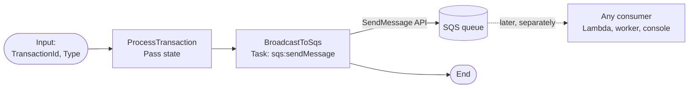
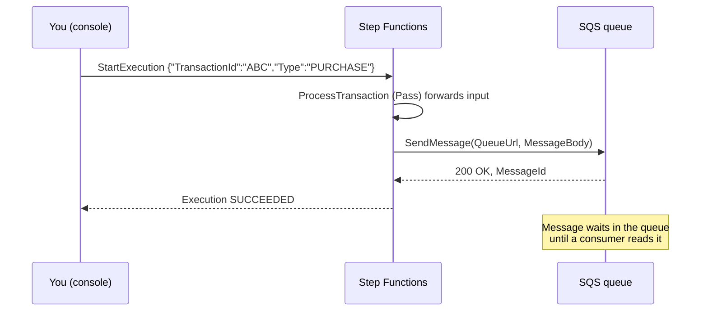
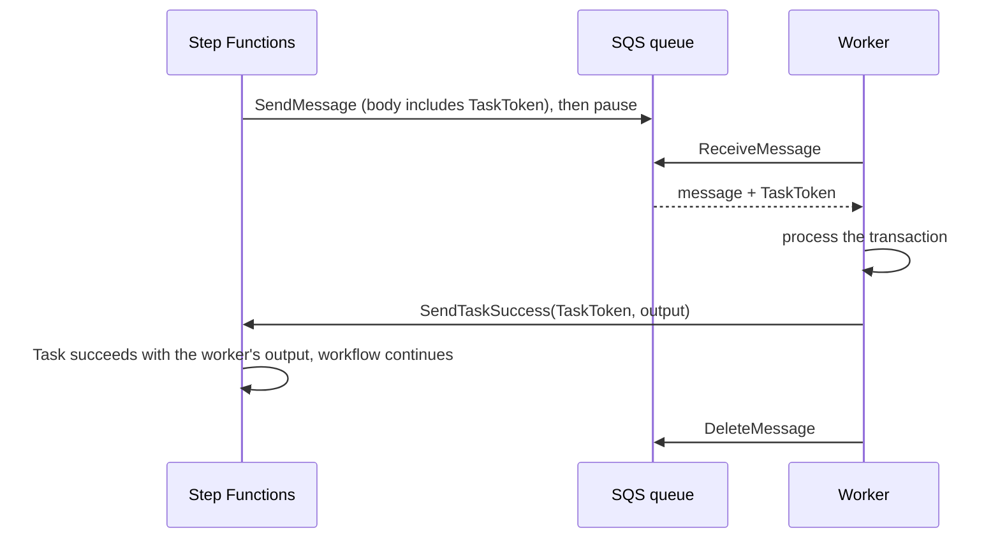

# AWS Step Functions with SQS: Study Notes

Source: [Step Functions with SQS (AWS Simplified)](https://youtu.be/tPYa1r_cZ2E?list=PL9nWRykSBSFgQrO66TmO1vHFP6yuPF5G-), about 4.5 minutes.

A short hands-on video. You build a state machine that **sends a message to an SQS queue directly**, with no Lambda in between. Then you run it and check that the message landed in the queue.

It follows the same transaction theme as [02_AWS_Step_Functions_with_Lambda_Study_Notes.md](02_AWS_Step_Functions_with_Lambda_Study_Notes.md). Concepts and pricing are in [01_AWS_Step_Functions_Overview_Study_Notes.md](01_AWS_Step_Functions_Overview_Study_Notes.md).

Code marked **reconstructed** was rebuilt from what the video describes on screen. Resource names come from garbled captions, so treat them as close guesses.

What was checked:
- Every state machine definition here passed `ValidateStateMachineDefinition` (result `OK`, no diagnostics).
- The `.$` substitution examples in section 5 were run through the `TestState` API, and the outputs shown are the real results.
- The worker script in section 9 was parsed and its boto3 calls checked against the SDK. It hasn't been run against a live queue.

---

## Contents

1. [Corrected terms](#1-corrected-terms)
2. [What you build](#2-what-you-build)
3. [The key idea: calling AWS services directly](#3-the-key-idea-calling-aws-services-directly)
4. [Step 1: Create the queue](#4-step-1-create-the-queue)
5. [Step 2: Write the state machine definition](#5-step-2-write-the-state-machine-definition)
6. [Step 3: The IAM role](#6-step-3-the-iam-role)
7. [Step 4: Run it and check the queue](#7-step-4-run-it-and-check-the-queue)
8. [Same setup with the AWS CLI](#8-same-setup-with-the-aws-cli)
9. [Beyond the video: wait for a reply with a task token](#9-beyond-the-video-wait-for-a-reply-with-a-task-token)
10. [More variations: hardened, FIFO, JSONata](#10-more-variations-hardened-fifo-jsonata)
11. [Gotchas](#11-gotchas)
12. [What has changed since the video](#12-what-has-changed-since-the-video)
13. [Cheat sheet](#13-cheat-sheet)
14. [Review questions](#14-review-questions)

---

## 1. Corrected terms

| Caption says | Actually means |
|---|---|
| S qsq / ask us / SQL | **SQS** (Simple Queue Service) |
| the air / AR n | He says "ARN" at 02:28, but the field takes the **queue URL**, as he says himself at 00:31 |
| I am role | **IAM role** |
| fresh | **Refresh** the graph preview |
| transact | The `TransactionId` key |
| pull this queue | **Poll** the queue (receive messages) |
| ASL | **Amazon States Language** |

---

## 2. What you build

### Architecture



- **ProcessTransaction** is a **Pass** state. It does no work and only hands its input to the next state. In the video it's a placeholder where real processing would go later.
- **BroadcastToSqs** is a **Task** state. Its resource is the SQS `SendMessage` API, so Step Functions puts a message on the queue itself.
- The workflow **doesn't wait for anyone to read the message.** Once SQS accepts it, the state succeeds and the execution ends.
- Whatever reads the queue later is a separate system, outside the state machine.

### Input

```json
{
  "TransactionId": "ABC",
  "Type": "PURCHASE"
}
```

### What ends up in the queue

The message body is built from the input. Two fields are copied across, giving a JSON message with the same keys:

```json
{"TransactionId":"ABC","Type":"PURCHASE"}
```

### Compared with notes 02

| | Notes 02 (Lambda) | This video (SQS) |
|---|---|---|
| Task resource | A Lambda function ARN | `arn:aws:states:::sqs:sendMessage` |
| Code you write | Python handler | None, only the ASL definition |
| What the Task waits for | The function to return | SQS to accept the message |
| State output | The function's return value | SQS's reply (message ID, status code) |
| Role permission | `lambda:InvokeFunction` | `sqs:SendMessage` |

---

## 3. The key idea: calling AWS services directly

In notes 02, every bit of work went through a Lambda. Here **Step Functions calls the AWS API itself**. This is called a **service integration**.

Why it matters:

- **Less code.** A Lambda that only forwards input to `sqs.send_message()` adds code, a deployment, logs, cold starts and cost, and does nothing Step Functions can't do on its own.
- **Fewer moving parts.** There's no Lambda execution role and no function to deploy. The state machine's role only needs `sqs:SendMessage`.

### Two kinds of integration

| Kind | Resource ARN | Covers |
|---|---|---|
| **Optimized** (this video) | `arn:aws:states:::sqs:sendMessage` | For SQS, only `SendMessage`. Step Functions adds conveniences such as accepting a JSON object as the message body. |
| **AWS SDK** | `arn:aws:states:::aws-sdk:sqs:<apiAction>`, for example `aws-sdk:sqs:getQueueAttributes` | Almost any SQS API, called as-is |

### Three integration patterns

The suffix on the resource ARN decides how long the Task waits:

| Pattern | Resource suffix | SQS supports it? | The Task waits until |
|---|---|---|---|
| **Request Response** | *(none)*, as in this video | Yes | SQS accepts the message (milliseconds) |
| **Run a Job** | `.sync` | No | A job finishes. Used for Batch, ECS, Glue, and similar. |
| **Wait for Callback** | `.waitForTaskToken` | Yes | Someone calls `SendTaskSuccess` or `SendTaskFailure` with the token. See section 9. |

---

## 4. Step 1: Create the queue

### Console steps

1. Open **SQS** and click **Create queue**. The video used the old "Quick-Create" button, which no longer exists.
2. **Type: Standard.**
3. Name: `SQSFromStepFunction`.
4. Leave everything else at its defaults and click **Create queue**.
5. On the queue's page, **copy the URL**. You need it in the next step.

### URL vs ARN

The video stresses this, and it trips people up: a queue has both, and they're used in different places.

| | Format | Where it's used |
|---|---|---|
| **Queue URL** | `https://sqs.us-east-1.amazonaws.com/123456789012/SQSFromStepFunction` | The `QueueUrl` parameter in the state machine. The `SendMessage` API takes a URL. |
| **Queue ARN** | `arn:aws:sqs:us-east-1:123456789012:SQSFromStepFunction` | The IAM policy `Resource`. Permissions are always written against ARNs. |

Both contain the same three parts (region, account ID, queue name), arranged differently.

---

## 5. Step 2: Write the state machine definition

### Console steps (as in the video)

1. Open **Step Functions** and choose **Create state machine**.
2. Name: `StepFunctionUsingSqs` (reconstructed).
3. Paste the definition below into the code editor.
4. Replace the `QueueUrl` value with your queue's **URL**.
5. Refresh the graph. It should show `ProcessTransaction` → `BroadcastToSqs`.

### The definition (reconstructed)

```json
{
  "Comment": "Transaction Processor State Machine Using SQS",
  "StartAt": "ProcessTransaction",
  "States": {
    "ProcessTransaction": {
      "Type": "Pass",
      "Next": "BroadcastToSqs"
    },
    "BroadcastToSqs": {
      "Type": "Task",
      "Resource": "arn:aws:states:::sqs:sendMessage",
      "Parameters": {
        "QueueUrl": "https://sqs.us-east-1.amazonaws.com/123456789012/SQSFromStepFunction",
        "MessageBody": {
          "TransactionId.$": "$.TransactionId",
          "Type.$": "$.Type"
        }
      },
      "End": true
    }
  }
}
```

### Line by line

| Part | What it does |
|---|---|
| `"Type": "Pass"` | Copies input to output and does nothing else. Useful as a placeholder or to reshape data. |
| `"Next": "BroadcastToSqs"` | Go to the SQS step next |
| `"Resource": "arn:aws:states:::sqs:sendMessage"` | Call the SQS `SendMessage` API (optimized integration, Request Response pattern) |
| `"Parameters"` | The arguments for the API call. The names match the SQS API in PascalCase: `QueueUrl`, `MessageBody`. |
| `"QueueUrl"` | A fixed string: the queue's URL |
| `"MessageBody"` | The message content. Here it's a JSON object, and Step Functions turns it into a JSON string before sending. |
| `"TransactionId.$": "$.TransactionId"` | Take the value at `$.TransactionId` in the state's input and store it under the key `TransactionId` (see below) |
| `"End": true` | Last state |

### The `.$` rule

This is what the video explains at 01:52 to 02:16 ("this whole thing is going to be replaced with ABC"):

- A key **without** `.$` keeps its value **as written**.
- A key **ending in `.$`** treats its value as a **path into the input**. Step Functions looks the value up, drops the `.$` from the key name, and puts the looked-up value there.

Real `TestState` results with input `{"TransactionId": "ABC", "Type": "PURCHASE"}`:

| `MessageBody` template | Result |
|---|---|
| `{"TransactionId.$": "$.TransactionId", "Type.$": "$.Type"}` | `{"Type": "PURCHASE", "TransactionId": "ABC"}` |
| `{"TransactionId": "$.TransactionId", "Type": "$.Type"}` (forgot `.$`) | `{"TransactionId": "$.TransactionId", "Type": "$.Type"}`: the literal text gets sent |

With input `{"Type": "PURCHASE"}` (no `TransactionId`), the first template **fails**:

```
States.Runtime: The JSONPath '$.TransactionId' specified for the field 'TransactionId.$'
could not be found in the input '{"Type": "PURCHASE"}'
```

Key order in the result isn't guaranteed. `Type` came out first above, and JSON consumers shouldn't depend on order anyway.

---

## 6. Step 3: The IAM role

### Console steps (as in the video)

1. Click **Next** to reach the permissions page.
2. Keep **Create new role** and name it, for example `StepFunctionSqsIamRole`.
3. The console **reads your definition, sees the SQS task, and adds `sqs:SendMessage` for that queue** automatically. The video calls this out as a nice feature.
4. Skip tags and click **Create state machine**.

### What the generated policy looks like

This is the format from the AWS docs for a fixed queue. Note that it uses the **ARN**:

```json
{
  "Version": "2012-10-17",
  "Statement": [
    {
      "Effect": "Allow",
      "Action": ["sqs:SendMessage"],
      "Resource": ["arn:aws:sqs:us-east-1:123456789012:SQSFromStepFunction"]
    }
  ]
}
```

If the queue URL came from the input (`"QueueUrl.$": "$.queueUrl"`), Step Functions couldn't know the queue in advance. The generated policy would then use `"Resource": "*"`. That's broad, so prefer a fixed URL or narrow the policy by hand.

### Roles compared with notes 02

| | Notes 02 | This video |
|---|---|---|
| Lambda execution role | Yes, one per function | None, because there's no Lambda |
| State machine role | `lambda:InvokeFunction` | `sqs:SendMessage` on one queue |
| How you got it | Created by hand in IAM | Generated by the console from the definition |

---

## 7. Step 4: Run it and check the queue

### Start an execution

1. On the state machine page, click **Start execution**.
2. Input:

   ```json
   { "TransactionId": "ABC", "Type": "PURCHASE" }
   ```

3. Click **Start execution**. It turns green within a few seconds.

### What the Task returns

Click **BroadcastToSqs** in the graph:

- **Input** is what you passed in.
- **Output** is SQS's reply, which has this shape:

```json
{
  "MD5OfMessageBody": "…",
  "MessageId": "…",
  "SdkHttpMetadata": {
    "AllHttpHeaders": { "…": ["…"] },
    "HttpHeaders": { "…": "…" },
    "HttpStatusCode": 200
  },
  "SdkResponseMetadata": { "RequestId": "…" }
}
```

`HttpStatusCode: 200` is the "200 OK confirmation" the video points at.

Notice that **the original input is gone from the output.** By default, a Task's result replaces its input. That's fine here because this is the last state. Section 10 shows how to keep both.

### Check the queue

1. Open **SQS > Queues**. The queue's **Messages available** column shows `1`.
2. **Select the queue**: click its radio button, or click its name to open it. **Send and receive messages** stays greyed out until a queue is selected.
3. Click **Send and receive messages**.
4. Scroll to the **Receive messages** section at the bottom and click **Poll for messages**.
5. The message appears in a list. **Click its message ID.**
6. In the popup, open the **Body** tab. You should see the JSON built from your input:

   ```json
   {"TransactionId":"ABC","Type":"PURCHASE"}
   ```

   The **Attributes** tab shows details such as the sent time and the receive count.

Polling in the console **receives** the message but doesn't **delete** it:

- While you look at it, it's **in flight**: **Messages in flight** shows `1` and **Messages available** shows `0`.
- After the visibility timeout (30 seconds by default), it becomes available again, and its receive count goes up by one.
- To remove it, select it in the list and click **Delete**. If you leave it, it expires after the retention period (4 days by default).

### Execution lifecycle



---

## 8. Same setup with the AWS CLI

The video uses the console only. Here's the same setup from a shell. `state-machine.json` is the definition from section 5, with your queue URL filled in.

```bash
ACCOUNT_ID=$(aws sts get-caller-identity --query Account --output text)

# --- Queue: keep both the URL and the ARN ---
QUEUE_URL=$(aws sqs create-queue --queue-name SQSFromStepFunction \
  --query QueueUrl --output text)
QUEUE_ARN=$(aws sqs get-queue-attributes --queue-url "$QUEUE_URL" \
  --attribute-names QueueArn --query Attributes.QueueArn --output text)
echo "$QUEUE_URL"   # paste this into state-machine.json

# --- State machine role ---
cat > sfn-trust.json <<EOF
{
  "Version": "2012-10-17",
  "Statement": [{
    "Effect": "Allow",
    "Principal": { "Service": "states.amazonaws.com" },
    "Action": "sts:AssumeRole",
    "Condition": { "StringEquals": { "aws:SourceAccount": "$ACCOUNT_ID" } }
  }]
}
EOF
aws iam create-role --role-name StepFunctionSqsRole \
  --assume-role-policy-document file://sfn-trust.json

cat > sfn-sqs-policy.json <<EOF
{
  "Version": "2012-10-17",
  "Statement": [{ "Effect": "Allow", "Action": "sqs:SendMessage", "Resource": "$QUEUE_ARN" }]
}
EOF
aws iam put-role-policy --role-name StepFunctionSqsRole \
  --policy-name SendToQueue --policy-document file://sfn-sqs-policy.json

# --- State machine ---
SM_ARN=$(aws stepfunctions create-state-machine --name StepFunctionUsingSqs \
  --definition file://state-machine.json \
  --role-arn "arn:aws:iam::${ACCOUNT_ID}:role/StepFunctionSqsRole" \
  --query stateMachineArn --output text)

# --- Run it ---
EXEC=$(aws stepfunctions start-execution --state-machine-arn "$SM_ARN" \
  --input '{"TransactionId": "ABC", "Type": "PURCHASE"}' \
  --query executionArn --output text)
aws stepfunctions describe-execution --execution-arn "$EXEC" \
  --query '{status: status, output: output}'

# --- Read the message, then delete it ---
aws sqs receive-message --queue-url "$QUEUE_URL" --wait-time-seconds 5 \
  --query 'Messages[0].[Body, ReceiptHandle]' --output text
aws sqs delete-message --queue-url "$QUEUE_URL" --receipt-handle '<ReceiptHandle from above>'

# --- Clean up ---
aws stepfunctions delete-state-machine --state-machine-arn "$SM_ARN"
aws iam delete-role-policy --role-name StepFunctionSqsRole --policy-name SendToQueue
aws iam delete-role --role-name StepFunctionSqsRole
aws sqs delete-queue --queue-url "$QUEUE_URL"
```

Notes:

- The heredocs use `<<EOF` without quotes, so `$ACCOUNT_ID` and `$QUEUE_ARN` get filled in. Notes 02 used `<<'EOF'` because there was nothing to fill in.
- A brand-new role can take a few seconds to work. If `create-state-machine` says it can't assume the role, wait and retry.
- A message is only removed from the queue by `delete-message`, using the `ReceiptHandle` from the receive call.

---

## 9. Beyond the video: wait for a reply with a task token

In the video, the workflow fires the message and ends. It never learns whether anyone processed the transaction. Often you want the workflow to **pause until a worker finishes** and then continue with the worker's result. That's the **Wait for Callback** pattern, and SQS is the standard example in the AWS docs.



### Definition (validated: `OK`)

```json
{
  "Comment": "Send to SQS and wait until a worker reports back with the task token",
  "StartAt": "SendAndWait",
  "States": {
    "SendAndWait": {
      "Type": "Task",
      "Resource": "arn:aws:states:::sqs:sendMessage.waitForTaskToken",
      "Parameters": {
        "QueueUrl": "https://sqs.us-east-1.amazonaws.com/123456789012/SQSFromStepFunction",
        "MessageBody": {
          "TransactionId.$": "$.TransactionId",
          "Type.$": "$.Type",
          "TaskToken.$": "$$.Task.Token"
        }
      },
      "HeartbeatSeconds": 600,
      "TimeoutSeconds": 3600,
      "End": true
    }
  }
}
```

| Part | What it does |
|---|---|
| `.waitForTaskToken` | Send the message, then **pause** this Task until the token comes back |
| `"$$.Task.Token"` | `$$` reads the **Context object** (execution metadata), not the input. `Task.Token` is a unique token for this paused Task. |
| `TimeoutSeconds: 3600` | Give up after 1 hour with `States.Timeout`. Without a timeout, a lost message could leave the execution waiting for a very long time. |
| `HeartbeatSeconds: 600` | A long-running worker must call `SendTaskHeartbeat` at least every 10 minutes, or the Task fails with `States.HeartbeatTimeout`. Drop it if your worker is quick. |

The worker's `output` becomes the Task's output. A `SendTaskFailure` makes the Task fail with the error name the worker gave, which `Catch` or `Retry` can handle.

### Worker (Python, boto3)

Save it as `sqs_worker.py` and run it with `uv run sqs_worker.py`. The header lets uv install boto3 for it.

```python
# /// script
# dependencies = ["boto3"]
# ///
"""Worker for the wait-for-callback pattern: read one batch, report back to Step Functions."""
import json
import sys

import boto3
from botocore.exceptions import ClientError

QUEUE_URL = "https://sqs.us-east-1.amazonaws.com/123456789012/SQSFromStepFunction"

sqs = boto3.client("sqs")
sfn = boto3.client("stepfunctions")


def process(body: dict) -> dict:
    # Real work goes here: charge the card, call another system, and so on.
    return {"TransactionId": body["TransactionId"], "Status": "PROCESSED"}


def handle_one_batch() -> int:
    resp = sqs.receive_message(QueueUrl=QUEUE_URL, MaxNumberOfMessages=10, WaitTimeSeconds=20)
    messages = resp.get("Messages", [])
    for msg in messages:
        body = json.loads(msg["Body"])  # MessageBody arrives as a JSON string
        token = body.pop("TaskToken")
        try:
            sfn.send_task_success(taskToken=token, output=json.dumps(process(body)))
        except KeyError as e:
            sfn.send_task_failure(taskToken=token, error="BadMessage", cause=f"missing field {e}")
        except sfn.exceptions.TaskTimedOut:
            pass  # the workflow already gave up on this task; just drop the message
        sqs.delete_message(QueueUrl=QUEUE_URL, ReceiptHandle=msg["ReceiptHandle"])
    return len(messages)


def main() -> int:
    try:
        print(f"Handled {handle_one_batch()} message(s)")
        return 0
    except ClientError as e:
        print(f"Error: {e}", file=sys.stderr)
        return 1


if __name__ == "__main__":
    sys.exit(main())
```

- `WaitTimeSeconds=20` turns on **long polling**: the call waits up to 20 seconds for a message instead of returning empty right away. That's fewer empty calls and lower cost.
- The message is deleted **after** reporting back. If the worker crashes before that, the message reappears after the visibility timeout and another worker can retry it.
- The worker needs `sqs:ReceiveMessage` and `sqs:DeleteMessage` on the queue, plus `states:SendTaskSuccess` and `states:SendTaskFailure`. The state machine's role still only needs `sqs:SendMessage`.

In real setups, the worker is often a Lambda triggered by the queue (an event source mapping) instead of a polling script. The task-token logic is the same.

---

## 10. More variations: hardened, FIFO, JSONata

### Hardened: keep the input, record the MessageId, retry (validated: `OK`)

```json
{
  "Comment": "Transaction processor using SQS, keeping the input and the MessageId",
  "StartAt": "ProcessTransaction",
  "States": {
    "ProcessTransaction": { "Type": "Pass", "Next": "BroadcastToSqs" },
    "BroadcastToSqs": {
      "Type": "Task",
      "Resource": "arn:aws:states:::sqs:sendMessage",
      "Parameters": {
        "QueueUrl": "https://sqs.us-east-1.amazonaws.com/123456789012/SQSFromStepFunction",
        "MessageBody": { "TransactionId.$": "$.TransactionId", "Type.$": "$.Type" }
      },
      "ResultSelector": { "MessageId.$": "$.MessageId" },
      "ResultPath": "$.Sqs",
      "Retry": [
        {
          "ErrorEquals": ["States.TaskFailed"],
          "IntervalSeconds": 1,
          "MaxAttempts": 3,
          "BackoffRate": 2,
          "JitterStrategy": "FULL"
        }
      ],
      "End": true
    }
  }
}
```

Output: `{"TransactionId": "ABC", "Type": "PURCHASE", "Sqs": {"MessageId": "…"}}`

| Field | Effect |
|---|---|
| `ResultSelector` | Keep only `MessageId` from SQS's reply and drop the HTTP metadata |
| `ResultPath: "$.Sqs"` | Put that result **inside** the input under `Sqs`, instead of replacing the input |
| `Retry` | Try again on failures such as throttling, up to 3 times with growing, randomized gaps |

A retry can send a **duplicate** if the first attempt actually reached SQS but the reply was lost. Standard queues can deliver duplicates anyway, so consumers should be idempotent: use `TransactionId` to skip work that's already done.

### FIFO queue (validated: `OK`)

FIFO queues keep order within a group and drop duplicates, but `SendMessage` needs extra fields:

```json
"Parameters": {
  "QueueUrl": "https://sqs.us-east-1.amazonaws.com/123456789012/Transactions.fifo",
  "MessageBody": { "TransactionId.$": "$.TransactionId", "Type.$": "$.Type" },
  "MessageGroupId.$": "$.TransactionId",
  "MessageDeduplicationId.$": "$$.Execution.Name"
}
```

- FIFO queue names must end in `.fifo`.
- `MessageGroupId` is **required**. Messages with the same group ID are delivered in order.
- `MessageDeduplicationId` is required unless the queue has content-based deduplication turned on. Using the execution name (`$$.Execution.Name`, unique per state machine) means a retry inside the 5-minute dedup window doesn't produce a second message.

### JSONata version (validated: `OK`)

The same state in the newer query language. `Parameters` becomes `Arguments`, and `` replaces `.$` paths:

```json
{
  "QueryLanguage": "JSONata",
  "StartAt": "ProcessTransaction",
  "States": {
    "ProcessTransaction": { "Type": "Pass", "Next": "BroadcastToSqs" },
    "BroadcastToSqs": {
      "Type": "Task",
      "Resource": "arn:aws:states:::sqs:sendMessage",
      "Arguments": {
        "QueueUrl": "https://sqs.us-east-1.amazonaws.com/123456789012/SQSFromStepFunction",
        "MessageBody": {
          "TransactionId": "",
          "Type": ""
        }
      },
      "End": true
    }
  }
}
```

---

## 11. Gotchas

1. **URL vs ARN.** `QueueUrl` takes the URL, and IAM policies take the ARN. Swapping them is the most common mistake, and even the video says "ARN" while pasting the URL.
2. **Forgetting `.$`.** Without it, the message contains the literal text `"$.TransactionId"`. The execution still **succeeds**, so nothing warns you (section 5).
3. **Missing input field.** If the input has no `TransactionId`, the Task fails with `States.Runtime` before anything is sent.
4. **The body arrives as a string.** You write `MessageBody` as a JSON object, but SQS stores a string. Consumers must parse it (`json.loads(msg["Body"])`).
5. **Fire and forget.** Request Response only confirms that SQS **stored** the message. The workflow doesn't know whether it was processed. Use `.waitForTaskToken` if it needs to know (section 9).
6. **The Task output replaces the input.** After `BroadcastToSqs`, the transaction data is gone unless you use `ResultPath` (section 10).
7. **Size limits.** SQS accepts messages up to 1 MiB (raised from 256 KiB in August 2025). A Step Functions task's input or result is capped at 256 KiB, so through Step Functions the practical limit is still 256 KiB. For bigger payloads, store the data in S3 and send the object key.
8. **Duplicates.** Standard queues deliver at least once, and retries can resend. Make consumers idempotent.
9. **Polling isn't deleting.** Receiving a message (in the console or with `receive-message`) only hides it for the visibility timeout. Delete it explicitly.
10. **Encrypted queues with your own KMS key.** New queues use SQS-managed encryption (SSE-SQS) by default, which needs no extra permissions. If the queue uses a customer-managed KMS key, the state machine role also needs `kms:GenerateDataKey` and `kms:Decrypt` on that key, or `SendMessage` fails with an access error.
11. **FIFO queues** reject messages without `MessageGroupId` (section 10).
12. **Dynamic queue URLs** (`"QueueUrl.$"`) make the auto-generated role use `"Resource": "*"`. Narrow it by hand.
13. **Cross-account queues.** Sending to a queue in another account also needs a **queue policy** in that account that allows your role. The role's own IAM policy isn't enough.

---

## 12. What has changed since the video

The video was recorded around 2019:

| Then (video) | Now |
|---|---|
| SQS "Get started" / **Quick-Create Queue** | **Create queue** page with Standard/FIFO choice and grouped settings |
| Queue unencrypted by default | **SSE-SQS encryption on by default** for new queues |
| Paste ASL in a plain editor | **Workflow Studio**: drag in the "Amazon SQS SendMessage" action and fill in a form, or edit the code view |
| Max message 256 KiB | SQS accepts **1 MiB**, but Step Functions still caps task data at 256 KiB |
| JSONPath only (`.$` keys) | **JSONata** also available (`QueryLanguage`, `Arguments`, ``) |
| Only `sqs:sendMessage` | **AWS SDK integrations** (`aws-sdk:sqs:*`) reach other SQS APIs too |
| SQS → Step Functions needed a Lambda in between | **EventBridge Pipes** can read from a queue and start executions directly |
| Test by running the whole machine | **TestState** API / "Test state" button tests a single state |

---

## 13. Cheat sheet

```
Resource (send)      : arn:aws:states:::sqs:sendMessage                    (Request Response)
Resource (send+wait) : arn:aws:states:::sqs:sendMessage.waitForTaskToken   (Wait for Callback)
Resource (other API) : arn:aws:states:::aws-sdk:sqs:<apiAction>
Not supported        : .sync (Run a Job) for SQS

Parameters           : QueueUrl (URL!), MessageBody (string or JSON object), MessageAttributes,
                       MessageGroupId + MessageDeduplicationId (FIFO), DelaySeconds
IAM (state machine)  : sqs:SendMessage on the queue ARN (+ kms:GenerateDataKey/Decrypt if CMK)
.$ rule              : "Key.$": "$.path" -> Key = value from input;  no .$ -> literal text
$$                   : Context object, e.g. $$.Task.Token, $$.Execution.Name
Task output          : MD5OfMessageBody, MessageId, SdkHttpMetadata (HttpStatusCode 200), SdkResponseMetadata
Keep input           : "ResultPath": "$.Sqs"  (+ "ResultSelector" to trim)
Callback             : worker calls SendTaskSuccess / SendTaskFailure with the token;
                       set TimeoutSeconds (and HeartbeatSeconds for long jobs)
Limits               : SFN task data 256 KiB; SQS message 1 MiB
Consumers            : parse Body as JSON, delete after processing, be idempotent
```

---

## 14. Review questions

<details>
<summary>1. Why doesn't this workflow need a Lambda function?</summary>

Step Functions calls the SQS `SendMessage` API itself through a service integration (`arn:aws:states:::sqs:sendMessage`). A Lambda that only forwards the input to SQS would add code, cost and latency for nothing.
</details>

<details>
<summary>2. Which goes in <code>QueueUrl</code>, and which goes in the IAM policy: the queue URL or the queue ARN?</summary>

The **URL** goes in `QueueUrl` (the `SendMessage` API takes a URL). The **ARN** goes in the IAM policy's `Resource`.
</details>

<details>
<summary>3. What does the Pass state <code>ProcessTransaction</code> do here?</summary>

Nothing except pass its input to `BroadcastToSqs`. It's a placeholder where real processing could go later.
</details>

<details>
<summary>4. Input is <code>{"TransactionId": "ABC", "Type": "PURCHASE"}</code>. What does <code>{"TransactionId.$": "$.TransactionId"}</code> become?</summary>

`{"TransactionId": "ABC"}`. The `.$` tells Step Functions to look up the path in the input and drop the `.$` from the key.
</details>

<details>
<summary>5. Someone writes <code>"TransactionId": "$.TransactionId"</code> (no <code>.$</code>). Does the execution fail?</summary>

No. It succeeds and sends the literal string `"$.TransactionId"`. That's why this bug is easy to miss.
</details>

<details>
<summary>6. The execution succeeded. Does that mean the transaction was processed?</summary>

No. With Request Response it only means SQS accepted the message. Nobody may have read it yet. Use `.waitForTaskToken` if the workflow must wait for processing.
</details>

<details>
<summary>7. What is the output of the <code>BroadcastToSqs</code> state, and where did the transaction data go?</summary>

SQS's reply: `MessageId`, `MD5OfMessageBody`, HTTP metadata with status 200, and a request ID. The original input was replaced, because a Task's result becomes its output by default. `ResultPath` keeps both.
</details>

<details>
<summary>8. How does the console know to give the role <code>sqs:SendMessage</code>?</summary>

When it creates a role, Step Functions reads the definition, sees the SQS task and its fixed queue URL, and generates a policy for `sqs:SendMessage` on that queue's ARN.
</details>

<details>
<summary>9. You polled the message in the SQS console. Why is it back in the queue a bit later?</summary>

Receiving a message only hides it for the visibility timeout (30 seconds by default). It's removed only when someone deletes it.
</details>

<details>
<summary>10. What is <code>$$.Task.Token</code>, and who uses it?</summary>

A unique token for the paused Task, read from the Context object (`$$`). It travels inside the message, and the worker passes it to `SendTaskSuccess` or `SendTaskFailure` so Step Functions knows which paused Task to resume.
</details>

<details>
<summary>11. What happens to a <code>.waitForTaskToken</code> Task if the worker crashes and never calls back?</summary>

It keeps waiting until `TimeoutSeconds` (fails with `States.Timeout`), or until `HeartbeatSeconds` passes without a heartbeat (fails with `States.HeartbeatTimeout`). Without either, it can wait for a very long time, so always set a timeout.
</details>

<details>
<summary>12. SQS accepts 1 MiB messages. Can you send a 600 KiB body from Step Functions?</summary>

No. Step Functions caps a task's input and result at 256 KiB. Put the large data in S3 and send the object key in the message.
</details>

<details>
<summary>13. What extra fields does <code>SendMessage</code> need for a FIFO queue?</summary>

`MessageGroupId`, always. `MessageDeduplicationId` too, unless the queue has content-based deduplication turned on.
</details>

<details>
<summary>14. The queue is encrypted with a customer-managed KMS key and the execution fails with an access error. What's missing?</summary>

The state machine role needs `kms:GenerateDataKey` and `kms:Decrypt` on that key, in addition to `sqs:SendMessage`.
</details>
