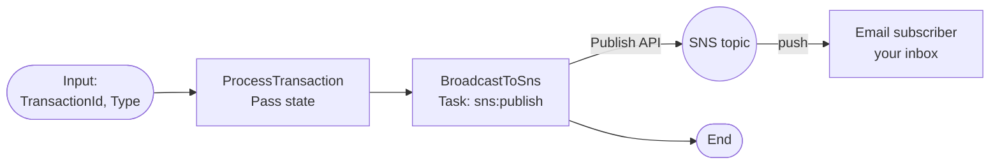
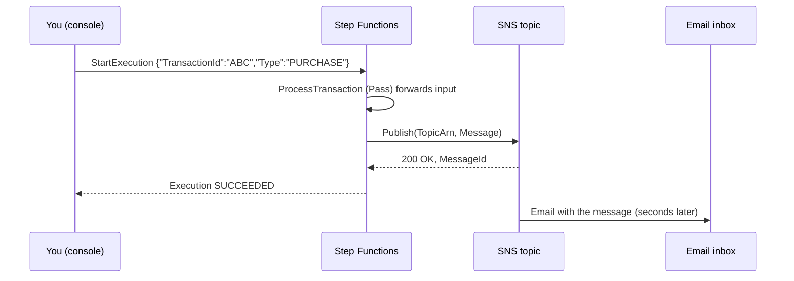
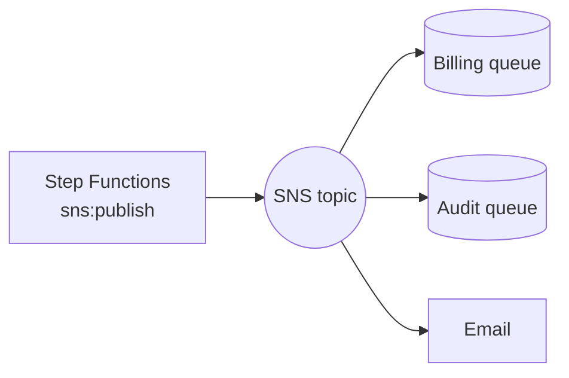

# AWS Step Functions with SNS: Study Notes

Source: [Step Functions with SNS (AWS Simplified)](https://youtu.be/cuUhaBFAus4?list=PL9nWRykSBSFgQrO66TmO1vHFP6yuPF5G-), about 5 minutes.

A short hands-on video. A state machine **publishes a message to an SNS topic** directly, with no Lambda. The topic has an email subscription, so the message shows up in your inbox.

This is the third video in the series that sends a transaction somewhere:

| Notes | Target | Task resource |
|---|---|---|
| [02](02_AWS_Step_Functions_with_Lambda_Study_Notes.md) | Lambda function | Function ARN / `lambda:invoke` |
| [03](03_AWS_Step_Functions_with_SQS_Study_Notes.md) | SQS queue | `arn:aws:states:::sqs:sendMessage` |
| **04 (this)** | SNS topic | `arn:aws:states:::sns:publish` |

The video also mentions a DynamoDB video in the same series: see [05](05_AWS_Step_Functions_with_DynamoDB_Study_Notes.md). Concepts and pricing are in [01](01_AWS_Step_Functions_Overview_Study_Notes.md).

This video uses the same structure as notes 03: a Pass state, then one Task that calls an AWS API. These notes focus on **what's different with SNS** and don't repeat the `.$` and Pass-state explanations in full.

Code marked **reconstructed** was rebuilt from what the video describes. The video doesn't show the topic's name, so `StepFunctionSNSTopic` below is a placeholder.

What was checked:
- Every state machine definition passed `ValidateStateMachineDefinition` (result `OK`, no diagnostics).
- The message mapping, `Subject` formatting, and case-sensitivity examples were run through the `TestState` API, and the outputs shown are the real results.

---

## Contents

1. [Corrected terms](#1-corrected-terms)
2. [What you build](#2-what-you-build)
3. [SNS in two minutes](#3-sns-in-two-minutes)
4. [Step 1: Create the topic and an email subscription](#4-step-1-create-the-topic-and-an-email-subscription)
5. [Step 2: Write the state machine definition](#5-step-2-write-the-state-machine-definition)
6. [Step 3: The IAM role](#6-step-3-the-iam-role)
7. [Step 4: Run it and check your email](#7-step-4-run-it-and-check-your-email)
8. [Same setup with the AWS CLI](#8-same-setup-with-the-aws-cli)
9. [Beyond the video: subject, attributes and filtering](#9-beyond-the-video-subject-attributes-and-filtering)
10. [Beyond the video: fan-out to SQS](#10-beyond-the-video-fan-out-to-sqs)
11. [Beyond the video: wait for a reply, and JSONata](#11-beyond-the-video-wait-for-a-reply-and-jsonata)
12. [Gotchas](#12-gotchas)
13. [What has changed since the video](#13-what-has-changed-since-the-video)
14. [Cheat sheet](#14-cheat-sheet)
15. [Review questions](#15-review-questions)

---

## 1. Corrected terms

| Caption says | Actually means |
|---|---|
| S&S / SN s | **SNS** (Simple Notification Service) |
| AR n | **ARN** (Amazon Resource Name) |
| roll | IAM **role** |
| transaction Eddie | The `TransactionId` key |
| pass through | A **Pass** state |
| policy template | The IAM policy Step Functions generates from the definition |

---

## 2. What you build

### Architecture



- **ProcessTransaction** (Pass) hands its input to the next state unchanged.
- **BroadcastToSns** (Task) calls the SNS `Publish` API with a message built from the input, plus one fixed field.
- SNS **pushes** the message to every confirmed subscriber. Here there's one: an email address.
- The workflow ends once SNS **accepts** the publish. It doesn't wait for the email to arrive.

### Input

```json
{
  "TransactionId": "ABC",
  "Type": "PURCHASE"
}
```

### What gets published

Two fields come from the input, and `Source` is fixed text:

```json
{"TransactionId":"ABC","Type":"PURCHASE","Source":"Step Functions"}
```

---

## 3. SNS in two minutes

| Term | Meaning |
|---|---|
| **Topic** | A named channel you publish to. Identified by an **ARN**, for example `arn:aws:sns:us-east-1:123456789012:StepFunctionSNSTopic`. |
| **Subscription** | "Send this topic's messages to this endpoint." One topic can have many subscriptions. |
| **Protocol** | The kind of endpoint: `email`, `email-json`, `sqs`, `lambda`, `http`/`https`, `sms`, `firehose`, mobile push |
| **Confirmation** | Email and HTTP subscriptions start as **PendingConfirmation**. Nothing is delivered until someone clicks the link (email) or confirms the request (HTTP). |
| **Publish** | Send one message to the topic. SNS copies it to every confirmed subscriber. |

### SNS vs SQS (notes 03)

| | SQS | SNS |
|---|---|---|
| Model | **Queue**: messages wait until someone pulls them | **Pub/sub**: SNS pushes each message to subscribers right away |
| Receivers | Usually one consumer group, and each message is processed once | Every subscriber gets its own copy (**fan-out**) |
| Storage | Keeps messages (4 days by default, up to 14) | **Doesn't store** messages. Delivery is attempted, with retries, then the message is gone. |
| Identified in the API by | Queue **URL** | Topic **ARN** |
| Step Functions resource | `arn:aws:states:::sqs:sendMessage` | `arn:aws:states:::sns:publish` |
| Body parameter | `MessageBody` | `Message` |
| Role permission | `sqs:SendMessage` | `sns:Publish` |

Rule of thumb: use **SQS** when work must be done reliably by a worker, and **SNS** when several parties need to hear about an event. They're often combined: SNS fans out to several SQS queues (section 10).

---

## 4. Step 1: Create the topic and an email subscription

### Console steps

1. Open **SNS**, go to **Topics**, and click **Create topic**.
2. Type: **Standard**. Name it, for example `StepFunctionSNSTopic`. Keep the defaults and click **Create topic**.
3. On the topic page, click **Create subscription**:
   - Protocol: **Email**
   - Endpoint: your email address
   - Click **Create subscription**.
4. Open your inbox, find **"AWS Notification - Subscription Confirmation"**, and click **Confirm subscription**. Check spam if it isn't there.
5. Back on the topic page, the subscription's status should now be **Confirmed**.
6. **Copy the topic ARN** from the top of the topic page.

### ARN, not URL

The video makes this point at 01:39: SQS wanted the queue **URL**, but SNS wants the topic **ARN**. Each one simply follows its own API:

| Service | API call | Parameter | Takes |
|---|---|---|---|
| SQS | `SendMessage` | `QueueUrl` | URL |
| SNS | `Publish` | `TopicArn` | ARN |

In IAM policies, both use the ARN.

---

## 5. Step 2: Write the state machine definition

### Console steps (as in the video)

1. Open **Step Functions** and choose **Create state machine**.
2. Name: `StepFunctionSNS`.
3. Paste the definition below into the code editor.
4. Replace `TopicArn` with your topic's ARN.
5. Refresh the graph: `ProcessTransaction` → `BroadcastToSns`.

### The definition (reconstructed)

```json
{
  "Comment": "Transaction Processor State Machine Using SNS",
  "StartAt": "ProcessTransaction",
  "States": {
    "ProcessTransaction": {
      "Type": "Pass",
      "Next": "BroadcastToSns"
    },
    "BroadcastToSns": {
      "Type": "Task",
      "Resource": "arn:aws:states:::sns:publish",
      "Parameters": {
        "TopicArn": "arn:aws:sns:us-east-1:123456789012:StepFunctionSNSTopic",
        "Message": {
          "TransactionId.$": "$.TransactionId",
          "Type.$": "$.Type",
          "Source": "Step Functions"
        }
      },
      "End": true
    }
  }
}
```

### Line by line

| Part | What it does |
|---|---|
| `"Type": "Pass"` | Placeholder that forwards input unchanged |
| `"Resource": "arn:aws:states:::sns:publish"` | Call the SNS `Publish` API (optimized integration, Request Response pattern) |
| `"TopicArn"` | Which topic to publish to, as an ARN |
| `"Message"` | The message. Written as a JSON object here; Step Functions turns it into a JSON string before publishing. |
| `"TransactionId.$": "$.TransactionId"` | Ends in `.$`, so the value is **looked up** in the input |
| `"Source": "Step Functions"` | No `.$`, so the value is **used as written** |
| `"End": true` | Terminal state: the execution ends here |

### Dynamic and fixed fields side by side

This is what the video explains from 02:13 to 02:37. Real `TestState` output with input `{"TransactionId": "ABC", "Type": "PURCHASE"}`:

```json
{"Message": {"Source": "Step Functions", "Type": "PURCHASE", "TransactionId": "ABC"}}
```

- `TransactionId.$` and `Type.$` are replaced with `ABC` and `PURCHASE`, and the `.$` is dropped from the key names.
- `Source` comes through exactly as written.
- Key order in the output isn't guaranteed, and it doesn't matter for JSON.

**Paths are case-sensitive.** With input `{"TransactionId": "ABC", "type": "PURCHASE"}` (lowercase `type`), the state fails:

```
States.Runtime: The JSONPath '$.Type' specified for the field 'Type.$'
could not be found in the input '{"TransactionId": "ABC", "type": "PURCHASE"}'
```

---

## 6. Step 3: The IAM role

### Console steps (as in the video)

1. Click **Next** to reach the permissions page.
2. Create a new role, for example `StepFunctionSNSDemoRole`.
3. Step Functions sees the `sns:publish` task and **fills in a policy with `sns:Publish`** for your topic. The video calls this "one less thing we need to do".
4. Click **Create state machine**.

### The generated policy

This is the format from the AWS docs for a fixed topic:

```json
{
  "Version": "2012-10-17",
  "Statement": [
    {
      "Effect": "Allow",
      "Action": ["sns:Publish"],
      "Resource": ["arn:aws:sns:us-east-1:123456789012:StepFunctionSNSTopic"]
    }
  ]
}
```

If the topic comes from the input (`"TopicArn.$"`), or you publish to a `TargetArn` or `PhoneNumber` instead of a topic, Step Functions can't know the target in advance. The generated policy then uses `"Resource": "*"`, so narrow it by hand.

---

## 7. Step 4: Run it and check your email

### Start an execution

1. Click **Start execution** with this input:

   ```json
   { "TransactionId": "ABC", "Type": "PURCHASE" }
   ```

2. It finishes in about a second.

### What the Task returns

Click **BroadcastToSns** in the graph:

- **Input** is the same as the execution input (the Pass state changed nothing).
- **Output** is SNS's reply, which has this shape:

```json
{
  "MessageId": "…",
  "SdkHttpMetadata": {
    "AllHttpHeaders": { "…": ["…"] },
    "HttpHeaders": { "…": "…" },
    "HttpStatusCode": 200
  },
  "SdkResponseMetadata": { "RequestId": "…" }
}
```

`HttpStatusCode: 200` is the confirmation the video points at. As with SQS, the transaction data is no longer in the output. Section 9 shows how to keep it.

### Check the email

- **From:** AWS Notifications
- **Subject:** "AWS Notification Message", the default when the publish has no `Subject` (section 9 sets one)
- **Body:** the message as a JSON string, followed by an unsubscribe link:

  ```
  {"TransactionId":"ABC","Type":"PURCHASE","Source":"Step Functions"}
  ```

The email shows the raw JSON because the `email` protocol sends the message text exactly as published. Use the `email-json` protocol to get the full SNS envelope (section 10) instead.

### Execution lifecycle



---

## 8. Same setup with the AWS CLI

`state-machine.json` is the definition from section 5, with your topic ARN filled in. Replace the email address with your own.

```bash
ACCOUNT_ID=$(aws sts get-caller-identity --query Account --output text)

# --- Topic and email subscription ---
TOPIC_ARN=$(aws sns create-topic --name StepFunctionSNSTopic --query TopicArn --output text)
aws sns subscribe --topic-arn "$TOPIC_ARN" --protocol email \
  --notification-endpoint you@example.com
# Click "Confirm subscription" in the email, then check. A SubscriptionArn of
# "PendingConfirmation" means it isn't confirmed yet.
aws sns list-subscriptions-by-topic --topic-arn "$TOPIC_ARN" \
  --query 'Subscriptions[].[Protocol, Endpoint, SubscriptionArn]' --output table

# Optional: test the topic on its own, without Step Functions
aws sns publish --topic-arn "$TOPIC_ARN" --message 'hello from the CLI'

# --- State machine role ---
cat > sfn-trust.json <<EOF
{
  "Version": "2012-10-17",
  "Statement": [{
    "Effect": "Allow",
    "Principal": { "Service": "states.amazonaws.com" },
    "Action": "sts:AssumeRole",
    "Condition": { "StringEquals": { "aws:SourceAccount": "$ACCOUNT_ID" } }
  }]
}
EOF
aws iam create-role --role-name StepFunctionSNSDemoRole \
  --assume-role-policy-document file://sfn-trust.json

cat > sfn-sns-policy.json <<EOF
{
  "Version": "2012-10-17",
  "Statement": [{ "Effect": "Allow", "Action": "sns:Publish", "Resource": "$TOPIC_ARN" }]
}
EOF
aws iam put-role-policy --role-name StepFunctionSNSDemoRole \
  --policy-name PublishToTopic --policy-document file://sfn-sns-policy.json

# --- State machine ---
SM_ARN=$(aws stepfunctions create-state-machine --name StepFunctionSNS \
  --definition file://state-machine.json \
  --role-arn "arn:aws:iam::${ACCOUNT_ID}:role/StepFunctionSNSDemoRole" \
  --query stateMachineArn --output text)

# --- Run it ---
EXEC=$(aws stepfunctions start-execution --state-machine-arn "$SM_ARN" \
  --input '{"TransactionId": "ABC", "Type": "PURCHASE"}' \
  --query executionArn --output text)
aws stepfunctions describe-execution --execution-arn "$EXEC" \
  --query '{status: status, output: output}'

# --- Clean up (deleting the topic also deletes its subscriptions) ---
aws stepfunctions delete-state-machine --state-machine-arn "$SM_ARN"
aws iam delete-role-policy --role-name StepFunctionSNSDemoRole --policy-name PublishToTopic
aws iam delete-role --role-name StepFunctionSNSDemoRole
aws sns delete-topic --topic-arn "$TOPIC_ARN"
```

If you built it in the console, remember what you saw after the SQS experiment. Deleting the state machine **leaves its role behind**. The console names it like `StepFunctions-StepFunctionSNS-role-xxxx`, with customer-managed policies such as `XRayAccessPolicy-…` and an SNS publish policy attached. Delete the role under **IAM > Roles**, then its policies under **IAM > Policies** (filter: Customer managed).

---

## 9. Beyond the video: subject, attributes and filtering

### A better publish (validated: `OK`)

```json
{
  "Comment": "SNS publish with a subject, a filterable attribute, and the input kept",
  "StartAt": "ProcessTransaction",
  "States": {
    "ProcessTransaction": { "Type": "Pass", "Next": "BroadcastToSns" },
    "BroadcastToSns": {
      "Type": "Task",
      "Resource": "arn:aws:states:::sns:publish",
      "Parameters": {
        "TopicArn": "arn:aws:sns:us-east-1:123456789012:StepFunctionSNSTopic",
        "Subject.$": "States.Format('Transaction {} ({})', $.TransactionId, $.Type)",
        "Message": {
          "TransactionId.$": "$.TransactionId",
          "Type.$": "$.Type",
          "Source": "Step Functions"
        },
        "MessageAttributes": {
          "Type": { "DataType": "String", "StringValue.$": "$.Type" }
        }
      },
      "ResultSelector": { "MessageId.$": "$.MessageId" },
      "ResultPath": "$.Sns",
      "End": true
    }
  }
}
```

| Addition | What it does |
|---|---|
| `"Subject.$": "States.Format(...)"` | Sets the email subject line. `States.Format` is an **intrinsic function** that fills each `{}` in order. TestState output: `"Transaction ABC (PURCHASE)"`. |
| `"MessageAttributes"` | Metadata sent next to the message, not inside it. Subscribers can **filter** on it (below). |
| `ResultSelector` + `ResultPath` | Keep the input and add only the `MessageId` under `Sns`. Same idea as notes 03 section 10. |

Output: `{"TransactionId": "ABC", "Type": "PURCHASE", "Sns": {"MessageId": "…"}}`

Subject rules: ASCII only, no line breaks, fewer than 100 characters. Email uses it as the subject line, and SQS and HTTP subscribers see it in the envelope.

### Subscription filter policies

Without a filter, every subscriber gets every message. A **filter policy** on a subscription lets it receive only the messages it cares about. For example, an email subscription that should hear only about refunds:

```json
{ "Type": ["REFUND"] }
```

```bash
aws sns set-subscription-attributes --subscription-arn <SubscriptionArn> \
  --attribute-name FilterPolicy --attribute-value '{"Type": ["REFUND"]}'
```

- By default, filter policies match **message attributes**. That's why the definition above copies `Type` into `MessageAttributes`.
- Setting the subscription attribute `FilterPolicyScope` to `MessageBody` filters on fields **inside** the JSON message instead.
- This is the SNS way to route purchases and refunds to different places. Notes 02 used a **Choice state** for that. With SNS you can publish once and let each subscription pick what it wants.

---

## 10. Beyond the video: fan-out to SQS

A common setup combines notes 03 and 04: **Step Functions → SNS topic → several SQS queues.** Each queue (billing, analytics, audit, and so on) gets its own copy and processes it at its own pace. SNS delivers, and SQS stores the message until a worker is ready.



Setting it up in the console: open the **SQS queue**, choose **Subscribe to Amazon SNS topic**, and pick the topic. The console also adds a **queue access policy** that lets the topic send to the queue. Without that policy, delivery fails silently from the publisher's point of view.

### The envelope: raw message delivery off vs on

By default, an SQS subscriber receives SNS's **envelope**, a JSON wrapper whose `Message` field holds your message **as a string**:

```json
{
  "Type": "Notification",
  "MessageId": "…",
  "TopicArn": "arn:aws:sns:us-east-1:123456789012:StepFunctionSNSTopic",
  "Message": "{\"TransactionId\":\"ABC\",\"Type\":\"PURCHASE\",\"Source\":\"Step Functions\"}",
  "Timestamp": "…",
  "SignatureVersion": "1",
  "Signature": "…",
  "SigningCertURL": "…",
  "UnsubscribeURL": "…"
}
```

The consumer has to parse twice: once for the SQS body (the envelope), then once more for `Message`.

With **raw message delivery** turned on for the subscription (`RawMessageDelivery = true`), the queue receives just `{"TransactionId":"ABC",...}`, and the message attributes become SQS message attributes. For SQS subscribers this is usually what you want.

---

## 11. Beyond the video: wait for a reply, and JSONata

### Publish and wait (validated: `OK`)

SNS also supports the **Wait for Callback** pattern:

```json
{
  "StartAt": "PublishAndWait",
  "States": {
    "PublishAndWait": {
      "Type": "Task",
      "Resource": "arn:aws:states:::sns:publish.waitForTaskToken",
      "Parameters": {
        "TopicArn": "arn:aws:sns:us-east-1:123456789012:StepFunctionSNSTopic",
        "Message": {
          "TransactionId.$": "$.TransactionId",
          "Type.$": "$.Type",
          "TaskToken.$": "$$.Task.Token"
        }
      },
      "TimeoutSeconds": 3600,
      "End": true
    }
  }
}
```

- The workflow pauses until a subscriber calls `SendTaskSuccess` or `SendTaskFailure` with the token. That subscriber is usually a Lambda function or a worker reading an SQS queue. Notes 03 section 9 has a full worker.
- **An email subscriber alone can't call back.** A person reading the token in an email has no button to press. Human-approval workflows put a link in the email, which hits API Gateway, which calls `SendTaskSuccess`.
- Always set `TimeoutSeconds`, or a lost message leaves the execution waiting.

### JSONata version (validated: `OK`)

```json
{
  "QueryLanguage": "JSONata",
  "StartAt": "ProcessTransaction",
  "States": {
    "ProcessTransaction": { "Type": "Pass", "Next": "BroadcastToSns" },
    "BroadcastToSns": {
      "Type": "Task",
      "Resource": "arn:aws:states:::sns:publish",
      "Arguments": {
        "TopicArn": "arn:aws:sns:us-east-1:123456789012:StepFunctionSNSTopic",
        "Message": {
          "TransactionId": "",
          "Type": "",
          "Source": "Step Functions"
        }
      },
      "End": true
    }
  }
}
```

In JSONata, every value without `` is literal, so `Source` needs nothing special.

---

## 12. Gotchas

1. **ARN, not URL.** `TopicArn` takes the ARN. This is the opposite of SQS's `QueueUrl`.
2. **An unconfirmed subscription gets nothing, and the execution still succeeds.** SNS accepts a publish even with zero confirmed subscribers. A green execution only means SNS took the message. If no email arrives, check that the subscription says **Confirmed**, and check spam.
3. **SNS doesn't keep messages.** If delivery to a subscriber fails after SNS's retries, the message is gone for that subscriber, unless the subscription has a dead-letter queue. When it matters, fan out to SQS (section 10).
4. **The message becomes a string.** Your JSON object is published as text, which is why the email shows raw JSON and why SQS subscribers have to parse it.
5. **`.$` and case.** A missing `.$` sends literal text, and a wrong-case path (`$.type` vs `$.Type`) fails with `States.Runtime` (section 5).
6. **The Task output replaces the input** unless you use `ResultPath` (section 9).
7. **Size.** Topics accept 256 KiB by default. Since September 2026, a topic's `MaximumMessageSize` attribute can raise that to 1 MiB, but only for SQS, Lambda and Firehose subscribers, not email. Step Functions caps task data at 256 KiB anyway.
8. **Subject rules.** ASCII, no line breaks, under 100 characters, or the publish fails.
9. **Encrypted topics.** Unlike new SQS queues, SNS topics aren't encrypted by default. If you turn on encryption with a customer-managed KMS key, the state machine role also needs `kms:GenerateDataKey` and `kms:Decrypt` on that key.
10. **FIFO topics** need a `MessageGroupId` on every publish.
11. **Email is for people and testing.** Anyone who receives the email can unsubscribe the address with the link at the bottom. Systems should subscribe with SQS, Lambda or HTTPS.
12. **SNS to SQS needs a queue policy** that allows the topic. The SQS console's "Subscribe to Amazon SNS topic" adds it. If you build it any other way, you add it yourself.
13. **Leftovers.** Deleting a console-built state machine leaves its role and policies behind, and deleting a topic does remove its subscriptions (section 8).

---

## 13. What has changed since the video

| Then (video) | Now |
|---|---|
| Create topic with defaults | **Create topic** asks for **Standard or FIFO** first |
| Plain ASL editor with "refresh" | **Workflow Studio**: "Amazon SNS Publish" is in the **Most popular** actions list, next to Lambda Invoke |
| Role page shows a policy template | Console creates `StepFunctions-<name>-role-…` with generated customer-managed policies, including X-Ray access |
| 256 KiB messages | Up to **1 MiB** with `MaximumMessageSize` (SQS, Lambda, Firehose subscribers) |
| Filter only on message attributes | Filter on attributes **or the message body** (`FilterPolicyScope`) |
| JSONPath only | **JSONata** also available |
| Test by running the whole machine | **TestState** / "Test state" tests one state on its own |

---

## 14. Cheat sheet

```
Resource (publish)      : arn:aws:states:::sns:publish                     (Request Response)
Resource (publish+wait) : arn:aws:states:::sns:publish.waitForTaskToken    (Wait for Callback)
Optimized API           : Publish only

Parameters              : TopicArn (ARN!), Message (string or JSON object), Subject,
                          MessageAttributes, MessageStructure, MessageGroupId (FIFO),
                          or TargetArn / PhoneNumber instead of TopicArn
IAM (state machine)     : sns:Publish on the topic ARN (+ kms:GenerateDataKey/Decrypt if CMK)
.$ rule                 : "Key.$": "$.Path" -> looked up (case-sensitive);  no .$ -> literal
Intrinsic               : States.Format('Transaction {} ({})', $.a, $.b)
Task output             : MessageId, SdkHttpMetadata (HttpStatusCode 200), SdkResponseMetadata
Keep input              : "ResultPath": "$.Sns"  (+ "ResultSelector")

Email subscription      : must be Confirmed; default subject "AWS Notification Message"
Filtering               : subscription FilterPolicy, e.g. {"Type": ["REFUND"]}
SNS -> SQS              : queue policy allowing the topic; RawMessageDelivery=true to skip the envelope
SNS vs SQS              : push + fan-out + no storage  vs  pull + one consumer + stored
Limits                  : SFN task data 256 KiB; SNS 256 KiB default, 1 MiB opt-in
```

---

## 15. Review questions

<details>
<summary>1. SQS needed the queue URL. What does SNS need, and why the difference?</summary>

The topic **ARN**. Each service's API decides: SQS `SendMessage` takes `QueueUrl`, and SNS `Publish` takes `TopicArn`. IAM policies use the ARN for both.
</details>

<details>
<summary>2. In the message, why does <code>Source</code> come through as "Step Functions" while <code>Type</code> becomes "PURCHASE"?</summary>

`Type.$` ends in `.$`, so its value `$.Type` is looked up in the input. `Source` has no `.$`, so its value is used as written.
</details>

<details>
<summary>3. The execution succeeded, but no email arrived. Name two likely causes.</summary>

The email subscription is still **PendingConfirmation**, because nobody clicked the confirmation link. Or the email went to spam. The execution succeeds either way, because it only means SNS accepted the publish.
</details>

<details>
<summary>4. What does the <code>BroadcastToSns</code> Task output?</summary>

SNS's reply: `MessageId`, HTTP metadata with status 200, and a request ID. The input is replaced, unless you use `ResultPath`.
</details>

<details>
<summary>5. How does the console know to give the role <code>sns:Publish</code>?</summary>

Step Functions reads the definition, sees the `sns:publish` task and its fixed `TopicArn`, and generates a policy allowing `sns:Publish` on that topic.
</details>

<details>
<summary>6. Name three differences between SNS and SQS.</summary>

SNS **pushes** to subscribers, and SQS consumers **pull**. SNS gives **every subscriber a copy** (fan-out), and an SQS message is processed by one consumer. SNS **doesn't store** messages, and SQS keeps them until they're deleted or expire.
</details>

<details>
<summary>7. You want a "refunds" team to get only REFUND emails. How, without changing the state machine's flow?</summary>

Publish `Type` as a message attribute, and put a **filter policy** `{"Type": ["REFUND"]}` on that team's subscription. You could also filter on the body with `FilterPolicyScope = MessageBody`.
</details>

<details>
<summary>8. An SQS queue subscribed to the topic receives a big JSON with a <code>Message</code> string inside. Why, and how do you get just your message?</summary>

That's the SNS **envelope**, which is the default for SQS subscribers. Turn on **raw message delivery** (`RawMessageDelivery = true`) on the subscription to receive only the original message.
</details>

<details>
<summary>9. What does <code>States.Format('Transaction {} ({})', $.TransactionId, $.Type)</code> produce for the sample input?</summary>

`Transaction ABC (PURCHASE)`. It's an intrinsic function that fills each `{}` in order.
</details>

<details>
<summary>10. Can a <code>.waitForTaskToken</code> publish be completed by the email subscriber?</summary>

Not by email alone. Something has to call `SendTaskSuccess` or `SendTaskFailure` with the token: usually a Lambda or a queue worker. For human approval, an emailed link to an API Gateway endpoint that makes the call.
</details>

<details>
<summary>11. Input is <code>{"TransactionId": "ABC", "type": "PURCHASE"}</code>. What happens?</summary>

The Task fails with `States.Runtime`. `$.Type` isn't found, because JSONPath is case-sensitive and the input has `type`.
</details>

<details>
<summary>12. SNS now allows 1 MiB messages. Can this state machine send a 500 KiB message to the email subscriber?</summary>

No, for two reasons. Step Functions caps task data at 256 KiB. And 1 MiB topics (`MaximumMessageSize`) only support SQS, Lambda and Firehose subscribers, not email.
</details>

<details>
<summary>13. You deleted the state machine and the topic in the console. What's probably still there?</summary>

The IAM role the console created (`StepFunctions-<name>-role-…`) and its customer-managed policies. Subscriptions are gone, because deleting a topic deletes them.
</details>
