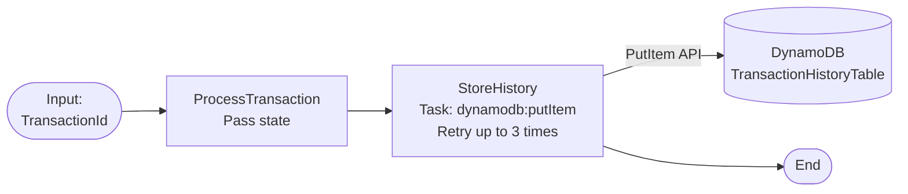
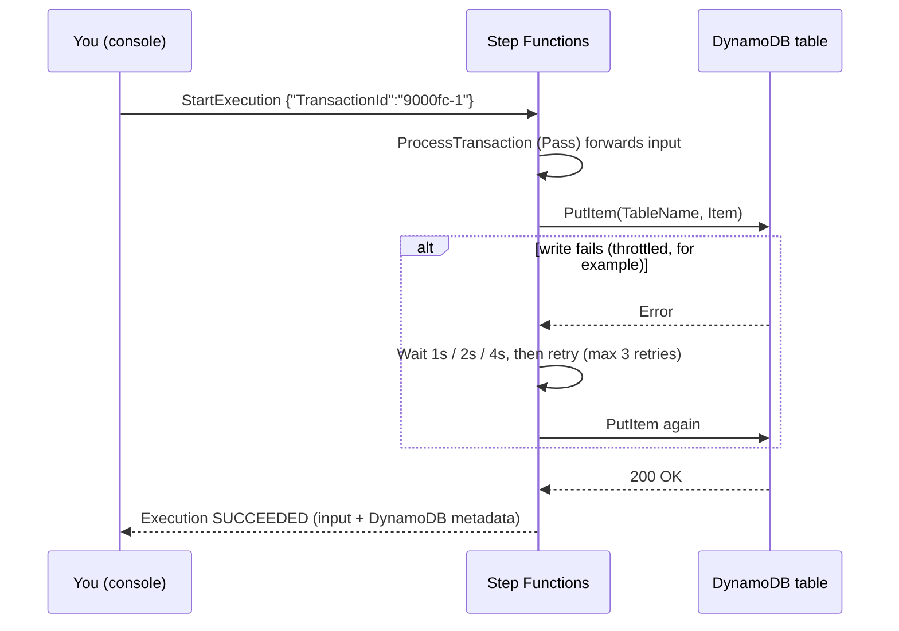

# AWS Step Functions with DynamoDB: Study Notes

Source: [Step Functions with DynamoDB (AWS Simplified)](https://youtu.be/9aE9Yjna8J0?list=PL9nWRykSBSFgQrO66TmO1vHFP6yuPF5G-), about 5 minutes.

A short hands-on video. A state machine **writes a row to a DynamoDB table** directly, with no Lambda function or other code in between. Everything is done in the state machine definition (ASL).

This is the fourth target in the series:

| Notes | Target | Task resource | What the role needs |
|---|---|---|---|
| [02](02_AWS_Step_Functions_with_Lambda_Study_Notes.md) | Lambda function | `arn:aws:states:::lambda:invoke` | `lambda:InvokeFunction` |
| [03](03_AWS_Step_Functions_with_SQS_Study_Notes.md) | SQS queue | `arn:aws:states:::sqs:sendMessage` | `sqs:SendMessage` |
| [04](04_AWS_Step_Functions_with_SNS_Study_Notes.md) | SNS topic | `arn:aws:states:::sns:publish` | `sns:Publish` |
| **05 (this)** | DynamoDB table | `arn:aws:states:::dynamodb:putItem` | `dynamodb:PutItem` |

Concepts and pricing are in [01](01_AWS_Step_Functions_Overview_Study_Notes.md). Its section 8.2 already sketches this same `StoreHistory` state; this video builds it for real.

The video uses the same structure as notes 03 and 04: a Pass state, then one Task that calls an AWS API. New in this video: DynamoDB's **typed attribute format**, a **Retry** policy, and **ResultPath**.

Code marked **reconstructed** was rebuilt from what the video describes. The video names the state machine "transaction processor" and the role "step function IAM", so `TransactionProcessor` and `StepFunctionDynamoDBRole` below are close guesses.

What was checked:
- Every state machine definition passed `ValidateStateMachineDefinition` (result `OK`, no diagnostics).
- The request rendering, retry timing, duplicate handling, read-back and JSONata examples were run through the `TestState` API with **mocked** DynamoDB responses (a feature added in November 2025). No table was created. The outputs shown are the real TestState results.

---

## Contents

1. [Corrected terms](#1-corrected-terms)
2. [What you build](#2-what-you-build)
3. [DynamoDB in two minutes](#3-dynamodb-in-two-minutes)
4. [Step 1: Create the table](#4-step-1-create-the-table)
5. [Step 2: Write the state machine definition](#5-step-2-write-the-state-machine-definition)
6. [The Retry policy, measured](#6-the-retry-policy-measured)
7. [ResultPath: what goes to the next step](#7-resultpath-what-goes-to-the-next-step)
8. [Step 3: The IAM role](#8-step-3-the-iam-role)
9. [Step 4: Run it and check the table](#9-step-4-run-it-and-check-the-table)
10. [Same setup with the AWS CLI](#10-same-setup-with-the-aws-cli)
11. [Beyond the video: a safer write](#11-beyond-the-video-a-safer-write)
12. [Beyond the video: read, update, query, and JSONata](#12-beyond-the-video-read-update-query-and-jsonata)
13. [Beyond the video: test states with mocks](#13-beyond-the-video-test-states-with-mocks)
14. [Gotchas](#14-gotchas)
15. [What has changed since the video](#15-what-has-changed-since-the-video)
16. [Cheat sheet](#16-cheat-sheet)
17. [Review questions](#17-review-questions)

---

## 1. Corrected terms

| Caption says | Actually means |
|---|---|
| a DSL / ADSL | **ASL** (Amazon States Language) |
| petition key | **Partition key** |
| DynamoDB x' put item api | DynamoDB's **PutItem** API |
| animo DB / dynamo | **DynamoDB** |
| I am role | **IAM role** |
| "there is our role" (04:49) | There is our **row** (item) |
| pass through | A **Pass** state |
| result path | The **`ResultPath`** field |

---

## 2. What you build

### Architecture



- **ProcessTransaction** (Pass) hands its input to the next state unchanged. The video calls it "just for cosmetic reasons".
- **StoreHistory** (Task) calls DynamoDB's `PutItem` API and writes one item. "This is really where all the work is being done."
- If the write fails, the **Retry** policy tries again, up to 3 more times.
- The workflow ends after DynamoDB confirms the write.

### Input

```json
{ "TransactionId": "9000fc-1" }
```

### What gets written

One item in `TransactionHistoryTable`:

| TransactionId (partition key) |
|---|
| `9000fc-1` |

---

## 3. DynamoDB in two minutes

| Term | Meaning |
|---|---|
| **Table** | A collection of items. You only define the key when you create it; other attributes can differ from item to item. |
| **Item** | One row. Max size **400 KB**. |
| **Attribute** | One field of an item, for example `TransactionId` or `Amount`. |
| **Partition key** | The required primary key attribute. DynamoDB hashes it to decide where the item lives. Must be unique, unless you also have a sort key. |
| **Sort key** | Optional second part of the primary key. Lets several items share a partition key, sorted by this value. The video doesn't use one. |
| **Capacity mode** | **On-demand** (pay per request, no planning) or **provisioned** (you set read and write units per second). |

### The attribute value format

DynamoDB's low-level API, which Step Functions calls, wants every value **wrapped in its type**. This is the part that looks odd at first:

| Type | Descriptor | Example |
|---|---|---|
| String | `S` | `{"S": "9000fc-1"}` |
| Number | `N` | `{"N": "42.5"}`: the number is sent **as a string** |
| Boolean | `BOOL` | `{"BOOL": true}` |
| Null | `NULL` | `{"NULL": true}` |
| Map | `M` | `{"M": {"City": {"S": "Austin"}}}` |
| List | `L` | `{"L": [{"S": "a"}, {"N": "1"}]}` |
| String set / number set | `SS` / `NS` | `{"SS": ["a", "b"]}`, `{"NS": ["1", "2"]}` |
| Binary | `B` | Base64-encoded string |

So an item with a string key and a number looks like:

```json
{
  "TransactionId": { "S": "9000fc-1" },
  "Amount": { "N": "42.5" }
}
```

### How DynamoDB compares to SQS and SNS

| | SQS (03) | SNS (04) | DynamoDB (05) |
|---|---|---|---|
| What it is | Queue | Pub/sub | Database |
| Data stays | Until a consumer deletes it (max 14 days) | Not stored | Until you delete it |
| Identified in the API by | Queue URL | Topic ARN | **Table name** (an ARN also works) |
| Typical role in a workflow | Hand work to a worker | Tell several parties | **Record state**: audit log, status, idempotency |

---

## 4. Step 1: Create the table

### Console steps (as in the video)

1. Open **DynamoDB** and click **Create table**.
2. Table name: `TransactionHistoryTable`.
3. Partition key: `TransactionId`, type **String**.
4. No sort key. Leave everything else at the defaults.
5. Click **Create table**.

The table takes a moment to become **Active**. The video creates the state machine while it waits. That's fine, as long as the table is Active before you **run** the state machine. Writing to a table that's still being created fails with a `ResourceNotFoundException`.

Today the default settings give you **on-demand** capacity, which AWS docs call the default and recommended mode. For a lab like this, on-demand has no throughput charge while idle; you only pay for the few bytes stored.

---

## 5. Step 2: Write the state machine definition

### Console steps (as in the video)

1. Open **Step Functions** and choose **Create state machine**.
2. Name: `TransactionProcessor`.
3. Paste the definition below into the code editor. The graph shows `ProcessTransaction` → `StoreHistory`.

### The definition (reconstructed, validated: `OK`)

```json
{
  "Comment": "Transaction Processor State Machine Using DynamoDB",
  "StartAt": "ProcessTransaction",
  "States": {
    "ProcessTransaction": {
      "Type": "Pass",
      "Next": "StoreHistory"
    },
    "StoreHistory": {
      "Type": "Task",
      "Resource": "arn:aws:states:::dynamodb:putItem",
      "Parameters": {
        "TableName": "TransactionHistoryTable",
        "Item": {
          "TransactionId": { "S.$": "$.TransactionId" }
        }
      },
      "Retry": [
        {
          "ErrorEquals": ["States.ALL"],
          "IntervalSeconds": 1,
          "MaxAttempts": 3
        }
      ],
      "End": true,
      "ResultPath": "$.DynamoDB"
    }
  }
}
```

### Line by line

| Part | What it does |
|---|---|
| `"Comment"` | Free text describing the state machine. Ignored at runtime. |
| `"StartAt": "ProcessTransaction"` | The first state to run |
| `"Type": "Pass"` | Placeholder that forwards input unchanged |
| `"Resource": "arn:aws:states:::dynamodb:putItem"` | Call DynamoDB's `PutItem` API (optimized integration, Request Response pattern) |
| `"TableName"` | Which table to write to |
| `"Item"` | The item to write, in the attribute value format from section 3 |
| `"TransactionId"` | The attribute name. It must match the table's partition key exactly. |
| `"S.$": "$.TransactionId"` | Type `S` (string). The `.$` means "look this value up in the input". |
| `"Retry"` | Try again on failure. Section 6. |
| `"End": true` | Terminal state: the execution ends here |
| `"ResultPath": "$.DynamoDB"` | Where to put DynamoDB's reply. Section 7. The video doesn't read out the value; `$.DynamoDB` is a reconstruction. |

### Where the `.$` goes

In notes 03 and 04, the `.$` was on the field name: `"TransactionId.$": "$.TransactionId"`. Here it's one level deeper, on the **type descriptor**:

```json
"TransactionId": { "S.$": "$.TransactionId" }
```

- `TransactionId` (outer key) is the **attribute name**. It's always literal.
- `S.$` is the field whose **value** is dynamic, so that's where the `.$` goes.

The video's point at 02:11: you could also hardcode it. `{"S": "foo"}` writes `foo` every time, and `{"S.$": "$.TransactionId"}` writes whatever the input says.

### What Step Functions actually sends

TestState shows the request after `Parameters` is applied (`afterParameters`). With input `{"TransactionId": "9000fc-1"}`:

```json
{"TableName":"TransactionHistoryTable","Item":{"TransactionId":{"S":"9000fc-1"}}}
```

That is exactly the body of a DynamoDB `PutItem` request. The `.$` is gone and the value is filled in.

If the input has `transactionId` (lowercase t) instead, the state fails right away:

```
States.Runtime: The JSONPath '$.TransactionId' specified for the field 'S.$'
could not be found in the input '{"transactionId": "9000fc-1"}'
```

Note that this failed even though the state has a `States.ALL` retrier. More on that in section 6.

---

## 6. The Retry policy, measured

The video's retry block (02:27):

```json
"Retry": [
  { "ErrorEquals": ["States.ALL"], "IntervalSeconds": 1, "MaxAttempts": 3 }
]
```

| Field | Meaning |
|---|---|
| `ErrorEquals: ["States.ALL"]` | Match any error. The video mentions optimistic locking and provisioned throughput errors as examples. |
| `IntervalSeconds: 1` | Wait 1 second before the **first** retry |
| `MaxAttempts: 3` | Retry up to 3 times. Plus the original attempt, that's **4 attempts** in total. |
| `BackoffRate` (not set) | Defaults to **2.0**: each wait is double the one before |

### The waits double

The video says "a one-second interval between each retry". That's not quite right: without `BackoffRate`, the default of 2.0 applies. TestState with a mocked `DynamoDB.ProvisionedThroughputExceededException` reports:

| Retries so far | TestState status | Next wait |
|---|---|---|
| 0 | `RETRIABLE` | 1 s |
| 1 | `RETRIABLE` | 2 s |
| 2 | `RETRIABLE` | 4 s |
| 3 | `FAILED` | (gives up) |

To get the video's wording exactly (1 second every time), add `"BackoffRate": 1.0`, as notes 01 section 8.2 does.

### Other Retry fields worth knowing

| Field | Default | Use |
|---|---|---|
| `BackoffRate` | 2.0 | Multiplier for each wait |
| `MaxDelaySeconds` | none | Upper limit for any single wait |
| `JitterStrategy` | `NONE` | `FULL` picks a random wait between 0 and the computed one, so many executions don't all retry at the same moment |

### `States.ALL` is too broad

`States.ALL` retries errors that will never succeed on a retry:

- **`DynamoDB.ConditionalCheckFailedException`**: the write's condition was false, for example "only if this item doesn't exist yet". Sending the same request again gives the same answer. TestState confirms the video's retrier does retry it (`RETRIABLE`, wait 1 s). This also covers the video's "optimistic locking" example: a version check that failed needs a fresh read first, not a blind retry.
- **Validation errors**: wrong key name or type, bad expression. Retrying changes nothing.
- **Permission errors**: the role is missing `dynamodb:PutItem`. Same.

What `States.ALL` does **not** retry: **`States.Runtime`** errors, like the missing `$.TransactionId` in section 5. Those always fail the execution right away.

Section 11 shows a retry setup that skips the hopeless cases.

---

## 7. ResultPath: what goes to the next step

By default, a Task's output is the **service's reply**, and the original input is gone. `ResultPath` changes that.

| `ResultPath` | Output of StoreHistory |
|---|---|
| not set (default `$`) | Only DynamoDB's reply. `TransactionId` is lost. |
| `"$.DynamoDB"` (video) | The input, plus DynamoDB's reply under a new `DynamoDB` key |
| `null` | The input unchanged. The reply is thrown away. |

TestState with a mocked PutItem response (empty, as PutItem returns no attributes by default) and `"ResultPath": "$.DynamoDB"`:

```json
{"TransactionId":"9000fc-1","DynamoDB":{}}
```

In a real run, `DynamoDB` holds the HTTP metadata (section 9).

The video says it at 02:54: `ResultPath` decides "what to pipe into the next step, provided one exists". `StoreHistory` is the last state, so here it only changes what the execution shows as its final output. It starts to matter as soon as you add a state after it, like publishing to SNS from notes 04, which needs `TransactionId`.

---

## 8. Step 3: The IAM role

### Console steps (as in the video)

1. Click **Next** to reach the permissions page.
2. Create a new role, for example `StepFunctionDynamoDBRole`.
3. Step Functions sees the `dynamodb:putItem` task and the fixed table name, and **generates a policy** that allows DynamoDB actions on that table. The video: it "allows Step Functions to perform DynamoDB actions on your behalf".
4. Click **Create state machine**.

### The generated policy

This is the format from the AWS docs for a fixed table name. The generator allows all four item actions, even though this state machine only uses `PutItem`:

```json
{
  "Version": "2012-10-17",
  "Statement": [
    {
      "Effect": "Allow",
      "Action": [
        "dynamodb:GetItem",
        "dynamodb:PutItem",
        "dynamodb:UpdateItem",
        "dynamodb:DeleteItem"
      ],
      "Resource": ["arn:aws:dynamodb:us-east-1:123456789012:table/TransactionHistoryTable"]
    }
  ]
}
```

- If the table name comes from the input (`"TableName.$"`), the generator can't know the table, and uses `"Resource": "*"`. Narrow it by hand.
- For least privilege, trim it to `dynamodb:PutItem` only.

### Adding DynamoDB to an existing state machine

The video's warning at 03:45: the automatic policy only happens when you **create** the state machine through the console. If you later add a DynamoDB step to an existing state machine, you have to add the permission (`dynamodb:PutItem` on the table ARN) to its role yourself. Without it, the step fails with an access-denied error.

---

## 9. Step 4: Run it and check the table

### Start an execution

1. Click **Start execution** with this input:

   ```json
   { "TransactionId": "9000fc-1" }
   ```

2. It finishes in about a second.

### What the Task returns

Click **StoreHistory** in the graph.

- **Input:** the same as the execution input.
- **Output:** the input, plus DynamoDB's reply under `DynamoDB`. It has this shape:

```json
{
  "TransactionId": "9000fc-1",
  "DynamoDB": {
    "SdkHttpMetadata": {
      "AllHttpHeaders": { "…": ["…"] },
      "HttpHeaders": { "…": "…" },
      "HttpStatusCode": 200
    },
    "SdkResponseMetadata": { "RequestId": "…" }
  }
}
```

`HttpStatusCode: 200` is the "200 OK" the video points at (04:38). PutItem returns no item data unless you ask for it with `ReturnValues`, so there's nothing else inside.

### Check the table

1. Open **DynamoDB > Tables > TransactionHistoryTable**.
2. Click **Explore table items**. (The video's console had an **Items** tab.)
3. The item `TransactionId = 9000fc-1` is listed under **Items returned**.

To see the item in the typed format from section 3, open it and switch on **View DynamoDB JSON**.

### Execution lifecycle



---

## 10. Same setup with the AWS CLI

`state-machine.json` is the definition from section 5.

```bash
ACCOUNT_ID=$(aws sts get-caller-identity --query Account --output text)

# --- Table (on-demand, string partition key) ---
aws dynamodb create-table --table-name TransactionHistoryTable \
  --attribute-definitions AttributeName=TransactionId,AttributeType=S \
  --key-schema AttributeName=TransactionId,KeyType=HASH \
  --billing-mode PAY_PER_REQUEST
aws dynamodb wait table-exists --table-name TransactionHistoryTable   # until Active
TABLE_ARN=$(aws dynamodb describe-table --table-name TransactionHistoryTable \
  --query Table.TableArn --output text)

# --- State machine role ---
cat > sfn-trust.json <<EOF
{
  "Version": "2012-10-17",
  "Statement": [{
    "Effect": "Allow",
    "Principal": { "Service": "states.amazonaws.com" },
    "Action": "sts:AssumeRole",
    "Condition": { "StringEquals": { "aws:SourceAccount": "$ACCOUNT_ID" } }
  }]
}
EOF
aws iam create-role --role-name StepFunctionDynamoDBRole \
  --assume-role-policy-document file://sfn-trust.json

cat > sfn-ddb-policy.json <<EOF
{
  "Version": "2012-10-17",
  "Statement": [{ "Effect": "Allow", "Action": "dynamodb:PutItem", "Resource": "$TABLE_ARN" }]
}
EOF
aws iam put-role-policy --role-name StepFunctionDynamoDBRole \
  --policy-name PutTransactionHistory --policy-document file://sfn-ddb-policy.json

# --- State machine ---
# Right after creating a role, this can fail for a few seconds while IAM catches up.
# If it does, wait and run it again.
SM_ARN=$(aws stepfunctions create-state-machine --name TransactionProcessor \
  --definition file://state-machine.json \
  --role-arn "arn:aws:iam::${ACCOUNT_ID}:role/StepFunctionDynamoDBRole" \
  --query stateMachineArn --output text)

# --- Run it ---
EXEC=$(aws stepfunctions start-execution --state-machine-arn "$SM_ARN" \
  --input '{"TransactionId": "9000fc-1"}' \
  --query executionArn --output text)
aws stepfunctions describe-execution --execution-arn "$EXEC" \
  --query '{status: status, output: output}'

# --- Check the item ---
aws dynamodb get-item --table-name TransactionHistoryTable \
  --key '{"TransactionId": {"S": "9000fc-1"}}'

# --- Clean up ---
aws stepfunctions delete-state-machine --state-machine-arn "$SM_ARN"
aws iam delete-role-policy --role-name StepFunctionDynamoDBRole --policy-name PutTransactionHistory
aws iam delete-role --role-name StepFunctionDynamoDBRole
aws dynamodb delete-table --table-name TransactionHistoryTable
```

The CLI uses the same typed format as the state machine: `--key '{"TransactionId": {"S": "..."}}'`.

If you built it in the console, deleting the state machine **leaves its role behind**, as you saw after the SQS and SNS labs. The console names it like `StepFunctions-TransactionProcessor-role-xxxx`, with customer-managed policies attached: `XRayAccessPolicy-…` plus a generated DynamoDB policy. Delete the role under **IAM > Roles**, then its policies under **IAM > Policies** (filter: Customer managed). Also delete the table, because unlike the state machine it can hold data and, in provisioned mode, cost money while idle.

---

## 11. Beyond the video: a safer write

### Problem 1: PutItem overwrites

`PutItem` **replaces** any item with the same key, silently. Run the execution twice with `9000fc-1` and you still have one item, now holding the second run's data. For an audit log, that's usually wrong.

Fix: add a **condition**. `attribute_not_exists(TransactionId)` means "only write if no item with this key exists yet". If one does, DynamoDB rejects the write with `ConditionalCheckFailedException`.

### Problem 2: the retrier retries hopeless errors

As shown in section 6, `States.ALL` would retry that rejection 3 times for nothing. Retriers are checked **in order, and the first match wins**. So put a retrier with `"MaxAttempts": 0` (never retry) for that error **first**, then the catch-all.

### The definition (validated: `OK`)

```json
{
  "Comment": "Conditional put with more attributes, targeted retry, duplicate handling",
  "StartAt": "ProcessTransaction",
  "States": {
    "ProcessTransaction": { "Type": "Pass", "Next": "StoreHistory" },
    "StoreHistory": {
      "Type": "Task",
      "Resource": "arn:aws:states:::dynamodb:putItem",
      "Parameters": {
        "TableName": "TransactionHistoryTable",
        "Item": {
          "TransactionId": { "S.$": "$.TransactionId" },
          "Type":          { "S.$": "$.Type" },
          "Amount":        { "N.$": "States.JsonToString($.Amount)" },
          "RecordedAt":    { "S.$": "$$.State.EnteredTime" },
          "ExecutionName": { "S.$": "$$.Execution.Name" }
        },
        "ConditionExpression": "attribute_not_exists(TransactionId)"
      },
      "Retry": [
        { "ErrorEquals": ["DynamoDB.ConditionalCheckFailedException"], "MaxAttempts": 0 },
        {
          "ErrorEquals": ["States.ALL"],
          "IntervalSeconds": 1,
          "MaxAttempts": 3,
          "BackoffRate": 2.0,
          "JitterStrategy": "FULL"
        }
      ],
      "Catch": [
        {
          "ErrorEquals": ["DynamoDB.ConditionalCheckFailedException"],
          "ResultPath": "$.Error",
          "Next": "AlreadyRecorded"
        }
      ],
      "ResultPath": null,
      "End": true
    },
    "AlreadyRecorded": {
      "Type": "Succeed",
      "Comment": "Same TransactionId already stored; treat as done"
    }
  }
}
```

| Addition | What it does |
|---|---|
| `"N.$": "States.JsonToString($.Amount)"` | Turns the number `42.5` into the string `"42.5"` that `N` needs |
| `"S.$": "$$.State.EnteredTime"` | `$$` is the **Context object**: execution metadata. This is when the state started, as an ISO timestamp. |
| `"S.$": "$$.Execution.Name"` | The execution's name, handy for tracing a row back to its run |
| `ConditionExpression` | Only write if the key is new |
| First retrier, `MaxAttempts: 0` | Don't retry a failed condition |
| `JitterStrategy: FULL` | Randomize the retry waits |
| `Catch` → `AlreadyRecorded` | A duplicate isn't an error here: end successfully |
| `"ResultPath": null` | Pass the input through. DynamoDB's metadata isn't useful downstream. |

### TestState results

Input `{"TransactionId": "9000fc-1", "Type": "PURCHASE", "Amount": 42.5}`, with a Context object supplying the timestamp and execution name.

**Successful write.** The request DynamoDB receives (`afterParameters`):

```json
{
  "TableName": "TransactionHistoryTable",
  "Item": {
    "TransactionId": {"S": "9000fc-1"},
    "Type": {"S": "PURCHASE"},
    "Amount": {"N": "42.5"},
    "RecordedAt": {"S": "2026-11-22T10:00:00.123Z"},
    "ExecutionName": {"S": "test-exec-1"}
  },
  "ConditionExpression": "attribute_not_exists(TransactionId)"
}
```

The output is the input unchanged, because of `ResultPath: null`: `{"TransactionId": "9000fc-1", "Type": "PURCHASE", "Amount": 42.5}`.

**Duplicate** (mocked `ConditionalCheckFailedException`):
- Status `CAUGHT_ERROR`, next state `AlreadyRecorded`.
- `retryIndex: 0`: the `MaxAttempts: 0` retrier matched, so there was no retry.
- Output: the input plus `"Error": {"Error": "DynamoDB.ConditionalCheckFailedException", "Cause": "The conditional request failed"}`.

**Throttled** (mocked `ProvisionedThroughputExceededException`):
- Status `RETRIABLE`, `retryIndex: 1`: the second retrier (`States.ALL`) matched.
- The wait came back as 0 seconds. That's full jitter: a random wait between 0 and the computed 1 second.

### Another way to stop duplicates: the execution name

Standard workflows treat the **execution name** as an idempotency key. Start the execution with `--name` set to the transaction ID. A second `StartExecution` with the same name and input, while the first is still running, returns the original execution instead of starting a new one. With different input, or after the first run has finished, it fails with `ExecutionAlreadyExists`. The name becomes reusable 90 days after that execution closes. This only applies to Standard workflows; Express workflows aren't idempotent this way.

---

## 12. Beyond the video: read, update, query, and JSONata

### The four optimized DynamoDB APIs

| API | Resource | Use |
|---|---|---|
| `GetItem` | `arn:aws:states:::dynamodb:getItem` | Read one item by key |
| `PutItem` | `arn:aws:states:::dynamodb:putItem` | Create or replace one item |
| `UpdateItem` | `arn:aws:states:::dynamodb:updateItem` | Change some attributes of one item |
| `DeleteItem` | `arn:aws:states:::dynamodb:deleteItem` | Delete one item |

- Request Response only: DynamoDB has **no `.sync` and no `.waitForTaskToken`**. Both would make no sense for a single fast write.
- Everything else (`Query`, `Scan`, `BatchWriteItem`, `TransactWriteItems`, `CreateTable`, and so on) goes through the **AWS SDK integration**: `arn:aws:states:::aws-sdk:dynamodb:<apiName>`.

### Read back, then update (validated: `OK`)

```json
{
  "StartAt": "StoreHistory",
  "States": {
    "StoreHistory": {
      "Type": "Task",
      "Resource": "arn:aws:states:::dynamodb:putItem",
      "Parameters": {
        "TableName": "TransactionHistoryTable",
        "Item": {
          "TransactionId": { "S.$": "$.TransactionId" },
          "Type": { "S.$": "$.Type" }
        }
      },
      "ResultPath": null,
      "Next": "ReadBack"
    },
    "ReadBack": {
      "Type": "Task",
      "Resource": "arn:aws:states:::dynamodb:getItem",
      "Parameters": {
        "TableName": "TransactionHistoryTable",
        "Key": { "TransactionId": { "S.$": "$.TransactionId" } },
        "ConsistentRead": true
      },
      "ResultSelector": {
        "TransactionId.$": "$.Item.TransactionId.S",
        "Type.$": "$.Item.Type.S"
      },
      "ResultPath": "$.Stored",
      "Next": "MarkProcessed"
    },
    "MarkProcessed": {
      "Type": "Task",
      "Resource": "arn:aws:states:::dynamodb:updateItem",
      "Parameters": {
        "TableName": "TransactionHistoryTable",
        "Key": { "TransactionId": { "S.$": "$.TransactionId" } },
        "UpdateExpression": "SET #s = :s, ProcessedAt = :t",
        "ExpressionAttributeNames": { "#s": "Status" },
        "ExpressionAttributeValues": {
          ":s": { "S": "PROCESSED" },
          ":t": { "S.$": "$$.State.EnteredTime" }
        },
        "ReturnValues": "ALL_NEW"
      },
      "ResultSelector": { "Status.$": "$.Attributes.Status.S" },
      "ResultPath": "$.Update",
      "End": true
    }
  }
}
```

**ReadBack.** `GetItem` returns the item in the typed format: `{"Item": {"TransactionId": {"S": "9000fc-1"}, "Type": {"S": "PURCHASE"}}}`. `ResultSelector` unwraps the `S` values. TestState output:

```json
{"TransactionId":"9000fc-1","Stored":{"Type":"PURCHASE","TransactionId":"9000fc-1"}}
```

- `ConsistentRead: true` makes sure the read sees the write that just happened. The default is an eventually consistent read, which can briefly return older data.

**If the item doesn't exist**, `GetItem` succeeds but returns `{}`, with no `Item`. The `ResultSelector` then fails (TestState):

```
States.Runtime: The JSONPath '$.Item.TransactionId.S' specified for the field
'TransactionId.$' could not be found in the input '{}'
```

To handle "not found" on purpose, skip the `ResultSelector`, store the raw result, and follow with a Choice state that checks `"IsPresent": true` on `$.Stored.Item`.

**MarkProcessed.** `UpdateItem` changes only the listed attributes and leaves the rest alone. Unlike `PutItem`, it doesn't replace the whole item.
- `UpdateExpression` uses **placeholders**: `:name` for values (`ExpressionAttributeValues`), and `#name` for attribute names (`ExpressionAttributeNames`).
- `#s` is needed because `Status` is a DynamoDB **reserved word**, along with hundreds of other common words such as `Name` and `Date`. Using a reserved word directly in an expression fails with a validation error.
- `ReturnValues: ALL_NEW` returns the item after the update.

TestState output for `MarkProcessed`: `{..., "Update": {"Status": "PROCESSED"}}`.

### Query through the AWS SDK integration (validated: `OK`)

```json
"ListByKey": {
  "Type": "Task",
  "Resource": "arn:aws:states:::aws-sdk:dynamodb:query",
  "Parameters": {
    "TableName": "TransactionHistoryTable",
    "KeyConditionExpression": "TransactionId = :id",
    "ExpressionAttributeValues": { ":id": { "S.$": "$.TransactionId" } }
  },
  "End": true
}
```

Two differences from the optimized integration:
- The role needs `dynamodb:Query`. The console's policy generator can't always work out SDK integration permissions, so check the role.
- Error names start with **`DynamoDb.`** (lower-case `b`), not `DynamoDB.`. A retrier written for one won't match the other.

### JSONata version (validated: `OK`)

```json
{
  "QueryLanguage": "JSONata",
  "StartAt": "ProcessTransaction",
  "States": {
    "ProcessTransaction": { "Type": "Pass", "Next": "StoreHistory" },
    "StoreHistory": {
      "Type": "Task",
      "Resource": "arn:aws:states:::dynamodb:putItem",
      "Arguments": {
        "TableName": "TransactionHistoryTable",
        "Item": {
          "TransactionId": { "S": "" },
          "Amount":        { "N": "" },
          "RecordedAt":    { "S": "" }
        }
      },
      "Retry": [{ "ErrorEquals": ["States.ALL"], "IntervalSeconds": 1, "MaxAttempts": 3 }],
      "Output": "",
      "End": true
    }
  }
}
```

| JSONPath | JSONata |
|---|---|
| `"S.$": "$.TransactionId"` | `"S": ""` |
| `States.JsonToString($.Amount)` | `$string($states.input.Amount)` |
| `$$.State.EnteredTime` | `$states.context.State.EnteredTime` |
| `ResultPath` / `ResultSelector` | `Output` (one expression that builds the whole output) |

TestState: the request is the same typed item (`"Amount": {"N": "42.5"}`), and the output is `{"TransactionId": "9000fc-1", "Type": "PURCHASE", "Amount": 42.5, "Stored": true}`.

---

## 13. Beyond the video: test states with mocks

Everything in sections 5, 6, 11 and 12 was tested **without a table and without a role**. Since November 2025, the `TestState` API accepts a `mock`: Step Functions runs the state's data handling, retry and catch logic, but uses your fake result instead of calling DynamoDB.

```bash
# store-history-state.json holds just the StoreHistory state from section 5

# 1. See the exact PutItem request, and the output after ResultPath
aws stepfunctions test-state \
  --definition file://store-history-state.json \
  --input '{"TransactionId": "9000fc-1"}' \
  --mock '{"result": "{}"}' \
  --inspection-level DEBUG

# 2. Pretend DynamoDB throttled us after 1 retry: what happens next?
aws stepfunctions test-state \
  --definition file://store-history-state.json \
  --input '{"TransactionId": "9000fc-1"}' \
  --mock '{"errorOutput": {"error": "DynamoDB.ProvisionedThroughputExceededException", "cause": "Throughput exceeded"}}' \
  --state-configuration '{"retrierRetryCount": 1}' \
  --inspection-level DEBUG
# -> "status": "RETRIABLE", "retryBackoffIntervalSeconds": 2
```

- `--inspection-level DEBUG` shows `afterParameters`, the request that would go to DynamoDB.
- `--context '{...}'` supplies `$$` values such as `State.EnteredTime`.
- To test one state from a full definition, pass the whole definition with `--state-name StoreHistory`.
- Mocking currently works from the CLI and SDKs only, not the console's **Test state** button.

**What mocks don't prove.** A mock skips DynamoDB entirely, so it can't catch a request DynamoDB would reject. For example, `"N.$": "$.Amount"` without `States.JsonToString` renders as `{"N": 42.5}`, a JSON number. TestState with a mock reports success, but DynamoDB's API expects `N` as a string. Test the real call once against a real table before trusting a new definition.

---

## 14. Gotchas

1. **The typed format.** Every value needs its type wrapper: `{"S": "..."}`, not `"..."`. The `.$` goes on the type key: `{"S.$": "$.Path"}`.
2. **`N` takes a string.** Convert numbers with `States.JsonToString(...)` (JSONPath) or `$string(...)` (JSONata). A mocked test won't catch this (section 13).
3. **The key must match the table.** Same attribute name, same case, same type (`S` vs `N`). `TransactionId` and `transactionId` are different attributes.
4. **Missing input fields fail with `States.Runtime`**, and no retrier helps, not even `States.ALL`.
5. **PutItem overwrites** an existing item with the same key. Use `ConditionExpression` when that matters (section 11).
6. **`States.ALL` retries hopeless errors**, like a failed condition. Put a `MaxAttempts: 0` retrier for them first.
7. **Retry waits double** by default (1 s, 2 s, 4 s). `MaxAttempts: 3` means 4 attempts in total.
8. **The Task output replaces the input** unless you set `ResultPath`.
9. **GetItem on a missing key** returns `{}`, and a `ResultSelector` on `$.Item...` then fails with `States.Runtime`.
10. **Reserved words** such as `Status`, `Name` and `Date` need `#placeholders` in expressions.
11. **Wait for the table to be Active** before writing, or you get `ResourceNotFoundException`.
12. **Error prefixes differ:** `DynamoDB.` for the optimized integration, `DynamoDb.` for the AWS SDK integration.
13. **Size limits:** a DynamoDB item can be up to 400 KB, but Step Functions caps task input and output at 256 KiB. Big payloads belong in S3, with only the key in DynamoDB.
14. **Only four APIs are optimized.** Query, Scan and batch writes need the AWS SDK integration and their own IAM actions.
15. **Adding a DynamoDB step later** needs a manual role update (section 8).
16. **Don't store sensitive data** such as card numbers or PINs in an audit table (the advice from notes 01).
17. **Leftovers.** A console-built state machine leaves its role and policies behind, and the table stays until you delete it (section 10).

---

## 15. What has changed since the video

| Then (video) | Now |
|---|---|
| Table defaults: provisioned capacity | **On-demand** is the default and recommended capacity mode |
| **Items** tab on the table page | **Explore table items** |
| Plain ASL editor with a graph preview | **Workflow Studio**, with DynamoDB GetItem / PutItem / UpdateItem / DeleteItem as drag-and-drop actions |
| Role page shows a policy template | Console creates `StepFunctions-<name>-role-…` with generated customer-managed policies, including X-Ray access |
| Retry: `IntervalSeconds`, `MaxAttempts`, `BackoffRate` | Also `MaxDelaySeconds` and `JitterStrategy` |
| Only optimized APIs for DynamoDB | **AWS SDK integration** reaches every DynamoDB API |
| JSONPath only | **JSONata** also available (`Arguments`, `Output`, `$states`) |
| Test by running the whole state machine | **TestState** tests one state, and since November 2025 can **mock** the service call |

---

## 16. Cheat sheet

```
Resources (optimized)  : arn:aws:states:::dynamodb:getItem | putItem | updateItem | deleteItem
                         Request Response only (no .sync, no .waitForTaskToken)
Everything else        : arn:aws:states:::aws-sdk:dynamodb:<apiName>   e.g. query, scan

PutItem parameters     : TableName, Item, ConditionExpression, ExpressionAttributeNames/Values,
                         ReturnValues
Typed values           : {"S": "text"}  {"N": "42.5"}  {"BOOL": true}  {"M": {...}}  {"L": [...]}
Dynamic value          : "TransactionId": {"S.$": "$.TransactionId"}
Number from input      : {"N.$": "States.JsonToString($.Amount)"}      JSONata: $string(...)
Timestamp              : {"S.$": "$$.State.EnteredTime"}  or  $$.Execution.StartTime

Retry (video)          : States.ALL, IntervalSeconds 1, MaxAttempts 3  -> waits 1s, 2s, 4s (BackoffRate 2.0)
Don't retry            : {"ErrorEquals": ["DynamoDB.ConditionalCheckFailedException"], "MaxAttempts": 0} first
No duplicates          : "ConditionExpression": "attribute_not_exists(TransactionId)"
ResultPath             : "$.DynamoDB" keep input + reply | null keep input only | default: reply only

GetItem result         : {"Item": {"Attr": {"S": "..."}}}  -> unwrap with ResultSelector "$.Item.Attr.S"
                         missing key -> {}  (no Item)
UpdateItem             : UpdateExpression "SET #s = :s", ExpressionAttributeNames for reserved words

IAM (state machine)    : dynamodb:PutItem (+ GetItem/UpdateItem/DeleteItem) on the table ARN
Error prefix           : DynamoDB.*  (optimized)   DynamoDb.*  (aws-sdk)
Limits                 : item 400 KB; SFN task data 256 KiB
Test without AWS       : aws stepfunctions test-state --mock '{"result": "{}"}' --inspection-level DEBUG
```

---

## 17. Review questions

<details>
<summary>1. Why is the item written as <code>{"TransactionId": {"S.$": "$.TransactionId"}}</code> and not <code>{"TransactionId.$": "$.TransactionId"}</code>?</summary>

DynamoDB's API needs every value wrapped in its type (`S` for string). The attribute name `TransactionId` is literal, and the dynamic part is the value of `S`, so the `.$` goes on `S`.
</details>

<details>
<summary>2. With the video's Retry block, how many times is PutItem attempted at most, and how long are the waits?</summary>

4 attempts: the original plus 3 retries. The waits are 1, 2 and 4 seconds, because `BackoffRate` defaults to 2.0. The video's "one second between each retry" needs `"BackoffRate": 1.0`.
</details>

<details>
<summary>3. The input is <code>{"transactionId": "X"}</code>. Does the <code>States.ALL</code> retrier retry it?</summary>

No. `$.TransactionId` isn't found (paths are case-sensitive), which is a `States.Runtime` error. Those are never retried, even by `States.ALL`. The execution fails right away.
</details>

<details>
<summary>4. What does <code>"ResultPath": "$.DynamoDB"</code> do, and what would happen without it?</summary>

It keeps the input and adds DynamoDB's reply under a `DynamoDB` key. Without it, the output would be only DynamoDB's reply (HTTP metadata), and `TransactionId` would be lost for any following state.
</details>

<details>
<summary>5. You run the execution twice with the same TransactionId. How many items are in the table, and whose data do they hold?</summary>

One item, holding the second run's data. `PutItem` replaces an existing item with the same key, without an error. Use `ConditionExpression: attribute_not_exists(TransactionId)` to prevent that.
</details>

<details>
<summary>6. Why put a retrier with <code>MaxAttempts: 0</code> for <code>ConditionalCheckFailedException</code> before the <code>States.ALL</code> retrier?</summary>

Retriers are checked in order and the first match wins. Without it, `States.ALL` would retry a failed condition 3 times, and each retry fails the same way. With it, the error goes straight to the `Catch`.
</details>

<details>
<summary>7. How do you store a number from the input, such as <code>"Amount": 42.5</code>?</summary>

As type `N` with a **string** value: `{"N.$": "States.JsonToString($.Amount)"}` in JSONPath, or `{"N": ""}` in JSONata.
</details>

<details>
<summary>8. You add a DynamoDB step to a state machine that already exists. It fails with access denied. Why?</summary>

The console only generates the DynamoDB policy when the state machine is created. For an existing one, you add `dynamodb:PutItem` on the table ARN to its role yourself.
</details>

<details>
<summary>9. Which DynamoDB APIs have optimized integrations, and how do you run a Query?</summary>

`GetItem`, `PutItem`, `UpdateItem` and `DeleteItem`. A Query uses the AWS SDK integration, `arn:aws:states:::aws-sdk:dynamodb:query`, and the role needs `dynamodb:Query`.
</details>

<details>
<summary>10. A GetItem state with <code>ResultSelector</code> on <code>$.Item.TransactionId.S</code> fails with <code>States.Runtime</code>. The GetItem call itself succeeded. What happened?</summary>

The key doesn't exist. `GetItem` returns `{}` with no `Item` field, so the `ResultSelector` path isn't found. Handle "not found" with a Choice state that checks `IsPresent` on `$.Item`.
</details>

<details>
<summary>11. Why does <code>UpdateExpression: "SET Status = :s"</code> fail, and what's the fix?</summary>

`Status` is a DynamoDB reserved word. Use a placeholder: `"SET #s = :s"` with `"ExpressionAttributeNames": {"#s": "Status"}`.
</details>

<details>
<summary>12. A retrier on <code>DynamoDB.ProvisionedThroughputExceededException</code> works with <code>dynamodb:putItem</code>, but not after switching to <code>aws-sdk:dynamodb:putItem</code>. Why?</summary>

The AWS SDK integration prefixes errors with `DynamoDb.` (lower-case `b`). The retrier needs `DynamoDb.ProvisionedThroughputExceededException`.
</details>

<details>
<summary>13. A TestState call with a mock says your PutItem state succeeds. Does that prove the real write works?</summary>

No. A mock skips the DynamoDB call, so it tests only Step Functions' side: data handling, retry and catch. A request DynamoDB would reject, such as a number sent for `N`, still passes. Run it once against a real table.
</details>

<details>
<summary>14. What's left in the account after you delete a console-built state machine from this lab?</summary>

The IAM role (`StepFunctions-<name>-role-…`) and its customer-managed policies, and the DynamoDB table with its items. Delete them separately.
</details>
