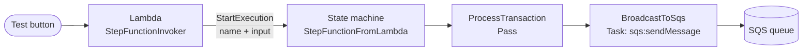
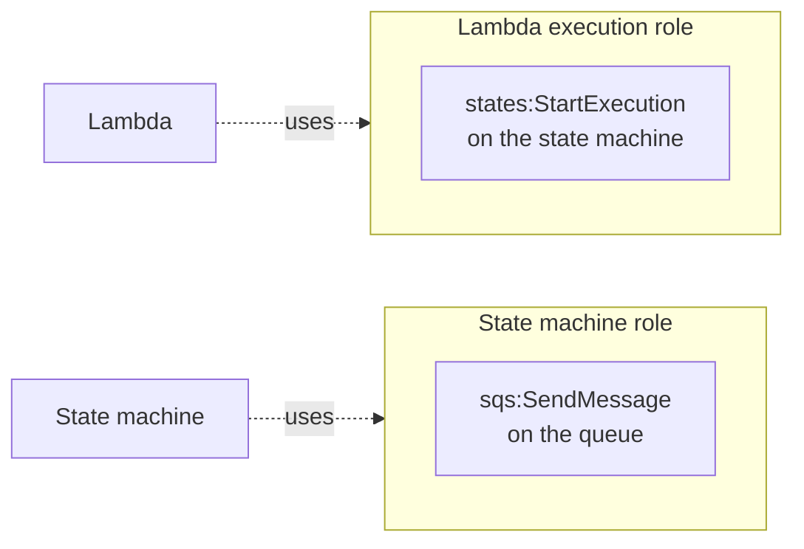
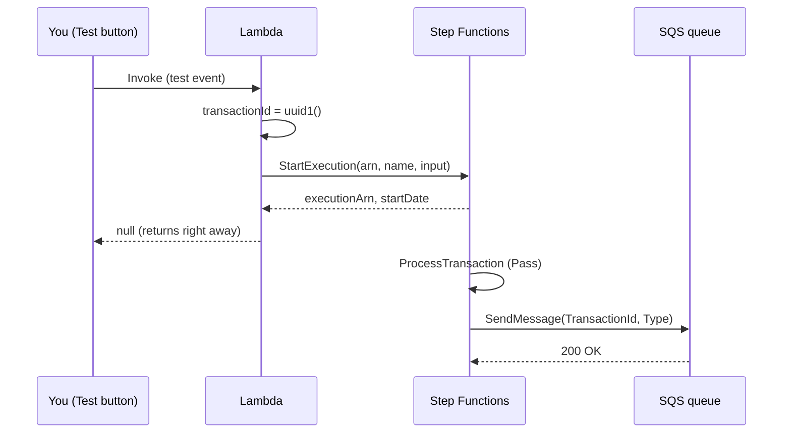

# Starting a Step Functions Execution from Lambda: Study Notes

Source: [Start a Step Function from Lambda (AWS Simplified)](https://youtu.be/kpuqc_7DQZA?list=PL9nWRykSBSFgQrO66TmO1vHFP6yuPF5G-), about 9 minutes.

The earlier videos had a state machine **call** something. This one goes the other way: a **Lambda function starts a state machine execution**, using boto3's `start_execution`. Every click of the Lambda **Test** button starts a new execution.

| Notes | Direction | What happens |
|---|---|---|
| [02](02_AWS_Step_Functions_with_Lambda_Study_Notes.md) | Step Functions → Lambda | A Task invokes a function |
| [03](03_AWS_Step_Functions_with_SQS_Study_Notes.md) | Step Functions → SQS | A Task sends a message |
| [04](04_AWS_Step_Functions_with_SNS_Study_Notes.md) | Step Functions → SNS | A Task publishes |
| [05](05_AWS_Step_Functions_with_DynamoDB_Study_Notes.md) | Step Functions → DynamoDB | A Task writes an item |
| **06 (this)** | **Lambda → Step Functions** | Code calls `StartExecution` |

The state machine started here is the SQS one from notes 03. Concepts and pricing are in [01](01_AWS_Step_Functions_Overview_Study_Notes.md).

Code marked **reconstructed** was rebuilt from what the video describes. The names `StepFunctionFromLambda` (state machine) and `StepFunctionInvoker` (function) are from the video. The role name `StepFunctionInvokerRole` is a placeholder.

What was checked:
- Both Lambda handlers (the video's and the improved one) were run locally against a **stubbed** Step Functions client (botocore's `Stubber`), so no AWS calls. The parameters, error messages and return values shown are the real results.
- The least-privilege policy was checked with IAM's policy simulator (`SimulateCustomPolicy`).
- The contents of `AWSStepFunctionsFullAccess` were read from IAM.
- `StartExecution` naming and idempotency rules come from the API reference, and the async retry behavior from AWS's Lambda docs.

---

## Contents

1. [Corrected terms](#1-corrected-terms)
2. [What you build](#2-what-you-build)
3. [StartExecution in two minutes](#3-startexecution-in-two-minutes)
4. [Step 1: The state machine](#4-step-1-the-state-machine)
5. [Step 2: Create the Lambda function](#5-step-2-create-the-lambda-function)
6. [Step 3: Write the code](#6-step-3-write-the-code)
7. [Step 4: Test it and check the executions](#7-step-4-test-it-and-check-the-executions)
8. [Least privilege instead of full access](#8-least-privilege-instead-of-full-access)
9. [Same setup with the AWS CLI](#9-same-setup-with-the-aws-cli)
10. [Beyond the video: a better handler](#10-beyond-the-video-a-better-handler)
11. [Beyond the video: test the handler without AWS](#11-beyond-the-video-test-the-handler-without-aws)
12. [Beyond the video: waiting for the result, and other ways to start](#12-beyond-the-video-waiting-for-the-result-and-other-ways-to-start)
13. [Gotchas](#13-gotchas)
14. [What has changed since the video](#14-what-has-changed-since-the-video)
15. [Cheat sheet](#15-cheat-sheet)
16. [Review questions](#16-review-questions)

---

## 1. Corrected terms

| Caption says | Actually means |
|---|---|
| moto3 / boat o 3 | **boto3**, the AWS SDK for Python |
| step function instance | An **execution** of the state machine |
| functions start execution policy | A policy allowing **`states:StartExecution`** |
| lease privilege | **Least privilege** |
| string Phi | **Stringify**: turn a dict into a JSON string with `json.dumps` |
| JSON dump s | **`json.dumps`** |
| uu ID dot u u ID 1 | **`uuid.uuid1()`** |
| sq bus / Q | SQS **queue** |
| click on save | Today: **Deploy** |
| staff function | **Step Function** |

---

## 2. What you build

### Architecture



1. You click **Test** on the Lambda function.
2. The function generates a unique transaction ID and calls `StartExecution`.
3. Step Functions starts a new execution and **returns right away**. The Lambda doesn't wait for the workflow.
4. The execution runs the notes 03 workflow and puts the transaction on the SQS queue.

### Two roles, two jobs



The Lambda only **starts** the workflow, so it needs `states:StartExecution`. It never touches SQS: the state machine does that with **its own** role. This split comes up in exam questions.

---

## 3. StartExecution in two minutes

`StartExecution` is the API call that starts a state machine. In boto3 it's `client.start_execution(...)` on a `boto3.client("stepfunctions")`.

### Request

| Parameter | Required | Meaning |
|---|---|---|
| `stateMachineArn` | Yes | Which state machine to start |
| `name` | No | The execution's name. Step Functions generates a UUID if you leave it out. |
| `input` | No | The execution input as a **JSON string** (not a dict). Up to 256 KiB. |
| `traceHeader` | No | X-Ray trace header, to link the execution to the caller's trace |

### Response

| Field | Meaning |
|---|---|
| `executionArn` | ID of the new execution: `arn:aws:states:<region>:<account>:execution:<state machine name>:<execution name>` |
| `startDate` | When it started (a `datetime` in boto3) |

There's **no output** in the response: `StartExecution` only starts the workflow. Section 12 covers how to get the result.

### Execution name rules

- 1 to 80 characters.
- Not allowed: whitespace, brackets `< > { } [ ]`, wildcards `? *`, and the special characters `" # % \ ^ | ~ ` $ & , ; : /`.
- For CloudWatch Logs logging, stick to `0-9`, `A-Z`, `a-z`, `-` and `_`.
- **Standard workflows**: the name must be unique per account, region and state machine. It becomes reusable 90 days after that execution closes.
- **Express workflows**: names can be reused right away.

The video's point at 04:27: the name "needs to be unique, you cannot have two step function instances with the same key value". That's the Standard rule above. A UUID meets every rule (36 characters: 32 hex digits and 4 hyphens).

### Same name twice (Standard)

From the API reference:

| Situation | Result |
|---|---|
| Same name, **same input**, first execution still running | Succeeds and returns the **original** execution. Nothing new starts. |
| Same name, **different input** | `ExecutionAlreadyExists` (HTTP 400) |
| Same name, first execution **already finished** | `ExecutionAlreadyExists` |

So the name doubles as an **idempotency key**: send the same request twice and you still get one execution. Section 10 uses that.

---

## 4. Step 1: The state machine

The video starts with a state machine already built, called `StepFunctionFromLambda`. It's the notes 03 workflow: a Pass state, then a Task that sends the input to an SQS queue.

```json
{
  "Comment": "Transaction Processor State Machine Using SQS",
  "StartAt": "ProcessTransaction",
  "States": {
    "ProcessTransaction": { "Type": "Pass", "Next": "BroadcastToSqs" },
    "BroadcastToSqs": {
      "Type": "Task",
      "Resource": "arn:aws:states:::sqs:sendMessage",
      "Parameters": {
        "QueueUrl": "https://sqs.us-east-1.amazonaws.com/123456789012/SQSFromStepFunction",
        "MessageBody": {
          "TransactionId.$": "$.TransactionId",
          "Type.$": "$.Type"
        }
      },
      "End": true
    }
  }
}
```

Expected input: a `TransactionId` string and a `Type` string (`PURCHASE` or `REFUND`).

```json
{ "TransactionId": "foo", "Type": "PURCHASE" }
```

**Copy the state machine ARN** from its details page. The Lambda code needs it (01:11).

To build the state machine and queue from scratch, follow notes 03 sections 4 to 6.

---

## 5. Step 2: Create the Lambda function

### Console steps (as in the video)

1. Open **Lambda** and click **Create function**.
2. Choose **Author from scratch**.
3. Function name: `StepFunctionInvoker`.
4. Runtime: the video uses **Python 3.7**, which has long been retired. Pick a current one, such as **Python 3.13** (3.14 and 3.15 are also available).
5. **Permissions**, "actually quite important" (01:48):
   - The video picks **Use an existing role** that has the `AWSStepFunctionsFullAccess` policy attached.
   - From scratch, the default **Create a new role with basic Lambda permissions** only gives CloudWatch Logs access. You have to add `states:StartExecution` to that role yourself (section 8).
6. Click **Create function**.

### What the full-access policy really contains

Read from IAM (version `v1`):

```json
{
  "Version": "2012-10-17",
  "Statement": [{ "Effect": "Allow", "Action": "states:*", "Resource": "*" }]
}
```

Every Step Functions action, on every state machine and execution in the account: create, delete, stop and so on. The video says so too: "I'm using full access, but I encourage you to use least privilege." Section 8 shows the one-line alternative.

---

## 6. Step 3: Write the code

### The handler (reconstructed)

```python
import json
import uuid

import boto3

client = boto3.client("stepfunctions")


def lambda_handler(event, context):
    transactionId = str(uuid.uuid1())

    input = {"TransactionId": transactionId, "Type": "PURCHASE"}

    response = client.start_execution(
        stateMachineArn="arn:aws:states:us-east-1:123456789012:stateMachine:StepFunctionFromLambda",
        name=transactionId,
        input=json.dumps(input),
    )
```

### Line by line

| Code | What it does |
|---|---|
| `import json` | For `json.dumps`, to turn the input dict into a string |
| `import uuid` | To generate a unique ID |
| `import boto3` | The AWS SDK. It's built into the Lambda Python runtime, so there's nothing to install. |
| `client = boto3.client("stepfunctions")` | A Step Functions client. It's created **outside** the handler, so warm invocations reuse it. |
| `str(uuid.uuid1())` | A unique ID. `uuid1()` returns a `UUID` object, so `str()` turns it into text (05:19). |
| `input = {...}` | The execution input as a Python dict. The `Type` is hardcoded to `PURCHASE` for the demo. (Naming it `input` hides Python's built-in `input()` function; harmless here, but `payload` is a better name.) |
| `stateMachineArn=` | Which state machine. This is the ARN copied in step 1. |
| `name=transactionId` | The execution name. The same value goes into the input, so the execution's name and its `TransactionId` match. |
| `input=json.dumps(input)` | The API wants a **string**, so the dict is converted to JSON text (07:17) |

The handler returns nothing, so the Lambda **Test** result shows `null`.

### Stubbed run of this handler

The call the handler made (real output from the local test):

```json
{
  "stateMachineArn": "arn:aws:states:us-east-1:123456789012:stateMachine:StepFunctionFromLambda",
  "name": "805c62fe-e705-11f1-b14e-c1b5a57b203a",
  "input": "{\"TransactionId\": \"805c62fe-e705-11f1-b14e-c1b5a57b203a\", \"Type\": \"PURCHASE\"}"
}
```

Note that `input` is a string with escaped quotes inside, which is what `json.dumps` produced.

### What if you forget `json.dumps`?

boto3 checks parameter types before sending anything. Passing the dict fails in the Lambda, before the request goes out:

```
Parameter validation failed: Invalid type for parameter input,
value: {'TransactionId': 't1'}, type: <class 'dict'>, valid types: <class 'str'>
```

### uuid1 vs uuid4

The video calls `uuid1()` "a random string of characters". It isn't random: `uuid1` is built from the **current time** plus a **machine identifier**. Three values generated in a row:

```
805c7f3c-e705-11f1-b14e-c1b5a57b203a
805c7f82-e705-11f1-b14e-c1b5a57b203a
805c7fa0-e705-11f1-b14e-c1b5a57b203a
```

Only the first part changes. That's why, at 08:35, the execution names "at first glance may look the same". They are unique, but they're near-identical and they include a host identifier.

`uuid4()` is fully random:

```
ab60a641-faf9-4027-aab7-8b347e1110df
3f82d834-6075-4209-8139-d24ce0d568a5
```

Both are 36 characters. For IDs that shouldn't reveal timing or host details, use `uuid4()`.

### Other ID ideas from the video

At 04:21 the video says the ID "could be something meaningful like a customer ID plus a date". That works, with one catch: a timestamp like `cust42-2026-11-23T10:00:00` contains `:`, which isn't allowed in execution names. Use `cust42-20261123T100000` or similar instead.

---

## 7. Step 4: Test it and check the executions

### Deploy, then test

1. Paste the code into the Lambda editor.
2. Click **Deploy**. (The video clicks "Save"; the current editor deploys with **Deploy**.) Testing before you deploy runs the **old** code. That's the `Runtime.HandlerNotFound` problem from the notes 02 lab.
3. Click **Test**, then create a test event. Any name works, and the default event content is fine, because the handler ignores `event`.
4. Click **Test** again a few times. Each click starts a new execution with a new UUID. The video clicks 8 times.

The Test result shows `Response: null`, because the handler returns nothing, plus the function's log output.

### Check in Step Functions

1. Open **Step Functions > State machines > StepFunctionFromLambda**.
2. The **Executions** list shows one execution per click, all **Succeeded**, each **named with its UUID**.
3. Click one to see the graph. Both states are green.
4. Click **BroadcastToSqs**. Its output has `HttpStatusCode: 200` from SQS (08:53).

The queue now holds one message per click. Notes 03 section 7 shows how to view them.

### Lifecycle



The Lambda is finished before the workflow sends anything to SQS. Starting an execution is **fire and forget**.

---

## 8. Least privilege instead of full access

Give the Lambda's role only what it needs: one action, on one state machine.

```json
{
  "Version": "2012-10-17",
  "Statement": [
    {
      "Effect": "Allow",
      "Action": "states:StartExecution",
      "Resource": "arn:aws:states:us-east-1:123456789012:stateMachine:StepFunctionFromLambda"
    }
  ]
}
```

Add it as an inline policy: **Lambda > Configuration > Permissions > role name** opens the role in IAM, then **Add permissions > Create inline policy**.

Results from IAM's policy simulator (`SimulateCustomPolicy`) for this policy:

| Action | Resource | Decision |
|---|---|---|
| `states:StartExecution` | `stateMachine:StepFunctionFromLambda` | **allowed** |
| `states:StartExecution` | `stateMachine:SomethingElse` | implicitDeny |
| `states:StartSyncExecution` | `stateMachine:StepFunctionFromLambda` | implicitDeny |
| `states:DescribeExecution` | `execution:StepFunctionFromLambda:abc` | implicitDeny |
| `sqs:SendMessage` | the queue | implicitDeny |

- `StartExecution` is granted on the **state machine** ARN, not on an execution ARN.
- Reading results later (`DescribeExecution`) is a separate action, on **execution** ARNs: `arn:aws:states:<region>:<account>:execution:StepFunctionFromLambda:*`.
- `StartSyncExecution` (section 12) is also a separate action.
- The Lambda doesn't need `sqs:SendMessage`. That's the state machine role's job (section 2).
- The role also needs CloudWatch Logs access (`AWSLambdaBasicExecutionRole`), which the console's default role already has.

---

## 9. Same setup with the AWS CLI

This assumes the state machine from notes 03 exists under the name `StepFunctionFromLambda`. `lambda_function.py` is the improved handler from section 10.

```bash
ACCOUNT_ID=$(aws sts get-caller-identity --query Account --output text)
SM_ARN="arn:aws:states:us-east-1:${ACCOUNT_ID}:stateMachine:StepFunctionFromLambda"

# --- Lambda execution role ---
cat > lambda-trust.json <<EOF
{
  "Version": "2012-10-17",
  "Statement": [{
    "Effect": "Allow",
    "Principal": { "Service": "lambda.amazonaws.com" },
    "Action": "sts:AssumeRole"
  }]
}
EOF
aws iam create-role --role-name StepFunctionInvokerRole \
  --assume-role-policy-document file://lambda-trust.json
aws iam attach-role-policy --role-name StepFunctionInvokerRole \
  --policy-arn arn:aws:iam::aws:policy/service-role/AWSLambdaBasicExecutionRole

cat > start-execution-policy.json <<EOF
{
  "Version": "2012-10-17",
  "Statement": [{ "Effect": "Allow", "Action": "states:StartExecution", "Resource": "$SM_ARN" }]
}
EOF
aws iam put-role-policy --role-name StepFunctionInvokerRole \
  --policy-name StartTransactionExecutions --policy-document file://start-execution-policy.json

# --- Function (the ARN goes in an environment variable, not the code) ---
zip function.zip lambda_function.py
# Right after creating a role, this can fail for a few seconds while IAM catches up.
aws lambda create-function --function-name StepFunctionInvoker \
  --runtime python3.13 --handler lambda_function.lambda_handler \
  --role "arn:aws:iam::${ACCOUNT_ID}:role/StepFunctionInvokerRole" \
  --zip-file fileb://function.zip \
  --environment "Variables={STATE_MACHINE_ARN=$SM_ARN}"
aws lambda wait function-active-v2 --function-name StepFunctionInvoker

# --- Invoke it (the same as clicking Test) ---
aws lambda invoke --function-name StepFunctionInvoker \
  --cli-binary-format raw-in-base64-out \
  --payload '{"TransactionId": "T-1001", "Type": "REFUND"}' out.json
cat out.json

# --- See the executions ---
aws stepfunctions list-executions --state-machine-arn "$SM_ARN" \
  --query 'executions[].[name, status, startDate]' --output table

# --- Or start an execution straight from the CLI, no Lambda ---
aws stepfunctions start-execution --state-machine-arn "$SM_ARN" \
  --name T-1002 --input '{"TransactionId": "T-1002", "Type": "PURCHASE"}'

# --- Clean up (the state machine and queue: see notes 03) ---
aws lambda delete-function --function-name StepFunctionInvoker
aws iam delete-role-policy --role-name StepFunctionInvokerRole --policy-name StartTransactionExecutions
aws iam detach-role-policy --role-name StepFunctionInvokerRole \
  --policy-arn arn:aws:iam::aws:policy/service-role/AWSLambdaBasicExecutionRole
aws iam delete-role --role-name StepFunctionInvokerRole
aws logs delete-log-group --log-group-name /aws/lambda/StepFunctionInvoker
```

`--cli-binary-format raw-in-base64-out` lets you pass `--payload` as plain JSON. Without it, AWS CLI v2 expects base64.

If you built it in the console, deleting the function **leaves its role and log group behind**. A role created by the console is named like `StepFunctionInvoker-role-xxxx`, with a customer-managed `AWSLambdaBasicExecutionRole-…` policy, as you saw after the notes 02 lab.

---

## 10. Beyond the video: a better handler

```python
import json
import os

import boto3

sfn = boto3.client("stepfunctions")
STATE_MACHINE_ARN = os.environ["STATE_MACHINE_ARN"]


def lambda_handler(event, context):
    # Use the caller's ID if it sent one. Otherwise use the Lambda request ID:
    # Lambda keeps it the same when it retries an async invocation, so a retry
    # reuses the execution name instead of starting a second execution.
    transaction_id = event.get("TransactionId") or context.aws_request_id
    payload = {"TransactionId": transaction_id, "Type": event.get("Type", "PURCHASE")}

    try:
        resp = sfn.start_execution(
            stateMachineArn=STATE_MACHINE_ARN,
            name=transaction_id,
            input=json.dumps(payload),
        )
    except sfn.exceptions.ExecutionAlreadyExists:
        # This name was already used (a finished run, or different input).
        return {"TransactionId": transaction_id, "Started": False}

    # resp["startDate"] is a datetime, which Lambda can't turn into JSON,
    # so return only plain values.
    return {"TransactionId": transaction_id, "Started": True, "ExecutionArn": resp["executionArn"]}
```

| Change | Why |
|---|---|
| ARN from `os.environ` | Same code for dev and prod, and no account IDs in the code |
| `TransactionId` and `Type` come from `event` | The caller decides: purchase or refund, and which ID |
| Fallback name `context.aws_request_id` | Safe under Lambda retries (below) |
| Catch `ExecutionAlreadyExists` | A repeat request isn't a crash. Typed exception, not string matching on `ClientError`. |
| Return `executionArn`, not the raw response | Useful output, and JSON-safe (below) |

### Why not a new UUID per invocation?

Event sources such as S3, SNS and EventBridge invoke Lambda **asynchronously**. If the function fails, Lambda **runs it again**, by default up to twice more. Duplicate deliveries can happen even without errors.

- With `uuid1()` or `uuid4()`, each retry makes a **new** name, so a retry can start a **second** execution for the same event.
- **Request IDs stay the same throughout an asynchronous invocation's retries**, according to AWS's Lambda documentation. With `aws_request_id` as the name, a retry sends the same name and input:
  - If the first execution is still running, Step Functions returns it and starts nothing new.
  - If it has finished, you get `ExecutionAlreadyExists`, which the handler treats as "already done".
- An ID that comes from the business event (an order number, a payment ID) is even better: it stays the same no matter how the event reaches you.

The **Test** button is a synchronous invocation with a new request ID each time, so clicking it 8 times still starts 8 executions, as in the video.

### Don't return the raw response

`start_execution` returns `startDate` as a Python `datetime`. Lambda converts the handler's return value to JSON, and `json.dumps` on that response fails:

```
Object of type datetime is not JSON serializable
```

In Lambda this shows up as a `Runtime.MarshalError`. Return plain values like `executionArn`, or convert the date with `.isoformat()`.

---

## 11. Beyond the video: test the handler without AWS

botocore's **Stubber** replaces the API response with one you supply, and checks the parameters you sent. It's the Python counterpart of TestState mocks from notes 05: no state machine, no role, no network.

`test_handler.py`, next to `lambda_function.py`:

```python
# /// script
# dependencies = ["boto3"]
# ///
import datetime
import os
import sys
from types import SimpleNamespace

os.environ.pop("AWS_PROFILE", None)  # make sure no real credentials are used
os.environ.update({
    "AWS_ACCESS_KEY_ID": "testing", "AWS_SECRET_ACCESS_KEY": "testing",
    "AWS_DEFAULT_REGION": "us-east-1",
    "STATE_MACHINE_ARN": "arn:aws:states:us-east-1:123456789012:stateMachine:StepFunctionFromLambda",
})

from botocore.stub import ANY, Stubber

import lambda_function as fn

SM = os.environ["STATE_MACHINE_ARN"]


def main() -> int:
    ctx = SimpleNamespace(aws_request_id="8a6b1c2d-0000-4000-8000-000000000001")
    started = {"executionArn": SM.replace(":stateMachine:", ":execution:") + ":T-1001",
               "startDate": datetime.datetime.now(datetime.timezone.utc)}
    with Stubber(fn.sfn) as stub:
        stub.add_response("start_execution", started,
                          {"stateMachineArn": SM, "name": "T-1001", "input": ANY})
        print(fn.lambda_handler({"TransactionId": "T-1001", "Type": "REFUND"}, ctx))

        stub.add_client_error("start_execution", service_error_code="ExecutionAlreadyExists",
                              http_status_code=400)
        print(fn.lambda_handler({"TransactionId": "T-1001", "Type": "REFUND"}, ctx))
        stub.assert_no_pending_responses()
    return 0


if __name__ == "__main__":
    sys.exit(main())
```

Run it with `uv run test_handler.py`. Results from the stubbed runs:

| Event | Name sent | Input sent | Handler returns |
|---|---|---|---|
| `{}` | the request ID | `{"TransactionId": "<request ID>", "Type": "PURCHASE"}` | `Started: True` and the execution ARN |
| `{"TransactionId": "T-1001", "Type": "REFUND"}` | `T-1001` | `{"TransactionId": "T-1001", "Type": "REFUND"}` | `Started: True`, ARN ending in `:execution:StepFunctionFromLambda:T-1001` |
| The same event again (stubbed `ExecutionAlreadyExists`) | `T-1001` | same | `{"TransactionId": "T-1001", "Started": False}` |

If the handler sends a different name than the test expects, the Stubber raises an error. So the test checks the request as well as the handling of the response.

---

## 12. Beyond the video: waiting for the result, and other ways to start

### StartExecution vs StartSyncExecution

| | `StartExecution` (video) | `StartSyncExecution` |
|---|---|---|
| Workflow types | Standard and Express | **Express only** |
| Returns | `executionArn`, `startDate` right away | Waits for the end, then returns `status`, `output`, `error` |
| Max wait | none | The Express limit, 5 minutes |
| IAM action | `states:StartExecution` | `states:StartSyncExecution` |
| Use when | Fire and forget, or long workflows | A short workflow whose answer the caller needs now, such as an API request |

For a **Standard** workflow, the Lambda can't wait for the result in any good way. Polling `DescribeExecution` in a loop keeps the Lambda running and billing, and runs into its timeout (3 seconds by default, 15 minutes max). Better options:
- Have the workflow report back at the end, for example with a last step that publishes to SNS (notes 04) or writes to DynamoDB (notes 05).
- Or have whoever needs the result check later with `DescribeExecution` and the `executionArn`.

### Other ways to start an execution

A Lambda is just one way in. Several AWS services start executions with no code at all:

| Starter | How |
|---|---|
| Any code (Lambda, a server, a script) | SDK `StartExecution` (this video) |
| AWS CLI | `aws stepfunctions start-execution` (section 9) |
| API Gateway | Direct integration with `StartExecution` or `StartSyncExecution`, with no Lambda in between |
| EventBridge rule | A state machine as the rule's target, for example on an S3 upload event |
| EventBridge Scheduler | A state machine as the target of a cron or one-time schedule |
| EventBridge Pipes | From SQS, Kinesis or DynamoDB Streams straight into a state machine |
| Another state machine | A Task with `arn:aws:states:::states:startExecution`, optionally `.sync:2` to wait for it |

If the Lambda in this video does nothing but pass data to the state machine, one of these is usually simpler: there's no function code to maintain.

---

## 13. Gotchas

1. **`input` must be a string.** Use `json.dumps(...)`. A dict fails boto3's parameter check (section 6).
2. **Names are unique per state machine** (Standard), for 90 days after the execution closes. Reusing one with different input, or after it finished, gives `ExecutionAlreadyExists`.
3. **Name characters.** No spaces, `:`, `/`, `#`, brackets and so on, and at most 80 characters. Timestamps with colons don't work.
4. **`uuid1` isn't random.** Consecutive values are near-identical and include a host identifier. Use `uuid4` for random IDs.
5. **A random name per invocation defeats idempotency.** A Lambda retry starts a second execution. Use a stable ID: from the event, or `context.aws_request_id` (section 10).
6. **`StartExecution` doesn't return output.** It only starts the workflow (section 12).
7. **Returning the raw response** from the handler fails, because `startDate` is a `datetime` (section 10).
8. **Two roles.** The Lambda needs `states:StartExecution`. SQS access belongs to the state machine's role.
9. **`StartExecution` is granted on the state machine ARN.** `DescribeExecution` and `StopExecution` are granted on **execution** ARNs.
10. **Full access is `states:*` on `*`.** That includes deleting every state machine in the account.
11. **Deploy before Test.** An undeployed edit runs the old code.
12. **Region.** A boto3 client in Lambda talks to the function's own region. For a state machine in another region, create the client with `region_name=` set to that region.
13. **Hardcoded ARNs** carry the account ID and region. Put them in an environment variable.
14. **Leftovers.** Deleting the function leaves its role, policies and log group behind (section 9).

---

## 14. What has changed since the video

| Then (video) | Now |
|---|---|
| Python 3.7 runtime | Retired. Current Python runtimes include 3.13, 3.14 and 3.15. |
| Old code editor with **Save** | VS Code-based editor with **Deploy** (and **Test** next to it) |
| Code edited in Sublime and pasted in | Still fine. Also: deploy a zip with the CLI, or use Terraform as in `02_terraform` |
| Only `StartExecution` | `StartSyncExecution` for Express workflows returns the result directly |
| Code needed to start from most events | **EventBridge Scheduler**, **EventBridge Pipes** and API Gateway start executions with no code |
| Test by running for real | Unit test the code with botocore's `Stubber`, and states with TestState mocks (notes 05) |

---

## 15. Cheat sheet

```
Client          : sfn = boto3.client("stepfunctions")      (create once, outside the handler)
Start           : sfn.start_execution(stateMachineArn=ARN, name=NAME, input=json.dumps(payload))
Returns         : {"executionArn": "...:execution:<sm>:<name>", "startDate": datetime}   (no output)
input           : JSON string, max 256 KiB.  dict -> ParamValidationError
name            : 1-80 chars; no spaces : / # % [ ] { } < > ? * etc.; optional (UUID if omitted)
                  Standard: unique per state machine, reusable 90 days after close
                  same name + same input while running -> returns the original (idempotent)
                  otherwise -> ExecutionAlreadyExists
IDs             : uuid4() random | uuid1() time + host | context.aws_request_id stable across async retries

IAM (Lambda)    : states:StartExecution on arn:aws:states:<r>:<acct>:stateMachine:<name>
                  + AWSLambdaBasicExecutionRole for logs
                  DescribeExecution/StopExecution -> execution ARNs;  StartSyncExecution -> separate
IAM (SM)        : whatever its tasks call (here sqs:SendMessage)
Full access     : AWSStepFunctionsFullAccess = states:* on *

Need the result : Express -> start_sync_execution;  Standard -> notify at the end, or DescribeExecution later
No-code starts  : API Gateway, EventBridge rule / Scheduler / Pipes, states:startExecution(.sync:2)
CLI             : aws stepfunctions start-execution --state-machine-arn ARN --name N --input '{...}'
                  aws lambda invoke --cli-binary-format raw-in-base64-out --payload '{...}' out.json
Test locally    : botocore.stub.Stubber(sfn) + uv run test_handler.py
```

---

## 16. Review questions

<details>
<summary>1. What permission does the Lambda's role need to start the state machine, and on which resource?</summary>

`states:StartExecution` on the **state machine** ARN, `arn:aws:states:<region>:<account>:stateMachine:StepFunctionFromLambda`. Plus CloudWatch Logs access for the function itself.
</details>

<details>
<summary>2. The state machine sends to SQS. Does the Lambda's role need <code>sqs:SendMessage</code>?</summary>

No. The Lambda only starts the execution. The state machine sends the message using **its own** role, which is the one that needs `sqs:SendMessage`.
</details>

<details>
<summary>3. Why does the code call <code>json.dumps(input)</code>, and what happens without it?</summary>

The `input` parameter must be a JSON **string**. Passing the dict fails boto3's parameter check before any request is sent: `Invalid type for parameter input ... valid types: <class 'str'>`.
</details>

<details>
<summary>4. What does <code>start_execution</code> return? Does it include the workflow's output?</summary>

`executionArn` and `startDate` only. It returns as soon as the execution has started, with no output. Use `DescribeExecution` later, or `StartSyncExecution` for Express workflows.
</details>

<details>
<summary>5. You call <code>start_execution</code> twice with the same name on a Standard state machine. What happens?</summary>

It depends. With the same input while the first execution is still running, the second call returns the original execution and nothing new starts. With different input, or once the first has finished, it fails with `ExecutionAlreadyExists`. The name can be reused 90 days after the execution closes.
</details>

<details>
<summary>6. The video's execution names "look the same at first glance". Why?</summary>

They're `uuid1()` values, built from the time plus a host identifier. Values generated close together differ only in the first block. `uuid4()` gives fully random IDs.
</details>

<details>
<summary>7. An S3 event triggers the Lambda, which fails after calling <code>start_execution</code>. Lambda retries. How many executions are there, with the video's code and with the improved handler?</summary>

Video's code: two. Each attempt generates a new UUID, so each starts its own execution. Improved handler: one. The retry has the same `aws_request_id`, so it reuses the name. Step Functions either returns the running execution or raises `ExecutionAlreadyExists`, which the handler treats as done.
</details>

<details>
<summary>8. Why is <code>cust42-2026-11-23T10:00:00</code> a bad execution name?</summary>

It contains `:`, which isn't allowed in execution names. Use something like `cust42-20261123T100000`.
</details>

<details>
<summary>9. The handler ends with <code>return response</code>. The Test result shows an error instead of the response. Why?</summary>

`response["startDate"]` is a Python `datetime`, which can't be converted to JSON. Lambda reports `Runtime.MarshalError`, "Object of type datetime is not JSON serializable". Return `executionArn` or other plain values instead.
</details>

<details>
<summary>10. What does <code>AWSStepFunctionsFullAccess</code> allow, and why avoid it here?</summary>

`states:*` on `*`: every Step Functions action on every state machine and execution, including delete. The function only needs `states:StartExecution` on one state machine.
</details>

<details>
<summary>11. A web request needs the workflow's answer within a few seconds. Which API and workflow type?</summary>

An **Express** workflow started with **`StartSyncExecution`**. It waits for the end and returns `status` and `output`. It needs the `states:StartSyncExecution` permission. API Gateway can call it directly, without a Lambda.
</details>

<details>
<summary>12. Name three ways to start an execution without writing any code.</summary>

Any three of: an EventBridge rule, EventBridge Scheduler, EventBridge Pipes, API Gateway's direct integration, a `states:startExecution` Task in another state machine, or the AWS CLI / console.
</details>

<details>
<summary>13. Why is the boto3 client created outside the handler?</summary>

Code outside the handler runs once per execution environment (at cold start). Warm invocations reuse the client instead of building a new one on every call.
</details>

<details>
<summary>14. How can you test the handler without a state machine or AWS credentials?</summary>

Wrap the client in botocore's `Stubber`, queue the responses or errors you want, and call `lambda_handler` with a fake event and context. The Stubber also checks the parameters the code sends.
</details>
