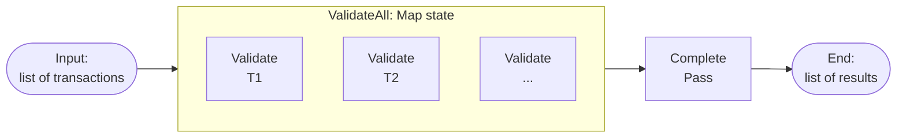

# AWS Step Functions Map State: Study Notes

Source: [AWS Step Function Map Task Tutorial (AWS Simplified)](https://youtu.be/w6cqUhSdy-M?list=PL9nWRykSBSFgQrO66TmO1vHFP6yuPF5G-), about 5 minutes.

The input is a **list** of transactions, and a **Map state** runs the same steps for each one, in parallel. Here, each transaction goes to a Lambda function that validates it. The Map state collects the results into one list.

Notes 02 to 06 handled one transaction per execution. This video handles a batch of them in a single execution. [15](15_AWS_Step_Functions_Distributed_Map_S3_Study_Notes.md) covers the large-scale version (Distributed Map, reading from S3).

Code marked **reconstructed** was rebuilt from what the video describes. The function name `ValidateTransaction` and the sample transactions are placeholders. The video doesn't show them in a readable way.

What was checked:
- Every state machine definition passed `ValidateStateMachineDefinition` (result `OK`, no diagnostics). That includes the video's older `Iterator` syntax, which still works.
- The Map state's item extraction, `ItemSelector`, `ResultPath`, error handling and the JSONata version were run through the `TestState` API with **mocked** results. The outputs shown are the real TestState results.
- The Lambda handlers were run locally with `uv run`.
- Concurrency limits and failure behavior come from the current AWS docs on inline Map.

---

## Contents

1. [Corrected terms](#1-corrected-terms)
2. [What you build](#2-what-you-build)
3. [The Map state in two minutes](#3-the-map-state-in-two-minutes)
4. [The definition](#4-the-definition)
5. [The Lambda function](#5-the-lambda-function)
6. [Run it and read the results](#6-run-it-and-read-the-results)
7. [Same setup with the AWS CLI](#7-same-setup-with-the-aws-cli)
8. [Beyond the video: current syntax, ItemSelector, and errors](#8-beyond-the-video-current-syntax-itemselector-and-errors)
9. [Beyond the video: JSONata version](#9-beyond-the-video-jsonata-version)
10. [Inline vs Distributed](#10-inline-vs-distributed)
11. [Gotchas](#11-gotchas)
12. [What has changed since the video](#12-what-has-changed-since-the-video)
13. [Cheat sheet](#13-cheat-sheet)
14. [Review questions](#14-review-questions)

---

## 1. Corrected terms

| Caption says | Actually means |
|---|---|
| map tasks / map types | The **Map state** (`"Type": "Map"`) |
| act while logic of the iterator | The logic of the **iterator**: the steps run for each item |
| back box | The **Map state** box in the execution graph |
| passed task | A **Pass** state |
| interest a pass | "and it's a Pass" |
| how they suggest | "highly suggest" |

---

## 2. What you build



- **ValidateAll** (Map) takes the `transactions` array and runs its inner workflow once per transaction.
- **Validate** (Task, inside the Map) sends one transaction to a Lambda function.
- The Map state's output is a **list**: one result per transaction, in the same order as the input.
- **Complete** (Pass) passes the list on, and the execution ends.

The video at 03:06: "whatever you return from the Lambda function will get converted into a list on the step function side".

### Input

```json
{
  "BatchId": "B-2026-11-23",
  "transactions": [
    { "TransactionId": "T1", "Type": "PURCHASE", "Amount": 20 },
    { "TransactionId": "T2", "Type": "REFUND",   "Amount": 15 },
    { "TransactionId": "T3", "Type": "PURCHASE", "Amount": 100 },
    { "TransactionId": "T4", "Type": "PURCHASE", "Amount": 7 },
    { "TransactionId": "T5", "Type": "REFUND",   "Amount": 42 }
  ]
}
```

The video shows "five or so" transactions with different IDs, types and amounts. `BatchId` isn't in the video; section 8 uses it.

### Output

```json
["T1-PURCHASE", "T2-REFUND", "T3-PURCHASE", "T4-PURCHASE", "T5-REFUND"]
```

---

## 3. The Map state in two minutes

| Term | Meaning |
|---|---|
| **Map state** | A state that runs a small workflow **once per item** of an array |
| **Iteration** | One run of that workflow, for one item |
| **Item processor** (old name: `Iterator`) | The workflow inside the Map: its own `StartAt` and `States` |
| **ItemsPath** | Where the array is in the input, for example `$.transactions` |
| **MaxConcurrency** | The most iterations allowed to run at the same time. `0` means no limit; `1` means one at a time, in order. |
| **Map output** | An array with one entry per iteration, in input order |

### Before the Map state

The video at 00:40: before Map existed (it launched in September 2019), looping meant a "fairly hacky approach". You built the loop yourself, roughly like this:
1. A Lambda function kept a counter and returned the next item.
2. A Task processed that item.
3. A Choice state checked whether items were left and jumped back to step 1.

A Map state does all of that in one state, and runs the items in parallel.

### Where Map fits among the flow states

| State | Runs | Branches decided |
|---|---|---|
| **Choice** | One of several paths | By the input |
| **Parallel** | A **fixed** number of different branches at the same time | In the definition |
| **Map** | The **same** steps for every item of an array, at the same time | By the length of the array at runtime |

---

## 4. The definition

### As in the video (reconstructed, validated: `OK`)

```json
{
  "Comment": "Validate every transaction with a Map state",
  "StartAt": "ValidateAll",
  "States": {
    "ValidateAll": {
      "Type": "Map",
      "InputPath": "$",
      "ItemsPath": "$.transactions",
      "MaxConcurrency": 0,
      "Iterator": {
        "StartAt": "Validate",
        "States": {
          "Validate": {
            "Type": "Task",
            "Resource": "arn:aws:lambda:us-east-1:123456789012:function:ValidateTransaction",
            "End": true
          }
        }
      },
      "Next": "Complete"
    },
    "Complete": {
      "Type": "Pass",
      "End": true
    }
  }
}
```

### Line by line

| Part | What it does |
|---|---|
| `"Type": "Map"` | Run the inner workflow once per array item |
| `"InputPath": "$"` | Use the whole input. `$` is the default, so this line could be left out. |
| `"ItemsPath": "$.transactions"` | The array to loop over. The video at 01:51: "transactions is the key where the items are located". |
| `"MaxConcurrency": 0` | No limit on parallel iterations. The video suggests `1` or `5` to throttle. |
| `"Iterator"` | The inner workflow, with its own `StartAt` and `States`. Today this field is called `ItemProcessor` (section 8). |
| `"Validate"` | A Task inside the Map. Its input is **one** transaction. |
| `"Resource": "arn:aws:lambda:...:function:ValidateTransaction"` | Calls the Lambda function directly by its ARN. The result is the function's return value, with no wrapper. |
| `"End": true` inside the iterator | Ends **this iteration**, not the whole execution |
| `"Next": "Complete"` | After all iterations finish, go to `Complete` |
| `Complete` (Pass) | Forwards the list. The execution ends here. |

The video also mentions `ResultPath`. With the default (`$`), the Map's output is just the list of results, which matches what the video shows at 04:35. Section 8 uses `ResultPath` to keep the input next to the results.

### What TestState shows

TestState with the input from section 2, and a mocked result for the whole Map:

| Stage | Value |
|---|---|
| `afterItemsPath` | The 5 transaction objects, as an array |
| Map output | `["T1-PURCHASE", "T2-REFUND", "T3-PURCHASE", "T4-PURCHASE", "T5-REFUND"]` |
| `maxConcurrency` | `0` |
| Next state | `Complete` |

If the input has no `transactions` key, for example `{"txs": [...]}`, the Map fails right away:

```
States.ReferencePathConflict: Unable to apply step "transactions" to input {"txs": [...]}
```

Note the error name: `States.ReferencePathConflict`, not `States.Runtime` as in the earlier notes.

---

## 5. The Lambda function

The video at 02:40: "every input to this Lambda function is going to be a single one of those transactions", and it returns "the transaction ID plus the type".

### Handler (reconstructed)

```python
def lambda_handler(event, context):
    # event is one transaction, e.g. {"TransactionId": "T1", "Type": "PURCHASE", "Amount": 20}
    return f'{event["TransactionId"]}-{event["Type"]}'
```

Local run: `{"TransactionId": "T1", "Type": "PURCHASE", "Amount": 20}` returns `T1-PURCHASE`. The `-` separator is a choice made for these notes; the video only says "concatenated".

In a real workflow this is where the work happens. The video's examples are saving each transaction to a database, or transforming it.

### Permissions

As in notes 02:
- The function's own role needs only CloudWatch Logs (`AWSLambdaBasicExecutionRole`).
- The **state machine's** role needs `lambda:InvokeFunction` on the function.
- The Map state doesn't need any permission of its own. The Task inside it does the calling.

---

## 6. Run it and read the results

### Start an execution

1. **Start execution** with the input from section 2.
2. It finishes almost instantly. The video: "wow, this was done almost instantly".

### What you see in the console

| Click | Shows |
|---|---|
| The **Map state** (ValidateAll) | **Input**: the whole list. Also the **iteration details**: how many iterations succeeded, failed, were aborted, or are still running. |
| An **iteration**, picked by its index | **Input**: one transaction. **Output**: that transaction's Lambda result, for example `"T1-PURCHASE"`. |
| The Map state's **Output** | The full list of results, in input order |

### Execution history events

Each iteration shows up in the execution's event history, between the Map's own start and end events:

```
MapStateEntered
MapStateStarted
  MapIterationStarted     (index 0)
  TaskScheduled / LambdaFunction...
  MapIterationSucceeded   (index 0)
  ... one set per item ...
MapStateSucceeded
MapStateExited
```

That's why inline Map has a size limit: all of these events count toward the execution's history limit of **25,000 events** (section 10).

---

## 7. Same setup with the AWS CLI

`state-machine.json` is the definition from section 4, with your account ID in the function ARN. `input.json` is the input from section 2. `lambda_function.py` is the handler from section 5.

```bash
ACCOUNT_ID=$(aws sts get-caller-identity --query Account --output text)

# --- Lambda function and its role ---
cat > lambda-trust.json <<'EOF'
{"Version": "2012-10-17", "Statement": [{"Effect": "Allow",
  "Principal": {"Service": "lambda.amazonaws.com"}, "Action": "sts:AssumeRole"}]}
EOF
aws iam create-role --role-name ValidateTransactionRole \
  --assume-role-policy-document file://lambda-trust.json
aws iam attach-role-policy --role-name ValidateTransactionRole \
  --policy-arn arn:aws:iam::aws:policy/service-role/AWSLambdaBasicExecutionRole
zip function.zip lambda_function.py
aws lambda create-function --function-name ValidateTransaction \
  --runtime python3.13 --handler lambda_function.lambda_handler \
  --role "arn:aws:iam::${ACCOUNT_ID}:role/ValidateTransactionRole" \
  --zip-file fileb://function.zip
FN_ARN="arn:aws:lambda:us-east-1:${ACCOUNT_ID}:function:ValidateTransaction"

# --- State machine role ---
cat > sfn-trust.json <<EOF
{"Version": "2012-10-17", "Statement": [{"Effect": "Allow",
  "Principal": {"Service": "states.amazonaws.com"}, "Action": "sts:AssumeRole",
  "Condition": {"StringEquals": {"aws:SourceAccount": "$ACCOUNT_ID"}}}]}
EOF
aws iam create-role --role-name MapStateDemoRole --assume-role-policy-document file://sfn-trust.json
aws iam put-role-policy --role-name MapStateDemoRole --policy-name InvokeValidate \
  --policy-document "{\"Version\": \"2012-10-17\", \"Statement\": [{\"Effect\": \"Allow\",
    \"Action\": \"lambda:InvokeFunction\", \"Resource\": [\"$FN_ARN\", \"$FN_ARN:*\"]}]}"

# --- State machine and a run ---
SM_ARN=$(aws stepfunctions create-state-machine --name MapStateDemo \
  --definition file://state-machine.json \
  --role-arn "arn:aws:iam::${ACCOUNT_ID}:role/MapStateDemoRole" \
  --query stateMachineArn --output text)
EXEC=$(aws stepfunctions start-execution --state-machine-arn "$SM_ARN" \
  --input file://input.json --query executionArn --output text)
aws stepfunctions describe-execution --execution-arn "$EXEC" --query '{status: status, output: output}'

# The per-item events
aws stepfunctions get-execution-history --execution-arn "$EXEC" \
  --query 'events[?starts_with(type, `MapIteration`)].[type, mapIterationStartedEventDetails.index || mapIterationSucceededEventDetails.index]' \
  --output table

# --- Clean up ---
aws stepfunctions delete-state-machine --state-machine-arn "$SM_ARN"
aws iam delete-role-policy --role-name MapStateDemoRole --policy-name InvokeValidate
aws iam delete-role --role-name MapStateDemoRole
aws lambda delete-function --function-name ValidateTransaction
aws iam detach-role-policy --role-name ValidateTransactionRole \
  --policy-arn arn:aws:iam::aws:policy/service-role/AWSLambdaBasicExecutionRole
aws iam delete-role --role-name ValidateTransactionRole
aws logs delete-log-group --log-group-name /aws/lambda/ValidateTransaction
```

---

## 8. Beyond the video: current syntax, ItemSelector, and errors

### The same Map with today's field names (validated: `OK`)

```json
{
  "Comment": "Same Map with current field names",
  "StartAt": "ValidateAll",
  "States": {
    "ValidateAll": {
      "Type": "Map",
      "ItemsPath": "$.transactions",
      "ItemSelector": {
        "BatchId.$": "$.BatchId",
        "Index.$": "$$.Map.Item.Index",
        "Transaction.$": "$$.Map.Item.Value"
      },
      "MaxConcurrency": 2,
      "ItemProcessor": {
        "ProcessorConfig": { "Mode": "INLINE" },
        "StartAt": "Validate",
        "States": {
          "Validate": {
            "Type": "Task",
            "Resource": "arn:aws:states:::lambda:invoke",
            "Parameters": {
              "FunctionName": "arn:aws:lambda:us-east-1:123456789012:function:ValidateTransaction",
              "Payload.$": "$"
            },
            "OutputPath": "$.Payload",
            "Retry": [
              {
                "ErrorEquals": ["Lambda.ServiceException", "Lambda.TooManyRequestsException"],
                "IntervalSeconds": 1,
                "MaxAttempts": 3,
                "BackoffRate": 2.0,
                "JitterStrategy": "FULL"
              }
            ],
            "End": true
          }
        }
      },
      "ResultPath": "$.Results",
      "Catch": [
        { "ErrorEquals": ["States.ALL"], "ResultPath": "$.Error", "Next": "ReportFailure" }
      ],
      "Next": "Complete"
    },
    "ReportFailure": {
      "Type": "Fail",
      "Error": "ValidationFailed",
      "Cause": "At least one transaction failed validation"
    },
    "Complete": { "Type": "Pass", "End": true }
  }
}
```

| Change | Why |
|---|---|
| `ItemProcessor` + `ProcessorConfig: INLINE` | Replaces `Iterator` (deprecated, still accepted). `INLINE` is the default mode. |
| `ItemSelector` | Builds each iteration's input. Replaces `Parameters` inside a Map (deprecated, still accepted). |
| `$$.Map.Item.Index` / `$$.Map.Item.Value` | The Context object's Map fields: this item's position, and the item itself |
| `"BatchId.$": "$.BatchId"` | Copies a value from **outside** the array into every iteration. Without `ItemSelector`, an iteration only sees its own item. |
| `MaxConcurrency: 2` | At most 2 Lambda calls at a time, for example to protect a database |
| `lambda:invoke` + `OutputPath: $.Payload` | The optimized Lambda integration (notes 02). The result comes wrapped in `Payload`, so `OutputPath` unwraps it. |
| `Retry` on the **inner** Task | Retries just the failing item |
| `ResultPath: "$.Results"` | Keeps the input and adds the list under `Results` |
| `Catch` on the Map | If any iteration fails for good, go to `ReportFailure` |

### TestState results

**Item extraction and `ItemSelector`.** Each iteration's input (`afterItemSelector`), first two of five:

```json
[
  {"Transaction": {"TransactionId": "T1", "Type": "PURCHASE", "Amount": 20}, "BatchId": "B-2026-11-23", "Index": 0},
  {"Transaction": {"TransactionId": "T2", "Type": "REFUND", "Amount": 15}, "BatchId": "B-2026-11-23", "Index": 1}
]
```

**Output with `ResultPath`:**

```json
{"BatchId": "B-2026-11-23", "transactions": [ ...5 items... ],
 "Results": ["T1-PURCHASE", "T2-REFUND", "T3-PURCHASE", "T4-PURCHASE", "T5-REFUND"]}
```

**The inner Task**, tested on its own with the second iteration's input. The request sent to Lambda (`afterParameters`):

```json
{"FunctionName": "arn:aws:lambda:...:function:ValidateTransaction",
 "Payload": {"BatchId": "B-2026-11-23", "Index": 1,
             "Transaction": {"TransactionId": "T2", "Type": "REFUND", "Amount": 15}}}
```

With a mocked reply of `{"StatusCode": 200, "Payload": "T2-REFUND"}`, `OutputPath` turns the output into just `"T2-REFUND"`.

**One iteration fails.** Mocked `States.TaskFailed` from `Validate`:
- Status `CAUGHT_ERROR`, next state `ReportFailure`.
- Output: the input plus `"Error": {"Error": "States.TaskFailed", "Cause": "T3 amount too large"}`.

### A handler for the `ItemSelector` input

With `ItemSelector`, the function receives `{"BatchId", "Index", "Transaction"}` instead of a bare transaction, so the handler changes:

```python
def lambda_handler(event, context):
    # event is built by ItemSelector: {"BatchId": ..., "Index": ..., "Transaction": {...}}
    tx = event["Transaction"]
    if tx["Amount"] <= 0:
        raise ValueError(f'Transaction {tx["TransactionId"]} has a non-positive amount')
    return {"TransactionId": tx["TransactionId"], "Index": event["Index"], "Valid": True}
```

Local runs:
- `T2` returns `{'TransactionId': 'T2', 'Index': 1, 'Valid': True}`.
- An amount of `0` raises `ValueError: Transaction T9 has a non-positive amount`.

In Step Functions, that exception arrives as an error named **`ValueError`**, the exception's class name. `States.TaskFailed` and `States.ALL` both match it.

### What happens when one item fails

From the inline Map docs:
- **The failure of any iteration causes the whole Map state to fail, and all other iterations stop.** One bad transaction fails the batch.
- **A `Retry` on the Map state itself re-runs all iterations**, including the ones that succeeded. Put retries on the Task **inside** the Map instead, as above.

To let a batch succeed despite bad items, either:
- catch the error **inside** the item processor (a `Catch` on `Validate` that goes to a Pass state returning `{"Valid": false}`), so the iteration succeeds with a "failed" result; or
- use Distributed mode, which supports a tolerated failure percentage or count (section 10).

---

## 9. Beyond the video: JSONata version

Validated: `OK`. TestState output matches section 8.

```json
{
  "QueryLanguage": "JSONata",
  "StartAt": "ValidateAll",
  "States": {
    "ValidateAll": {
      "Type": "Map",
      "Items": "",
      "ItemSelector": {
        "Index": "",
        "Transaction": ""
      },
      "MaxConcurrency": 2,
      "ItemProcessor": {
        "ProcessorConfig": { "Mode": "INLINE" },
        "StartAt": "Validate",
        "States": {
          "Validate": {
            "Type": "Task",
            "Resource": "arn:aws:states:::lambda:invoke",
            "Arguments": {
              "FunctionName": "arn:aws:lambda:us-east-1:123456789012:function:ValidateTransaction",
              "Payload": ""
            },
            "Output": "",
            "End": true
          }
        }
      },
      "Output": "",
      "End": true
    }
  }
}
```

| JSONPath | JSONata |
|---|---|
| `"ItemsPath": "$.transactions"` | `"Items": ""` |
| `"Index.$": "$$.Map.Item.Index"` | `"Index": ""` |
| `OutputPath: "$.Payload"` | `"Output": ""` |
| `ResultPath: "$.Results"` | `"Output": ""` |

`Items` can be any expression that returns an array, for example `` to loop over refunds only.

---

## 10. Inline vs Distributed

The video shows **inline** mode, the only mode in 2019. Distributed mode came in December 2022. Notes [15](15_AWS_Step_Functions_Distributed_Map_S3_Study_Notes.md) covers it in depth.

| | Inline (video) | Distributed |
|---|---|---|
| Set by | `ProcessorConfig.Mode: INLINE` (default) | `Mode: DISTRIBUTED` |
| Max concurrent iterations | **40** | 10,000 child executions |
| Items come from | A JSON array in the state input | A JSON array, or **S3** (CSV, JSON, object lists) via `ItemReader` |
| Execution history | Every iteration's events go into the **parent's** history (25,000-event limit) | Each iteration is a **child execution** with its own history |
| Input size | Bound by the 256 KiB state data limit | Read from S3 in pieces, so the dataset can be huge |
| Failure handling | One failure fails the whole Map | `ToleratedFailurePercentage` / `ToleratedFailureCount` |
| Batching | No | `ItemBatcher`: several items per iteration |
| Results | Returned as an array | Returned, or written to S3 with `ResultWriter` |

Use inline for small lists (dozens to low hundreds of items) inside a normal workflow. Use Distributed for large datasets, high parallelism, or data already in S3.

### "0 means unlimited", with a catch

The video says `MaxConcurrency: 0` means "unlimited concurrency". In the definition that's true, but inline mode **runs at most 40 iterations at the same time**. The AWS docs add that above 40 items, some iterations wait for earlier ones to finish.

---

## 11. Gotchas

1. **`ItemsPath` must point at an array.** A missing key fails with `States.ReferencePathConflict` (section 4).
2. **Iterations only see their own item.** Use `ItemSelector` to pass in values from outside the array, such as a batch ID.
3. **Inline means 40 at most** at the same time, whatever `MaxConcurrency` says.
4. **One failed iteration fails the whole Map** and stops the others.
5. **A `Retry` on the Map re-runs every iteration**, not just the failed one. Retry inside the item processor.
6. **History limit.** Each iteration adds several events to the execution's history, which is capped at 25,000 events. A few thousand items can hit it. Use Distributed mode for big lists.
7. **The 256 KiB limit applies to the whole result array.** Large per-item results add up. Return small results, or use Distributed mode with `ResultWriter`.
8. **Output order follows input order**, not completion order.
9. **`End: true` inside the item processor** ends one iteration, not the workflow.
10. **No state outside the Map can jump into it**, and states inside can only go to each other.
11. **Direct Lambda ARN vs `lambda:invoke`.** The video's direct function ARN returns the raw result. `lambda:invoke` wraps it in `Payload`, so add `OutputPath: "$.Payload"` (JSONPath) or `$states.result.Payload` (JSONata).
12. **`Iterator` and `Parameters` are deprecated** inside Map. They still work, but new definitions should use `ItemProcessor` and `ItemSelector`.
13. **`MaxConcurrency: 1`** processes items strictly one at a time, in input order. Useful when order matters or the target can't take parallel calls.

---

## 12. What has changed since the video

| Then (video) | Now |
|---|---|
| Map was "a fairly new feature" | Standard, in Workflow Studio's **Flow** section |
| `Iterator` | `ItemProcessor` (with `ProcessorConfig`) |
| `Parameters` inside Map | `ItemSelector` |
| One mode | **Inline** or **Distributed** (December 2022) |
| Arrays from the input only | Distributed Map reads from **S3** (`ItemReader`) |
| `MaxConcurrency` fixed in the definition | `MaxConcurrencyPath` (JSONPath), or an expression (JSONata) |
| Function ARN as `Resource` | `arn:aws:states:::lambda:invoke` is the default in Workflow Studio |
| JSONPath only | **JSONata**: `Items`, `$states.context.Map.Item.*` |
| Test by running | **TestState** tests a Map state's item handling with a mocked result |

---

## 13. Cheat sheet

```
Map state (inline)
  "Type": "Map"
  "ItemsPath": "$.transactions"                 JSONata: "Items": ""
  "ItemSelector": {"Item.$": "$$.Map.Item.Value", "Index.$": "$$.Map.Item.Index", "Extra.$": "$.X"}
  "MaxConcurrency": 0 (no limit) | 1 (in order) | N
  "ItemProcessor": {"ProcessorConfig": {"Mode": "INLINE"}, "StartAt": "...", "States": {...}}
  "ResultPath": "$.Results"   (default: output = the results array)
Deprecated      : Iterator -> ItemProcessor,  Parameters -> ItemSelector  (still accepted)
Output          : array, one entry per item, input order
Failure         : any iteration fails -> Map fails, others stop
Retry on Map    : re-runs ALL iterations -> put Retry on the inner Task
Limits (inline) : 40 concurrent iterations; 25,000 history events per execution; 256 KiB data
Bad ItemsPath   : States.ReferencePathConflict
Distributed     : Mode DISTRIBUTED, up to 10,000 child executions, ItemReader (S3), ItemBatcher,
                  ToleratedFailurePercentage/Count, ResultWriter
History events  : MapStateStarted, MapIterationStarted/Succeeded/Failed, MapStateSucceeded
Test            : aws stepfunctions test-state --mock '{"result": "[...]"}' --inspection-level DEBUG
                  -> afterItemsPath, afterItemSelector, output
```

---

## 14. Review questions

<details>
<summary>1. What does a Map state do, and what is its output?</summary>

It runs the same inner workflow once per item of an array, in parallel by default. Its output is an array with one result per item, in the same order as the input.
</details>

<details>
<summary>2. What does <code>"ItemsPath": "$.transactions"</code> do?</summary>

It tells the Map state where the array is in its input. Each element of `transactions` becomes one iteration's input.
</details>

<details>
<summary>3. The video says <code>MaxConcurrency: 0</code> means unlimited. What's the real limit in inline mode?</summary>

40 concurrent iterations. `0` means no limit in the definition, but inline Map runs at most 40 at a time. Above 40 items, the rest wait. For more, use Distributed mode (up to 10,000).
</details>

<details>
<summary>4. When would you set <code>MaxConcurrency</code> to 1?</summary>

When items must be processed one at a time, in input order, or when the downstream system can't handle parallel calls.
</details>

<details>
<summary>5. Each iteration needs the <code>BatchId</code> from the top of the input, but only receives its own transaction. How do you fix that?</summary>

Use `ItemSelector`, for example `{"BatchId.$": "$.BatchId", "Transaction.$": "$$.Map.Item.Value"}`. It builds each iteration's input from the Map's input plus the current item.
</details>

<details>
<summary>6. One of five transactions fails validation. What happens to the other four, and to the Map?</summary>

In inline mode, the whole Map state fails and the remaining iterations stop. A `Catch` on the Map can route to a failure handler. To keep going despite bad items, catch the error inside the item processor, or use Distributed mode with a tolerated failure threshold.
</details>

<details>
<summary>7. Why put <code>Retry</code> on the Task inside the Map, not on the Map state?</summary>

A `Retry` on an inline Map state re-runs all iterations, including the ones that succeeded. A `Retry` on the inner Task retries only the failing item.
</details>

<details>
<summary>8. What replaced <code>Iterator</code> and <code>Parameters</code> in Map states? Do the old fields still work?</summary>

`ItemProcessor` replaced `Iterator`, and `ItemSelector` replaced `Parameters`. The old fields are deprecated but still accepted. The video's definition validates `OK`.
</details>

<details>
<summary>9. The input is <code>{"txs": [...]}</code> but <code>ItemsPath</code> is <code>$.transactions</code>. What error do you get?</summary>

`States.ReferencePathConflict`: "Unable to apply step "transactions" to input ...".
</details>

<details>
<summary>10. The function in the Map returns a string. With <code>lambda:invoke</code>, the Map output is a list of objects with <code>StatusCode</code> and <code>Payload</code>. Why, and how do you fix it?</summary>

The optimized `lambda:invoke` integration wraps the function's return value in `Payload`, with metadata alongside. Add `"OutputPath": "$.Payload"` on the inner Task (or `Output: $states.result.Payload` in JSONata). The video's direct function ARN didn't have this wrapper.
</details>

<details>
<summary>11. Name three reasons to switch from inline to Distributed Map.</summary>

Any three of: more than 40 concurrent iterations; a dataset larger than 256 KiB, or stored in S3; more history events than the 25,000 limit; tolerating some failed items; batching items; writing results to S3.
</details>

<details>
<summary>12. How was looping done before the Map state existed?</summary>

By hand: a Lambda function kept a counter and returned the next item, a Task processed it, and a Choice state jumped back until no items were left. The video calls this "a fairly hacky approach".
</details>
