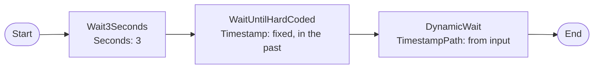
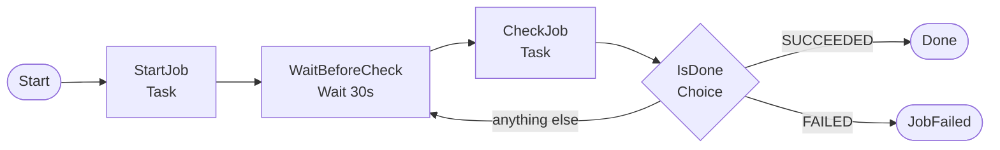

# AWS Step Functions Wait State: Study Notes

Source: [Set timers with AWS Step Functions using Wait State (AWS Simplified)](https://youtu.be/2ntuvgFTmL4?list=PL9nWRykSBSFgQrO66TmO1vHFP6yuPF5G-), about 3 minutes.

A **Wait state** pauses the workflow, either for a number of seconds or until a point in time. The video chains three Wait states to show three ways to set the delay:

1. A fixed number of seconds.
2. A fixed timestamp.
3. A timestamp read from the execution input.

There's a fourth way the video doesn't show: a number of seconds read from the input (`SecondsPath`).

Code marked **reconstructed** was rebuilt from what the video describes. The video doesn't show the timestamps clearly, so the dates below are close guesses.

What was checked:
- Every definition passed `ValidateStateMachineDefinition` (result `OK`). The invalid ones show the real validation errors.
- Every Wait variant and every error case was run through the `TestState` API. The statuses, timings and error messages shown are the real results.
- Limits and timestamp rules come from the current Wait state reference.

---

## Contents

- [AWS Step Functions Wait State: Study Notes](#aws-step-functions-wait-state-study-notes)
  - [Contents](#contents)
  - [1. Corrected terms](#1-corrected-terms)
  - [2. What you build](#2-what-you-build)
    - [Input](#input)
  - [3. The four ways to wait](#3-the-four-ways-to-wait)
    - [Limits](#limits)
  - [4. The definition](#4-the-definition)
    - [As in the video (reconstructed, validated: `OK`)](#as-in-the-video-reconstructed-validated-ok)
    - [Line by line](#line-by-line)
  - [5. Run it](#5-run-it)
    - [Timings measured with TestState](#timings-measured-with-teststate)
    - [Stopping a waiting execution](#stopping-a-waiting-execution)
  - [6. Timestamp rules, tested](#6-timestamp-rules-tested)
  - [7. Seconds rules, tested](#7-seconds-rules-tested)
  - [8. Same setup with the AWS CLI](#8-same-setup-with-the-aws-cli)
  - [9. Beyond the video: the polling loop](#9-beyond-the-video-the-polling-loop)
    - [Definition (validated: `OK`)](#definition-validated-ok)
    - [Better than polling, when available](#better-than-polling-when-available)
  - [10. Beyond the video: JSONata, cost, and alternatives](#10-beyond-the-video-jsonata-cost-and-alternatives)
    - [JSONata (validated: `OK`)](#jsonata-validated-ok)
    - [What waiting costs](#what-waiting-costs)
    - [Wait state vs other ways to delay](#wait-state-vs-other-ways-to-delay)
  - [11. Gotchas](#11-gotchas)
  - [12. What has changed since the video](#12-what-has-changed-since-the-video)
  - [13. Cheat sheet](#13-cheat-sheet)
  - [14. Review questions](#14-review-questions)

---

## 1. Corrected terms

| Caption says | Actually means |
|---|---|
| weight / weight states | **Wait** / **Wait states** |
| dynamic weight | The **DynamicWait** state (`TimestampPath`) |
| time step | **Timestamp** |
| snap function | **Step Function** |
| wait until timestamp | The input key `waitUntilTimestamp` |
| tasks (for Wait states) | **States**: a Wait is a state, not a Task |

---

## 2. What you build



| State | Waits | In the video's run |
|---|---|---|
| `Wait3Seconds` | 3 seconds | Done after 3 seconds |
| `WaitUntilHardCoded` | Until a hard-coded date | The date is in the past, so it **continues right away** |
| `DynamicWait` | Until the date in the input | The input is "tomorrow evening", so the execution sits there until then |

The video's use case at 00:13: wait after "firing off a task", giving it time to complete. Section 9 turns that into a proper polling loop.

### Input

```json
{ "waitUntilTimestamp": "2020-05-18T23:00:00Z" }
```

At recording time, this was the next day (May 18, 2020).

---

## 3. The four ways to wait

Each Wait state uses **exactly one** of these fields:

| Field | Value | Example | Video |
|---|---|---|---|
| `Seconds` | A fixed whole number of seconds | `"Seconds": 3` | Yes |
| `Timestamp` | A fixed point in time | `"Timestamp": "2020-05-01T00:00:00Z"` | Yes |
| `TimestampPath` | A path to a timestamp in the input | `"TimestampPath": "$.waitUntilTimestamp"` | Yes |
| `SecondsPath` | A path to a number of seconds in the input | `"SecondsPath": "$.delaySeconds"` | No |

- **Relative** waits (`Seconds`, `SecondsPath`) count from when the state starts.
- **Absolute** waits (`Timestamp`, `TimestampPath`) end at a set time. A time in the past ends the wait **immediately**.
- The `...Path` versions are JSONPath only. In JSONata, `Seconds` and `Timestamp` accept expressions instead (section 10).

### Limits

| Limit | Value |
|---|---|
| `Seconds` | 0 to 99,999,999 (validation: "Maximum value is 99999999") |
| Longest wait, Standard workflow | 1 year (the maximum execution length) |
| Longest wait, Express workflow | 5 minutes (the maximum execution length) |
| Timestamp precision | Seconds. Milliseconds are dropped. |

99,999,999 seconds is about 3.2 years, so for Standard workflows the 1-year execution limit is the real cap.

Using two of the fields at once fails validation:

```
There should only be one of the following fields: [SecondsPath, Seconds, TimestampPath, Timestamp]
```

---

## 4. The definition

### As in the video (reconstructed, validated: `OK`)

```json
{
  "Comment": "Three ways to use a Wait state",
  "StartAt": "Wait3Seconds",
  "States": {
    "Wait3Seconds": {
      "Type": "Wait",
      "Seconds": 3,
      "Next": "WaitUntilHardCoded"
    },
    "WaitUntilHardCoded": {
      "Type": "Wait",
      "Timestamp": "2020-05-01T00:00:00Z",
      "Next": "DynamicWait"
    },
    "DynamicWait": {
      "Type": "Wait",
      "TimestampPath": "$.waitUntilTimestamp",
      "End": true
    }
  }
}
```

### Line by line

| Part | What it does |
|---|---|
| `"Type": "Wait"` | Pause, then go to `Next` |
| `"Seconds": 3` | Hard-coded relative delay (00:39) |
| `"Timestamp": "2020-05-01T00:00:00Z"` | Hard-coded absolute time. It's in the past, so the state ends at once (01:06). |
| `"TimestampPath": "$.waitUntilTimestamp"` | Read the end time from the input (01:35) |
| `"End": true` | The execution ends after the last wait |

A Wait state passes its **input through unchanged**. TestState confirms it: the output of each Wait was exactly its input, `{"waitUntilTimestamp": "..."}`.

---

## 5. Run it

1. **Start execution** with `{"waitUntilTimestamp": "<tomorrow>T18:00:00Z"}`.
2. Watch the graph:
   - `Wait3Seconds` turns green after 3 seconds.
   - `WaitUntilHardCoded` turns green right after, because its time is in the past.
   - `DynamicWait` stays **in progress** until tomorrow at 18:00 UTC.
3. The execution status stays **Running** the whole time.

The video notes that the console updated only "once every 10 seconds or so". Use the refresh button if the graph seems behind.

### Timings measured with TestState

`TestState` **really waits**, so use short delays or past timestamps when testing:

| Test | Result | Time taken |
|---|---|---|
| `Seconds: 3` | `SUCCEEDED`, next `WaitUntilHardCoded` | 3.3 s |
| `Timestamp` in 2020 (the past) | `SUCCEEDED`, next `DynamicWait` | immediate |
| `TimestampPath` 20 seconds ahead | `SUCCEEDED` | returned when the time arrived |
| `SecondsPath` with `2` | `SUCCEEDED` | 2.2 s |

A test with a timestamp a day ahead didn't return at all, because it was waiting for that time.

### Stopping a waiting execution

A Wait is just a paused execution. To cancel it, stop the execution:
- In the console: **Stop execution**.
- From the CLI: `aws stepfunctions stop-execution --execution-arn <arn>`.

---

## 6. Timestamp rules, tested

The docs require the RFC 3339 profile of ISO 8601, with an uppercase `T` between date and time and an uppercase `Z` for UTC, for example `2024-08-18T17:33:00Z`. The video at 01:18: it "needs to conform to that format or else your step function will fail".

`TimestampPath` with different values:

| Input value | Result |
|---|---|
| `2020-05-18T23:00:00Z` | Works |
| `2020-05-18T23:00:00+02:00` (offset instead of `Z`) | Works |
| `2020-05-18t23:00:00z` (lowercase) | Works at runtime, although the docs say uppercase. Don't rely on it. |
| `2020-05-18 23:00:00` (space, no zone) | **Fails** |
| `2020-05-18` (date only) | **Fails** |
| Key missing from the input | **Fails** |

The error messages, all `States.Runtime`:

```
The TimestampPath parameter does not reference a valid ISO-8601 extended offset
date-time format string: $.waitUntilTimestamp == 2020-05-18 23:00:00

The TimestampPath parameter does not reference an input value: $.waitUntilTimestamp
```

A malformed timestamp in a **literal** `Timestamp` field isn't always caught early: the lowercase `2020-05-01t00:00:00z` passed validation too.

Producing a correct timestamp:
- Python: `datetime.now(timezone.utc).strftime("%Y-%m-%dT%H:%M:%SZ")`
- Shell: `date -u +%Y-%m-%dT%H:%M:%SZ`
- Step Functions itself: `$$.Execution.StartTime` and `$$.State.EnteredTime` are already in the right format.

---

## 7. Seconds rules, tested

`SecondsPath: "$.delaySeconds"` with different values:

| Input value | Result |
|---|---|
| `2` | Works (waited 2.2 s) |
| `"2"` (a string) | Works: a string holding a whole number is accepted |
| `-5` | **Fails**: `The SecondsPath parameter references a negative value: $.delaySeconds == -5` |
| `2.5` | **Fails**: `The SecondsPath parameter cannot be parsed as a long value: $.delaySeconds == 2.5` |

`Seconds` itself must be a whole number. Round up in whatever produces the value, or use JSONata's `$ceil(...)`.

---

## 8. Same setup with the AWS CLI

Wait states call no other service, so the state machine role only needs to exist. It needs no permissions.

```bash
ACCOUNT_ID=$(aws sts get-caller-identity --query Account --output text)

cat > sfn-trust.json <<EOF
{"Version": "2012-10-17", "Statement": [{"Effect": "Allow",
  "Principal": {"Service": "states.amazonaws.com"}, "Action": "sts:AssumeRole",
  "Condition": {"StringEquals": {"aws:SourceAccount": "$ACCOUNT_ID"}}}]}
EOF
aws iam create-role --role-name WaitStateDemoRole --assume-role-policy-document file://sfn-trust.json

SM_ARN=$(aws stepfunctions create-state-machine --name WaitStateDemo \
  --definition file://state-machine.json \
  --role-arn "arn:aws:iam::${ACCOUNT_ID}:role/WaitStateDemoRole" \
  --query stateMachineArn --output text)

# Wait until 2 minutes from now
UNTIL=$(date -u -d '+2 minutes' +%Y-%m-%dT%H:%M:%SZ)     # macOS: date -u -v+2M +%Y-%m-%dT%H:%M:%SZ
EXEC=$(aws stepfunctions start-execution --state-machine-arn "$SM_ARN" \
  --input "{\"waitUntilTimestamp\": \"$UNTIL\"}" --query executionArn --output text)

# Which state is it in? Look at the newest events.
aws stepfunctions get-execution-history --execution-arn "$EXEC" --reverse-order --max-results 3 \
  --query 'events[].[timestamp, type, stateEnteredEventDetails.name]' --output table

# Changed your mind? Stop it.
aws stepfunctions stop-execution --execution-arn "$EXEC"

# Clean up
aws stepfunctions delete-state-machine --state-machine-arn "$SM_ARN"
aws iam delete-role --role-name WaitStateDemoRole
```

The history shows `WaitStateEntered` for each wait, and `WaitStateExited` when it ends.

---

## 9. Beyond the video: the polling loop

The video's motivation, "firing off a task and then waiting for it", usually becomes a **polling loop**: start a job, wait, check, and repeat until it's done.



### Definition (validated: `OK`)

```json
{
  "Comment": "Poll a job until it finishes",
  "TimeoutSeconds": 3600,
  "StartAt": "StartJob",
  "States": {
    "StartJob": {
      "Type": "Task",
      "Resource": "arn:aws:states:::lambda:invoke",
      "Parameters": {
        "FunctionName": "arn:aws:lambda:us-east-1:123456789012:function:StartJob",
        "Payload.$": "$"
      },
      "OutputPath": "$.Payload",
      "Next": "WaitBeforeCheck"
    },
    "WaitBeforeCheck": { "Type": "Wait", "Seconds": 30, "Next": "CheckJob" },
    "CheckJob": {
      "Type": "Task",
      "Resource": "arn:aws:states:::lambda:invoke",
      "Parameters": {
        "FunctionName": "arn:aws:lambda:us-east-1:123456789012:function:CheckJob",
        "Payload.$": "$"
      },
      "OutputPath": "$.Payload",
      "Next": "IsDone"
    },
    "IsDone": {
      "Type": "Choice",
      "Choices": [
        { "Variable": "$.status", "StringEquals": "SUCCEEDED", "Next": "Done" },
        { "Variable": "$.status", "StringEquals": "FAILED", "Next": "JobFailed" }
      ],
      "Default": "WaitBeforeCheck"
    },
    "Done": { "Type": "Succeed" },
    "JobFailed": { "Type": "Fail", "Error": "JobFailed", "Cause": "The job reported FAILED" }
  }
}
```

TestState on `IsDone`:

| `status` from CheckJob | Next state |
|---|---|
| `RUNNING` | `WaitBeforeCheck` (loop) |
| `SUCCEEDED` | `Done` |
| `FAILED` | `JobFailed` |

- **`TimeoutSeconds: 3600`** on the whole state machine stops a job that never finishes from looping forever.
- Each loop adds a few events to the history. At 30 seconds per loop, the 25,000-event limit is far away for a one-hour job. For longer polling, wait longer between checks.

### Better than polling, when available

| Option | When |
|---|---|
| **`.sync` integrations** (Glue, ECS, Batch, CodeBuild, nested Step Functions, and more) | Step Functions waits for the job itself. No loop needed. Notes [14](14_AWS_Step_Functions_Nested_Workflows_Study_Notes.md) uses it. |
| **Callback with a task token** (`.waitForTaskToken`) | The job reports back when done. Notes 03 section 9, and [16](16_AWS_Step_Functions_Callback_with_Lambda_Study_Notes.md). |
| **Wait + check loop** (this section) | The job has no `.sync` and can't call back |

---

## 10. Beyond the video: JSONata, cost, and alternatives

### JSONata (validated: `OK`)

In JSONata, `Seconds` and `Timestamp` take expressions, so you can compute the wait:

```json
{
  "QueryLanguage": "JSONata",
  "StartAt": "WaitOneHourAfterOrder",
  "States": {
    "WaitOneHourAfterOrder": {
      "Type": "Wait",
      "Timestamp": "",
      "Next": "WaitInputSeconds"
    },
    "WaitInputSeconds": {
      "Type": "Wait",
      "Seconds": "",
      "End": true
    }
  }
}
```

- `$toMillis` turns the order time into milliseconds, `+ 3600000` adds an hour, and `$fromMillis` turns it back into a timestamp.
- TestState with `orderTime` `2026-11-22T10:00:00Z`: the computed time was in the past, so it continued immediately. `delaySeconds: 2` waited 2.2 s.

### What waiting costs

| Workflow type | Billed by | Cost of a long wait |
|---|---|---|
| **Standard** | State transitions | One transition. Waiting 3 seconds or 3 months costs the same. |
| **Express** | Number of requests and **duration** | Waiting is billed time, and capped at 5 minutes anyway |

Notes [09](09_AWS_Step_Functions_Standard_vs_Express_Study_Notes.md) covers the two types in detail. For long waits, use Standard.

### Wait state vs other ways to delay

| Need | Good fit |
|---|---|
| Pause inside a workflow (seconds to months) | **Wait state** |
| Run something once at a future time, with no workflow around it | **EventBridge Scheduler** (one-time schedule) |
| Run something on a timetable (every night at 2:00) | **EventBridge Scheduler** with a cron expression, starting the state machine |
| Delay a queue message up to 15 minutes | **SQS** delay queues / `DelaySeconds` |
| Wait for an outside event, not a time | Callback task token (notes 16) |

---

## 11. Gotchas

1. **Exactly one** of `Seconds`, `Timestamp`, `SecondsPath`, `TimestampPath` per Wait state.
2. **Past timestamps don't fail.** They end the wait immediately, as in the video.
3. **Timestamp format.** Use `YYYY-MM-DDTHH:MM:SSZ` (or with an offset). A space instead of `T`, or a date without a time, fails with `States.Runtime`.
4. **Time zones.** A timestamp without `Z` or an offset isn't accepted. Always say which zone you mean; UTC (`Z`) is safest.
5. **Milliseconds are dropped** from timestamps.
6. **`SecondsPath` needs a whole, non-negative number.** `2.5` and `-5` fail. `"2"` (a string) happens to work.
7. **Express workflows can't wait longer than 5 minutes**, and validation won't warn you: a 600-second Wait in an Express definition validated `OK`. The execution fails at runtime instead.
8. **A missing input key** fails with `States.Runtime` (`does not reference an input value`).
9. **Wait doesn't change data.** Its output is its input.
10. **Testing waits really waits.** TestState and real executions both sleep. Test with small values or past timestamps.
11. **Polling loops need an exit.** Set `TimeoutSeconds` on the state machine, or count attempts.
12. **Long waits hold an open execution.** Standard workflows have a quota on open executions per account. Thousands of month-long waits count against it.

---

## 12. What has changed since the video

| Then (video, 2020) | Now |
|---|---|
| ASL editor only | Workflow Studio: **Wait** is in the **Flow** section, with a form for the four options |
| Console updates "every 10 seconds or so" | Execution view refreshes on its own, and has a refresh button |
| JSONPath only | **JSONata**: computed `Seconds` and `Timestamp` |
| Test by running | **TestState** runs a single Wait state (and really waits) |
| Cron-style timing needed CloudWatch Events | **EventBridge Scheduler** (2022) for one-time and recurring schedules |

---

## 13. Cheat sheet

```
Wait state       : "Type": "Wait" + exactly one of:
  Seconds        : 3                               (0 .. 99,999,999)
  Timestamp      : "2020-05-01T00:00:00Z"
  SecondsPath    : "$.delaySeconds"                (JSONPath only)
  TimestampPath  : "$.waitUntilTimestamp"          (JSONPath only)
JSONata          : "Seconds": "",  "Timestamp": ""
Max wait         : Standard 1 year, Express 5 minutes
Past timestamp   : continues immediately
Format           : RFC 3339: 2026-11-23T18:00:00Z or 2026-11-23T18:00:00+02:00 (no space, no date-only)
Bad values       : States.Runtime (bad format, missing key, negative, decimal seconds)
Output           : same as input
Cost             : Standard 1 transition (duration free); Express billed by duration
Polling loop     : Task -> Wait -> Check -> Choice (Default: back to Wait); set TimeoutSeconds
Instead of polling: .sync integrations, or .waitForTaskToken callbacks
Stop a waiting run: aws stepfunctions stop-execution --execution-arn ARN
```

---

## 14. Review questions

<details>
<summary>1. Name the four ways to set a Wait state's delay.</summary>

`Seconds` (fixed seconds), `Timestamp` (fixed time), `SecondsPath` (seconds from the input), and `TimestampPath` (time from the input). A Wait state uses exactly one.
</details>

<details>
<summary>2. A Wait state's <code>Timestamp</code> is in the past. What happens?</summary>

The wait ends immediately and the workflow continues. It doesn't fail. The video's `WaitUntilHardCoded` state shows exactly this.
</details>

<details>
<summary>3. The input is <code>{"waitUntilTimestamp": "2026-11-24 18:00:00"}</code>. What happens at <code>DynamicWait</code>?</summary>

It fails with `States.Runtime`: the value isn't a valid ISO 8601 date-time. It needs a `T` between date and time, and a `Z` or offset: `2026-11-24T18:00:00Z`.
</details>

<details>
<summary>4. What's the longest a Wait state can pause, in a Standard and in an Express workflow?</summary>

Standard: 1 year, the maximum execution length. Express: 5 minutes. The `Seconds` field itself allows up to 99,999,999.
</details>

<details>
<summary>5. An Express definition has <code>"Seconds": 600</code>. Does validation catch it?</summary>

No. It validated `OK`. The execution fails at runtime because Express executions can't run longer than 5 minutes.
</details>

<details>
<summary>6. <code>SecondsPath</code> points at <code>2.5</code>. What happens? And <code>"2"</code>?</summary>

`2.5` fails with `States.Runtime` ("cannot be parsed as a long value"). `"2"` works: a string containing a whole number is accepted.
</details>

<details>
<summary>7. What's the output of a Wait state?</summary>

Its input, unchanged.
</details>

<details>
<summary>8. Does a 3-month wait cost more than a 3-second wait?</summary>

In a Standard workflow, no: Standard bills per state transition, and a Wait is one transition no matter how long. Express bills by duration, but it can't wait more than 5 minutes anyway.
</details>

<details>
<summary>9. Sketch a polling loop with a Wait state, and say what stops it looping forever.</summary>

Task (start the job) → Wait → Task (check status) → Choice. Done goes to Succeed, failed goes to Fail, and anything else goes back to the Wait. `TimeoutSeconds` on the state machine, or an attempt counter, stops it from looping forever.
</details>

<details>
<summary>10. When is a polling loop the wrong choice?</summary>

When the service has a `.sync` integration (Step Functions waits for the job itself), or when the job can report back with a task token (`.waitForTaskToken`). Both avoid repeated checks.
</details>

<details>
<summary>11. You want to compute "one hour after <code>orderTime</code>" as the wait end. How, without a Lambda?</summary>

In JSONata: `"Timestamp": ""`.
</details>

<details>
<summary>12. An execution is waiting until next week, and you want to cancel it. How?</summary>

Stop the execution: **Stop execution** in the console, or `aws stepfunctions stop-execution --execution-arn <arn>`.
</details>
