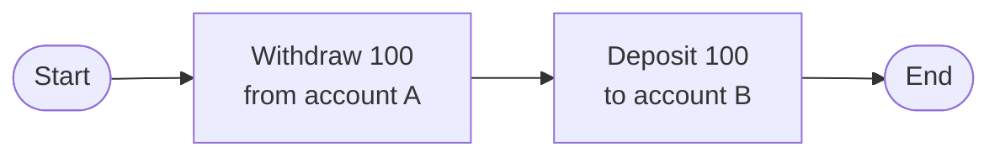
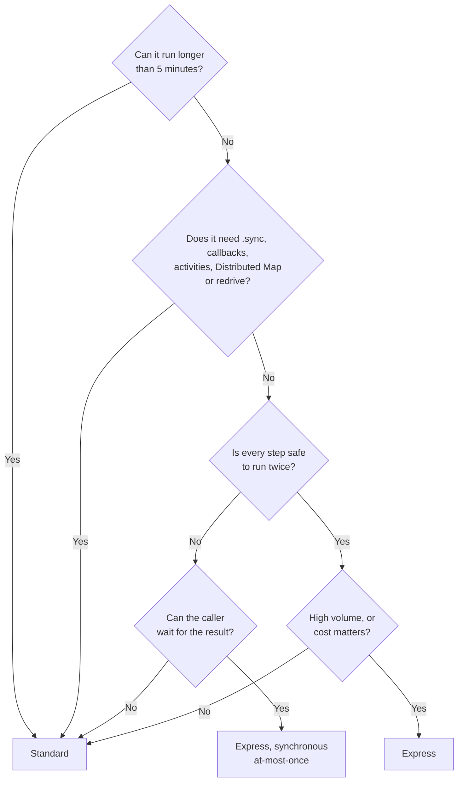

# Standard vs Express Step Functions: Study Notes

Source: [Standard vs Express AWS Step Functions - What's The Difference? (AWS Simplified)](https://youtu.be/RrdvSoQNABg?list=PL9nWRykSBSFgQrO66TmO1vHFP6yuPF5G-), about 13 minutes.

A whiteboard talk, with no console demo. Every state machine is one of two **types**, chosen when you create it:
- **Standard**: long-running, exactly-once, fully recorded.
- **Express**: short, high-volume, at-least-once, billed by duration.

The video compares them on guarantees, duration, history, limits and pricing, with a bank transfer (Standard) and a photo upload pipeline (Express) as examples.

Every state machine in notes 02 to 08 was Standard, the default.

What was checked:
- Guarantees, durations, feature support and history behavior come from the current "Choosing workflow type" page.
- Throughput numbers come from the current service quotas page, and prices from the Step Functions pricing page (us-east-1).
- Which features Express rejects was tested with `ValidateStateMachineDefinition` (type `EXPRESS`). The messages shown are the real results.
- The cost comparison in section 7 was computed with `uv run` from the published prices.
- The example definitions validated `OK`.

---

## Contents

1. [Corrected terms](#1-corrected-terms)
2. [The two types at a glance](#2-the-two-types-at-a-glance)
3. [Standard workflows](#3-standard-workflows)
4. [Express workflows](#4-express-workflows)
5. [Execution guarantees, and why idempotency still matters](#5-execution-guarantees-and-why-idempotency-still-matters)
6. [What Express can't do, tested](#6-what-express-cant-do-tested)
7. [Cost, worked out](#7-cost-worked-out)
8. [Choosing between them](#8-choosing-between-them)
9. [Beyond the video: using both together](#9-beyond-the-video-using-both-together)
10. [Same ideas with the AWS CLI](#10-same-ideas-with-the-aws-cli)
11. [Gotchas](#11-gotchas)
12. [What has changed since the video](#12-what-has-changed-since-the-video)
13. [Cheat sheet](#13-cheat-sheet)
14. [Review questions](#14-review-questions)

---

## 1. Corrected terms

| Caption says | Actually means |
|---|---|
| build on state transitions | **Billed** on state transitions |
| exactly one's property | The **exactly-once** property |
| step function instance | An **execution** |
| debugging console tool | The console's **execution graph** view |
| if statement | A **Choice** state |

---

## 2. The two types at a glance

| | Standard | Express |
|---|---|---|
| Default | **Yes** | No |
| Maximum duration | **1 year** | **5 minutes** |
| Execution semantics | **Exactly-once** | Asynchronous: **at-least-once**. Synchronous: **at-most-once**. |
| State between steps | Persisted by the service | Not persisted |
| Execution history | Kept by Step Functions for 90 days; API and console | Not kept by Step Functions. Send it to **CloudWatch Logs**; the console shows it from there. |
| Billed by | **State transitions** | **Requests + duration × memory** |
| `.sync` and `.waitForTaskToken` | Supported | **Not supported** |
| Activities | Supported | Not supported |
| Distributed Map | Supported | Not supported (but its child executions can be Express) |
| Redrive (notes 18) | Supported | Not supported |
| `StartExecution` with the same name | Idempotent (notes 06) | Not idempotent: starts another one |
| Can be started synchronously | No | Yes: `StartSyncExecution` |
| Type can be changed later | **No.** Create a new state machine. | No |

---

## 3. Standard workflows

### Exactly-once

The video's main point at 00:44: in a Standard workflow, **each step runs once**. AWS's wording: "your tasks and states are never run more than once, unless you have specified `Retry` behavior". That makes Standard the right type for **non-idempotent** actions: actions that do harm when repeated, like moving money or starting a cluster.

The video's example is a bank transfer:



If either step ran twice, money would be taken or given twice. The video adds that a transactional database write could also solve this. That's often the better fix anyway (section 5).

### Long-running: up to 1 year

An execution can run for up to one year. After that, it's stopped with a timeout. Long waits (notes 08) and human approvals (callbacks, notes 16) fit here.

### Durable

The video at 02:14: "each step is persisted". Step Functions saves the state after every transition. If something is interrupted, the execution carries on from where it was. And since late 2023, a **failed** Standard execution can be **redriven** from the failed step instead of starting over (notes [18](18_AWS_Step_Functions_Redrive_Study_Notes.md)).

### Auditable

- The full **execution history** is available through the API (`GetExecutionHistory`) and the console for **90 days** after the execution ends. AWS Support can shorten that to 30 days for compliance reasons.
- The console's **graph view** shows the path taken, each state's input and output, and where an error happened. The video calls it "the amazing debugging tool" (03:53).

### Limits

The video quotes 2,000 starts per second and 4,000 state transitions per second. AWS's overview page still uses those headline numbers. The **service quotas** page gives the actual default throttles, as a token bucket (a burst allowance, refilled at a steady rate):

| Throttle (Standard, per account and region) | us-east-1, us-west-2, eu-west-1 | Other regions |
|---|---|---|
| `StartExecution` | Burst 1,300, then 300 per second | Burst 800, then 150 per second |
| State transitions | Burst 5,000, then 5,000 per second | Burst 800, then 800 per second |

These are **soft** quotas: you can request increases. Hitting the transition limit shows up as the `ExecutionThrottled` CloudWatch metric.

### Pricing

- Billed per **state transition**: $0.000025 each in us-east-1 ($25 per million).
- **4,000 free transitions per month**, which doesn't expire after the first year.
- **Every retry is another transition.**
- How long a state takes doesn't matter. A Wait of 3 months costs the same as a Wait of 3 seconds.

---

## 4. Express workflows

### At-least-once (and at-most-once)

The video at 07:02: Express is **at-least-once**, so a step "may be run more than once". It also notes that two executions started with the same name at the same time can both run.

The video doesn't mention that Express has **two modes**, with different guarantees:

| Mode | Started with | Returns | Guarantee |
|---|---|---|---|
| **Asynchronous** | `StartExecution`, EventBridge, a parent workflow | Right away, with the execution ARN | **At-least-once**: may run more than once |
| **Synchronous** | `StartSyncExecution`, API Gateway, Lambda | When the workflow ends, with its output | **At-most-once**: never restarted, even after an error |

So Express is safe only for **idempotent** steps, where running twice gives the same result. AWS's example: transforming data and storing it with a DynamoDB `PutItem` (notes 05), which just overwrites the same item.

### Short-running and high-volume

- Max 5 minutes per execution. The video: "a very, very low number for any kind of workflow" that waits for people or events.
- Throughput is much higher:

| Throttle (Express) | Value |
|---|---|
| `StartExecution` | Burst 6,000, then 6,000 per second (all regions) |
| State transitions | **No limit** |
| `StartSyncExecution` | Doesn't count against account capacity; scales on demand |

AWS's headline figure is "over 100,000 executions per second".

### Debugging through CloudWatch Logs

The video at 09:10: Express has no history to download and no graph view, only CloudWatch Logs, which "can be very cumbersome". Half of that has changed:
- Still true: Step Functions **doesn't record** Express history. Without logging turned on, you see nothing.
- New: with logging turned on, the **console shows Express executions** (list, graph and events), reading them from CloudWatch Logs. How much you see depends on the **log level** (`ALL` for everything).
- You pay for the logs, and at high volume there are a lot of them.

### Pricing

- **$1.00 per million requests** (one request per execution, console tests included).
- **Duration × memory**: $0.00001667 per GB-second for the first 1,000 GB-hours a month, then less.
  - Duration is rounded up to the next 100 ms.
  - Memory is billed in 64 MB chunks. It's estimated as 50 MB + the definition size + the execution data size × the number of Map or Parallel steps, so a simple workflow is billed at 64 MB.

### "Express runs on Lambda behind the scenes"?

The video says the pricing model exists because Express "takes advantage of Lambda functions" behind the scenes (10:14). **AWS doesn't document this.** The pricing does look like Lambda's (requests plus GB-seconds), but the memory isn't something you configure: it's calculated from your definition and data. Treat it as the presenter's guess.

---

## 5. Execution guarantees, and why idempotency still matters

| | Standard | Express (async) | Express (sync) |
|---|---|---|---|
| A step can run twice on its own | No | **Yes** | No |
| A step can run twice because of your `Retry` | **Yes** | Yes | Yes |
| Same-name start while one is running | Returns the running one | Starts a second | Starts a second |
| State saved between steps | Yes | No | No |

The `Retry` row is the catch in the video's bank example. Even in Standard, suppose the Withdraw step:
1. calls the bank API, and the money moves;
2. then the response times out;
3. and `Retry` calls it again.

That's a **second withdrawal**, and the exactly-once guarantee doesn't cover it, because you asked for the retry. Ways to protect against it:
- Pass an **idempotency key** (for example the transaction ID) that the bank API uses to ignore repeats.
- Use a **conditional write** (notes 05 section 11) or a database transaction.
- Retry only errors that mean "nothing happened", such as throttling.

Rule of thumb: Standard removes duplicates caused by Step Functions itself. You still handle duplicates caused by retries and by the systems you call.

---

## 6. What Express can't do, tested

`ValidateStateMachineDefinition` on small definitions, as both types:

| Feature | Standard | Express |
|---|---|---|
| Request Response (`sqs:sendMessage`) | `OK` | `OK` |
| Callback (`sqs:sendMessage.waitForTaskToken`) | `OK` | **FAIL**: "Express state machine does not support '.waitForTaskToken' service integration" |
| Activity (`arn:aws:states:...:activity:Approve`) | `OK` | **FAIL**: "Express state machine does not support Activity ARN" |
| Distributed Map (`Mode: DISTRIBUTED`) | `OK` | **FAIL**: "The field 'Mode' with value 'DISTRIBUTED' is not supported inside 'EXPRESS' state machines" |
| Job run (`states:startExecution.sync:2`) | `OK` | `OK`. Not caught by validation, but the docs say Express doesn't support `.sync`. Don't rely on it. |
| Wait of 600 seconds (notes 08) | `OK` | `OK`. Not caught, but the execution would hit the 5-minute limit. |

Validation catches most of the type mismatches, but not all. The docs are the reference.

---

## 7. Cost, worked out

Computed from the prices in sections 3 and 4, for **1 million executions a month**, each with **5 state transitions** and 64 MB billed memory:

| Workflow | Standard | Express |
|---|---|---|
| Short and busy: **2 seconds** each | (5,000,000 − 4,000 free) × $0.000025 = **$124.90** | $1.00 requests + $2.08 duration (34.7 GB-hours) = **$3.08** |
| Mostly waiting: **4 minutes** each | **$124.90** (duration doesn't matter) | $1.00 requests + $155.00 duration (4,166.7 GB-hours) = **$156.00** |

- For short, frequent workflows, Express is often **40 times cheaper**.
- For workflows that spend their time **waiting**, Standard can be cheaper, because Standard doesn't charge for time.
- Retries add transitions in Standard and duration in Express.
- Lambda, DynamoDB and other services your steps call are billed separately, either way.

---

## 8. Choosing between them



### Typical fits

| Standard | Express |
|---|---|
| Payments and transfers (the video's bank example) | Image or video upload pipelines (the video's "Instagram" example: upload, content check, confirm) |
| Order fulfilment over hours or days | IoT data ingestion |
| Human approvals (callbacks) | Streaming data transformation |
| Long ETL jobs with `.sync` (Glue, EMR, Batch) | Mobile and web API backends (synchronous) |
| Anything you must audit later | Microservice orchestration within one request |

The video's photo example works with Express because a repeated step is "not optimal" but "not a deal breaker". A photo processed twice does no harm. Money moved twice does.

---

## 9. Beyond the video: using both together

You don't have to pick one type for the whole system.

### Standard parent, Express child

The parent handles the long, must-not-repeat parts. The child handles a fast burst of idempotent steps, cheaply. The parent can wait for the child with `.sync`, which Standard supports.

Validated `OK` (Standard):

```json
{
  "Comment": "Standard parent that runs an Express child and waits for it",
  "StartAt": "RunExpressChild",
  "States": {
    "RunExpressChild": {
      "Type": "Task",
      "Resource": "arn:aws:states:::states:startExecution.sync:2",
      "Parameters": {
        "StateMachineArn": "arn:aws:states:us-east-1:123456789012:stateMachine:EnrichTransactionExpress",
        "Input.$": "$"
      },
      "OutputPath": "$.Output",
      "Next": "WaitForApproval"
    },
    "WaitForApproval": {
      "Type": "Task",
      "Resource": "arn:aws:states:::sqs:sendMessage.waitForTaskToken",
      "Parameters": {
        "QueueUrl": "https://sqs.us-east-1.amazonaws.com/123456789012/Approvals",
        "MessageBody": { "Transaction.$": "$", "TaskToken.$": "$$.Task.Token" }
      },
      "TimeoutSeconds": 86400,
      "End": true
    }
  }
}
```

The Express child, validated `OK` as `EXPRESS`. Both steps are safe to repeat: a pure transformation, then an overwrite of the same item:

```json
{
  "Comment": "Short, idempotent transaction enrichment (Express)",
  "QueryLanguage": "JSONata",
  "StartAt": "Normalize",
  "States": {
    "Normalize": {
      "Type": "Pass",
      "Output": {
        "TransactionId": "",
        "Type": "",
        "AmountCents": ""
      },
      "Next": "Store"
    },
    "Store": {
      "Type": "Task",
      "Resource": "arn:aws:states:::dynamodb:putItem",
      "Arguments": {
        "TableName": "TransactionHistoryTable",
        "Item": {
          "TransactionId": { "S": "" },
          "Type": { "S": "" },
          "AmountCents": { "N": "" }
        }
      },
      "Output": "",
      "End": true
    }
  }
}
```

TestState on `Normalize` with `{"TransactionId": "T1", "Type": "purchase", "Amount": 19.99}` returns `{"TransactionId": "T1", "Type": "PURCHASE", "AmountCents": 1999}`.

Notes [14](14_AWS_Step_Functions_Nested_Workflows_Study_Notes.md) covers parent and child workflows in depth.

### Distributed Map with Express children

A Standard workflow with a Distributed Map (notes 07 section 10 and notes 15) can run each batch of items as an **Express** child execution (`"ExecutionType": "EXPRESS"`). The parent gets durability and failure tolerance; the thousands of children are cheap and fast.

---

## 10. Same ideas with the AWS CLI

`express.json` is the Express child from section 9. `$ROLE_ARN` is a state machine role allowed to `dynamodb:PutItem` on the table, plus the CloudWatch Logs delivery actions listed below.

```bash
# Express needs logging to be inspectable. Log groups for Step Functions
# conventionally start with /aws/vendedlogs/.
aws logs create-log-group --log-group-name /aws/vendedlogs/states/EnrichTransactionExpress
LOG_ARN=$(aws logs describe-log-groups \
  --log-group-name-prefix /aws/vendedlogs/states/EnrichTransactionExpress \
  --query 'logGroups[0].arn' --output text)

# The type is set here, once, and can't be changed later
SM_ARN=$(aws stepfunctions create-state-machine --name EnrichTransactionExpress \
  --type EXPRESS --definition file://express.json --role-arn "$ROLE_ARN" \
  --logging-configuration "level=ALL,includeExecutionData=true,destinations=[{cloudWatchLogsLogGroup={logGroupArn=$LOG_ARN}}]" \
  --query stateMachineArn --output text)

# Synchronous: waits, returns the output and what was billed
aws stepfunctions start-sync-execution --state-machine-arn "$SM_ARN" \
  --input '{"TransactionId": "T1", "Type": "purchase", "Amount": 19.99}' \
  --query '{status: status, output: output, billing: billingDetails}'

# Asynchronous: returns at once; the result is only in the logs
aws stepfunctions start-execution --state-machine-arn "$SM_ARN" \
  --input '{"TransactionId": "T2", "Type": "refund", "Amount": 5}'
aws logs tail /aws/vendedlogs/states/EnrichTransactionExpress --since 5m

# Clean up
aws stepfunctions delete-state-machine --state-machine-arn "$SM_ARN"
aws logs delete-log-group --log-group-name /aws/vendedlogs/states/EnrichTransactionExpress
```

- `billingDetails` in the synchronous response shows the billed memory (MB) and billed duration (ms) for that run.
- The role (or the user creating the state machine) needs the CloudWatch Logs delivery permissions for logging: `logs:CreateLogDelivery`, `GetLogDelivery`, `UpdateLogDelivery`, `DeleteLogDelivery`, `ListLogDeliveries`, `PutResourcePolicy`, `DescribeResourcePolicies` and `DescribeLogGroups`.
- In the console, a synchronous run times out after 60 seconds. Use the CLI or SDK for runs up to 5 minutes.

---

## 11. Gotchas

1. **The type is permanent.** Switching means creating a new state machine and moving callers to it.
2. **Exactly-once has an exception: your own `Retry`.** Retries can repeat side effects in Standard too (section 5).
3. **Async Express can run a step, or the whole execution, twice.** Every step must be idempotent.
4. **Express names aren't idempotency keys.** Two starts with the same name run twice.
5. **No logs, no visibility.** Without CloudWatch Logs turned on, an Express execution leaves no trace you can inspect.
6. **Express rejects** `.waitForTaskToken`, Activities and Distributed Map at validation. **`.sync` and waits over 5 minutes aren't caught by validation**: check the docs.
7. **Standard charges for retries and loops.** Each pass through a polling loop is more transitions (notes 08).
8. **Express charges for waiting.** A mostly-idle 4-minute workflow can cost more on Express than on Standard (section 7).
9. **Quotas differ by region.** Standard's default throttles are much lower outside us-east-1, us-west-2 and eu-west-1.
10. **The headline numbers aren't the quotas.** "2,000 starts per second" is a marketing figure; the default `StartExecution` throttle is a burst of 1,300 with 300 per second in us-east-1.
11. **Redrive is Standard-only** (notes 18).
12. **Synchronous Express in the console** gives up after 60 seconds.

---

## 12. What has changed since the video

| Then (video) | Now |
|---|---|
| Express: no visual debugging at all | Console shows Express executions **from CloudWatch Logs**, if logging is on |
| 2,000 starts/s, 4,000 transitions/s | Quotas page: Standard transitions burst 5,000 and refill 5,000/s in the big three regions; starts burst 1,300, refill 300/s |
| Express sync vs async not discussed | Documented: async = at-least-once, sync = at-most-once |
| Restart a failed Standard execution from the start | **Redrive** from the failed state (November 2023) |
| No Distributed Map | Distributed Map (Standard only), with Express child executions as an option |
| History kept 90 days | Still 90 days; can be shortened to 30 through AWS Support |
| Express memory unclear | Pricing page explains: 50 MB + definition + data, billed in 64 MB chunks |

---

## 13. Cheat sheet

```
                 STANDARD                          EXPRESS
Default          yes                               no
Max duration     1 year                            5 minutes
Semantics        exactly-once                      async: at-least-once | sync: at-most-once
History          90 days in Step Functions          only CloudWatch Logs (console reads them)
Billing          $0.000025 / transition             $1.00 / million requests
                 4,000 free / month                 + $0.00001667 / GB-s (64 MB chunks, 100 ms rounding)
Throttles        start: 1,300 burst, 300/s          start: 6,000 burst, 6,000/s
(us-east-1)      transitions: 5,000 burst, 5,000/s  transitions: unlimited
Not in Express   .waitForTaskToken, .sync, Activities, Distributed Map, redrive
Same-name start  idempotent                         starts another execution
Sync start       no                                 StartSyncExecution (console: 60 s limit)
Type change      never: create a new state machine

Pick Standard    long, waits, approvals, non-idempotent steps, auditing, .sync/callbacks
Pick Express     < 5 min, high volume, idempotent steps, API backends (sync)
Mix              Standard parent + Express child (startExecution.sync:2);
                 Distributed Map with ExecutionType EXPRESS
```

---

## 14. Review questions

<details>
<summary>1. What are the maximum durations of Standard and Express executions?</summary>

Standard: 1 year. Express: 5 minutes.
</details>

<details>
<summary>2. What does "exactly-once" promise in a Standard workflow, and what's the exception?</summary>

Step Functions never runs a task or state more than once on its own. The exception is `Retry`: if you configure retries, a step can run again. If the first attempt had a side effect before failing, the retry can repeat it.
</details>

<details>
<summary>3. What are the guarantees of asynchronous and synchronous Express workflows?</summary>

Asynchronous: at-least-once, so a step or execution may run more than once. Synchronous: at-most-once. It's never restarted, and the caller gets the result or the error.
</details>

<details>
<summary>4. Why is a bank transfer a poor fit for asynchronous Express?</summary>

At-least-once means the withdrawal or deposit could run twice, taking or giving money twice. That step isn't idempotent, so it needs Standard, plus an idempotency key if you retry.
</details>

<details>
<summary>5. How is each type billed?</summary>

Standard: per state transition, including retries ($0.000025 each in us-east-1, 4,000 free a month). Express: per request ($1.00 per million) plus duration × memory (GB-seconds, 64 MB chunks, 100 ms rounding).
</details>

<details>
<summary>6. A workflow runs 1 million times a month and spends 4 minutes in each run waiting. Which type is cheaper, and why?</summary>

Standard, about $125 vs about $156 (section 7). Standard doesn't charge for time spent waiting; Express charges for every second of duration.
</details>

<details>
<summary>7. Name three features Standard supports and Express doesn't.</summary>

Any three of: `.waitForTaskToken` callbacks, `.sync` job runs, Activities, Distributed Map, redrive, 90-day execution history in Step Functions, idempotent same-name starts.
</details>

<details>
<summary>8. How do you debug an Express workflow?</summary>

Turn on CloudWatch Logs logging for the state machine (level `ALL` with execution data, for full detail). The console then shows Express executions based on those logs. Without logging, there's nothing to inspect.
</details>

<details>
<summary>9. Can you change an existing Standard state machine to Express?</summary>

No. The type is set at creation and can't be updated. Create a new state machine of the other type.
</details>

<details>
<summary>10. You start two Express executions with the same name at the same moment. What happens? And with Standard?</summary>

Express: both run. Standard: while the first is running, a second start with the same name and input returns the first execution; with different input, or after it finishes, it fails with `ExecutionAlreadyExists`.
</details>

<details>
<summary>11. The video says Express runs on Lambda behind the scenes. Is that documented?</summary>

No. The pricing looks like Lambda's (requests plus GB-seconds), but AWS doesn't say how Express is implemented, and the billed memory is calculated from the definition and data, not configured.
</details>

<details>
<summary>12. How can one system get both durability for long steps and low cost for fast ones?</summary>

Use a Standard parent workflow for the long-running, non-idempotent parts, and have it start Express child workflows (for example with `startExecution.sync:2`) for short bursts of idempotent work. Distributed Map can also run its child executions as Express.
</details>

<details>
<summary>13. An Express definition uses <code>.waitForTaskToken</code>. What happens when you validate it?</summary>

Validation fails: "Express state machine does not support '.waitForTaskToken' service integration".
</details>
