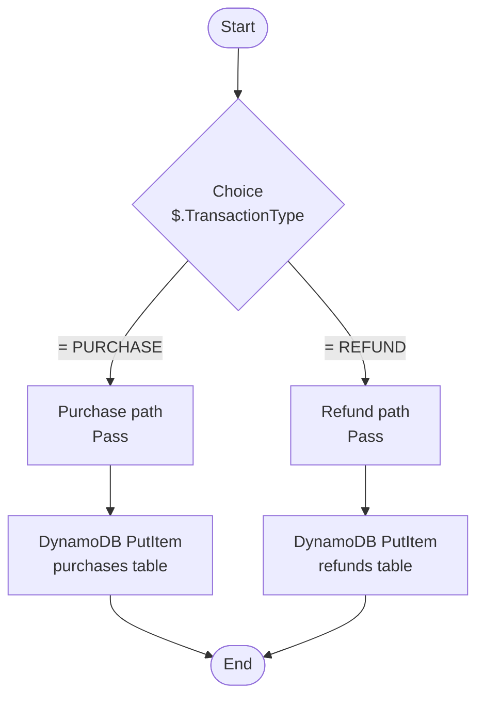

# Step Functions Workflow Studio: Study Notes

Source: [Create AWS Step Functions Visually with Workflow Studio (AWS Simplified)](https://youtu.be/65MK5KqaVh4?list=PL9nWRykSBSFgQrO66TmO1vHFP6yuPF5G-), about 9 minutes.

**Workflow Studio** is the drag-and-drop designer for state machines, launched in June 2021. Instead of writing ASL by hand, you drop states onto a canvas, fill in forms, and Workflow Studio writes the ASL for you.

The video builds a small workflow to show it: a **Choice** state sends a card transaction left (purchase) or right (refund), each side gets a **Pass** state as a label, and then a **DynamoDB PutItem**. It doesn't fill in real tables, so the test run fails, as the video expects.

Notes 02 used Workflow Studio's output (the `TransactionProcessorStateMachine`), and [13](13_AWS_Step_Functions_Lambda_Workflow_Studio_Study_Notes.md) builds a full Lambda workflow in it.

Code marked **reconstructed** was rebuilt from what the video describes. Workflow Studio's default state names and placeholders are used where the video kept them.

What was checked:
- Every definition passed `ValidateStateMachineDefinition` (result `OK`).
- The Choice routing (match, no match, wrong case, missing key, JSONPath vs JSONata) and the PutItem requests were run through `TestState`, with mocked DynamoDB results. The outputs shown are the real results.
- The current layout (modes, panels, tabs, VS Code and Infrastructure Composer) comes from the current Workflow Studio docs.

---

## Contents

1. [Corrected terms](#1-corrected-terms)
2. [Why Workflow Studio exists](#2-why-workflow-studio-exists)
3. [The layout](#3-the-layout)
4. [Building the video's workflow](#4-building-the-videos-workflow)
5. [The ASL it generates](#5-the-asl-it-generates)
6. [Choice rules, tested](#6-choice-rules-tested)
7. [The Inspector tabs and the ASL fields behind them](#7-the-inspector-tabs-and-the-asl-fields-behind-them)
8. [Finishing the workflow so it actually works](#8-finishing-the-workflow-so-it-actually-works)
9. [Beyond the video: round-tripping with code](#9-beyond-the-video-round-tripping-with-code)
10. [Beyond the video: JSONata in Workflow Studio](#10-beyond-the-video-jsonata-in-workflow-studio)
11. [Gotchas](#11-gotchas)
12. [What has changed since the video](#12-what-has-changed-since-the-video)
13. [Cheat sheet](#13-cheat-sheet)
14. [Review questions](#14-review-questions)

---

## 1. Corrected terms

| Caption says | Actually means |
|---|---|
| choice function | A **Choice state** |
| pass function | A **Pass state** |
| weights | **Wait** states |
| state dot transaction type | The variable **`$.TransactionType`** |
| string constant | The comparison value type: a fixed **string** |
| context options | The **Inspector panel**'s settings for the selected state |
| dynmodb | **DynamoDB** |

---

## 2. Why Workflow Studio exists

The video's case at 00:30: writing ASL directly "is kind of confusing". You need to know the state types, look up each service's parameters, and switch back and forth between the docs and your definition.

| Before (code only) | With Workflow Studio |
|---|---|
| Type the ASL in an editor, with a read-only graph next to it | Drag states onto a canvas; the ASL is written for you |
| The graph shows boxes, but not what they do. The video: "is this a Lambda?" | Each box shows its service icon and API, for example "DynamoDB PutItem" |
| Look up API parameter names in the docs | The form lists the parameters, with a sample request |
| Hand-write `Retry`, `Catch`, `TimeoutSeconds` | Fill in the **Error handling** tab |

You can still see and edit the ASL at any time (section 9). The video's point at 07:52: "it actually generates the corresponding ASL".

---

## 3. The layout

### Then (video)

1. **Step Functions > Get started** opened the old code editor, with an option to **design your workflow visually**.
2. A small wizard asked: **Design your workflow visually** or **Write your workflow in code**.
3. Next opened Workflow Studio. Next again showed the generated ASL. Next again asked for the name and role.

### Now

1. **Step Functions > State machines > Create state machine.**
2. Choose a **template**, or **Create from blank**.
3. Workflow Studio opens in **Design** mode.

| Part | What it does |
|---|---|
| **Mode buttons** | **Design** (canvas), **Code** (ASL editor), **Config** (name, type, role, logging, tracing, versions) |
| **States browser** (left) | Tabs: **Actions** (AWS service APIs), **Flow** (Choice, Parallel, Map, Pass, Wait, Success, Fail), **Patterns** (ready-made combinations, such as processing a CSV file in S3; see notes 15) |
| **Canvas** (center) | The workflow graph. Drop states, drag them around, select one to configure it. |
| **Design toolbar** | Undo and redo, delete, zoom, and other common actions |
| **Inspector panel** (right) | Settings for the selected state, in tabs: **Configuration**, **Input/Output**, **Variables**, **Error handling** (section 7) |
| **Utility buttons** | Save, exit, export the ASL as JSON or YAML |

The video's description of the two left-hand sections still fits:
- **Actions** are "the AWS services and the corresponding APIs": DynamoDB, ECS, EKS, EMR, Glue, and many more.
- **Flow** is "your control flow structures": Choice to branch, Parallel, Map to iterate, Pass "just to label", Wait for delays.

---

## 4. Building the video's workflow

The goal (03:08): a card transaction is either a **purchase** or a **refund**.
- Purchases go left and are saved to a purchases table.
- Refunds go right and are saved to a refunds table.



### Steps in Design mode

1. From **Flow**, drag a **Choice** state onto the canvas. It comes with **Rule #1** and a **Default rule**.
2. Select the Choice state. In the Inspector, edit **Rule #1** and choose **Add conditions**:
   - Variable: `$.TransactionType`
   - Operator: **is equal to**
   - Value: **String constant**, `PURCHASE`
   - **Save conditions**.
3. Drag a **Pass** state under the rule's branch and name it `Purchase path`. The video uses Pass states only as labels (05:23).
4. Back on the Choice state, **Add new choice rule** for `REFUND` the same way, and put a Pass named `Refund path` under it.
5. From **Actions**, search for **DynamoDB**, and drag **PutItem** under each Pass state.
6. Select each PutItem and look at the Inspector tabs (section 7). The video stops here without filling in real tables.
7. Switch to **Code** mode to see the ASL (section 5).
8. In **Config** mode, name the state machine and pick or create a role. Then **Create**.
9. **Start execution** with a sample transaction. It fails, because the tables are placeholders (section 5).

What the video struggled with:
- **The Default rule couldn't be removed** in the Workflow Studio of 2021 (05:41). That's fine; a default is a good idea anyway (section 6).
- **Rules couldn't be reordered by dragging** (05:57). Rule order matters, because the first matching rule wins.
- **Undo and redo** saved the day when a change went wrong (05:49).

---

## 5. The ASL it generates

### Reconstructed (validated: `OK`)

This is the shape Workflow Studio generates, with its default names (`DynamoDB PutItem`, `DynamoDB PutItem (1)`) and its PutItem placeholders:

```json
{
  "Comment": "A description of my state machine",
  "StartAt": "Choice",
  "States": {
    "Choice": {
      "Type": "Choice",
      "Choices": [
        { "Variable": "$.TransactionType", "StringEquals": "PURCHASE", "Next": "Purchase path" },
        { "Variable": "$.TransactionType", "StringEquals": "REFUND", "Next": "Refund path" }
      ]
    },
    "Purchase path": { "Type": "Pass", "Next": "DynamoDB PutItem" },
    "DynamoDB PutItem": {
      "Type": "Task",
      "Resource": "arn:aws:states:::dynamodb:putItem",
      "Parameters": {
        "TableName": "MyDynamoDBTable",
        "Item": { "Column": { "S": "MyEntry" } }
      },
      "End": true
    },
    "Refund path": { "Type": "Pass", "Next": "DynamoDB PutItem (1)" },
    "DynamoDB PutItem (1)": {
      "Type": "Task",
      "Resource": "arn:aws:states:::dynamodb:putItem",
      "Parameters": {
        "TableName": "MyDynamoDBTable",
        "Item": { "Column": { "S": "MyEntry" } }
      },
      "End": true
    }
  }
}
```

### Why the test run fails

TestState shows the request the PutItem would send (`afterParameters`):

```json
{"TableName": "MyDynamoDBTable", "Item": {"Column": {"S": "MyEntry"}}}
```

That's Workflow Studio's **placeholder**. There's no table called `MyDynamoDBTable`, and even if there were, its key is unlikely to be `Column`. A real run fails at the PutItem with a DynamoDB error. The video says so at 08:20: "this is not going to work correctly and everything is going to fail".

Section 8 fills in real values.

---

## 6. Choice rules, tested

TestState on the `Choice` state from section 5:

| Input `TransactionType` | Result |
|---|---|
| `"PURCHASE"` | Goes to `Purchase path` |
| `"REFUND"` | Goes to `Refund path` |
| `"purchase"` (lowercase) | **Fails**: no rule matches and there's no Default. TestState reports `States.Runtime`, "Failed to transition out of the state. The state does not point to a next state." In a real execution this error is `States.NoChoiceMatched`. |
| Key missing from the input | **Fails**: `States.Runtime`, "Invalid path '$.TransactionType': The choice state's condition path references an invalid value." |

Lessons:
- **`StringEquals` is case-sensitive.** `purchase` doesn't match `PURCHASE`.
- **Always have a Default.** In the finished version (section 8), anything else goes to a `Fail` state with a clear error. TestState with `CHARGEBACK` went to `Unknown type`.
- **A missing key isn't "no match"** in JSONPath: it's a runtime error. Guard with an `IsPresent` rule first, or use JSONata (section 10).
- **Rule order matters.** The first rule that matches wins.

### The comparison types offered in the rule form

| Category | Examples |
|---|---|
| String | `StringEquals`, `StringLessThan`, `StringMatches` (with `*` wildcards) |
| Number | `NumericEquals`, `NumericGreaterThan`, `NumericLessThanEquals` |
| Boolean | `BooleanEquals` |
| Timestamp | `TimestampEquals`, `TimestampLessThan`, ... |
| Type checks | `IsPresent`, `IsNull`, `IsString`, `IsNumeric`, `IsBoolean`, `IsTimestamp` |
| Compare to another field | Any comparison ending in `Path`, for example `NumericGreaterThanPath` |
| Combine | `And`, `Or`, `Not` (the rule form's "Add conditions" builds these) |

---

## 7. The Inspector tabs and the ASL fields behind them

Every form field ends up as an ASL field. Knowing the mapping makes the generated code easy to read.

| Tab (Task states) | Sets | ASL (JSONPath) | ASL (JSONata) |
|---|---|---|---|
| **Configuration** | State name, the API, its parameters, the integration pattern (Request Response, `.sync`, `.waitForTaskToken`), Next state | `Resource`, `Parameters` | `Resource`, `Arguments` |
| **Input/Output** | What goes in, what comes out | `InputPath`, `ResultSelector`, `ResultPath`, `OutputPath` | `Output` |
| **Variables** | Values saved for later states | `Assign` | `Assign` |
| **Error handling** | Retries, catchers, timeouts | `Retry`, `Catch`, `TimeoutSeconds`, `HeartbeatSeconds` | Same |

The video's tour of these tabs (06:59 to 07:31):
- **Input**: "extract certain elements from your input event", for example only a couple of keys to put in the table.
- **Output**: transform the output path.
- **Error handling**: "add retries, a new catch statement, a timeout, a heartbeat if you expect this operation to take a long time". The video adds: "this is all stuff that you usually have to do anyway through the ASL language; it was just a lot more manual."

A few things only make sense once you see the ASL:
- **Heartbeat** only matters for long-running tasks that report progress, such as callbacks (notes 16) and activities.
- **Retry** on Lambda is pre-filled by Workflow Studio with the standard throttling and service errors (you saw that block in `02_terraform/statemachine.asl.json`).
- **Pass** states have no Error handling tab, because they can't fail on their own.

---

## 8. Finishing the workflow so it actually works

Real table names, items built from the input, a Default, and the input kept. Validated `OK`:

```json
{
  "Comment": "Route a card transaction to the purchases or refunds table",
  "StartAt": "Choice",
  "States": {
    "Choice": {
      "Type": "Choice",
      "Choices": [
        { "Variable": "$.TransactionType", "StringEquals": "PURCHASE", "Next": "Purchase path" },
        { "Variable": "$.TransactionType", "StringEquals": "REFUND", "Next": "Refund path" }
      ],
      "Default": "Unknown type"
    },
    "Purchase path": { "Type": "Pass", "Next": "Save purchase" },
    "Save purchase": {
      "Type": "Task",
      "Resource": "arn:aws:states:::dynamodb:putItem",
      "Parameters": {
        "TableName": "Purchases",
        "Item": {
          "TransactionId": { "S.$": "$.TransactionId" },
          "Amount": { "N.$": "States.JsonToString($.Amount)" }
        }
      },
      "ResultPath": null,
      "End": true
    },
    "Refund path": { "Type": "Pass", "Next": "Save refund" },
    "Save refund": {
      "Type": "Task",
      "Resource": "arn:aws:states:::dynamodb:putItem",
      "Parameters": {
        "TableName": "Refunds",
        "Item": {
          "TransactionId": { "S.$": "$.TransactionId" },
          "Amount": { "N.$": "States.JsonToString($.Amount)" }
        }
      },
      "ResultPath": null,
      "End": true
    },
    "Unknown type": {
      "Type": "Fail",
      "Error": "UnknownTransactionType",
      "Cause": "TransactionType must be PURCHASE or REFUND"
    }
  }
}
```

TestState on `Save purchase` with `{"TransactionId": "T-100", "TransactionType": "PURCHASE", "Amount": 49.99}` sends:

```json
{"TableName": "Purchases", "Item": {"TransactionId": {"S": "T-100"}, "Amount": {"N": "49.99"}}}
```

The output is the input unchanged, because of `ResultPath: null`.

In Workflow Studio, you'd type these values into the PutItem's **API Parameters** box in the Configuration tab. The typed format and `States.JsonToString` are explained in notes 05.

### Running it for real

1. Create two DynamoDB tables, `Purchases` and `Refunds`, each with partition key `TransactionId` (String). See notes 05 section 10 for the CLI.
2. Create the state machine. Workflow Studio's generated role will allow DynamoDB item actions on both tables, because their names are fixed in the definition.
3. Start executions with `PURCHASE`, `REFUND` and an unknown type, and check that each ends where you expect.

---

## 9. Beyond the video: round-tripping with code

Workflow Studio and code aren't either-or. Many teams sketch in the console, then keep the ASL in Git.

| Task | How |
|---|---|
| See or hand-edit the ASL | **Code** mode. Changes show up on the canvas when you switch back to Design. |
| Download the definition | **Export** (utility buttons): JSON or YAML |
| Pull a deployed definition | `aws stepfunctions describe-state-machine --state-machine-arn ARN --query definition --output text > workflow.asl.json` |
| Push an edited definition | `aws stepfunctions update-state-machine --state-machine-arn ARN --definition file://workflow.asl.json` |
| Test one state without running everything | Select it, then **Test state** (the TestState API; see notes 05 section 13) |
| Design locally | **AWS Toolkit for VS Code** (version 3.49.0 or later): open any `*.asl.json` or `*.asl.yaml` file in Workflow Studio, with Design and Code modes, and test single states. Config mode isn't available there. |
| Design with the rest of the infrastructure | **AWS Infrastructure Composer** embeds Workflow Studio for state machines in SAM and CloudFormation templates |
| Manage with Terraform | Keep the exported ASL as a file and load it with `templatefile()`, as in `02_terraform` |

`02_terraform/statemachine.asl.json` started life exactly this way: Workflow Studio output, exported and turned into a template.

---

## 10. Beyond the video: JSONata in Workflow Studio

Workflow Studio now asks for the **query language** (JSONPath or JSONata) for the state machine. New states use that language. Once states are on the canvas, the console won't change the top-level setting, but you can convert individual states, or edit the ASL.

In JSONata, a Choice rule is a single `Condition`. Validated `OK`:

```json
{
  "QueryLanguage": "JSONata",
  "StartAt": "Choice",
  "States": {
    "Choice": {
      "Type": "Choice",
      "Choices": [
        { "Condition": "", "Next": "Purchase path" },
        { "Condition": "", "Next": "Refund path" }
      ],
      "Default": "Unknown type"
    },
    "Purchase path": { "Type": "Pass", "End": true },
    "Refund path": { "Type": "Pass", "End": true },
    "Unknown type": { "Type": "Fail", "Error": "UnknownTransactionType" }
  }
}
```

A real difference, tested: with the key **missing** from the input, the JSONPath Choice failed with `States.Runtime`, but the JSONata Choice went to **`Unknown type`** (the Default). A comparison on a missing field is simply false in JSONata.

To accept any case, compare in uppercase: ``.

---

## 11. Gotchas

1. **Placeholders aren't real.** `MyDynamoDBTable` and `{"Column": {"S": "MyEntry"}}` must be replaced, or the run fails, as in the video.
2. **Default names are vague.** Rename `DynamoDB PutItem (1)` to something like `Save refund` before the names spread into logs and alarms.
3. **Choice without a Default** fails on any unexpected value (`States.NoChoiceMatched` in an execution).
4. **String comparisons are case-sensitive.**
5. **A missing Choice variable** is a `States.Runtime` error in JSONPath, not a non-match.
6. **Rule order matters**: first match wins.
7. **The generated role follows the definition.** If you change tables or add services after creating the state machine, the role isn't updated for you (notes 05 section 8).
8. **The canvas and Code mode must stay valid.** Hand-written ASL with errors blocks switching back to Design until it's fixed.
9. **The query language is set early.** After adding states, the console won't switch the whole state machine between JSONPath and JSONata.
10. **VS Code's Workflow Studio** has no Config mode. Name, role and logging live in your deployment tool.
11. **Saving isn't deploying everything.** Saving updates the state machine definition, but not the DynamoDB tables, Lambda functions or roles it points at.

---

## 12. What has changed since the video

| Then (video, 2021) | Now |
|---|---|
| "Get started", then a choice between visual and code | **Create state machine** goes straight to Workflow Studio, from blank or a template |
| ASL shown on a separate "Next" page | **Code** mode, one click away; edits sync both ways |
| Name and role on the last wizard page | **Config** mode, which also holds logging, tracing, versions and aliases |
| States browser: Actions and Flow | Adds **Patterns** (for example S3 data processing with Distributed Map) |
| Inspector: Configuration, Input, Output, Error handling | Configuration, **Input/Output**, **Variables** (`Assign`), Error handling |
| No way to test a single state | **Test state** button (TestState API) |
| JSONPath only | JSONPath or **JSONata**, chosen per state machine |
| Console only | Also in **VS Code** (AWS Toolkit) and **Infrastructure Composer** |

---

## 13. Cheat sheet

```
Open           : Step Functions > State machines > Create state machine (blank or template)
Modes          : Design (canvas) | Code (ASL editor) | Config (name, type, role, logging, versions)
States browser : Actions (service APIs) | Flow (Choice, Parallel, Map, Pass, Wait, Success, Fail) | Patterns
Inspector tabs : Configuration -> Resource, Parameters/Arguments, Next
                 Input/Output  -> InputPath, ResultSelector, ResultPath, OutputPath | Output
                 Variables     -> Assign
                 Error handling-> Retry, Catch, TimeoutSeconds, HeartbeatSeconds
Choice rule    : JSONPath {"Variable": "$.X", "StringEquals": "A", "Next": ...}
                 JSONata  {"Condition": "", "Next": ...}
                 Always add a Default; first match wins; strings are case-sensitive
No match       : States.NoChoiceMatched (TestState shows States.Runtime)
Placeholders   : PutItem defaults to TableName "MyDynamoDBTable", Item {"Column": {"S": "MyEntry"}}
Export         : utility buttons (JSON/YAML), or describe-state-machine --query definition
Local          : AWS Toolkit for VS Code >= 3.49.0, files *.asl.json / *.asl.yaml (no Config mode)
```

---

## 14. Review questions

<details>
<summary>1. What problem does Workflow Studio solve?</summary>

Writing ASL by hand means knowing the state types and every service's parameters, and constantly checking the docs. Workflow Studio lets you build the workflow visually with forms, and generates valid ASL for you.
</details>

<details>
<summary>2. Name Workflow Studio's three modes and what each is for.</summary>

**Design**: the drag-and-drop canvas. **Code**: the ASL editor, kept in sync with the canvas. **Config**: the state machine's name, type, role, logging, tracing and versions.
</details>

<details>
<summary>3. What's the difference between the Actions and Flow tabs?</summary>

**Actions** are AWS service API calls (Task states), such as DynamoDB PutItem or Lambda Invoke. **Flow** holds the control-flow states: Choice, Parallel, Map, Pass, Wait, Success and Fail.
</details>

<details>
<summary>4. Why did the video's test execution fail?</summary>

The PutItem states still had Workflow Studio's placeholders: table `MyDynamoDBTable` and item `{"Column": {"S": "MyEntry"}}`. That table doesn't exist.
</details>

<details>
<summary>5. The input has <code>"TransactionType": "purchase"</code> and the rule compares with <code>PURCHASE</code>. There's no Default. What happens?</summary>

No rule matches, because `StringEquals` is case-sensitive, and there's no Default, so the execution fails with `States.NoChoiceMatched`.
</details>

<details>
<summary>6. The input has no <code>TransactionType</code> at all. What happens with a JSONPath Choice, and with a JSONata one?</summary>

JSONPath: `States.Runtime` ("Invalid path '$.TransactionType'"). JSONata: the condition is just false, so the Choice goes to its Default.
</details>

<details>
<summary>7. Which Inspector tab sets <code>ResultPath</code>, and which sets <code>Retry</code>?</summary>

**Input/Output** sets `ResultPath` (and `InputPath`, `ResultSelector`, `OutputPath`). **Error handling** sets `Retry`, `Catch`, `TimeoutSeconds` and `HeartbeatSeconds`.
</details>

<details>
<summary>8. Why does the video put Pass states right after the Choice?</summary>

As labels ("Purchase path", "Refund path"), so the graph is easier to read. A Pass state passes its input through unchanged.
</details>

<details>
<summary>9. How do you get a workflow built in the console into Git, and back out again?</summary>

Export it from Workflow Studio (JSON or YAML), or run `describe-state-machine --query definition`. Edit and commit the file, then deploy it with `update-state-machine --definition file://...`, or through Terraform, SAM or CloudFormation.
</details>

<details>
<summary>10. Can you use Workflow Studio outside the console?</summary>

Yes. The AWS Toolkit for VS Code opens `.asl.json` and `.asl.yaml` files in Workflow Studio, with Design and Code modes but no Config mode. AWS Infrastructure Composer also embeds it for SAM and CloudFormation templates.
</details>

<details>
<summary>11. You add a second DynamoDB table to an existing state machine in Workflow Studio. What else might you need to change?</summary>

The state machine's role. The console generates the policy when the state machine is created; it isn't updated for tables you add later, so the new PutItem would fail with access denied.
</details>
