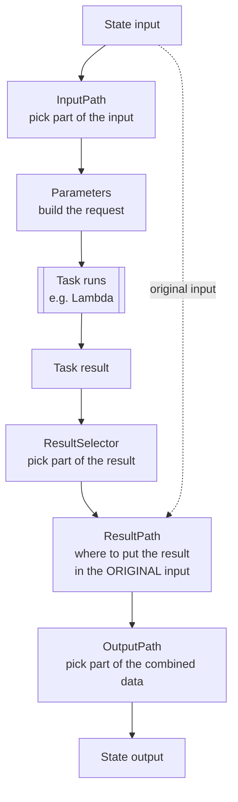

# Step Functions Data Flow (Data Flow Simulator): Study Notes

Source: [Simulate Data Flow with AWS Step Function Simulator (AWS Simplified)](https://youtu.be/oqFeVA-pFhI?list=PL9nWRykSBSFgQrO66TmO1vHFP6yuPF5G-), about 5 minutes.

The video shows the **data flow simulator**, a console tool added in April 2021. It let you paste a state's input and see how each JSONPath field changed it: `InputPath`, `Parameters`, the task result, `ResultSelector`, `ResultPath` and `OutputPath`. The demo uses a movie-library JSON and picks out parts of it with `$.library` and `$.library.movies[0]`.

**The simulator itself is gone.** AWS now lists it as **unsupported** and points to the **TestState API** instead. The concept the video teaches, how data moves through a state, matters as much as ever. So these notes:
- explain the data flow pipeline, field by field;
- re-run the video's example, and a full Task example, through TestState, which shows the same stages the simulator did;
- add the JSONata equivalent.

Notes 02 to 10 have used these fields all along (`ResultPath: "$.DynamoDB"`, `OutputPath: "$.Payload"`, `ResultSelector`). This note explains them all together.

What was checked:
- The simulator's status comes from the current "Testing and debugging" page.
- Every example ran through `TestState` with `inspectionLevel: DEBUG`, which returns each intermediate stage. A mocked Lambda result stood in for the task. All outputs shown are the real results, and the JSONata definition validated `OK`.

---

## Contents

1. [Corrected terms](#1-corrected-terms)
2. [Why data flow is hard](#2-why-data-flow-is-hard)
3. [The pipeline](#3-the-pipeline)
4. [The video's example](#4-the-videos-example)
5. [JSONPath syntax, tested](#5-jsonpath-syntax-tested)
6. [A full Task, stage by stage](#6-a-full-task-stage-by-stage)
7. [ResultPath and OutputPath variations](#7-resultpath-and-outputpath-variations)
8. [Simulating it today with TestState](#8-simulating-it-today-with-teststate)
9. [The JSONata way](#9-the-jsonata-way)
10. [Gotchas](#10-gotchas)
11. [What has changed since the video](#11-what-has-changed-since-the-video)
12. [Cheat sheet](#12-cheat-sheet)
13. [Review questions](#13-review-questions)

---

## 1. Corrected terms

| Caption says | Actually means |
|---|---|
| dataflow simulator | The **data flow simulator** console tool |
| pound dot library | **`$.library`** (the `$` sign, not a pound sign) |
| s s topic | **SNS** topic |
| horizontal icons | The simulator's **stage tabs**: state input, InputPath, Parameters, task result, ResultSelector, ResultPath, OutputPath, state output |
| jsonpath notation | **JSONPath**: a query language for picking parts of a JSON document |

---

## 2. Why data flow is hard

The video's point at 00:29: every state needs to pick certain fields out of its input and the task's output. "This sounds trivial, but as you build larger and larger step functions, this can get increasingly complicated."

The old way (00:16): build the state machine, run it, watch it fail, change a path, and run it again. "A very iterative process that was error prone and just took a long time."

The simulator's answer was a sandbox: paste the input, set the fields, and see each stage's result immediately, without running anything. TestState does the same today, for real definitions (section 8).

---

## 3. The pipeline

For a JSONPath Task state, data goes through these steps in order:



| Field | Works on | Purpose | Default |
|---|---|---|---|
| `InputPath` | The state input | Keep only part of it | `$` (all of it) |
| `Parameters` | The result of `InputPath` | Build the exact request: fixed values, paths ending in `.$`, intrinsic functions | Pass it through unchanged |
| *(task result)* | | What the service returned | |
| `ResultSelector` | The task result | Keep or reshape only the useful parts | The whole result |
| `ResultPath` | The **original state input** + the selected result | Where to put the result. `null` throws it away. | `$`: the result **replaces** the input |
| `OutputPath` | The combined data from `ResultPath` | Keep only part of it, as the state's output | `$` |

### Which states use which fields

| State | InputPath | Parameters | ResultSelector | ResultPath | OutputPath |
|---|---|---|---|---|---|
| Task, Parallel, Map | yes | yes (`ItemSelector` for Map) | yes | yes | yes |
| Pass | yes | yes (and `Result`) | | yes | yes |
| Choice, Wait, Succeed | yes | | | | yes |
| Fail | | | | | |

---

## 4. The video's example

### The input (reconstructed)

A movie library, the kind of sample the simulator came with:

```json
{
  "library": {
    "movies": [
      { "genre": "crime", "director": "Quentin Tarantino", "title": "Reservoir Dogs", "year": 1992 },
      { "genre": "action", "director": "Brian De Palma", "title": "Mission: Impossible",
        "year": 1996, "staring": ["Tom Cruise"] }
    ],
    "metadata": { "lastUpdated": "2020-05-27T08:00:00.000Z" }
  },
  "requestId": "req-42"
}
```

`requestId` isn't in the video; it's added here to show what `ResultPath` keeps (section 6).

### The video's two selections

| Expression | Result (TestState) |
|---|---|
| `$.library` (03:56) | The `library` object: `{"movies": [...], "metadata": {...}}` |
| `$.library.movies[0]` (04:36) | The first movie: `{"genre": "crime", "director": "Quentin Tarantino", "title": "Reservoir Dogs", "year": 1992}` |

The video at 04:13 describes JSONPath as "a query language for JSON, so that you can select certain things out of JSON objects with a pretty standardized notation".

---

## 5. JSONPath syntax, tested

Each expression was used in a Pass state's `Parameters` (`"value.$": "<expression>"`) on the input above:

| Expression | Means | Result |
|---|---|---|
| `$.library` | A field | the library object |
| `$.library.movies[0]` | An array element (0 is first) | the first movie |
| `$.library.movies[-1:].title` | Slice: the last element | `["Mission: Impossible"]` |
| `$.library.movies[*].title` | Every element's field | `["Reservoir Dogs", "Mission: Impossible"]` |
| `$.library.movies[?(@.year < 1995)].title` | Filter: `@` is the current element | `["Reservoir Dogs"]` |
| `$..director` | Deep scan: that field at any depth | `["Quentin Tarantino", "Brian De Palma"]` |
| `$.library.books` | A field that doesn't exist | **Fails**: `States.Runtime`, "The JSONPath '$.library.books' specified for the field 'value.$' could not be found in the input" |

Filters also work in `InputPath`. `"InputPath": "$.library.movies[?(@.genre == 'action')]"` produced a one-element array with Mission: Impossible.

### Paths vs Reference Paths

Not every field accepts all of that syntax:
- `InputPath`, `OutputPath` and values in `Parameters` / `ResultSelector` accept full **paths**, with `[*]`, filters and `..`.
- `ResultPath` (and a Choice rule's `Variable`) only take a **Reference Path**: a plain path to a single place, with no wildcards or filters.

Tested: `"ResultPath": "$.library.movies[*].tag"` is rejected:

```
SCHEMA_VALIDATION_FAILED: Value is not a Reference Path: '[' must be followed by ' or '['
```

---

## 6. A full Task, stage by stage

A Task that sends the movie titles to a recommendation Lambda function, using every field:

```json
{
  "Type": "Task",
  "Resource": "arn:aws:states:::lambda:invoke",
  "InputPath": "$.library",
  "Parameters": {
    "FunctionName": "arn:aws:lambda:us-east-1:123456789012:function:RecommendMovie",
    "Payload": {
      "titles.$": "$.movies[*].title",
      "count.$": "States.ArrayLength($.movies)",
      "updated.$": "$.metadata.lastUpdated"
    }
  },
  "ResultSelector": {
    "recommended.$": "$.Payload.recommended",
    "score.$": "$.Payload.score"
  },
  "ResultPath": "$.recommendation",
  "OutputPath": "$.recommendation",
  "End": true
}
```

TestState with the input from section 4, at `DEBUG` level, with a mocked Lambda reply. Each row is a real stage from the response:

| Stage | Value |
|---|---|
| **input** | The whole document: `library` and `requestId` |
| **afterInputPath** (`$.library`) | `{"movies": [...], "metadata": {...}}`. `requestId` is not here. |
| **afterParameters** | `{"FunctionName": "...RecommendMovie", "Payload": {"count": 2, "titles": ["Reservoir Dogs", "Mission: Impossible"], "updated": "2020-05-27T08:00:00.000Z"}}` |
| **result** (mocked) | `{"StatusCode": 200, "ExecutedVersion": "$LATEST", "Payload": {"recommended": "Reservoir Dogs", "score": 9.1, "debug": "lots of internal fields"}}` |
| **afterResultSelector** | `{"score": 9.1, "recommended": "Reservoir Dogs"}`. `StatusCode`, `ExecutedVersion` and `debug` are dropped. |
| **afterResultPath** (`$.recommendation`) | `{"library": {...}, "requestId": "req-42", "recommendation": {"score": 9.1, "recommended": "Reservoir Dogs"}}` |
| **output** (`OutputPath: $.recommendation`) | `{"score": 9.1, "recommended": "Reservoir Dogs"}` |

The row to study is **afterResultPath**. `InputPath` narrowed the input to `library` for building the request, but `ResultPath` put the result into the **original, full input**: `requestId` is back. `InputPath` only shapes what the task sees; it doesn't throw anything away from the state's output.

`States.ArrayLength` is one of the **intrinsic functions** usable in `Parameters` and `ResultSelector`. Others include `States.Format`, `States.JsonToString` (notes 05), `States.StringToJson`, `States.Array`, `States.UUID`, `States.MathAdd`, `States.Base64Encode` and `States.Hash`.

---

## 7. ResultPath and OutputPath variations

Same Task and mocked result, different settings:

| Setting | State output |
|---|---|
| `ResultPath` not set (default `$`) | `{"score": 9.1, "recommended": "Reservoir Dogs"}`: the result **replaces** everything, so `library` and `requestId` are gone |
| `"ResultPath": "$.recommendation"`, no `OutputPath` | The full original input **plus** `recommendation` |
| `"ResultPath": "$.recommendation"`, `"OutputPath": "$.recommendation"` | Only the recommendation (section 6) |
| `"ResultPath": null` | The original input, unchanged: the result is thrown away |

Which to use:

| You want the next state to get | Use |
|---|---|
| Only the task's result | Default `ResultPath` (plus `ResultSelector` to trim it) |
| The input, with the result added | `ResultPath: "$.someKey"` (notes 04, 05) |
| The input, as if the task never ran | `ResultPath: null` (notes 05 section 11) |
| A small piece of everything | `ResultPath` to combine, then `OutputPath` to pick |

---

## 8. Simulating it today with TestState

The simulator is unsupported. TestState shows the same stages, on a real state definition.

### In the console

1. Open the state machine in **Workflow Studio**.
2. Select a state and choose **Test state**.
3. Pick an execution role, paste an input, and set **Inspection level** to **DEBUG**.
4. **Start test**. The **Input/output processing** tab shows each stage, like the simulator's tabs.

The console's Test state calls the real service, so it needs a role with permission for it. To avoid calling the service, use a mock from the CLI.

### From the CLI, with a mock

```bash
# recommend-state.json: the Task from section 6.  library.json: the input from section 4.
aws stepfunctions test-state \
  --definition file://recommend-state.json \
  --input file://library.json \
  --mock '{"result": "{\"StatusCode\": 200, \"Payload\": {\"recommended\": \"Reservoir Dogs\", \"score\": 9.1}}", "fieldValidationMode": "NONE"}' \
  --inspection-level DEBUG \
  --query '{input: inspectionData.input, afterInputPath: inspectionData.afterInputPath,
            afterParameters: inspectionData.afterParameters, result: inspectionData.result,
            afterResultSelector: inspectionData.afterResultSelector,
            afterResultPath: inspectionData.afterResultPath, output: output}'
```

- No execution role is needed with a mock.
- `fieldValidationMode: NONE` skips checking the mock against Lambda's API model. Lambda's real `Payload` is a byte stream, so a JSON object in the mock would fail the default `STRICT` check.
- For Pass, Choice and Wait states, no mock is needed at all. They don't call anything.

| Simulator tab (video) | TestState field |
|---|---|
| State input | `inspectionData.input` |
| InputPath | `afterInputPath` |
| Parameters | `afterParameters` |
| Task result | `result` |
| ResultSelector | `afterResultSelector` |
| ResultPath | `afterResultPath` |
| OutputPath / state output | `output` |

TestState also does what the simulator couldn't: real service calls (without a mock), Retry and Catch behavior (notes 05), Map item processing (notes 07), and Wait timing (notes 08).

---

## 9. The JSONata way

With `"QueryLanguage": "JSONata"`, the five JSONPath fields become two:
- **`Arguments`** builds the request (replacing `InputPath` and `Parameters`).
- **`Output`** builds the state's output (replacing `ResultSelector`, `ResultPath` and `OutputPath`).

Expressions go inside ``; `$states.input` is the state input and `$states.result` is the task result.

### The same Task in JSONata (validated: `OK`)

```json
{
  "QueryLanguage": "JSONata",
  "Type": "Task",
  "Resource": "arn:aws:states:::lambda:invoke",
  "Arguments": {
    "FunctionName": "arn:aws:lambda:us-east-1:123456789012:function:RecommendMovie",
    "Payload": {
      "titles": "",
      "count": "",
      "before1995": ""
    }
  },
  "Output": {
    "requestId": "",
    "recommended": "",
    "score": ""
  },
  "End": true
}
```

TestState, with the same mocked result:
- `afterArguments`: `{"Payload": {"titles": ["Reservoir Dogs", "Mission: Impossible"], "count": 2, "before1995": "Reservoir Dogs"}, ...}`
- `output`: `{"requestId": "req-42", "recommended": "Reservoir Dogs", "score": 9.1}`

| JSONPath | JSONata |
|---|---|
| `$.library.movies[*].title` | `$states.input.library.movies.title` (maps over arrays on its own) |
| `$.library.movies[?(@.year < 1995)]` | `$states.input.library.movies[year < 1995]` |
| `States.ArrayLength(...)` | `$count(...)` |
| `ResultSelector` + `ResultPath` + `OutputPath` | One `Output` object that mixes `$states.input` and `$states.result` |

### Two JSONata surprises, tested

1. **One match is not a list.** `before1995` came back as the string `"Reservoir Dogs"`, not `["Reservoir Dogs"]`, because JSONata unwraps single-item results. Add `[]` to keep it a list: `...movies[year < 1995].title[]` returned `["Reservoir Dogs"]`.
2. **No match is an error.** An expression that finds nothing fails the state:

   ```
   States.QueryEvaluationError: The JSONata expression '$states.input.library.movies[year < 1900].title[]'
   specified for the field 'Output/none' returned nothing (undefined).
   ```

   Guard it: `` returned `[]`.

---

## 10. Gotchas

1. **The default `ResultPath` replaces the input.** Most "where did my data go?" moments come from this.
2. **`ResultPath` merges into the original input, not the `InputPath` output.** `InputPath` only shapes what the task sees.
3. **`ResultPath` takes only a Reference Path**: no `[*]`, filters or `..`.
4. **`.$` on the key** means "this value is a path or intrinsic function". Without it, the text is used literally (notes 03).
5. **A missing path fails the state** with `States.Runtime`, rather than producing `null`.
6. **`[*]` and filters always return a list**, even for one match. JSONata does the opposite: single matches are unwrapped unless you add `[]`.
7. **JSONata expressions that return nothing** fail with `States.QueryEvaluationError`.
8. **`OutputPath` can only pick, not build.** To build a new shape from the input and the result, use `ResultSelector` and `ResultPath` (JSONPath), or `Output` (JSONata).
9. **Mocks and Lambda's `Payload`.** A mocked Lambda result with a JSON `Payload` needs `fieldValidationMode` `NONE` or `PRESENT`.
10. **The data flow simulator is unsupported.** Old tutorials that link to it lead nowhere; use TestState.
11. **The 256 KiB limit** applies after each stage. Trimming with `ResultSelector` and `OutputPath` keeps large results from piling up.

---

## 11. What has changed since the video

| Then (video, 2021) | Now |
|---|---|
| Data flow simulator, hidden in the left menu | **Unsupported.** Use **TestState** (console Test state, or the API) |
| Simulated fields only, no real definition | TestState runs your actual state definition, at INFO, DEBUG or TRACE level |
| No way to fake the task result except by typing it in | TestState **mocks** (since November 2025) |
| JSONPath only | **JSONata**: `Arguments` and `Output` replace the five fields |
| Variables didn't exist | **`Assign`** stores values for later states, so you don't have to carry everything in the data |

---

## 12. Cheat sheet

```
Order (JSONPath Task)
  input -> InputPath -> Parameters -> [task] -> result -> ResultSelector
        -> ResultPath (merged into ORIGINAL input) -> OutputPath -> output
Defaults        : InputPath $, ResultPath $ (result REPLACES input), OutputPath $
ResultPath      : "$.key" add result | null discard result | default replace
Reference Path  : ResultPath and Choice Variable: no [*], no filters, no ..
JSONPath        : $.a.b  $.list[0]  $.list[-1:]  $.list[*].x  $.list[?(@.n < 5)]  $..x
Missing path    : States.Runtime
Intrinsics      : States.Format, JsonToString, StringToJson, Array, ArrayLength, UUID, MathAdd, Hash
JSONata         : Arguments (request) + Output (output);  
                  single match unwrapped -> add [] ; nothing found -> States.QueryEvaluationError
Simulate today  : aws stepfunctions test-state --inspection-level DEBUG [--mock '{"result": "..."}']
                  -> afterInputPath, afterParameters, result, afterResultSelector, afterResultPath, output
Data flow simulator : unsupported
```

---

## 13. Review questions

<details>
<summary>1. List the JSONPath data flow fields of a Task state in the order they're applied.</summary>

`InputPath`, `Parameters`, (the task runs and returns its result), `ResultSelector`, `ResultPath`, `OutputPath`.
</details>

<details>
<summary>2. What happens to the state input if <code>ResultPath</code> isn't set?</summary>

It's replaced by the task's result (after `ResultSelector`). The default `ResultPath` is `$`, which means "the result becomes the whole output".
</details>

<details>
<summary>3. <code>InputPath</code> is <code>$.library</code> and <code>ResultPath</code> is <code>$.recommendation</code>. Is <code>requestId</code>, a top-level field outside <code>library</code>, in the output?</summary>

Yes. `ResultPath` inserts the result into the state's **original** input, not the `InputPath`-filtered one. TestState's `afterResultPath` included `requestId`.
</details>

<details>
<summary>4. What's the difference between <code>ResultSelector</code> and <code>OutputPath</code>?</summary>

`ResultSelector` works on the task's raw result, before it's combined with the input, and can build a new object. `OutputPath` works after `ResultPath` has combined input and result, and can only pick one part of it.
</details>

<details>
<summary>5. What does <code>$.library.movies[?(@.year &lt; 1995)].title</code> return for the sample input?</summary>

`["Reservoir Dogs"]`: a list, because filters always return lists in JSONPath.
</details>

<details>
<summary>6. Why is <code>"ResultPath": "$.library.movies[*].tag"</code> rejected?</summary>

`ResultPath` must be a Reference Path, a plain path to one place. Wildcards and filters aren't allowed. Validation says "Value is not a Reference Path".
</details>

<details>
<summary>7. How do you throw away a task's result and pass the input on unchanged?</summary>

`"ResultPath": null`.
</details>

<details>
<summary>8. The data flow simulator link in an old tutorial doesn't work. What do you use instead?</summary>

The TestState API: **Test state** in Workflow Studio, or `aws stepfunctions test-state --inspection-level DEBUG`. It shows `afterInputPath`, `afterParameters`, `result`, `afterResultSelector`, `afterResultPath` and the output. With `--mock`, it doesn't call the real service.
</details>

<details>
<summary>9. Which two JSONata fields replace the five JSONPath fields, and what does each do?</summary>

`Arguments` builds the request (replacing `InputPath` and `Parameters`). `Output` builds the state's output from `$states.input` and `$states.result` (replacing `ResultSelector`, `ResultPath` and `OutputPath`).
</details>

<details>
<summary>10. A JSONata filter matches exactly one movie, and the next state expects a list. What goes wrong, and how do you fix it?</summary>

JSONata unwraps single matches, so you get the item itself, not a one-item list. Add `[]` at the end of the path (`...title[]`) to always get a list.
</details>

<details>
<summary>11. A JSONata expression in <code>Output</code> finds nothing. What happens?</summary>

The state fails with `States.QueryEvaluationError` ("returned nothing (undefined)"). Guard it with `$exists(...)`, or provide a default.
</details>
