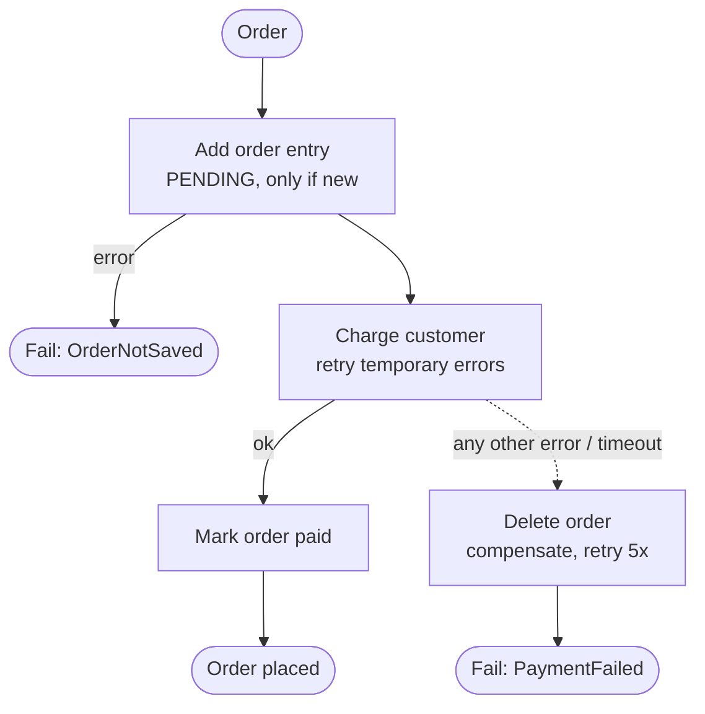

# Serverless Order Workflow with Step Functions, DynamoDB and Lambda: Study Notes

Source: [Build a Serverless Workflow with AWS Step Functions (AWS Simplified)](https://youtu.be/DFSko_sLyMM?list=PL9nWRykSBSFgQrO66TmO1vHFP6yuPF5G-), about 40 minutes.

The longest hands-on video in the series. An order goes through the workflow like this:
1. Save it to DynamoDB.
2. Call a Lambda function that stands in for a payment service.
3. If the payment fails, **delete the order again**, so no half-finished order is left behind.

The video calls it "a self-recovering workflow". The general name is the **saga pattern**: every step that changes something has a **compensating** step that undoes it.

It's built step by step in Workflow Studio, including a real bug and its fix at 36:17. These notes reproduce that bug exactly.

It combines what notes 05 (DynamoDB), 10 (Workflow Studio) and 11 (data flow) taught separately. Notes [18](18_AWS_Step_Functions_Redrive_Study_Notes.md) reuses this kind of workflow to show redrive.

Code marked **reconstructed** was rebuilt from what the video describes. The video promised to share its ASL; the version here follows every setting it shows.

What was checked:
- The video's definition, its buggy variant, and the improved saga version all passed `ValidateStateMachineDefinition` (`OK`).
- Every step was run through `TestState` with mocked DynamoDB and Lambda results: the PutItem request, the status-code extraction, the Choice, the failing Catch (the video's bug), the fixed Catch, the DeleteItem request, and every path of the improved version. The outputs and error messages shown are the real results.
- The Lambda handlers were run locally with `uv run`.

---

## Contents

1. [Corrected terms](#1-corrected-terms)
2. [What you build](#2-what-you-build)
3. [Setup: table, function, input](#3-setup-table-function-input)
4. [Step 1: Save the order (PutItem)](#4-step-1-save-the-order-putitem)
5. [The IAM shortcut: add every service before creating](#5-the-iam-shortcut-add-every-service-before-creating)
6. [Step 2: Shape the output](#6-step-2-shape-the-output)
7. [Step 3: Branch on the status code](#7-step-3-branch-on-the-status-code)
8. [Step 4: Charge the customer](#8-step-4-charge-the-customer)
9. [Step 5: Catch the failure and delete the order](#9-step-5-catch-the-failure-and-delete-the-order)
10. [The bug in the video, and the fix](#10-the-bug-in-the-video-and-the-fix)
11. [The complete definition](#11-the-complete-definition)
12. [Reading an execution](#12-reading-an-execution)
13. [Same setup with the AWS CLI](#13-same-setup-with-the-aws-cli)
14. [Beyond the video: the saga pattern done properly](#14-beyond-the-video-the-saga-pattern-done-properly)
15. [Gotchas](#15-gotchas)
16. [What has changed since the video](#16-what-has-changed-since-the-video)
17. [Cheat sheet](#17-cheat-sheet)
18. [Review questions](#18-review-questions)

---

## 1. Corrected terms

| Caption says | Actually means |
|---|---|
| DynamoB / Dynamob | **DynamoDB** |
| AM role / IM ro | **IAM** role |
| cloud for / Cloudatch | **CloudFormation** / **CloudWatch** |
| s.p pound / pound again | `S.$` / `.$`: the "this is a path" marker |
| SDK HTTP metadata | `SdkHttpMetadata` |
| weight task | **Wait** state |
| self-reovering workflow | Self-**recovering** workflow (a saga) |
| simple workflow service | Amazon **SWF**, Step Functions' older cousin |

---

## 2. What you build

```mermaid
flowchart TD
    S([Order input]) --> A[Add order entry<br/>DynamoDB PutItem]
    A --> C{Choice<br/>result.statusCode = 200?}
    C -->|yes| L[Call credit card service<br/>to charge customer<br/>Lambda Invoke]
    C -->|default| F([Fail])
    L -->|success| OK([Success])
    L -.Catch: States.ALL.-> D[Fallback deletes failed order<br/>DynamoDB DeleteItem]
    D --> F
```

| State | Type | Job |
|---|---|---|
| Add order entry | Task, DynamoDB `putItem` | Save `customerId` and `orderId` |
| Choice | Choice | Continue only if DynamoDB said HTTP 200 |
| Call credit card service to charge customer | Task, Lambda `invoke` | Stand-in for a payment call |
| Fallback deletes failed order | Task, DynamoDB `deleteItem` | Undo the save when the charge fails |
| Success | Succeed | Order placed |
| Fail | Fail | Order not placed |

The video's view at 31:16: after deleting, it goes to **Fail** rather than Success, because "you never completed the order". It admits this "is a little bit subjective".

---

## 3. Setup: table, function, input

### The DynamoDB table

| Setting | Value |
|---|---|
| Name | `CustomerOrdersTable` |
| Partition key | `customerId` (String) |
| Sort key | `orderId` (String) |

With a sort key, the **primary key is the pair**. Every write and delete must give **both** values. A customer can have many orders: same `customerId`, different `orderId`.

### The Lambda function (`test`)

A placeholder "to simulate us calling a dependency":

```python
def lambda_handler(event, context):
    return {"statusCode": 200}
```

Later in the video (35:20) it's changed to fail on purpose:

```python
def lambda_handler(event, context):
    raise Exception("simulated dependency failure")
```

Remember to click **Deploy** after the change, as the video does at 35:24 ("make sure you click on that, or else this will not save").

Run locally, the failing version raises an error with `errorType` `Exception`. That's the error name Step Functions sees (section 10).

### The input (reconstructed)

```json
{
  "orderId": "101",
  "customerId": "C-42",
  "amount": 59.99,
  "productId": "P-7",
  "quantity": 2
}
```

The video: "you don't really need to care about these three fields". Only `orderId` and `customerId` are used. Watch out for trailing commas when you paste input; the video trips over invalid JSON twice.

---

## 4. Step 1: Save the order (PutItem)

### In Workflow Studio

1. **Create state machine**, **Design your workflow visually**, type **Standard** (the video explains Express too; see notes 09).
2. Search the Actions for **PutItem** and drag in **DynamoDB PutItem**. Rename it `Add order entry` (22:22).
3. In the **Configuration** tab, replace the placeholder parameters:

```json
{
  "TableName": "CustomerOrdersTable",
  "Item": {
    "customerId": { "S.$": "$.customerId" },
    "orderId": { "S.$": "$.orderId" }
  }
}
```

The video explains the notation at 07:55:
- `S` is the type (string). Adding `.$` (`S.$`) means "the value is a path".
- `$.customerId` reads `customerId` from the input. Without `.$`, the literal text `MyEntry` would be stored as the customer ID.
- For nested input like `{"customer": {"customerId": ...}}`, use dots: `$.customer.customerId`.

TestState shows the PutItem request:

```json
{"TableName": "CustomerOrdersTable", "Item": {"customerId": {"S": "C-42"}, "orderId": {"S": "101"}}}
```

### Why not a Lambda for this?

The video at 05:14: you could write a Lambda that calls PutItem, which is useful for custom logic like adding a timestamp. To store the input as it is, the direct integration needs no code. (A timestamp doesn't need a Lambda either: `$$.State.EnteredTime`, notes 05 section 11.)

---

## 5. The IAM shortcut: add every service before creating

The video's trick at 09:48: before creating the state machine, it **drops in a Lambda Invoke state it doesn't need yet**, then deletes it later.

The reason: when you **create** the state machine, the console generates a role that covers every service in the definition at that moment. The review page says:

> An execution role will be created with full permissions... All required permissions for the actions specified in your state machine will be autogenerated.

The generated policies allow Step Functions to invoke the Lambda function and to perform DynamoDB actions, scoped to the function and table in the definition.

If you add a service **after** creation, the role isn't updated. When the video later saves its edits, the console warns (33:00):

> The changes to your state machine may affect which resources it needs to access. To ensure your state machine has the right permissions, you might need to edit the current IAM role, create a new one, or select a different role.

The cleaner alternatives to the trick:
- Write the full definition before creating the state machine.
- Or edit the role and add the action (`lambda:InvokeFunction` on the function ARN) yourself.
- Or manage the role in code (`02_terraform`).

Also note that DynamoDB's generated policy allows `GetItem`, `PutItem`, `UpdateItem` and `DeleteItem` (notes 05 section 8), so the DeleteItem added later in the video is already covered.

---

## 6. Step 2: Shape the output

The PutItem's raw result is a big HTTP response object (13:56). The next state needs two things from it:
1. **The status code**, to decide what to do next.
2. **The original input**, because the Lambda function needs the order details.

In the **Output** tab (17:03), the video ticks two boxes:

| Checkbox | Field | Value |
|---|---|---|
| Transform result with **ResultSelector** | `ResultSelector` | `{"statusCode.$": "$.SdkHttpMetadata.HttpStatusCode"}` |
| Add original input to output using **ResultPath** | `ResultPath` | `$.result` (combine) |

TestState, with a mocked PutItem response:

| Stage | Value |
|---|---|
| `afterResultSelector` | `{"statusCode": 200}` |
| Output | `{"orderId": "101", "customerId": "C-42", "amount": 59.99, "productId": "P-7", "quantity": 2, "result": {"statusCode": 200}}` |

This is the pattern from notes 11 sections 6 and 7: `ResultSelector` trims the result, and `ResultPath` adds it to the original input.

The video points out (19:18) that `HttpStatusCode` **is a number, not a string**: "this kind of bit me before". That matters in the next step.

---

## 7. Step 3: Branch on the status code

### The Choice rule

1. From **Flow**, drag a **Choice** state after `Add order entry` (22:38).
2. Rule 1: **Add conditions**:
   - Variable `$.result.statusCode`
   - Operator **is equal to**
   - Value **Number constant** `200`
3. **Save conditions**. The rule now reads "$.result.statusCode == 200".
4. The **Default** branch gets a **Fail** state (26:06): "if you do anything other than 200 here, we're done".

```json
"Choice": {
  "Type": "Choice",
  "Choices": [
    { "Variable": "$.result.statusCode", "NumericEquals": 200,
      "Next": "Call credit card service to charge customer" }
  ],
  "Default": "Fail"
}
```

TestState:

| `result.statusCode` | Goes to |
|---|---|
| `200` (number) | `Call credit card service to charge customer` |
| `"200"` (string) | `Fail`: `NumericEquals` never matches a string. This is why the number type mattered. |

The video at 25:12: "you can do matches string as well, but if it's a number type, that won't work".

### This Choice can never see anything but 200

TestState with a mocked DynamoDB **failure** on `Add order entry` (`DynamoDB.ProvisionedThroughputExceededException`):
- Status `FAILED`.
- The Choice is **never reached**.

With optimized integrations, a failed API call **fails the Task** with an error; it doesn't succeed with a non-200 code. So the Default branch is dead code. The way to react to a failed PutItem is a `Retry` and a `Catch` on the Task itself (section 14). The Choice does no harm, and it's a fine way to learn Choice rules, but don't copy it as a pattern.

---

## 8. Step 4: Charge the customer

1. Drag **Lambda Invoke** onto the Choice's first branch. Rename it `Call credit card service to charge customer` (23:25).
2. Function name: `test`, version `$LATEST`.
3. Payload: **Use state input as payload**. The function gets the whole order (23:44).
4. **Next state**: add a **Success** state (27:44). The Next state is the success path.

The video skips retries on purpose (28:45): a retrier "would mess up this demonstration", because it would hide the failure for a few attempts. In real use, keep the standard Lambda retrier (section 14).

---

## 9. Step 5: Catch the failure and delete the order

1. Select the Lambda state and open the **Error handling** tab (28:33).
2. **Catch errors**, **Add new catcher**:
   - Errors: **States.ALL** (every error)
   - Fallback state: **Add new state**
3. Drag **DynamoDB DeleteItem** onto the catch path. Rename it `Fallback deletes failed order` (31:35).
4. Give it the same table and the same two key values, under **`Key`** (not `Item`):

```json
{
  "TableName": "CustomerOrdersTable",
  "Key": {
    "customerId": { "S.$": "$.customerId" },
    "orderId": { "S.$": "$.orderId" }
  }
}
```

5. Next state: **Fail**.

The video first copies the PutItem parameters as they are, with `Item`, and gets a "specify key" error (32:10). Validation confirms it:

```
SCHEMA_VALIDATION_FAILED: The field 'Key' is required but was missing
```

`PutItem` takes the whole `Item`; `DeleteItem` (and `GetItem`, `UpdateItem`) take only the `Key`. Since the table has a partition key **and** a sort key, the `Key` needs both.

### Custom errors from Lambda

The video at 29:22: "I believe you can even throw custom errors from your Lambda function and then react to it". You can. The error name Step Functions sees is the exception's class name. Section 14 catches a `PaymentDeclined` error raised by the function.

---

## 10. The bug in the video, and the fix

### What happened

The first failing run (36:03) failed **inside the fallback**: the DeleteItem couldn't build its key. The video's diagnosis at 36:29: "I didn't correctly pipe the output of the input object to this step... it was unable to read the customer ID and the order ID."

### Reproduced with TestState

**1. The Lambda fails, and the Catch has no `ResultPath`.** The catch output is only the error:

```json
{"Error": "Exception", "Cause": "{\"errorMessage\": \"card service down\", \"errorType\": \"Exception\"}"}
```

**2. The DeleteItem gets that as input:**

```
States.Runtime: The JSONPath '$.customerId' specified for the field 'S.$' could not be found
in the input '{"Error": "Exception", "Cause": "..."}'
```

That's the same message the video shows at 37:06.

### The root cause

A `Catch` has its own `ResultPath`, and its default is `$`: **the error object replaces the state's input**. The order details are gone by the time the fallback runs.

### The fix

In the catcher, set `ResultPath` (in Workflow Studio: the catcher's **ResultPath** option, "add the error to the original input"):

```json
"Catch": [
  { "ErrorEquals": ["States.ALL"], "ResultPath": "$.error", "Next": "Fallback deletes failed order" }
]
```

TestState after the fix:
- The catch output is the full order **plus** `"error": {"Error": "Exception", "Cause": "..."}`.
- The DeleteItem request is correct: `{"TableName": "CustomerOrdersTable", "Key": {"customerId": {"S": "C-42"}, "orderId": {"S": "101"}}}`.

The video also changes the Lambda Task's own output to "add the original input using ResultPath" (38:00). That's sensible, because it keeps the order details on the success path too, but it isn't what fixed the bug. The **catcher's** `ResultPath` is.

---

## 11. The complete definition

Reconstructed, with the fix. Validated `OK`:

```json
{
  "Comment": "Customer order flow",
  "StartAt": "Add order entry",
  "States": {
    "Add order entry": {
      "Type": "Task",
      "Resource": "arn:aws:states:::dynamodb:putItem",
      "Parameters": {
        "TableName": "CustomerOrdersTable",
        "Item": {
          "customerId": { "S.$": "$.customerId" },
          "orderId": { "S.$": "$.orderId" }
        }
      },
      "ResultSelector": { "statusCode.$": "$.SdkHttpMetadata.HttpStatusCode" },
      "ResultPath": "$.result",
      "Next": "Choice"
    },
    "Choice": {
      "Type": "Choice",
      "Choices": [
        {
          "Variable": "$.result.statusCode",
          "NumericEquals": 200,
          "Next": "Call credit card service to charge customer"
        }
      ],
      "Default": "Fail"
    },
    "Call credit card service to charge customer": {
      "Type": "Task",
      "Resource": "arn:aws:states:::lambda:invoke",
      "Parameters": {
        "FunctionName": "arn:aws:lambda:us-east-1:123456789012:function:test:$LATEST",
        "Payload.$": "$"
      },
      "ResultPath": "$.chargeResult",
      "Catch": [
        { "ErrorEquals": ["States.ALL"], "ResultPath": "$.error", "Next": "Fallback deletes failed order" }
      ],
      "Next": "Success"
    },
    "Fallback deletes failed order": {
      "Type": "Task",
      "Resource": "arn:aws:states:::dynamodb:deleteItem",
      "Parameters": {
        "TableName": "CustomerOrdersTable",
        "Key": {
          "customerId": { "S.$": "$.customerId" },
          "orderId": { "S.$": "$.orderId" }
        }
      },
      "Next": "Fail"
    },
    "Success": { "Type": "Succeed" },
    "Fail": { "Type": "Fail" }
  }
}
```

The buggy version is the same without `"ResultPath": "$.error"` in the `Catch`.

---

## 12. Reading an execution

### Colors in the graph (15:25)

| Color | Meaning |
|---|---|
| Blue | In progress |
| Green | Succeeded |
| Orange | Caught error (a `Catch` handled it) |
| Red | Failed |

In the failure run, the Lambda state is orange (failed but caught), the fallback green, and the Fail state red.

### The event list

Below the graph is the execution's event history. The video compares it to SWF (14:47): every step is recorded with timestamps. For one Task:

```
TaskStateEntered -> TaskScheduled -> TaskStarted -> TaskSucceeded (or TaskFailed) -> TaskStateExited
```

When a Task fails, the event's details hold the error and cause. That's how the video found its bug: it opened the failed event and read the JSONPath error.

### Checking DynamoDB

**Explore table items** on `CustomerOrdersTable`:
- After a successful run, the item is there.
- After a failed charge, the item appears briefly and is then deleted. The video tries to catch it in the table before the fallback runs (35:42), and is too slow the second time.

---

## 13. Same setup with the AWS CLI

`state-machine.json` is section 11 with your account ID. `lambda_function.py` is the `test` handler from section 3.

```bash
ACCOUNT_ID=$(aws sts get-caller-identity --query Account --output text)

# --- Table with partition key + sort key ---
aws dynamodb create-table --table-name CustomerOrdersTable \
  --attribute-definitions AttributeName=customerId,AttributeType=S AttributeName=orderId,AttributeType=S \
  --key-schema AttributeName=customerId,KeyType=HASH AttributeName=orderId,KeyType=RANGE \
  --billing-mode PAY_PER_REQUEST
aws dynamodb wait table-exists --table-name CustomerOrdersTable

# --- Lambda "test" (role: see notes 07 section 7 for the Lambda trust policy) ---
zip function.zip lambda_function.py
aws lambda create-function --function-name test --runtime python3.13 \
  --handler lambda_function.lambda_handler \
  --role "arn:aws:iam::${ACCOUNT_ID}:role/TestFunctionRole" --zip-file fileb://function.zip

# --- State machine role: invoke the function, write and delete items ---
cat > sfn-policy.json <<EOF
{"Version": "2012-10-17", "Statement": [
  {"Effect": "Allow", "Action": "lambda:InvokeFunction",
   "Resource": ["arn:aws:lambda:us-east-1:${ACCOUNT_ID}:function:test", "arn:aws:lambda:us-east-1:${ACCOUNT_ID}:function:test:*"]},
  {"Effect": "Allow", "Action": ["dynamodb:PutItem", "dynamodb:DeleteItem"],
   "Resource": "arn:aws:dynamodb:us-east-1:${ACCOUNT_ID}:table/CustomerOrdersTable"}]}
EOF
aws iam create-role --role-name CustomerOrderFlowRole --assume-role-policy-document file://sfn-trust.json
aws iam put-role-policy --role-name CustomerOrderFlowRole --policy-name OrderFlow --policy-document file://sfn-policy.json

SM_ARN=$(aws stepfunctions create-state-machine --name CustomerOrderFlow \
  --definition file://state-machine.json \
  --role-arn "arn:aws:iam::${ACCOUNT_ID}:role/CustomerOrderFlowRole" \
  --query stateMachineArn --output text)

# --- Happy path ---
EXEC=$(aws stepfunctions start-execution --state-machine-arn "$SM_ARN" \
  --input '{"orderId": "101", "customerId": "C-42", "amount": 59.99}' --query executionArn --output text)
aws stepfunctions describe-execution --execution-arn "$EXEC" --query status
aws dynamodb get-item --table-name CustomerOrdersTable \
  --key '{"customerId": {"S": "C-42"}, "orderId": {"S": "101"}}'

# --- Failure path: deploy the failing handler, run again, and the item should be gone ---
EXEC=$(aws stepfunctions start-execution --state-machine-arn "$SM_ARN" \
  --input '{"orderId": "103", "customerId": "C-42", "amount": 59.99}' --query executionArn --output text)
aws stepfunctions get-execution-history --execution-arn "$EXEC" \
  --query 'events[?type==`TaskFailed` || type==`ExecutionFailed`].[type, taskFailedEventDetails.error || executionFailedEventDetails.error]' \
  --output table
aws dynamodb get-item --table-name CustomerOrdersTable \
  --key '{"customerId": {"S": "C-42"}, "orderId": {"S": "103"}}'    # empty: compensated

# --- Clean up ---
aws stepfunctions delete-state-machine --state-machine-arn "$SM_ARN"
aws iam delete-role-policy --role-name CustomerOrderFlowRole --policy-name OrderFlow
aws iam delete-role --role-name CustomerOrderFlowRole
aws lambda delete-function --function-name test
aws dynamodb delete-table --table-name CustomerOrdersTable
```

`sfn-trust.json` is the Step Functions trust policy from notes 05 section 10.

---

## 14. Beyond the video: the saga pattern done properly

### What a saga needs

| Need | Why | In the video? |
|---|---|---|
| A compensating step for each change | Undo the order if the charge fails | Yes (DeleteItem) |
| Catch with `ResultPath` | Keep the data the compensation needs | Yes, after the fix |
| Retries for **temporary** errors before compensating | Don't cancel an order because of one throttled call | No |
| Compensation that's retried hard | A failed undo leaves data inconsistent | No |
| Idempotent steps | Retries and duplicate starts must not double-charge | No |
| Clear failure reasons | Tell "declined" apart from "system down" | No |

### Improved definition (validated: `OK`)

```json
{
  "Comment": "Order flow with a compensating delete (saga pattern)",
  "StartAt": "Add order entry",
  "States": {
    "Add order entry": {
      "Type": "Task",
      "Resource": "arn:aws:states:::dynamodb:putItem",
      "Parameters": {
        "TableName": "CustomerOrdersTable",
        "Item": {
          "customerId": { "S.$": "$.customerId" },
          "orderId": { "S.$": "$.orderId" },
          "amount": { "N.$": "States.JsonToString($.amount)" },
          "orderStatus": { "S": "PENDING" }
        },
        "ConditionExpression": "attribute_not_exists(orderId)"
      },
      "ResultPath": null,
      "Retry": [
        { "ErrorEquals": ["DynamoDB.ConditionalCheckFailedException"], "MaxAttempts": 0 },
        { "ErrorEquals": ["States.ALL"], "IntervalSeconds": 1, "MaxAttempts": 3, "BackoffRate": 2, "JitterStrategy": "FULL" }
      ],
      "Catch": [ { "ErrorEquals": ["States.ALL"], "ResultPath": "$.error", "Next": "Order not saved" } ],
      "Next": "Charge customer"
    },
    "Charge customer": {
      "Type": "Task",
      "Resource": "arn:aws:states:::lambda:invoke",
      "Parameters": {
        "FunctionName": "arn:aws:lambda:us-east-1:123456789012:function:ChargeCustomer",
        "Payload.$": "$"
      },
      "TimeoutSeconds": 30,
      "ResultSelector": { "chargeId.$": "$.Payload.chargeId" },
      "ResultPath": "$.charge",
      "Retry": [
        {
          "ErrorEquals": ["Lambda.ServiceException", "Lambda.AWSLambdaException",
                          "Lambda.SdkClientException", "Lambda.TooManyRequestsException"],
          "IntervalSeconds": 1, "MaxAttempts": 3, "BackoffRate": 2, "JitterStrategy": "FULL"
        }
      ],
      "Catch": [ { "ErrorEquals": ["States.ALL"], "ResultPath": "$.error", "Next": "Delete order (compensate)" } ],
      "Next": "Mark order paid"
    },
    "Mark order paid": {
      "Type": "Task",
      "Resource": "arn:aws:states:::dynamodb:updateItem",
      "Parameters": {
        "TableName": "CustomerOrdersTable",
        "Key": { "customerId": { "S.$": "$.customerId" }, "orderId": { "S.$": "$.orderId" } },
        "UpdateExpression": "SET orderStatus = :paid, chargeId = :c",
        "ExpressionAttributeValues": { ":paid": { "S": "PAID" }, ":c": { "S.$": "$.charge.chargeId" } }
      },
      "ResultPath": null,
      "Retry": [ { "ErrorEquals": ["States.ALL"], "IntervalSeconds": 1, "MaxAttempts": 3, "BackoffRate": 2 } ],
      "Next": "Order placed"
    },
    "Delete order (compensate)": {
      "Type": "Task",
      "Resource": "arn:aws:states:::dynamodb:deleteItem",
      "Parameters": {
        "TableName": "CustomerOrdersTable",
        "Key": { "customerId": { "S.$": "$.customerId" }, "orderId": { "S.$": "$.orderId" } }
      },
      "ResultPath": null,
      "Retry": [ { "ErrorEquals": ["States.ALL"], "IntervalSeconds": 2, "MaxAttempts": 5, "BackoffRate": 2 } ],
      "Next": "Payment failed"
    },
    "Order not saved": { "Type": "Fail", "Error": "OrderNotSaved", "CausePath": "$.error.Cause" },
    "Payment failed": { "Type": "Fail", "Error": "PaymentFailed", "CausePath": "$.error.Cause" },
    "Order placed": { "Type": "Succeed" }
  }
}
```



| Change | Why |
|---|---|
| Choice on status code removed | A failed PutItem raises an error; `Catch` handles it (section 7) |
| `ConditionExpression` + no-retry on `ConditionalCheckFailedException` | A repeated order ID doesn't overwrite an existing order (notes 05 section 11) |
| `orderStatus` `PENDING`, then `PAID` | The table shows where each order is, even mid-flow |
| Lambda retrier for service errors only | Temporary problems are retried; real failures go to compensation |
| `TimeoutSeconds: 30` | A hung payment call can't block the order forever |
| Compensation retried 5 times | Undo must try harder than the step it undoes |
| `Fail` with `Error` and `CausePath` | The execution's failure says what happened, with the original message |

### TestState results

| Path | Mocked result | Status | Next state |
|---|---|---|---|
| Save new order | `{}` | `SUCCEEDED` | `Charge customer` |
| Order ID already exists | `DynamoDB.ConditionalCheckFailedException` | `CAUGHT_ERROR` (no retry: `retryIndex 0` with `MaxAttempts 0`) | `Order not saved` |
| Charge works | `Payload: {"chargeId": "ch_123"}` | `SUCCEEDED`, output adds `"charge": {"chargeId": "ch_123"}` | `Mark order paid` |
| Lambda throttled | `Lambda.TooManyRequestsException` | `RETRIABLE` | (retry) |
| Card declined | `PaymentDeclined` | `CAUGHT_ERROR`, output keeps the order plus `error` | `Delete order (compensate)` |
| Payment call hangs | `States.Timeout` | `CAUGHT_ERROR` | `Delete order (compensate)` |
| Mark paid | `{}` | `SUCCEEDED`, sends `SET orderStatus = :paid, chargeId = :c` with `ch_123` | `Order placed` |
| `Payment failed` state | | `FAILED` with error `PaymentFailed`, cause `{"errorMessage": "Card 4242 declined", "errorType": "PaymentDeclined"}` | |

### The payment function

```python
import uuid


class PaymentDeclined(Exception):
    """Business error: the card was refused. Step Functions sees the error name 'PaymentDeclined'."""


def lambda_handler(event, context):
    # A real charge call would pass event["orderId"] as the idempotency key to the payment API,
    # so a retried call can't charge the card twice.
    if event["amount"] > 1000:
        raise PaymentDeclined(f'Card for customer {event["customerId"]} declined for order {event["orderId"]}')
    return {"chargeId": f"ch_{uuid.uuid4().hex[:12]}", "orderId": event["orderId"]}
```

Local runs:
- An amount of 59.99 returns a `chargeId`.
- 5,000 raises `PaymentDeclined: Card for customer C-42 declined for order 104`, so Step Functions sees the error name `PaymentDeclined`.
- To handle declines differently from outages, add a separate catcher for `PaymentDeclined` before `States.ALL`.

### The timeout trap

A timeout is ambiguous. The payment API may have **charged the card** and then been slow to answer. The saga above deletes the order, but the money may be gone. Two protections:
1. Send the order ID as an **idempotency key** to the payment API, so a retry or a later "did this charge happen?" lookup is safe.
2. For timeouts, compensate with a **check-then-refund** step instead of just deleting the order.

---

## 15. Gotchas

1. **A Catch's `ResultPath` defaults to `$`**: the error replaces the input. Use `"ResultPath": "$.error"`, or the fallback can't see the data. This was the video's bug.
2. **`DeleteItem` takes `Key`, not `Item`**, and with a sort key it needs both parts.
3. **`NumericEquals` doesn't match strings.** `"200"` isn't `200`.
4. **A failed optimized integration raises an error**; it doesn't return a non-200 status. Handle failures with `Retry` and `Catch`, not a Choice on a status code.
5. **Permissions follow the definition at creation time.** Services added later need role changes (section 5).
6. **Don't catch before you retry.** Temporary errors (throttling, Lambda service errors) should be retried first, or orders get cancelled for no good reason.
7. **Compensation can fail too.** Retry it hard, and alert if it still fails. A Fail state after a failed undo is a bug report, not a cleanup.
8. **Timeouts are ambiguous** for payment calls (section 14).
9. **Deploy the Lambda after editing it.** An undeployed change isn't what runs.
10. **Paste valid JSON.** A trailing comma in the execution input fails before anything runs.
11. **Success vs Fail after compensating** is a design choice. Fail makes the outcome visible in the execution list and in CloudWatch metrics.

---

## 16. What has changed since the video

| Then (video) | Now |
|---|---|
| "Design your workflow visually" / "Write your workflow in code" / "Run a sample project" | **Create state machine**, then blank or a template, straight into Workflow Studio |
| Review page shows the ASL, then name, role and logging | **Code** and **Config** modes (notes 10) |
| "Definition" view in the editor | **Code** mode |
| Standard limit shown as "2,000 per second" | See the quotas in notes 09 |
| Manual retry of failed executions from the start | **Redrive** from the failed state (notes 18) |
| Fail state with fixed `Error` and `Cause` | `ErrorPath` and `CausePath` (JSONPath), or expressions (JSONata), set them from data |
| Lambda's default retrier sometimes missing | Workflow Studio adds the standard Lambda retrier by default |

---

## 17. Cheat sheet

```
Table           : partition key customerId (S) + sort key orderId (S) -> Key needs BOTH
PutItem         : "Item": {"customerId": {"S.$": "$.customerId"}, "orderId": {"S.$": "$.orderId"}}
DeleteItem      : "Key":  {...same two attributes...}        (Item -> "The field 'Key' is required")
Status code     : ResultSelector {"statusCode.$": "$.SdkHttpMetadata.HttpStatusCode"} (a NUMBER)
Keep input      : ResultPath "$.result"
Choice          : {"Variable": "$.result.statusCode", "NumericEquals": 200, ...}   ("200" won't match)
                  but a failed PutItem never reaches it -> use Retry/Catch instead
Catch           : {"ErrorEquals": ["States.ALL"], "ResultPath": "$.error", "Next": "Compensate"}
                  no ResultPath -> input replaced by {"Error", "Cause"} -> "$.customerId could not be found"
Saga            : do -> (fail) -> undo (retry hard) -> Fail with Error + CausePath
Custom errors   : raise PaymentDeclined(...) in Lambda -> error name "PaymentDeclined"
Colors          : blue running, green ok, orange caught, red failed
Events          : TaskStateEntered, TaskScheduled, TaskStarted, TaskSucceeded/TaskFailed, TaskStateExited
IAM trick       : put every service in the definition before creating, or edit the role later
```

---

## 18. Review questions

<details>
<summary>1. What is the "self-recovering" pattern in this video usually called, and what's its key idea?</summary>

The **saga pattern**. Each step that changes something has a compensating step that undoes it. When a later step fails, the workflow runs the compensations, so no half-finished order is left behind.
</details>

<details>
<summary>2. Why did the video's fallback DeleteItem fail with "The JSONPath '$.customerId' ... could not be found"?</summary>

The Catch had no `ResultPath`, so its default `$` replaced the state's input with the error object (`{"Error": ..., "Cause": ...}`). The DeleteItem then had no `customerId` or `orderId` to build its key.
</details>

<details>
<summary>3. How do you fix it?</summary>

Set `"ResultPath": "$.error"` on the catcher. The error is added to the original input instead of replacing it.
</details>

<details>
<summary>4. The video copied the PutItem parameters into DeleteItem and got an error. Why?</summary>

`DeleteItem` needs `Key`, not `Item`. Validation says "The field 'Key' is required but was missing". With a partition key and a sort key, the `Key` must contain both.
</details>

<details>
<summary>5. Why does the status-code Choice never actually route to its Default?</summary>

With optimized integrations, a failed DynamoDB call fails the Task with an error such as `DynamoDB.ProvisionedThroughputExceededException`. The execution fails (or a Catch handles it) before the Choice is reached. A successful call always has status 200.
</details>

<details>
<summary>6. The Choice compares <code>$.result.statusCode</code> with <code>NumericEquals: 200</code>, but the value is the string "200". What happens?</summary>

No match: `NumericEquals` only matches numbers. The Choice goes to Default (Fail).
</details>

<details>
<summary>7. Why does the video add a Lambda state before creating the state machine, then delete it?</summary>

So the console's auto-generated role includes Lambda invoke permission. The role is generated from the definition at creation time; services added later aren't added to it.
</details>

<details>
<summary>8. What do <code>ResultSelector</code> and <code>ResultPath</code> do together in "Add order entry"?</summary>

`ResultSelector` picks only the HTTP status code out of DynamoDB's large response (`{"statusCode": 200}`). `ResultPath: "$.result"` adds that to the original input, so the order details stay available for the next states.
</details>

<details>
<summary>9. Why should temporary errors be retried before the Catch sends the flow to compensation?</summary>

A throttled or briefly unavailable service would otherwise cancel a valid order. Retry first; compensate only for real failures, or after retries are exhausted.
</details>

<details>
<summary>10. Why is a timeout on the payment step dangerous for a simple delete-on-failure saga?</summary>

The card may have been charged, with only the response lost. Deleting the order would leave a charge with no order. Use an idempotency key, and check-then-refund instead of blind deletion.
</details>

<details>
<summary>11. How can a Lambda function signal a business error the state machine handles specifically?</summary>

Raise a custom exception, for example `class PaymentDeclined(Exception)`. Step Functions sees the class name as the error, so a catcher with `"ErrorEquals": ["PaymentDeclined"]` handles it separately from `States.ALL`.
</details>

<details>
<summary>12. What do the colors orange and red mean in the execution graph?</summary>

Orange: the state failed, but a Catch handled the error. Red: the state failed and the error wasn't handled (or it's a Fail state).
</details>
