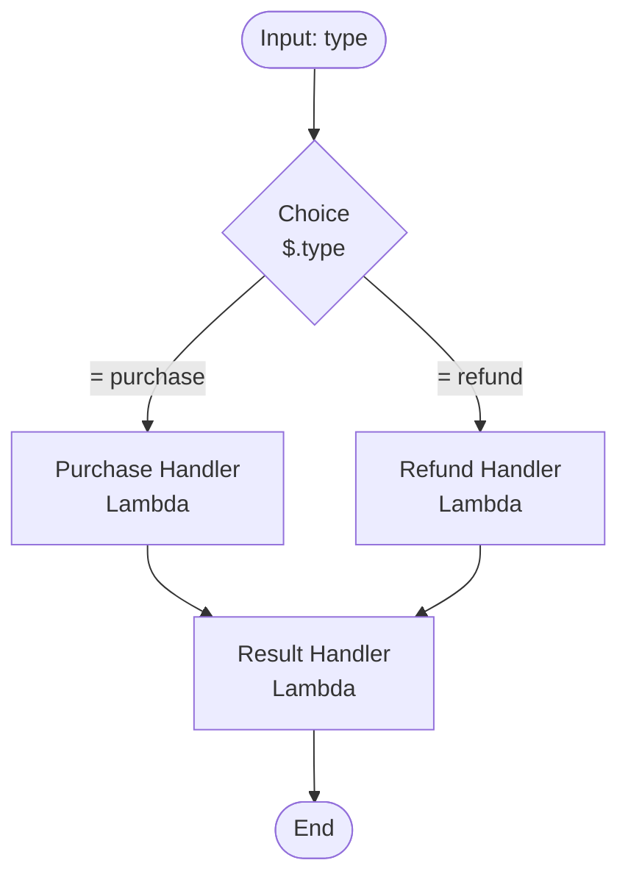

# Step Functions + Lambda in Workflow Studio: Study Notes

Source: [AWS Step Functions + Lambda Tutorial - Step by Step Guide in the Workflow Studio (AWS Simplified)](https://youtu.be/GVpmVu8vcNQ?list=PL9nWRykSBSFgQrO66TmO1vHFP6yuPF5G-), about 28 minutes.

A remake of the notes 02 workflow, built this time in **Workflow Studio**, with one addition:
1. A **Choice** state sends the input to a **Purchase Handler** or a **Refund Handler** Lambda function.
2. Both branches then join at a third function, the **Result Handler**, which reads what the previous function returned.

That last step is the new lesson: **how one Lambda's output becomes the next Lambda's input**.

### What's new compared with earlier notes

| Already covered | Where |
|---|---|
| Choice + two Lambda functions, roles, executions | [02](02_AWS_Step_Functions_with_Lambda_Study_Notes.md), and `02_terraform` |
| Workflow Studio's layout and Choice rule form | [10](10_AWS_Step_Functions_Workflow_Studio_Study_Notes.md) |
| `OutputPath`, `ResultPath`, data flow | [11](11_AWS_Step_Functions_Data_Flow_Simulator_Study_Notes.md) |
| Retry and Catch on Lambda | [12](12_AWS_Step_Functions_Serverless_Order_Workflow_Study_Notes.md) |

| New here | Section |
|---|---|
| Joining two branches into one state | 4 |
| Passing a Lambda's output on (`OutputPath: $.Payload`) | 5 |
| Optimized vs AWS SDK Lambda integration | 6 |
| Workflow Studio's Lambda options: payload, wait for callback, retries, catchers | 7 |
| Logging, X-Ray, and the state machine's execution counts | 8 |

Code marked **reconstructed** was rebuilt from what the video describes.

What was checked:
- The video's definition, an AWS SDK variant, and an improved JSONata version all passed `ValidateStateMachineDefinition` (`OK`).
- The Choice routing, each Lambda Task's request and output (with and without `OutputPath`), the SDK integration's string payload, and the improved version's paths were run through `TestState` with mocked Lambda results.
- The three handlers were run locally with `uv run`.
- Integration behavior comes from the current Lambda integration page.

---

## Contents

1. [Corrected terms](#1-corrected-terms)
2. [State machine vs execution](#2-state-machine-vs-execution)
3. [What you build](#3-what-you-build)
4. [Building it in Workflow Studio](#4-building-it-in-workflow-studio)
5. [How the Result Handler gets the previous result](#5-how-the-result-handler-gets-the-previous-result)
6. [Optimized vs AWS SDK integration](#6-optimized-vs-aws-sdk-integration)
7. [The Lambda Invoke options](#7-the-lambda-invoke-options)
8. [Create, run and inspect](#8-create-run-and-inspect)
9. [The generated ASL](#9-the-generated-asl)
10. [Beyond the video: a sturdier version](#10-beyond-the-video-a-sturdier-version)
11. [Gotchas](#11-gotchas)
12. [What has changed since the video](#12-what-has-changed-since-the-video)
13. [Cheat sheet](#13-cheat-sheet)
14. [Review questions](#14-review-questions)

---

## 1. Corrected terms

| Caption says | Actually means |
|---|---|
| purchase Handler / refund Handler / result Handler | The Lambda functions **PurchaseHandler**, **RefundHandler**, **ResultHandler** and their states |
| IEM role | **IAM** role |
| palumi | **Pulumi** |
| DePaul default | **Default** |
| weight | **Wait** |
| stat functions | **Step Functions** |
| swf / simple simple workflow service | Amazon **SWF** (Simple Workflow Service) |

---

## 2. State machine vs execution

The video clears this up first (01:57):

| Term | Is | Example |
|---|---|---|
| **State machine** | The workflow **template**: the definition, role and settings | "the order state machine" |
| **Execution** | **One run** of a state machine, with its own input, status and history | "each time someone places an order" |

One state machine, many executions. Notes 06 started executions from code, and notes 09 compared the two state machine types.

The video picks **Standard** for an order flow, because at-least-once (Express) could place an order twice (04:33). Notes 09 explains why.

---

## 3. What you build



### Input

```json
{ "type": "purchase" }
```

### The three functions (reconstructed)

```python
def purchase_handler(event, context):
    return {"result": "purchase_process_success"}


def refund_handler(event, context):
    return {"result": "refund_process_success"}


def result_handler(event, context):
    step_function_result = event["result"]
    return {"body": step_function_result + "_result"}
```

Each one is its own Lambda function in the video (`PurchaseHandler`, `RefundHandler`, `ResultHandler`). Local run of each branch, feeding the first function's output to the result handler:

| Branch | First function returns | Result Handler returns |
|---|---|---|
| purchase | `{"result": "purchase_process_success"}` | `{"body": "purchase_process_success_result"}` |
| refund | `{"result": "refund_process_success"}` | `{"body": "refund_process_success_result"}` |

The video's own first run failed because of a typo in the purchase function (23:13). The Lambda state turned red, and the error, with the Lambda's message, showed up in the state's details. Fix the code, **Deploy**, and run again.

---

## 4. Building it in Workflow Studio

The layout is the same as in notes 10: Actions, Flow, Patterns on the left; canvas in the middle; Inspector on the right.

### The Choice

1. Drag a **Choice** from **Flow** (07:48).
2. Rule #1: condition `$.type` **is equal to** string constant `purchase`.
3. **Add new choice rule**, Rule #2: `$.type` **is equal to** `refund`.
4. The video removes the **Default** rule using its **Clear** button (09:52). That works, but section 10 explains why to keep one.

The condition form offers simple conditions, plus **And**, **Or** and **Not**. The operators include **is present**, **is of type**, **is equal to**, **is less than** and more (08:50).

### The two handlers

1. From **Actions**, drag **AWS Lambda Invoke** under each branch (10:15).
2. **Rename them first** (10:39): `Purchase Handler`, `Refund Handler`. "If you have really big step functions, this can get really out of control if you're not naming things well."
3. For each, set **Function name** to the right function (11:35). The state shows a warning until it has one.
4. **Payload**: **Use state input as payload** (11:46), so the function receives `{"type": "purchase"}`.

### Joining the branches

This is the step notes 02 didn't have:
1. Drag a third **Lambda Invoke** under `Purchase Handler`, and name it `Result Handler` (16:16).
2. Workflow Studio connects it to that branch only. You can't drop one state under two branches at once (16:22).
3. Select `Refund Handler`, open its **Next state** setting (it says "Go to end"), and change it to **Result Handler** (16:53).

Now both branches lead into the same state. In ASL this is just two states with the same `"Next": "Result Handler"`. States can have any number of incoming arrows; a Choice or Parallel isn't needed to merge.

**Ctrl+Z** undoes a mistaken drop (16:11).

---

## 5. How the Result Handler gets the previous result

The Result Handler reads `event["result"]`. That works only because of one line Workflow Studio adds to every Lambda Invoke state: **`"OutputPath": "$.Payload"`**.

### What the optimized `lambda:invoke` returns

From the docs, the function's output is **nested inside metadata**:

```json
{
  "ExecutedVersion": "$LATEST",
  "Payload": { "result": "purchase_process_success" },
  "SdkHttpMetadata": { "HttpStatusCode": 200, "...": "..." },
  "SdkResponseMetadata": { "RequestId": "..." },
  "StatusCode": 200
}
```

### With and without `OutputPath`, tested

TestState on `Purchase Handler`, with that mocked result:

| `OutputPath` | State output = next state's input |
|---|---|
| `$.Payload` (Workflow Studio default) | `{"result": "purchase_process_success"}` |
| not set | The whole object above, with `result` buried inside `Payload` |

And the Result Handler, run locally on each:
- With `OutputPath`: returns `{"body": "purchase_process_success_result"}`.
- Without it: fails with **`KeyError: 'result'`**, because `result` isn't at the top level.

TestState on `Result Handler` with `{"result": "purchase_process_success"}` sends this request:

```json
{"FunctionName": "...:function:ResultHandler:$LATEST", "Payload": {"result": "purchase_process_success"}}
```

With a mocked reply, its output is `{"body": "purchase_process_success_result"}`. The video at 25:45 sees exactly this.

### Trade-off: `OutputPath: $.Payload` throws away the input

The Result Handler gets the purchase function's result, but **not** the original input. Here that's fine. If the Result Handler also needed `orderId` or `type`, use `ResultPath` instead (notes 11 section 7), or the JSONata `$merge` in section 10.

---

## 6. Optimized vs AWS SDK integration

The Lambda Invoke form has an **Integration type** (11:15). The video: leave it on the default, **Optimized**, "unless you have a reason to use the AWS SDK version". The optimized one adds "quality of life improvements like unescaping JSON".

| | Optimized (default) | AWS SDK |
|---|---|---|
| Resource | `arn:aws:states:::lambda:invoke` | `arn:aws:states:::aws-sdk:lambda:invoke` |
| `Payload` in the result | **Parsed JSON** ("parsed from escaped Json to Json", per the docs) | A **string** of escaped JSON |
| Patterns | Request Response, **`.waitForTaskToken`** | Request Response only |
| Function errors | The Task fails with the function's error | The Task fails with the function's error |

TestState with the SDK variant and a mocked string payload, `"{\"result\":\"purchase_process_success\"}"`:
- Read with `ResultSelector` `{"body.$": "States.StringToJson($.Payload)"}`.
- It became `{"body": {"result": "purchase_process_success"}}`.

The SDK version just needs that extra parsing step.

There's a third option from notes 07: the **function ARN directly as `Resource`**. The result is then only the function's output, no wrapper, but it can't use `.waitForTaskToken`.

---

## 7. The Lambda Invoke options

The video tours the Inspector for a Lambda Invoke state (11:12 to 15:40).

### Configuration tab

| Option | Meaning |
|---|---|
| **Integration type** | Optimized or AWS SDK (section 6) |
| **Function name** | The function, with an optional version or alias |
| **Payload** | Use state input (default), enter a custom payload, or send no payload |
| **Wait for callback** | Turns the Task into `lambda:invoke.waitForTaskToken`: the workflow **pauses** until something calls `SendTaskSuccess` or `SendTaskFailure` with the task token. The video's example: a person must check an order before it's placed (12:38). Notes [16](16_AWS_Step_Functions_Callback_with_Lambda_Study_Notes.md) covers this in depth. |
| **Next state** | Where to go on success; "Go to end" ends the execution |

### Error handling tab

| Option | Video's description |
|---|---|
| **Retry on errors** | "Retry when certain errors take place in your Lambda function", with interval, max attempts and backoff rate. You can pick built-in errors (`States.ALL`, `States.Timeout`, ...) or your own error names. |
| **Catch errors** | Detect an error type and "make a different control flow", for example emailing the customer when payment details are invalid |
| **Timeout** | Give up if Lambda doesn't answer in time |
| **Heartbeat** | For long tasks that report progress (callbacks) |

The video removes the retrier it added, to keep things simple (14:36). Workflow Studio's **default** retrier for Lambda (the four Lambda service errors) is worth keeping; it's in section 9.

---

## 8. Create, run and inspect

### The definition view

The video shows the generated ASL (18:53) and the three ways to use it with infrastructure as code (CDK, CloudFormation, Terraform, Pulumi):
- Paste it as a string or a file.
- Build the state machine with the IaC tool's own constructs.
- Or design in the console and export (notes 10 section 9). `02_terraform` uses a template file.

### Name, role, logging, tracing

| Setting | Video's choice | Notes |
|---|---|---|
| Name | `OrderStateMachine` | |
| Execution role | Create new role | Gets `lambda:InvokeFunction` for the three functions in the definition. Functions added later need manual role updates (notes 12 section 5). |
| Logging | **ALL** | Sends execution events to a CloudWatch Logs log group. Optional for Standard (the history is kept anyway); essential for Express (notes 09). |
| X-Ray tracing | Mentioned | Traces each call, to see where time goes and where failures happen |

### The state machine page

The state machine's page shows **execution counts by status**: running, succeeded, failed, timed out, aborted (22:17). Click a status to filter the list, which is the fastest way to find failed executions.

### One execution

| View | Shows |
|---|---|
| **Graph** | Blue running, green succeeded, red failed. Click a state for its input, output and error. |
| **State details** | Duration, a timeline, and a link to the **Lambda function's CloudWatch logs** for that call (24:42) |
| **Definition** | The ASL this execution ran with |
| **Events** | `TaskStateEntered`, `TaskScheduled`, `TaskStarted`, `TaskSucceeded`, `TaskStateExited`, ... with timestamps. The video compares it to SWF and guesses Step Functions uses SWF's engine "behind the scenes"; AWS doesn't document that. |

### The three runs

| Input `type` | Path | Result |
|---|---|---|
| `purchase` | Choice → Purchase Handler → Result Handler | Succeeded; final output `{"body": "purchase_process_success_result"}` |
| `refund` | Choice → Refund Handler → Result Handler | Succeeded; final output `{"body": "refund_process_success_result"}` |
| anything else | Choice | **Failed at the Choice**: no rule matched and the Default was cleared (27:19). TestState reports `States.Runtime` "does not point to a next state"; an execution reports `States.NoChoiceMatched`. |

---

## 9. The generated ASL

Reconstructed with Workflow Studio's defaults (`OutputPath`, the standard retrier). Validated `OK`:

```json
{
  "Comment": "A description of my state machine",
  "StartAt": "Choice",
  "States": {
    "Choice": {
      "Type": "Choice",
      "Choices": [
        { "Variable": "$.type", "StringEquals": "purchase", "Next": "Purchase Handler" },
        { "Variable": "$.type", "StringEquals": "refund", "Next": "Refund Handler" }
      ]
    },
    "Purchase Handler": {
      "Type": "Task",
      "Resource": "arn:aws:states:::lambda:invoke",
      "OutputPath": "$.Payload",
      "Parameters": {
        "Payload.$": "$",
        "FunctionName": "arn:aws:lambda:us-east-1:123456789012:function:PurchaseHandler:$LATEST"
      },
      "Retry": [
        {
          "ErrorEquals": ["Lambda.ServiceException", "Lambda.AWSLambdaException",
                          "Lambda.SdkClientException", "Lambda.TooManyRequestsException"],
          "IntervalSeconds": 1, "MaxAttempts": 3, "BackoffRate": 2, "JitterStrategy": "FULL"
        }
      ],
      "Next": "Result Handler"
    },
    "Refund Handler": {
      "Type": "Task",
      "Resource": "arn:aws:states:::lambda:invoke",
      "OutputPath": "$.Payload",
      "Parameters": {
        "Payload.$": "$",
        "FunctionName": "arn:aws:lambda:us-east-1:123456789012:function:RefundHandler:$LATEST"
      },
      "Retry": [
        {
          "ErrorEquals": ["Lambda.ServiceException", "Lambda.AWSLambdaException",
                          "Lambda.SdkClientException", "Lambda.TooManyRequestsException"],
          "IntervalSeconds": 1, "MaxAttempts": 3, "BackoffRate": 2, "JitterStrategy": "FULL"
        }
      ],
      "Next": "Result Handler"
    },
    "Result Handler": {
      "Type": "Task",
      "Resource": "arn:aws:states:::lambda:invoke",
      "OutputPath": "$.Payload",
      "Parameters": {
        "Payload.$": "$",
        "FunctionName": "arn:aws:lambda:us-east-1:123456789012:function:ResultHandler:$LATEST"
      },
      "Retry": [
        {
          "ErrorEquals": ["Lambda.ServiceException", "Lambda.AWSLambdaException",
                          "Lambda.SdkClientException", "Lambda.TooManyRequestsException"],
          "IntervalSeconds": 1, "MaxAttempts": 3, "BackoffRate": 2, "JitterStrategy": "FULL"
        }
      ],
      "End": true
    }
  }
}
```

Compared with `02_terraform/statemachine.asl.json`: the same building blocks, but here the Choice field is `type` (lowercase values) instead of `TransactionType`, and there's a joining third function.

To build this with the CLI or Terraform, reuse notes 02 section 7 or `02_terraform`. Add a third function and point both handlers' `Next` at it.

---

## 10. Beyond the video: a sturdier version

Validated `OK` (JSONata):

```json
{
  "Comment": "Purchase/refund handlers joined by a result handler (JSONata)",
  "QueryLanguage": "JSONata",
  "StartAt": "Choice",
  "States": {
    "Choice": {
      "Type": "Choice",
      "Choices": [
        { "Condition": "", "Next": "Purchase Handler" },
        { "Condition": "", "Next": "Refund Handler" }
      ],
      "Default": "Unknown type"
    },
    "Purchase Handler": {
      "Type": "Task",
      "Resource": "arn:aws:states:::lambda:invoke",
      "Arguments": {
        "FunctionName": "arn:aws:lambda:us-east-1:123456789012:function:PurchaseHandler:$LATEST",
        "Payload": ""
      },
      "Output": "",
      "Retry": [
        {
          "ErrorEquals": ["Lambda.ServiceException", "Lambda.AWSLambdaException",
                          "Lambda.SdkClientException", "Lambda.TooManyRequestsException"],
          "IntervalSeconds": 1, "MaxAttempts": 3, "BackoffRate": 2, "JitterStrategy": "FULL"
        }
      ],
      "Next": "Result Handler"
    },
    "Refund Handler": {
      "Type": "Task",
      "Resource": "arn:aws:states:::lambda:invoke",
      "Arguments": {
        "FunctionName": "arn:aws:lambda:us-east-1:123456789012:function:RefundHandler:$LATEST",
        "Payload": ""
      },
      "Output": "",
      "Retry": [
        {
          "ErrorEquals": ["Lambda.ServiceException", "Lambda.AWSLambdaException",
                          "Lambda.SdkClientException", "Lambda.TooManyRequestsException"],
          "IntervalSeconds": 1, "MaxAttempts": 3, "BackoffRate": 2, "JitterStrategy": "FULL"
        }
      ],
      "Next": "Result Handler"
    },
    "Result Handler": {
      "Type": "Task",
      "Resource": "arn:aws:states:::lambda:invoke",
      "Arguments": {
        "FunctionName": "arn:aws:lambda:us-east-1:123456789012:function:ResultHandler:$LATEST",
        "Payload": ""
      },
      "Output": "",
      "Retry": [
        {
          "ErrorEquals": ["Lambda.ServiceException", "Lambda.AWSLambdaException",
                          "Lambda.SdkClientException", "Lambda.TooManyRequestsException"],
          "IntervalSeconds": 1, "MaxAttempts": 3, "BackoffRate": 2, "JitterStrategy": "FULL"
        }
      ],
      "End": true
    },
    "Unknown type": {
      "Type": "Fail",
      "Error": "UnknownType",
      "Cause": ""
    }
  }
}
```

| Change | Why | TestState |
|---|---|---|
| `$lowercase(...)` in the conditions | `PURCHASE`, `Purchase` and `purchase` all work | `"type": "PURCHASE"` went to `Purchase Handler` |
| Default → `Unknown type` Fail, with a message | An unexpected type fails with a clear reason, not a routing error | `"exchange"` went to `Unknown type`, which failed with error `UnknownType`, cause "type must be purchase or refund, got: exchange" |
| `Output: $merge([$states.input, $states.result.Payload])` | The Result Handler sees the original input **and** the handler's result | With `{"orderId": "o-1", "type": "purchase"}`, the output was `{"orderId": "o-1", "type": "purchase", "result": "purchase_process_success"}` |

The Result Handler code works unchanged: `event["result"]` is still at the top level.

---

## 11. Gotchas

1. **Lambda results are wrapped.** With `lambda:invoke`, the function's return value is under `Payload`. Without `OutputPath: $.Payload` (or `$states.result.Payload`), the next function gets metadata and `KeyError`s.
2. **`OutputPath: $.Payload` drops the input.** Use `ResultPath` or JSONata `$merge` when later states need it.
3. **The AWS SDK integration returns `Payload` as a string.** Parse it with `States.StringToJson`, or use the optimized integration.
4. **Rename states before the workflow grows.** "Lambda Invoke (2)" in an error alert tells you nothing.
5. **Joining branches is just two `Next`s pointing at the same state.** In Workflow Studio, drop the state under one branch, then set the other branch's **Next state**.
6. **Clearing the Default rule** means any unexpected value fails the execution at the Choice.
7. **Choice comparisons are case-sensitive** in JSONPath.
8. **The role is generated once.** A fourth function added later needs a role update.
9. **Deploy Lambda changes.** The video's typo fix only helped after it was deployed.
10. **Wait for callback** changes the Task's behavior completely: the execution pauses until something sends the token back. Don't tick it by accident.
11. **Logging level ALL** writes input and output data to CloudWatch Logs if "include execution data" is on. Mind sensitive fields.

---

## 12. What has changed since the video

| Then (video) | Now |
|---|---|
| "Design your workflow visually" or "Write your workflow in code" chooser | **Create state machine**, then blank or a template, in Workflow Studio |
| Separate "Next" page with the old editor and definition | **Code** mode; name, role and logging in **Config** mode |
| Choice rules with `Variable` + comparison | Also **JSONata** `Condition` expressions (section 10) |
| `OutputPath` / `ResultPath` for passing data | Also JSONata **`Output`** and variables (**`Assign`**) |
| Patterns tab "being added to all the time" | Patterns tab includes Distributed Map data processing (notes 15) |
| Fail states with fixed text | Fail `Error`/`Cause` can be computed (JSONata, or `ErrorPath`/`CausePath`) |

---

## 13. Cheat sheet

```
State machine   = template (definition + role + settings);  execution = one run
Join branches   : two states with the same "Next"; in Workflow Studio set the 2nd branch's Next state
Lambda invoke   : arn:aws:states:::lambda:invoke                 (optimized: Payload parsed JSON)
                  arn:aws:states:::aws-sdk:lambda:invoke         (Payload is a string -> States.StringToJson)
                  arn:aws:lambda:...:function:Name (direct ARN)  (raw output, no .waitForTaskToken)
Result shape    : {"ExecutedVersion", "Payload": <function output>, "SdkHttpMetadata", "StatusCode", ...}
Pass result on  : "OutputPath": "$.Payload"           JSONata: "Output": ""
Keep input too  : "ResultPath": "$.x"                 JSONata: ""
Default retrier : Lambda.ServiceException / AWSLambdaException / SdkClientException / TooManyRequestsException
Wait for callback: lambda:invoke.waitForTaskToken (pause until SendTaskSuccess/Failure)
Inspect         : graph colors, state details (+ Lambda logs link), Definition, Events
Execution counts: state machine page, filter by Running / Succeeded / Failed / Timed out / Aborted
```

---

## 14. Review questions

<details>
<summary>1. What's the difference between a state machine and an execution?</summary>

A state machine is the workflow template: definition, role and settings. An execution is one run of it, with its own input, status and history. One state machine has many executions.
</details>

<details>
<summary>2. How do two Choice branches end up at the same Result Handler?</summary>

Both handler states have `"Next": "Result Handler"`. In Workflow Studio, you drop the Result Handler under one branch, then set the other branch's **Next state** to it.
</details>

<details>
<summary>3. Why can the Result Handler read <code>event["result"]</code>?</summary>

Because the previous Lambda state has `"OutputPath": "$.Payload"`. The optimized integration nests the function's return value under `Payload`; `OutputPath` passes only that object on.
</details>

<details>
<summary>4. You remove <code>OutputPath</code> from the Purchase Handler. What happens in the Result Handler?</summary>

It receives the whole wrapper (`ExecutedVersion`, `Payload`, `SdkHttpMetadata`, `StatusCode`). `event["result"]` raises `KeyError: 'result'`, because `result` is inside `Payload`.
</details>

<details>
<summary>5. What's the difference in the result between the optimized and AWS SDK Lambda integrations?</summary>

Optimized parses the function's JSON output, so `Payload` is a JSON object. The AWS SDK integration returns `Payload` as a string of escaped JSON, which you parse with `States.StringToJson`.
</details>

<details>
<summary>6. What does "Wait for callback" do to a Lambda Invoke state?</summary>

It turns it into `lambda:invoke.waitForTaskToken`. The function gets a task token, and the execution pauses at that state until something calls `SendTaskSuccess` or `SendTaskFailure` with that token, for example after a human review.
</details>

<details>
<summary>7. The input is <code>{"type": "exchange"}</code> and the Default rule was cleared. What happens?</summary>

The execution fails at the Choice state (`States.NoChoiceMatched`), because no rule matches and there's no Default.
</details>

<details>
<summary>8. How do you make the Result Handler see both the original input and the handler's result?</summary>

In JSONPath, use `ResultPath` (for example `"$.handlerResult"`) instead of `OutputPath: $.Payload`. In JSONata, `"Output": ""`.
</details>

<details>
<summary>9. Where do you find a failed Lambda call's own log output from the execution page?</summary>

Select the Lambda state in the execution graph. Its details include a link to that invocation's CloudWatch logs.
</details>

<details>
<summary>10. Why is Standard the right type for an order state machine?</summary>

Standard runs each step exactly once (unless you add retries). Express's at-least-once semantics could run a step twice and place an order twice.
</details>

<details>
<summary>11. What does the state machine page's execution count help with?</summary>

It shows how many executions are running, succeeded, failed, timed out or aborted, and clicking a count filters the list. It's the quickest way to find failed executions.
</details>
