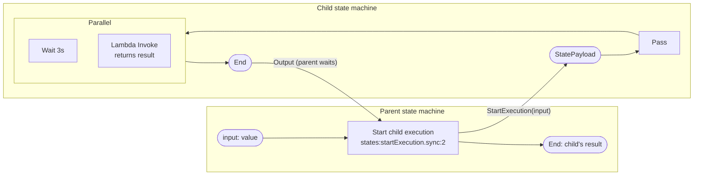
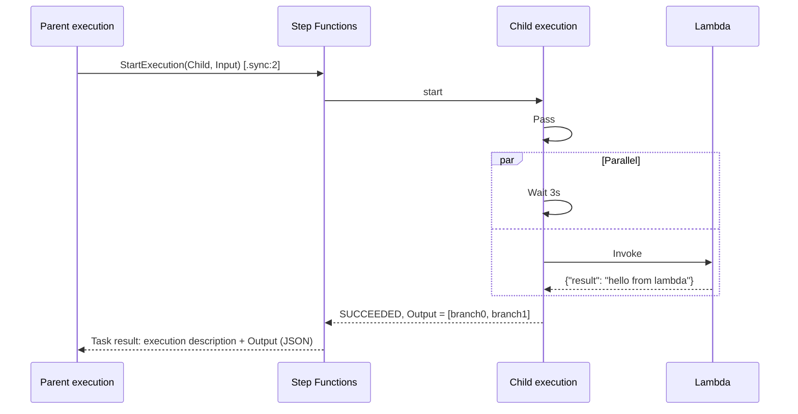

# Starting a Step Function from Within a Step Function: Study Notes

Source: [How to Start a Step Function from within a Step Function (AWS Simplified)](https://youtu.be/btl7BrH3Q9M?list=PL9nWRykSBSFgQrO66TmO1vHFP6yuPF5G-), about 11 minutes.

A **parent** state machine starts a **child** state machine as one of its steps. This is also called a *nested* or *child* workflow. The parent can:
- **wait** for the child to finish and use its result;
- fire it off and move on right away;
- or wait until something calls back.

The video builds a parent that passes part of its input to a child, waits for it, and reads the child's Lambda result from the output.

Notes 06 started executions from Lambda. Here a state machine starts one, with no code, through Step Functions' own **optimized integration** (`arn:aws:states:::states:startExecution`). Notes 09 section 9 used this to put an Express child under a Standard parent.

Code marked **reconstructed** was rebuilt from what the video describes. The state machine names `Parent` and `Child` are the video's.

What was checked:
- The parent (all three patterns), the child, and the improved JSONPath and JSONata parents passed `ValidateStateMachineDefinition` (`OK`).
- The parent's request to `StartExecution`, the async and `.sync:2` results, picking the child's Lambda result, and the child's Parallel output were run through `TestState` with mocked results.
- The patterns, output formats, `AWS_STEP_FUNCTIONS_STARTED_BY_EXECUTION_ID` and the IAM policies come from the current nested-workflow integration page.

---

## Contents

1. [Corrected terms](#1-corrected-terms)
2. [Why nest workflows](#2-why-nest-workflows)
3. [What you build](#3-what-you-build)
4. [The child workflow](#4-the-child-workflow)
5. [The parent: the Start Execution state](#5-the-parent-the-start-execution-state)
6. [The three integration patterns](#6-the-three-integration-patterns)
7. [The IAM role the console generates](#7-the-iam-role-the-console-generates)
8. [Run it and follow parent to child](#8-run-it-and-follow-parent-to-child)
9. [Reading the child's result](#9-reading-the-childs-result)
10. [Same setup with the AWS CLI](#10-same-setup-with-the-aws-cli)
11. [Beyond the video: names, failures, Express children, other accounts](#11-beyond-the-video-names-failures-express-children-other-accounts)
12. [Gotchas](#12-gotchas)
13. [What has changed since the video](#13-what-has-changed-since-the-video)
14. [Cheat sheet](#14-cheat-sheet)
15. [Review questions](#15-review-questions)

---

## 1. Corrected terms

| Caption says | Actually means |
|---|---|
| Parent's Day machine | Parent **state machine** |
| set function / stop function | **Step Function** |
| state's payload / state payload | The `StatePayload` key in the child's input |
| input dot dollar sign | `"input.$"`: a key whose value is a path |
| IEM role | **IAM** role |
| input selector | Input processing (`InputPath`, `Parameters`; notes 11) |

---

## 2. Why nest workflows

| Reason | Example |
|---|---|
| **Reuse** | One "send notification" workflow called from many parent workflows |
| **Smaller, clearer workflows** | The parent shows the business steps; each child hides the details |
| **Mix types** | A Standard parent (long, exactly-once) runs short Express children (cheap, fast); see notes 09 |
| **Stay under limits** | Each child has its own 25,000-event history, instead of one huge parent history |
| **Separate ownership** | Another team owns and deploys the child, with its own role and versions |

---

## 3. What you build



1. The parent gets `{"input": "value"}`.
2. Its single Task starts the child, passing that value inside `StatePayload`, and **waits**.
3. The child runs a Pass, then a Parallel: one branch waits a few seconds, and the other calls a Lambda function that returns `{"result": "hello from lambda"}`.
4. The child's final output comes back to the parent as the Task's result.

---

## 4. The child workflow

The video's child "doesn't really do anything smart" (00:48); it's there to show data going in and coming out.

### Definition (reconstructed, validated: `OK`)

```json
{
  "Comment": "Child: a Pass, then a Parallel with a Wait branch and a Lambda branch",
  "StartAt": "Pass",
  "States": {
    "Pass": { "Type": "Pass", "Next": "Parallel" },
    "Parallel": {
      "Type": "Parallel",
      "Branches": [
        {
          "StartAt": "Wait",
          "States": { "Wait": { "Type": "Wait", "Seconds": 3, "End": true } }
        },
        {
          "StartAt": "Lambda Invoke",
          "States": {
            "Lambda Invoke": {
              "Type": "Task",
              "Resource": "arn:aws:states:::lambda:invoke",
              "OutputPath": "$.Payload",
              "Parameters": {
                "Payload.$": "$",
                "FunctionName": "arn:aws:lambda:us-east-1:123456789012:function:HelloFunction:$LATEST"
              },
              "End": true
            }
          }
        }
      ],
      "End": true
    }
  }
}
```

The Lambda function (reconstructed):

```python
def lambda_handler(event, context):
    return {"result": "hello from lambda"}
```

### The Parallel state's output

A **Parallel** state runs its branches at the same time and outputs an **array with one entry per branch**, in branch order. TestState with the child's input and mocked branch results:

```json
[
  { "StatePayload": { "input": "value" },
    "AWS_STEP_FUNCTIONS_STARTED_BY_EXECUTION_ID": "arn:aws:states:us-east-1:123456789012:execution:Parent:run-1" },
  { "result": "hello from lambda" }
]
```

- Entry 0 is the **Wait** branch: a Wait passes its input through, so it's the child's input.
- Entry 1 is the **Lambda** branch: the function's result.

That array is the child's output, and what the parent gets back (section 9).

---

## 5. The parent: the Start Execution state

### In Workflow Studio

1. **Create state machine**, type **Standard**.
2. In Actions, type `start` and drag **AWS Step Functions StartExecution** onto the canvas (02:08).
3. Fill in the **API Parameters** box. It's a text box, not a form, which the video finds odd (02:38).

Workflow Studio's starting template looks like this:

```json
{
  "StateMachineArn": "arn:aws:states:REGION:ACCOUNT_ID:stateMachine:STATE_MACHINE_NAME",
  "Input": {
    "StatePayload": "Hello from Step Functions!",
    "AWS_STEP_FUNCTIONS_STARTED_BY_EXECUTION_ID.$": "$$.Execution.Id"
  }
}
```

The video replaces:
- `REGION` with `us-east-1`;
- `ACCOUNT_ID` with the account ID, copied from the account menu at the top right;
- `STATE_MACHINE_NAME` with `Child`;
- the `StatePayload` value with an object that copies `input` from the parent's input.

### The parent (reconstructed, validated: `OK`)

```json
{
  "Comment": "Parent that runs the Child state machine and waits for it",
  "StartAt": "Start child execution",
  "States": {
    "Start child execution": {
      "Type": "Task",
      "Resource": "arn:aws:states:::states:startExecution.sync:2",
      "Parameters": {
        "StateMachineArn": "arn:aws:states:us-east-1:123456789012:stateMachine:Child",
        "Input": {
          "StatePayload": { "input.$": "$.input" },
          "AWS_STEP_FUNCTIONS_STARTED_BY_EXECUTION_ID.$": "$$.Execution.Id"
        }
      },
      "End": true
    }
  }
}
```

| Part | Meaning |
|---|---|
| `states:startExecution.sync:2` | Start the child and **wait** for it; return its output as JSON |
| `StateMachineArn` | Which state machine to start (the child) |
| `Input` | The child's execution input, built like any `Parameters` object |
| `"input.$": "$.input"` | Copy `input` from the parent's input (the video's "special notation" at 04:10) |
| `AWS_STEP_FUNCTIONS_STARTED_BY_EXECUTION_ID` | A **specially named** field. Step Functions uses it to link the child execution to the parent in the console. |
| `$$.Execution.Id` | The parent execution's ARN, from the Context object |

### What gets sent

TestState's `afterParameters` with input `{"input": "value"}`:

```json
{
  "StateMachineArn": "arn:aws:states:us-east-1:123456789012:stateMachine:Child",
  "Input": {
    "StatePayload": { "input": "value" },
    "AWS_STEP_FUNCTIONS_STARTED_BY_EXECUTION_ID": "arn:aws:states:us-east-1:123456789012:execution:Parent:run-1"
  }
}
```

The child receives that `Input` object as its execution input.

---

## 6. The three integration patterns

The **Integration pattern** option for this action (04:47):

| Pattern | Resource | Parent... | Task result |
|---|---|---|---|
| **Request Response** (fire and forget) | `states:startExecution` | Moves on as soon as the child has **started** | `{"ExecutionArn": "...", "StartDate": "..."}` |
| **Run a job**, response format **JSON** | `states:startExecution.sync:2` | **Waits for the child to finish** | The child's description, with `Output` as **JSON** |
| **Run a job**, response format **string** | `states:startExecution.sync` | Waits for the child to finish | Same, but `Output` is a **string** of escaped JSON |
| **Wait for callback** | `states:startExecution.waitForTaskToken` | Waits until something calls `SendTaskSuccess` or `SendTaskFailure` with the token | Whatever the callback sends |

The video's choice, "probably the most common one": wait for the child, with JSON output (05:17).

### `.sync` vs `.sync:2`

From the docs, if the child returns `{"MyKey": "MyValue"}`:

```json
// startExecution.sync
{ "...": "...", "Output": "{ \"MyKey\": \"MyValue\" }" }

// startExecution.sync:2
{ "...": "...", "Output": { "MyKey": "MyValue" } }
```

Prefer `:2`: you can read `$.Output.MyKey` directly, without `States.StringToJson`.

### Fire and forget, tested

TestState with the Request Response resource and a mocked result:

```json
{"ExecutionArn": "arn:aws:states:us-east-1:123456789012:execution:Child:abc-123", "StartDate": "2026-11-23T10:00:00.000Z"}
```

That's like notes 06's `start_execution` from Lambda: started, nothing more.

### Wait for callback

Validated `OK` with `"TaskToken.$": "$$.Task.Token"` added to the child's input. The child must send the token back, for example with an AWS SDK Task:
- Resource: `arn:aws:states:::aws-sdk:sfn:sendTaskSuccess`
- Parameters: `TaskToken` and `Output`

Use this when the child should report "done" before it actually ends, or when the work isn't really a child workflow at all. Notes 16 covers callbacks.

---

## 7. The IAM role the console generates

When you create the parent in the console, the review page says an execution role "will be created with full permissions". The policy is named like **StepFunctionsStartExecutionManagementScopedAccessPolicy** (06:51; the video calls it "a mouthful").

What it contains for the **synchronous** pattern (the docs' template):

```json
{
  "Version": "2012-10-17",
  "Statement": [
    {
      "Effect": "Allow",
      "Action": ["states:StartExecution"],
      "Resource": ["arn:aws:states:us-east-1:123456789012:stateMachine:Child"]
    },
    {
      "Effect": "Allow",
      "Action": ["states:DescribeExecution", "states:StopExecution"],
      "Resource": ["arn:aws:states:us-east-1:123456789012:execution:Child:*"]
    },
    {
      "Effect": "Allow",
      "Action": ["events:PutTargets", "events:PutRule", "events:DescribeRule"],
      "Resource": ["arn:aws:events:us-east-1:123456789012:rule/StepFunctionsGetEventsForStepFunctionsExecutionRule"]
    }
  ]
}
```

| Statement | Why |
|---|---|
| `StartExecution` on the **state machine** ARN | To start the child |
| `DescribeExecution`, `StopExecution` on the child's **execution** ARNs | To check whether the child has finished (polling), and to stop it |
| EventBridge `PutTargets`, `PutRule`, `DescribeRule` on a managed rule | Step Functions also learns about the child finishing through an EventBridge rule it manages |

From the docs: without the EventBridge or `DescribeExecution` permissions, the parent may only notice **late** that the child finished.

For the **asynchronous** pattern, `states:StartExecution` alone is enough.

The docs warn about one mistake: `StartExecution` needs the **state machine** ARN, while `DescribeExecution` and `StopExecution` need **execution** ARNs. Putting all three on one resource gives a valid-looking policy that can leave workflows stuck.

With infrastructure as code (CDK, Terraform), you write this policy yourself (06:20). The video: "you're going to need to make sure your parent step function has the start execution permission for your child".

---

## 8. Run it and follow parent to child

1. Start the parent with:

   ```json
   { "input": "value" }
   ```

2. The parent's graph shows **one** state, `Start child execution`. It stays blue while the child runs, then turns green.
3. The parent's graph **doesn't show the child's states** (08:49). To see them, open the Task's details and follow the **child execution link** (09:01).
4. The child's execution page shows its own graph: Pass, then Parallel with Wait and Lambda. Its input is `{"StatePayload": {"input": "value"}, "AWS_STEP_FUNCTIONS_STARTED_BY_EXECUTION_ID": "..."}`.
5. Thanks to `AWS_STEP_FUNCTIONS_STARTED_BY_EXECUTION_ID`, the child's page also links **back** to the parent execution that started it.



---

## 9. Reading the child's result

With `.sync:2`, the Task result is the child execution's **description**: its ARN, name, status, start and stop times, input and output, with `Output` as JSON:

```json
{
  "ExecutionArn": "arn:aws:states:us-east-1:123456789012:execution:Child:abc-123",
  "StateMachineArn": "arn:aws:states:us-east-1:123456789012:stateMachine:Child",
  "Name": "abc-123",
  "Status": "SUCCEEDED",
  "StartDate": "...",
  "StopDate": "...",
  "Input": { "StatePayload": { "input": "value" }, "...": "..." },
  "Output": [
    { "StatePayload": { "input": "value" }, "...": "..." },
    { "result": "hello from lambda" }
  ]
}
```

The video at 10:41: the Lambda's result "is nested inside the output object". With no `ResultPath`, this whole description becomes the parent's output.

### Picking just what you need (validated: `OK`)

```json
"Start child execution": {
  "Type": "Task",
  "Resource": "arn:aws:states:::states:startExecution.sync:2",
  "Parameters": {
    "StateMachineArn": "arn:aws:states:us-east-1:123456789012:stateMachine:Child",
    "Name.$": "States.Format('{}-child', $$.Execution.Name)",
    "Input": {
      "StatePayload": { "input.$": "$.input" },
      "AWS_STEP_FUNCTIONS_STARTED_BY_EXECUTION_ID.$": "$$.Execution.Id"
    }
  },
  "ResultSelector": {
    "childResult.$": "$.Output[1].result",
    "childExecution.$": "$.ExecutionArn"
  },
  "ResultPath": "$.child",
  "End": true
}
```

TestState with parent execution name `run-1`:
- The request includes `"Name": "run-1-child"`.
- The output is `{"input": "value", "child": {"childResult": "hello from lambda", "childExecution": "...:execution:Child:abc-123"}}`.

`$.Output[1]` is the Parallel's **second** branch. If the child's branch order changes, this path breaks. A child that ends with a Pass state building a named result (`{"greeting.$": "$[1].result"}`) gives the parent a stabler contract.

The same in JSONata (TestState output `{"input": "value", "childResult": "hello from lambda"}`):

```json
"Output": ""
```

A testing note: TestState passes a mocked `Output` through exactly as given. It doesn't imitate `.sync:2` turning a string into JSON. Write the mock's `Output` as JSON (with `fieldValidationMode` `NONE`) to test a `.sync:2` parent.

---

## 10. Same setup with the AWS CLI

`child.json` and `parent.json` are the definitions from sections 4 and 5. The child's role needs `lambda:InvokeFunction` on `HelloFunction`; the parent's role needs the policy from section 7.

```bash
ACCOUNT_ID=$(aws sts get-caller-identity --query Account --output text)

CHILD_ARN=$(aws stepfunctions create-state-machine --name Child --definition file://child.json \
  --role-arn "arn:aws:iam::${ACCOUNT_ID}:role/ChildRole" --query stateMachineArn --output text)
PARENT_ARN=$(aws stepfunctions create-state-machine --name Parent --definition file://parent.json \
  --role-arn "arn:aws:iam::${ACCOUNT_ID}:role/ParentRole" --query stateMachineArn --output text)

# Run the parent; with .sync:2 it finishes only after the child does
EXEC=$(aws stepfunctions start-execution --state-machine-arn "$PARENT_ARN" \
  --name run-1 --input '{"input": "value"}' --query executionArn --output text)
aws stepfunctions describe-execution --execution-arn "$EXEC" --query '{status: status, output: output}'

# The child execution it started
aws stepfunctions list-executions --state-machine-arn "$CHILD_ARN" \
  --query 'executions[].[name, status, startDate]' --output table

# Clean up
aws stepfunctions delete-state-machine --state-machine-arn "$PARENT_ARN"
aws stepfunctions delete-state-machine --state-machine-arn "$CHILD_ARN"
```

Create the child first: the parent's definition and policy point at the child's ARN.

---

## 11. Beyond the video: names, failures, Express children, other accounts

### Name the child execution

Without `Name`, every start gets a random UUID. With `"Name.$": "States.Format('{}-child', $$.Execution.Name)"`:
- The child is easy to find from the parent's name.
- If the parent's Task is **retried**, the same name means Step Functions returns the already-running child instead of starting a second one (notes 06 section 3). A finished child gives `ExecutionAlreadyExists`, which a Retry or Catch should handle.

Names must be unique per child state machine for 90 days (Standard), so a parent that starts the same child twice needs different suffixes.

### When the child fails

With `.sync` or `.sync:2`, a failed, timed-out or aborted child makes the parent's **Task fail**. Treat it like any failing Task: add a `Retry` for temporary problems and a `Catch` to a fallback (notes 12). The child's own error and cause are visible on the child's execution page.

Because the parent's role can call `StopExecution` on the child, Step Functions can also stop a running child, for example when the parent's Task times out.

### Express children

A **Standard** parent can run an **Express** child with `.sync:2`: durable, exactly-once orchestration in the parent, and cheap bursts of fast work in the child (notes 09 section 9). An **Express** parent can't use `.sync` or `.waitForTaskToken` at all.

### Children in another account

The video mentions cross-account access (05:29). A Task state can assume a role in another account with the `Credentials` field:

```json
"Credentials": { "RoleArn": "arn:aws:iam::222222222222:role/StartChildFromAccountA" }
```

The parent's role must be allowed to assume that role, and the role in the other account needs the section 7 permissions there.

### Nested workflow vs Distributed Map

Distributed Map (notes 07 section 10 and notes 15) also creates child executions, one per batch of items. Use Start Execution for **one** child workflow per step, and Distributed Map to run the same child logic over **many** items.

---

## 12. Gotchas

1. **The parent's graph doesn't show the child's steps.** Follow the link to the child execution.
2. **`.sync` returns `Output` as a string; `.sync:2` returns JSON.** Use `:2`.
3. **The result is the child's whole description**, not just its output. Pick what you need with `ResultSelector` or `Output`.
4. **Paths into a Parallel's output depend on branch order.** Give the child a final Pass state that names its results.
5. **IAM ARN types differ:** state machine ARN for `StartExecution`; execution ARNs for `DescribeExecution` and `StopExecution`.
6. **Missing EventBridge or Describe permissions** can delay the parent noticing that the child finished.
7. **Replace every placeholder** in the template (`REGION`, `ACCOUNT_ID`, `STATE_MACHINE_NAME`).
8. **Keep `AWS_STEP_FUNCTIONS_STARTED_BY_EXECUTION_ID`.** It's what links parent and child in the console.
9. **Child execution names** must be unique per child state machine (Standard, 90 days).
10. **Each child execution is billed** separately (its own transitions, or duration for Express).
11. **Express parents can't wait for children** (`.sync` isn't supported in Express).
12. **Testing `.sync:2` with mocks**: the mocked `Output` isn't parsed for you.
13. **Create the child first.** The parent's definition and role need its ARN.

---

## 13. What has changed since the video

| Then (video) | Now |
|---|---|
| "Next" page shows the ASL, then name and role | **Code** and **Config** modes in Workflow Studio |
| Parameters typed into a JSON box | Still a JSON box; JSONata parents use `Arguments` and `Output` |
| Child shown only through a link | Child execution pages link back to the parent through `AWS_STEP_FUNCTIONS_STARTED_BY_EXECUTION_ID` |
| Nested workflows only through Start Execution | Also **Distributed Map** child executions, Standard or Express |
| Failed parent: start over | **Redrive** the parent from the failed Task (notes 18) |
| Test by running both | **TestState** with mocks tests the parent's Task; the mock must match `DescribeExecution` |

---

## 14. Cheat sheet

```
Resource (fire & forget) : arn:aws:states:::states:startExecution                -> ExecutionArn, StartDate
Resource (wait, string)  : arn:aws:states:::states:startExecution.sync           -> Output is a string
Resource (wait, JSON)    : arn:aws:states:::states:startExecution.sync:2         -> Output is JSON  (use this)
Resource (callback)      : arn:aws:states:::states:startExecution.waitForTaskToken (child sends token back)
Parameters               : StateMachineArn, Input {...}, Name (optional)
Link parent/child        : "AWS_STEP_FUNCTIONS_STARTED_BY_EXECUTION_ID.$": "$$.Execution.Id"
Child name               : "Name.$": "States.Format('{}-child', $$.Execution.Name)"
Read child result        : ResultSelector {"x.$": "$.Output..."}  |  JSONata $states.result.Output...
Parallel output          : array, one entry per branch, in branch order
IAM (sync)               : states:StartExecution on stateMachine:Child
                           states:DescribeExecution, StopExecution on execution:Child:*
                           events:PutTargets/PutRule/DescribeRule on
                             rule/StepFunctionsGetEventsForStepFunctionsExecutionRule
IAM (async)              : states:StartExecution only
Cross-account            : "Credentials": {"RoleArn": "arn:aws:iam::OTHER:role/..."}
Express                  : Standard parent -> Express child OK; Express parent can't .sync
```

---

## 15. Review questions

<details>
<summary>1. What are the three ways a parent can start a child workflow, and what does the parent do in each?</summary>

**Request Response** (`startExecution`): start the child and move on immediately. **Run a job** (`startExecution.sync` or `.sync:2`): start it and wait for it to finish. **Wait for callback** (`startExecution.waitForTaskToken`): start it and wait until someone calls `SendTaskSuccess` or `SendTaskFailure` with the token.
</details>

<details>
<summary>2. What's the difference between <code>.sync</code> and <code>.sync:2</code>?</summary>

Both wait for the child. `.sync` returns the child's `Output` as a string of escaped JSON; `.sync:2` returns it as JSON, so you can read fields directly.
</details>

<details>
<summary>3. What is <code>AWS_STEP_FUNCTIONS_STARTED_BY_EXECUTION_ID</code> for?</summary>

It's a specially named field in the child's input, set to the parent's execution ID (`$$.Execution.Id`). Step Functions uses it to link the child execution to the parent that started it.
</details>

<details>
<summary>4. Where do you see the child's individual states while looking at the parent execution?</summary>

Not in the parent's graph, which shows only the Start Execution task. Follow the child execution link from that task's details to the child's own execution page.
</details>

<details>
<summary>5. The child's last state is a Parallel with two branches. What does the parent get as <code>Output</code>, and where is the Lambda's result?</summary>

An array with one entry per branch, in order. The Lambda branch is second, so its result is at `$.Output[1]`, for example `$.Output[1].result` = "hello from lambda".
</details>

<details>
<summary>6. List the permissions a parent needs for <code>.sync:2</code>, and the ARN type for each.</summary>

`states:StartExecution` on the child **state machine** ARN. `states:DescribeExecution` and `states:StopExecution` on the child's **execution** ARNs (`execution:Child:*`). `events:PutTargets`, `events:PutRule` and `events:DescribeRule` on the managed rule `StepFunctionsGetEventsForStepFunctionsExecutionRule`.
</details>

<details>
<summary>7. What happens if the parent's role is missing the EventBridge permissions?</summary>

The parent can still detect that the child finished by polling (`DescribeExecution`), but it may notice later than it otherwise would.
</details>

<details>
<summary>8. The parent's Task is retried while the child is still running. How do you avoid starting a second child?</summary>

Give the child a deterministic `Name`, for example from the parent's execution name. A start with the same name and input while the first is running returns the existing execution instead of starting a new one.
</details>

<details>
<summary>9. Can an Express parent wait for a child workflow?</summary>

No. Express doesn't support `.sync` or `.waitForTaskToken`. A Standard parent can wait for a Standard or Express child.
</details>

<details>
<summary>10. How do you pass only part of the parent's input to the child?</summary>

Build the child's `Input` in `Parameters` with paths, for example `"Input": {"StatePayload": {"input.$": "$.input"}}`. In JSONata, use expressions in `Arguments.Input`.
</details>

<details>
<summary>11. When would you use Distributed Map instead of a Start Execution task?</summary>

When the same child logic must run over many items (for example rows of a file in S3), with high concurrency and failure tolerance. Start Execution runs one child per step.
</details>
