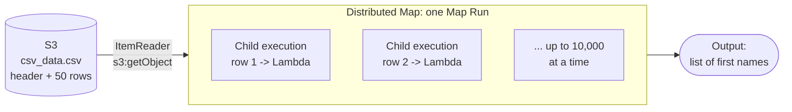

# Big Data Processing with Distributed Map (S3 + Lambda): Study Notes

Source: [Big Data Processing Using Distributed Maps and AWS Step Functions (S3 + Lambda) (AWS Simplified)](https://youtu.be/0Zs5s5F_lFc?list=PL9nWRykSBSFgQrO66TmO1vHFP6yuPF5G-), about 22 minutes.

A state machine **reads a CSV file straight from S3** and runs a Lambda function **once per row**. It uses a **Distributed Map**: the high-scale mode of the Map state, where every item runs as its own **child execution**.

The video builds it from Workflow Studio's **"Process CSV file in S3"** pattern. It walks through every option: batching, concurrency, child execution type, failure tolerance and exporting results to S3. Then it runs it and inspects the **Map Run**.

Notes [07](07_AWS_Step_Functions_Map_State_Study_Notes.md) covered the inline Map and compared the two modes (section 10). Notes 09 explained the Standard vs Express choice that comes back here for child executions.

Code marked **reconstructed** was rebuilt from what the video describes. The bucket `bbd-map-task-demo`, key `csv_data.csv` and function `SFLambdaDemo` are close to what the video shows. The CSV column names (`first_name`, `last_name`, `phone_number`) are placeholders.

What was checked:
- The video's definition, the improved batched version (with `ResultWriter` and `WriterConfig`) and a JSONata version all passed `ValidateStateMachineDefinition` (`OK`).
- TestState with the CSV rows supplied through `stateConfiguration.mapItemReaderData`, plus mocked child results: the Map output, the batches built by `ItemBatcher` (5 batches of 10), and `ToleratedFailurePercentage` at 5% and 20%. The outputs and errors shown are the real results.
- The per-row and batch Lambda handlers were run locally with `uv run`, on rows parsed from a CSV file.
- `ItemReader` formats, CSV parsing rules, `ResultWriter` options and IAM come from the current docs.

---

## Contents

1. [Corrected terms](#1-corrected-terms)
2. [What you build](#2-what-you-build)
3. [Distributed Map in two minutes](#3-distributed-map-in-two-minutes)
4. [Patterns are just Map states](#4-patterns-are-just-map-states)
5. [The data: a CSV file in S3](#5-the-data-a-csv-file-in-s3)
6. [Configuring the Map, option by option](#6-configuring-the-map-option-by-option)
7. [The Lambda function](#7-the-lambda-function)
8. [The generated ASL](#8-the-generated-asl)
9. [Permissions](#9-permissions)
10. [Run it and read the Map Run](#10-run-it-and-read-the-map-run)
11. [Testing a Distributed Map with TestState](#11-testing-a-distributed-map-with-teststate)
12. [Beyond the video: batched, Express, failure-tolerant, exported](#12-beyond-the-video-batched-express-failure-tolerant-exported)
13. [Same setup with the AWS CLI](#13-same-setup-with-the-aws-cli)
14. [Gotchas](#14-gotchas)
15. [What has changed since the video](#15-what-has-changed-since-the-video)
16. [Cheat sheet](#16-cheat-sheet)
17. [Review questions](#17-review-questions)

---

## 1. Corrected terms

| Caption says | Actually means |
|---|---|
| attributed mode | **Distributed** mode |
| map task | The **Map state** |
| item potent | **Idempotent** |
| build (a lot more) | **Billed** |
| snap standard workflows | **Standard** workflows |
| IEM error | **IAM** error |
| SF Lambda demo | The function **SFLambdaDemo** |

---

## 2. What you build



1. The Map state calls S3 `GetObject` on the CSV file itself. No Lambda reads the file.
2. Each row becomes a JSON object, with the header row providing the keys.
3. Each row starts a **child execution** that calls the Lambda function, which returns the row's first name.
4. The Map state collects the results into a list: 50 first names.

---

## 3. Distributed Map in two minutes

| Term | Meaning |
|---|---|
| **Distributed mode** | `ProcessorConfig.Mode: DISTRIBUTED`. Each item (or batch) runs as a separate **child workflow execution**, with its own history. |
| **Child execution** | One run of the Map's inner workflow. It can be **Standard** or **Express** (`ExecutionType`). |
| **Map Run** | The group of child executions started by one Distributed Map state in one execution. It has its own console page and ARN. |
| **ItemReader** | Where the items come from: an S3 object (CSV, JSON, JSONL, Parquet), a list of S3 objects, or a manifest |
| **ItemBatcher** | Group several items into each child execution |
| **ResultWriter** | Write the results to S3 instead of returning them |
| **Label** | A name for the Map Run; it shows up in the Map Run's ARN |

Compared with inline mode (notes 07):

| | Inline | Distributed (video) |
|---|---|---|
| Max concurrent iterations | 40 | 10,000 child executions |
| Items from S3 | **No** | **Yes** |
| Each iteration's history | In the parent's history (25,000-event limit) | Separate, per child execution |
| Failure tolerance | None: one failure fails the Map | `ToleratedFailurePercentage` / `ToleratedFailureCount` |
| Parent workflow type | Standard or Express | **Standard only** (notes 09 section 6) |

The video says inline mode handles "40 transactions per second" (02:56). The real limit is **40 at the same time**, not per second.

---

## 4. Patterns are just Map states

In Workflow Studio's **Patterns** tab (00:43), the S3 data processing options include:
- **Process CSV file in S3** (the video's choice)
- **Process JSON file in S3**
- **Process S3 objects**: iterate over a list of objects

The video's point (01:09): "these patterns are just abstractions or wrappers". Dragging one in creates a normal **Map** state in Distributed mode, pre-filled for that use case. The generated ASL proves it: the state's `"Type"` is `"Map"` (15:40). You could start from a plain Map in the **Flow** tab and set the same options.

---

## 5. The data: a CSV file in S3

The video's file has 50 people (02:07):

```
first_name,last_name,phone_number
Sophia,Smith,555-0100
Liam,Garcia,555-0101
...
```

### What each child execution receives

The header row supplies the keys, so each row arrives as a **JSON object**, not a list of values (12:34):

```json
{ "first_name": "Sophia", "last_name": "Smith", "phone_number": "555-0100" }
```

The video at 12:59: normally with CSV "you kind of need to rely on the ordering of your data... you don't have to do that using this feature".

### CSV parsing rules (from the docs)

| Rule | Detail |
|---|---|
| Header | `FIRST_ROW` (first line is the header) or `GIVEN` (headers listed in the definition as `CSVHeaders`). Headers up to 10 KiB. |
| **Header row is not an item** | "The Distributed Map state starts as many child workflow executions as the number of rows present in the CSV file, **excluding the header row**." |
| Values are **strings** | Even numbers: `"555-0100"`, `"3.5"`. Convert with `States.StringToJson` in `ItemSelector` if needed. |
| Delimiter | `CSVDelimiter`: `COMMA` (default), `PIPE`, `SEMICOLON`, `SPACE`, `TAB` |
| Quoting | Double quotes let a value contain commas and newlines; `""` escapes a quote |
| Short rows | Missing fields become empty strings |
| Long rows | Extra fields are dropped |
| Size | Files up to 10 GB; items up to 8 MB if `ItemSelector` reduces them below 256 KiB |

Locally, Python's `csv.DictReader` on a 3-row file with a header gives the same shape: 3 rows, each like `{'first_name': 'Sophia', 'last_name': 'Smith', 'phone_number': '555-0100'}`.

---

## 6. Configuring the Map, option by option

Selecting the Map state shows these options in the Inspector. The video goes through them in order.

### Processing mode (02:44)

**Distributed** (pre-selected by the pattern). **Inline** can't read from S3 (03:30).

### Item source (03:48)

| Choice | Meaning |
|---|---|
| **State input** | Items come from a JSON array in the state input |
| **Amazon S3** | Items come from S3 (the video's choice) |

**S3 item source**: **CSV file in S3** (the video notes the pattern should have pre-selected this; 04:17). Other choices: S3 object list, JSON file, a manifest, and now JSONL and Parquet (section 15).

### S3 object (04:33)

| Choice | Use when |
|---|---|
| **Enter bucket and key** | Fixed values |
| **Get bucket and key from state input** | A previous step decides the file. The video suggests input fields like `bucket_name` and `file_name` (18:05). In JSONPath: `"Bucket.$": "$.bucket_name"`. |
| **Browse S3 / enter S3 URI** | Pick the object in the console (the video's choice) |

### Additional configuration (05:44)

| Option | Field | Meaning |
|---|---|---|
| CSV header location | `ReaderConfig.CSVHeaderLocation` | `FIRST_ROW` or `GIVEN` |
| Limit number of items | `ReaderConfig.MaxItems` | Process only the first N rows, handy for testing big files (up to 100,000,000) |
| Modify items with ItemSelector | `ItemSelector` | Reshape each item before it reaches the child, for example to add a field or use intrinsic functions such as hashing |

### Batching (06:49)

`ItemBatcher` with **Max items per batch** sends several rows to each child execution. With 50 rows and 10 per batch, there are 5 child executions instead of 50.
- The console marks it **recommended**: fewer child executions, fewer Lambda calls, fewer state transitions, lower cost (07:16).
- The function then receives `{"Items": [...]}` instead of a single row, so the code has to loop (section 7).
- The video turns batching off to keep its Lambda simple.

### Runtime settings (07:38)

| Option | Field | Meaning |
|---|---|---|
| Concurrency limit | `MaxConcurrency` | How many child executions run at once, for example 10 or 1,000. Use it to protect what the children call. |
| Child execution type | `ProcessorConfig.ExecutionType` | **Standard** or **Express** |

The video's guidance on child type (07:53):
- Standard costs more, but is exactly-once and debuggable in the console.
- Express is cheaper, at-least-once, and you debug it through CloudWatch Logs.

It keeps Standard to show the console views later.

### Tolerated failure threshold (08:45)

By default, **one failed child execution fails the whole Map Run**. A threshold lets some fail:
- `ToleratedFailurePercentage`, for example 5%;
- or `ToleratedFailureCount`, for example 3.

Useful for "best effort processing". The video keeps the default (no tolerance).

### Label (09:43)

`Label` names the Map Run. It appears in the Map Run's ARN (`mapRun:<state machine>/<label>:<id>`).

### Export location (09:45)

`ResultWriter`: **Export Map state results to Amazon S3**. By default the results come back as a list to the next state. With export, they're written to an S3 bucket and prefix.

The video's warning (10:36): the export contains "a really big blob" per record: inputs, outputs and all the execution metadata. Test on a small sample, and trim the output. Since then, `WriterConfig` can export **only the outputs** (section 12).

---

## 7. The Lambda function

### One row per call (the video, reconstructed)

```python
import json


def lambda_handler(event, context):
    # One child execution per CSV row: event is that row as a JSON object.
    print(json.dumps(event))
    return event["first_name"]
```

Local run on three CSV rows: `['Sophia', 'Liam', 'Olivia']`.

In the Map's Lambda state, the video keeps:
- **Payload**: use the state input. Each child's input is its row.
- **Wait for callback**: off.

### A batch per call

The video sketches the change for batching (13:22): the rows arrive under `Items`, so "for item in event items".

```python
def batch_handler(event, context):
    # With ItemBatcher: event is {"Items": [row, row, ...], "BatchInput": {...}}.
    source = event.get("BatchInput", {}).get("source")
    return [{"first_name": item["first_name"], "source": source} for item in event["Items"]]
```

Local run: three rows, plus `BatchInput: {"source": "csv_data.csv"}`, return three results, each tagged with the source file.

---

## 8. The generated ASL

Reconstructed from the video's settings. Validated `OK`:

```json
{
  "Comment": "Process a CSV file in S3 with a Distributed Map",
  "StartAt": "Map",
  "States": {
    "Map": {
      "Type": "Map",
      "ItemReader": {
        "Resource": "arn:aws:states:::s3:getObject",
        "ReaderConfig": {
          "InputType": "CSV",
          "CSVHeaderLocation": "FIRST_ROW"
        },
        "Parameters": {
          "Bucket": "bbd-map-task-demo",
          "Key": "csv_data.csv"
        }
      },
      "ItemProcessor": {
        "ProcessorConfig": {
          "Mode": "DISTRIBUTED",
          "ExecutionType": "STANDARD"
        },
        "StartAt": "Lambda Invoke",
        "States": {
          "Lambda Invoke": {
            "Type": "Task",
            "Resource": "arn:aws:states:::lambda:invoke",
            "OutputPath": "$.Payload",
            "Parameters": {
              "Payload.$": "$",
              "FunctionName": "arn:aws:lambda:us-east-1:123456789012:function:SFLambdaDemo:$LATEST"
            },
            "Retry": [
              {
                "ErrorEquals": ["Lambda.ServiceException", "Lambda.AWSLambdaException",
                                "Lambda.SdkClientException", "Lambda.TooManyRequestsException"],
                "IntervalSeconds": 1, "MaxAttempts": 3, "BackoffRate": 2, "JitterStrategy": "FULL"
              }
            ],
            "End": true
          }
        }
      },
      "Label": "Map",
      "End": true
    }
  }
}
```

| Part | Meaning |
|---|---|
| `ItemReader.Resource: s3:getObject` | Step Functions reads the file with S3 `GetObject` |
| `ReaderConfig` | How to parse it: CSV, with the first row as header |
| `Parameters.Bucket` / `Key` | Which object |
| `ProcessorConfig.Mode: DISTRIBUTED` | Run each item as a child execution |
| `ExecutionType: STANDARD` | Child executions are Standard workflows |
| `Lambda Invoke` with `OutputPath: $.Payload` | Return only the function's value (notes 13 section 5) |
| No `ItemsPath` | With an `ItemReader`, the items come from S3, not from the state input |

---

## 9. Permissions

The console's generated role (16:44) covers, in the video's words: "invoke your Lambda, start the workflow, read objects from an S3 bucket, and X-Ray".

| Permission | Resource | Why |
|---|---|---|
| `lambda:InvokeFunction` | The function (and `:*`) | The child executions call it |
| `states:StartExecution` | **This state machine's own ARN** | A Distributed Map starts child executions of the state machine it's in |
| `states:DescribeExecution` | `arn:aws:states:...:execution:<this state machine>:*` | To track the child executions |
| `s3:GetObject` | The CSV object | `ItemReader` reads it |
| `s3:PutObject` (and multipart actions) | The export prefix | Only with `ResultWriter` |
| X-Ray actions | `*` | Only if tracing is on |

The first two `states:` rows are the docs' minimum policy for Distributed Map. With infrastructure as code, you write all of this yourself (17:01).

### The "weird IAM error" right after creating

The video at 17:24: starting an execution immediately after creating the state machine "sometimes fails with a really weird IAM error". Waiting about 30 seconds fixes it. That's **IAM propagation**: a newly created role or policy takes a few seconds to apply everywhere. The video suspects "some kind of race condition", and that's essentially what it is.

---

## 10. Run it and read the Map Run

### Start it

No input is needed when the bucket and key are fixed. With the "from state input" option, pass something like `{"bucket_name": "...", "file_name": "..."}`.

### The Map state's output (19:01)

All 50 first names, in file order:

```json
["Sophia", "Liam", "Olivia", "Noah", "Emma", "..."]
```

Each child returns one name, and the Map collects them into a list for the next state.

### The Map Run page (20:08)

From the Map state's details, open the **Map Run**:

| Shows | Detail |
|---|---|
| Item counts | Succeeded, failed, running, aborted, pending |
| Child executions | One row per child, each opening its own execution page |
| Per child | Input (the CSV row), output (the name), and on failure the error. For Standard children, the full graph and events too. |

With **Express** children, the Map Run page still lists results, but each child's step-by-step details live only in CloudWatch Logs (21:05): "you don't get the UI".

### About "51 records"

The video sees **51** processed records for 50 data rows and blames the header row (19:40). The docs say the opposite: with `CSVHeaderLocation: FIRST_ROW`, child executions are started for every row "**excluding the header row**". A count of 51 points to something in the file itself: a duplicated header, an extra data line, or a header setting that doesn't match the file. If you see an unexpected count, check the first child execution's input. A child whose values equal the column names means the header was processed as data.

---

## 11. Testing a Distributed Map with TestState

TestState can test a Distributed Map state's **data handling** without S3, Lambda or a role. It doesn't run the children.

| Need | How |
|---|---|
| Supply the "file" contents | `stateConfiguration.mapItemReaderData`: for CSV, the **already parsed rows** as a JSON array (raw CSV text is rejected: "The ItemReader data must be an array...") |
| Fake the children's results | `mock.result`: one entry per child execution. Without `ResultWriter`, the array size must equal the number of children, or TestState refuses ("Input array does not equal the mocked result array's size"). |
| Fake failed children | `stateConfiguration.mapIterationFailureCount` |
| With `ResultWriter` | The mocked result must be an object (the export details), not an array |

```bash
aws stepfunctions test-state --definition file://map-state.json \
  --input '{"bucket_name": "bbd-map-task-demo", "file_name": "csv_data.csv"}' \
  --state-configuration "$(jq -n --arg d "$(jq -c . rows.json)" '{mapItemReaderData: $d}')" \
  --mock '{"result": "[[...batch 1 results...], [...], [...], [...], [...]]"}' \
  --inspection-level DEBUG
```

### Results with 50 rows

| Test | Result |
|---|---|
| Video's Map (no batching), 50 rows | `SUCCEEDED`; output is the 50 names |
| Batched, `MaxItemsPerBatch: 10` | **5 batches** in `afterItemBatcher`. Each is `{"Items": [10 rows], "BatchInput": {"source": "csv_data.csv"}}`. Output: a list of 5 lists. |
| `ToleratedFailurePercentage: 5`, 1 failed child | **FAILED**: `States.ExceedToleratedFailureThreshold`, "The specified tolerated failure threshold was exceeded" |
| `ToleratedFailurePercentage: 20`, 1 failed child | `SUCCEEDED` (1 of 5 = 20%, which isn't more than 20%) |
| `ToleratedFailurePercentage: 20`, 2 failed children | **FAILED**: `States.ExceedToleratedFailureThreshold` |

The tolerance test shows a trap: **the threshold counts child executions, not rows**. With batches of 10, one bad row fails a whole batch, which is 20% of this run. A 5% threshold that sounds generous for 50 rows can't absorb even one failure.

---

## 12. Beyond the video: batched, Express, failure-tolerant, exported

### Definition (validated: `OK`)

```json
{
  "Comment": "Batched, Express children, failure tolerance, results exported to S3",
  "StartAt": "Map",
  "States": {
    "Map": {
      "Type": "Map",
      "ItemReader": {
        "Resource": "arn:aws:states:::s3:getObject",
        "ReaderConfig": { "InputType": "CSV", "CSVHeaderLocation": "FIRST_ROW" },
        "Parameters": { "Bucket.$": "$.bucket_name", "Key.$": "$.file_name" }
      },
      "ItemBatcher": {
        "MaxItemsPerBatch": 10,
        "BatchInput": { "source.$": "$.file_name" }
      },
      "MaxConcurrency": 10,
      "ToleratedFailurePercentage": 20,
      "ItemProcessor": {
        "ProcessorConfig": { "Mode": "DISTRIBUTED", "ExecutionType": "EXPRESS" },
        "StartAt": "Process batch",
        "States": {
          "Process batch": {
            "Type": "Task",
            "Resource": "arn:aws:states:::lambda:invoke",
            "OutputPath": "$.Payload",
            "Parameters": {
              "Payload.$": "$",
              "FunctionName": "arn:aws:lambda:us-east-1:123456789012:function:SFLambdaDemo:$LATEST"
            },
            "Retry": [
              {
                "ErrorEquals": ["Lambda.ServiceException", "Lambda.AWSLambdaException",
                                "Lambda.SdkClientException", "Lambda.TooManyRequestsException"],
                "IntervalSeconds": 1, "MaxAttempts": 3, "BackoffRate": 2, "JitterStrategy": "FULL"
              }
            ],
            "End": true
          }
        }
      },
      "ResultWriter": {
        "Resource": "arn:aws:states:::s3:putObject",
        "Parameters": { "Bucket": "bbd-map-task-demo", "Prefix": "results" },
        "WriterConfig": { "OutputType": "JSONL", "Transformation": "FLATTEN" }
      },
      "Label": "ProcessCsv",
      "End": true
    }
  }
}
```

| Change | Why |
|---|---|
| Bucket and key from the input | One state machine for any file |
| `ItemBatcher` (10 per batch) + `BatchInput` | 5 children instead of 50; every batch also gets the file name |
| `MaxConcurrency: 10` | Don't flood the function or whatever it calls |
| `ExecutionType: EXPRESS` | Much cheaper for short, idempotent work (notes 09 section 7). Debug via logs. |
| `ToleratedFailurePercentage: 20` | One bad batch out of five doesn't fail the run. Choose the value knowing it counts **batches**. |
| `ResultWriter` + `WriterConfig` | Write results to S3 as **JSON Lines**, **flattened** from a list of batch lists into one record per line. No metadata blob. |

### What the Map state returns with `ResultWriter`

With an export, the Map state's output is a pointer to the results in S3:

```json
{
  "MapRunArn": "arn:aws:states:us-east-1:123456789012:mapRun:MyStateMachineDemo/ProcessCsv:...",
  "ResultWriterDetails": { "Bucket": "bbd-map-task-demo", "Key": "results/.../manifest.json" }
}
```

The manifest lists the result files. The next state (or another job) reads the results from S3.

### `WriterConfig` options

| Transformation | Exports |
|---|---|
| `NONE` | Each child's output **plus** its metadata (the "big blob"). The default when exporting without a writer config. |
| `COMPACT` | Only the children's outputs. The default when **not** exporting. |
| `FLATTEN` | Like `COMPACT`, and if a child returned an array (a batch), its elements are spread into the top-level list |

| OutputType | Format |
|---|---|
| `JSON` | One JSON array |
| `JSONL` | One JSON object per line, good for feeding into other tools |

### JSONata version (validated: `OK`)

```json
{
  "QueryLanguage": "JSONata",
  "StartAt": "Map",
  "States": {
    "Map": {
      "Type": "Map",
      "ItemReader": {
        "Resource": "arn:aws:states:::s3:getObject",
        "ReaderConfig": { "InputType": "CSV", "CSVHeaderLocation": "FIRST_ROW" },
        "Arguments": {
          "Bucket": "",
          "Key": ""
        }
      },
      "ItemSelector": {
        "name": "",
        "row": ""
      },
      "ItemProcessor": {
        "ProcessorConfig": { "Mode": "DISTRIBUTED", "ExecutionType": "EXPRESS" },
        "StartAt": "Pass",
        "States": { "Pass": { "Type": "Pass", "End": true } }
      },
      "End": true
    }
  }
}
```

`ItemSelector` builds each child's input from the row, here a full name and the row number, so the child code can stay simple.

---

## 13. Same setup with the AWS CLI

`state-machine.json` is section 8, with your bucket, function ARN and account. `$ROLE_ARN` has the permissions from section 9. Bucket names are global, so pick your own.

```bash
BUCKET=my-unique-map-demo-bucket
aws s3 mb "s3://$BUCKET"
aws s3 cp csv_data.csv "s3://$BUCKET/csv_data.csv"

SM_ARN=$(aws stepfunctions create-state-machine --name MyStateMachineDemo \
  --definition file://state-machine.json --role-arn "$ROLE_ARN" \
  --query stateMachineArn --output text)
sleep 30   # IAM propagation, if the role is new (section 9)

EXEC=$(aws stepfunctions start-execution --state-machine-arn "$SM_ARN" \
  --query executionArn --output text)

# The Map Run and its counts
MAP_RUN=$(aws stepfunctions list-map-runs --execution-arn "$EXEC" \
  --query 'mapRuns[0].mapRunArn' --output text)
aws stepfunctions describe-map-run --map-run-arn "$MAP_RUN" \
  --query '{status: status, items: itemCounts, executions: executionCounts}'

# The child executions
aws stepfunctions list-executions --map-run-arn "$MAP_RUN" \
  --query 'executions[0:5].[name, status]' --output table

aws stepfunctions describe-execution --execution-arn "$EXEC" --query output

# Clean up
aws stepfunctions delete-state-machine --state-machine-arn "$SM_ARN"
aws s3 rm "s3://$BUCKET" --recursive && aws s3 rb "s3://$BUCKET"
```

`describe-map-run` separates `itemCounts` (rows) from `executionCounts` (children). With batching, those numbers differ.

---

## 14. Gotchas

1. **Distributed Map needs a Standard parent.** An Express state machine can't use it.
2. **The role must start its own state machine.** `states:StartExecution` on the state machine's own ARN, plus `states:DescribeExecution` on its executions, or no child starts.
3. **IAM propagation.** Right after creating a role, the first run can fail with an access error. Wait and retry.
4. **CSV values are strings.** Convert numbers yourself.
5. **The header isn't an item** with `FIRST_ROW`. If the counts are off by one, check the file.
6. **Batching changes the function's input** to `{"Items": [...]}`.
7. **Failure tolerance counts child executions**, so with batching, one bad row costs a whole batch.
8. **Default tolerance is zero**: one failed child fails the whole Map Run.
9. **Results returned inline are capped at 256 KiB.** For big result sets, use `ResultWriter`.
10. **The default export is bloated.** Use `WriterConfig` (`COMPACT` or `FLATTEN`) to keep only outputs.
11. **Express children** are cheaper but at-least-once, and only debuggable through logs. The work must be idempotent.
12. **`MaxConcurrency` protects downstream systems.** 10,000 parallel Lambda calls can exhaust the account's Lambda concurrency or overload a database.
13. **The bucket must be in the same account and region** as the state machine (a documented requirement for ItemReader datasets).
14. **Each child execution is billed** (Standard: its transitions; Express: requests and duration). Batching reduces the count.

---

## 15. What has changed since the video

| Then (video) | Now |
|---|---|
| Distributed mode "just got announced" | Mature. Also usable from the Flow tab's Map state, not only Patterns. |
| ItemReader: CSV, JSON, S3 object list, S3 Inventory manifest | Also **JSONL**, **Parquet**, and **Athena** data manifests. GZIP and ZSTD compressed files. |
| One Map to list objects, another to read each | **`LOAD_AND_FLATTEN`** (September 2025) lists objects and reads their contents in one Map |
| Only top-level JSON arrays | **`ItemsPointer`** selects a nested array in a JSON file |
| Export = big metadata blob | **`WriterConfig`**: `COMPACT` / `FLATTEN`, `JSON` / `JSONL` |
| Failed Map Run: run everything again | **Redrive** re-runs only the failed and unfinished child executions (notes 18) |
| Test by running on real data | **TestState** with `mapItemReaderData`, mocked results and failure counts |

---

## 16. Cheat sheet

```
Distributed Map  : "ItemProcessor": {"ProcessorConfig": {"Mode": "DISTRIBUTED", "ExecutionType": "STANDARD"|"EXPRESS"}}
CSV from S3      : "ItemReader": {"Resource": "arn:aws:states:::s3:getObject",
                      "ReaderConfig": {"InputType": "CSV", "CSVHeaderLocation": "FIRST_ROW"|"GIVEN", "MaxItems": N},
                      "Parameters": {"Bucket": "...", "Key": "..."}}      (JSONata: "Arguments")
InputType        : CSV | JSON | JSONL | PARQUET | MANIFEST    (+ Transformation LOAD_AND_FLATTEN with listObjectsV2)
Row shape        : {"col1": "value", ...}  all strings, header excluded
Batching         : "ItemBatcher": {"MaxItemsPerBatch": 10, "BatchInput": {...}} -> child gets {"Items": [...], "BatchInput": {...}}
Concurrency      : "MaxConcurrency": N    (up to 10,000 children)
Tolerance        : "ToleratedFailurePercentage": P | "ToleratedFailureCount": N  (counts CHILD EXECUTIONS)
                   exceeded -> States.ExceedToleratedFailureThreshold
Export           : "ResultWriter": {"Resource": "arn:aws:states:::s3:putObject", "Parameters": {"Bucket", "Prefix"},
                      "WriterConfig": {"OutputType": "JSON"|"JSONL", "Transformation": "NONE"|"COMPACT"|"FLATTEN"}}
                   output -> {"MapRunArn", "ResultWriterDetails": {"Bucket", "Key": ".../manifest.json"}}
IAM              : states:StartExecution on THIS state machine; states:DescribeExecution on its executions;
                   s3:GetObject on the dataset; s3:PutObject for ResultWriter; lambda:InvokeFunction
CLI              : list-map-runs --execution-arn | describe-map-run --map-run-arn | list-executions --map-run-arn
TestState        : stateConfiguration.mapItemReaderData (parsed rows), mapIterationFailureCount; mock one result per child
```

---

## 17. Review questions

<details>
<summary>1. What's a Map Run, and what's a child execution?</summary>

A child execution is one run of the Distributed Map's inner workflow, for one item or one batch, with its own history. A Map Run is the set of child executions started by one Distributed Map state in one execution, with its own console page and counts.
</details>

<details>
<summary>2. Why can't the video use inline mode for this?</summary>

Inline mode can't read items from S3 (no `ItemReader`), runs at most 40 iterations at once, and keeps every iteration's events in the parent's history.
</details>

<details>
<summary>3. Is the "Process CSV file in S3" pattern a special state type?</summary>

No. It's a normal Map state in Distributed mode with an S3 CSV `ItemReader`, pre-filled for that use case. The generated ASL shows `"Type": "Map"`.
</details>

<details>
<summary>4. What does a child execution receive for one CSV row, and what type are the values?</summary>

A JSON object keyed by the header columns, for example `{"first_name": "Sophia", "last_name": "Smith", "phone_number": "555-0100"}`. All values are strings.
</details>

<details>
<summary>5. You turn on batching with 10 items per batch. What changes in the Lambda function?</summary>

The event becomes `{"Items": [...10 rows...], "BatchInput": {...}}` (BatchInput if configured). The function must loop over `event["Items"]` and usually return a list of results.
</details>

<details>
<summary>6. 50 rows, batches of 10, <code>ToleratedFailurePercentage: 5</code>. One row fails. What happens?</summary>

Its whole batch fails: 1 of 5 child executions is 20%, which exceeds 5%. The Map fails with `States.ExceedToleratedFailureThreshold`. The threshold counts child executions, not rows.
</details>

<details>
<summary>7. What permissions does a Distributed Map need that an inline Map doesn't?</summary>

`states:StartExecution` on the state machine's own ARN (it starts child executions of itself), and `states:DescribeExecution` on its executions. With S3 data, also `s3:GetObject` on the dataset (and `s3:PutObject` for `ResultWriter`).
</details>

<details>
<summary>8. Standard or Express child executions: what's the trade-off?</summary>

Standard: exactly-once, full console details per child, but billed per state transition. Express: much cheaper for short work, but at-least-once, and each child's details are only in CloudWatch Logs.
</details>

<details>
<summary>9. The default S3 export is a huge blob of metadata. How do you export only the results, one per line?</summary>

Add `"WriterConfig": {"OutputType": "JSONL", "Transformation": "COMPACT"}` to `ResultWriter`, or `FLATTEN` if each child returns a list (batches).
</details>

<details>
<summary>10. The first execution right after creating the state machine fails with an IAM error, and a retry 30 seconds later works. Why?</summary>

IAM propagation: a new role and its policies take a few seconds to take effect everywhere. It isn't a bug in the definition.
</details>

<details>
<summary>11. Your Map Run reports 51 items for a file with a header and 50 data rows. What do you check?</summary>

With `FIRST_ROW`, the header shouldn't be an item. Check the file for a duplicated header or an extra line, check the header setting, and look at the first child's input: values equal to the column names mean the header was processed as data.
</details>

<details>
<summary>12. How do you test a Distributed Map's batching without S3?</summary>

TestState with `stateConfiguration.mapItemReaderData` set to the parsed rows (a JSON array), and a mocked result with one entry per child execution. `afterItemBatcher` shows the batches.
</details>
