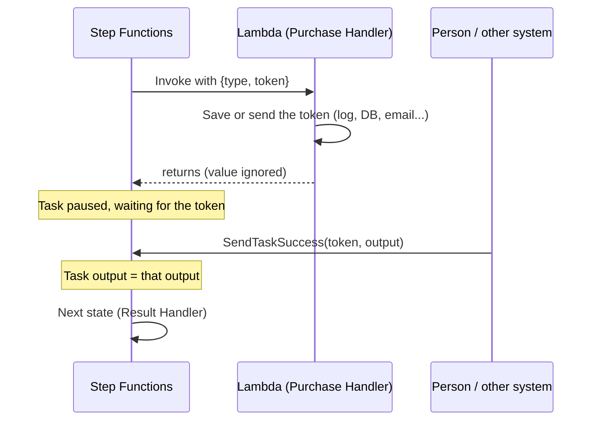
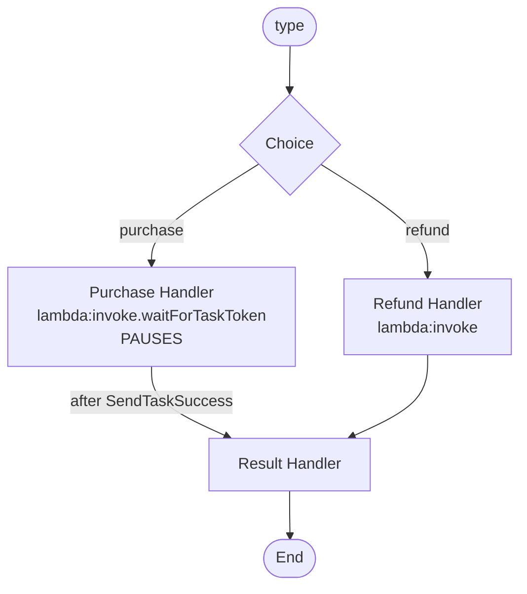
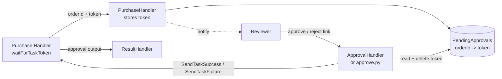

# Step Functions Callbacks with Lambda (Wait for Task Token): Study Notes

Source: [Step Function Callbacks with AWS Lambda | Console Tutorial (AWS Simplified)](https://youtu.be/Uacjxu_AJTI?list=PL9nWRykSBSFgQrO66TmO1vHFP6yuPF5G-), about 9 minutes.

The **Wait for callback** pattern (`.waitForTaskToken`) works like this:
- A Task hands a **task token** to someone else, then **pauses** the execution.
- The execution only continues when something calls `SendTaskSuccess` or `SendTaskFailure` with that token. That can be minutes or days later.
- Typical use: a person has to approve an order first.

The video adds it to the notes 13 workflow, Choice → Purchase Handler → Result Handler. It shows how to get the token into the Lambda function, and how to send it back from CloudShell. It also finds the pattern's biggest surprise: **the Lambda's return value is ignored**, so the next state gets whatever the **callback** sends.

The presenter calls the docs on this "absolutely terrible" and says it took two hours to figure out. These notes put it all in one place.

Earlier notes touched callbacks:
- Notes 03 section 9: an SQS worker that sends the token back.
- Notes 04 section 11: SNS.
- Notes 13 section 7: the Workflow Studio checkbox.
- Notes 14 section 6: a nested workflow.

Code marked **reconstructed** was rebuilt from what the video describes.

What was checked:
- The video's definition, an improved version with timeouts and catchers, and a JSONata version passed `ValidateStateMachineDefinition` (`OK`). The same definition as Express was rejected.
- The callback task was run through `TestState` with a mocked task token (via the Context object) and mocked callback results: success, a callback without the expected key, `OutputPath: $.Payload` on a callback task, a rejection, and a heartbeat timeout.
- The token-storing Lambda and an approver script were run locally against stubbed AWS clients (botocore `Stubber`).
- How Lambda behaves under a callback task comes from the current Lambda integration page.

---

## Contents

1. [Corrected terms](#1-corrected-terms)
2. [How the callback pattern works](#2-how-the-callback-pattern-works)
3. [The workflow](#3-the-workflow)
4. [Step 1: Turn on Wait for callback and pass the token](#4-step-1-turn-on-wait-for-callback-and-pass-the-token)
5. [Step 2: Find the token](#5-step-2-find-the-token)
6. [Step 3: Send the callback](#6-step-3-send-the-callback)
7. [The surprise: the Lambda's return value is ignored](#7-the-surprise-the-lambdas-return-value-is-ignored)
8. [The definition, tested](#8-the-definition-tested)
9. [Beyond the video: a real approval flow](#9-beyond-the-video-a-real-approval-flow)
10. [Same setup with the AWS CLI](#10-same-setup-with-the-aws-cli)
11. [Gotchas](#11-gotchas)
12. [What has changed since the video](#12-what-has-changed-since-the-video)
13. [Cheat sheet](#13-cheat-sheet)
14. [Review questions](#14-review-questions)

---

## 1. Corrected terms

| Caption says | Actually means |
|---|---|
| wafer callback | **Wait for callback** |
| centass success / sentas success | **SendTaskSuccess** |
| token dot star or pound | `"token.$"`: a key whose value is a path |
| dollar dollar dot task dot token | **`$$.Task.Token`** |
| lab to function | **Lambda** function |
| task dash output | The **`--task-output`** CLI option |
| big money | (excitement, not a term) |

---

## 2. How the callback pattern works



| Piece | Role |
|---|---|
| **Task token** | A long, unique string for **this** paused task. It encodes which execution and which task it belongs to. |
| `$$.Task.Token` | Where the token is found: the Context object, only inside a `.waitForTaskToken` task |
| `.waitForTaskToken` | Added to the Task's resource. It tells Step Functions to wait for a callback instead of the service's response. |
| `SendTaskSuccess(token, output)` | Resume the task successfully. `output` becomes the task's result. |
| `SendTaskFailure(token, error, cause)` | Fail the task with your own error name. A `Catch` can route it. |
| `SendTaskHeartbeat(token)` | "Still working on it": resets the task's heartbeat timer |

The video at 00:09: Lambda is just one way to hand out the token. SQS, SNS, a nested state machine, ECS and others support the same pattern.

---

## 3. The workflow

The same three functions as notes 13, with the purchase path waiting for a callback:



### The three functions (reconstructed)

Each is its own Lambda function (Python runtime, handler `lambda_function.lambda_handler`). They're the notes 13 functions, with one change to PurchaseHandler.

**PurchaseHandler.** It prints its event, which is how the video finds the token (section 5):

```python
def lambda_handler(event, context):
    # event = {"type": "purchase", "token": "<task token>"}, built by the state's Payload.
    # The video finds the token by reading this log line in CloudWatch Logs.
    print(event)
    # Ignored: with .waitForTaskToken the task's output comes from SendTaskSuccess, not from here.
    return {"result": "purchase_process_success"}
```

**RefundHandler.** Unchanged from notes 13. Its return value **is** used, because the refund state is a normal `lambda:invoke`:

```python
def lambda_handler(event, context):
    return {"result": "refund_process_success"}
```

**ResultHandler.** Unchanged from notes 13. It expects `{"result": "..."}`, which comes either from RefundHandler or from the purchase callback's output:

```python
def lambda_handler(event, context):
    # Expects {"result": "..."}: the refund's return value, or the purchase callback's output.
    step_function_result = event["result"]
    return {"body": step_function_result + "_result"}
```

Local runs:

| Call | Returns |
|---|---|
| PurchaseHandler with `{"type": "purchase", "token": "..."}` | `{"result": "purchase_process_success"}`, which Step Functions **discards** (section 7) |
| RefundHandler | `{"result": "refund_process_success"}` |
| ResultHandler with the refund's result | `{"body": "refund_process_success_result"}` |
| ResultHandler with the callback output `{"result": "purchase_process_success"}` | `{"body": "purchase_process_success_result"}` |

The last row only works if the callback sends `{"result": ...}`. That's the video's discovery in section 7.

Section 9 replaces PurchaseHandler and ResultHandler with production versions, and adds a fourth function for approval links.

---

## 4. Step 1: Turn on Wait for callback and pass the token

In Workflow Studio, select **Purchase Handler** (01:42):
1. Tick **Wait for callback**. The console shows a warning: the state won't continue until it gets a callback.
2. **Payload**: choose **Enter payload** and build the object yourself (01:59):

```json
{
  "type.$": "$.type",
  "token.$": "$$.Task.Token"
}
```

| Key | Value | Meaning |
|---|---|---|
| `type.$` | `$.type` | Pass `type` from the input (the video's app needs it) |
| `token.$` | `$$.Task.Token` | Pass the task token. The key name is up to you: "this can be anything" (02:14). |

`$$` is the **Context object** (notes 05 section 11). `$$.Task.Token` only exists in tasks with `.waitForTaskToken`. If you don't put the token in the payload, nobody can ever send it back, and the execution waits until it times out.

TestState, with a Context object supplying a sample token, shows the request:

```json
{"FunctionName": "...:function:PurchaseHandler:$LATEST",
 "Payload": {"type": "purchase", "token": "AQB4AAAA...example-token...=="}}
```

---

## 5. Step 2: Find the token

The video starts an execution with `{"type": "purchase"}` (03:02). The graph:
- **Choice** is green.
- **Purchase Handler** stays **in progress**. "It's not proceeding, and that's good."

The token isn't shown anywhere in the execution view (03:37). The video finds it in the **Lambda function's CloudWatch logs**, because PurchaseHandler prints its event (04:07; code in section 3). The log line looks like:

```
{'type': 'purchase', 'token': 'AQB4AAAA...'}
```

Printing the token is fine for a demo. In real systems, don't log tokens: anyone with the token and `states:SendTaskSuccess` permission can complete the task. Store it where only the approval process can read it (section 9).

---

## 6. Step 3: Send the callback

The video uses **CloudShell** (04:28):

```bash
aws stepfunctions send-task-success \
  --task-token "AQB4AAAA..." \
  --task-output '{"result": "purchase_process_success"}'
```

| Option | Meaning |
|---|---|
| `--task-token` | The token, in quotes. It's long. |
| `--task-output` | **Required**: the JSON the task will output. The video: "it must be a JSON object". |

There's no state machine or execution ARN in the call (07:34): "I guess it's embedded in this token". It is: the token identifies the execution and the task.

The other two calls:

```bash
aws stepfunctions send-task-failure --task-token "AQB4AAAA..." \
  --error Rejected --cause "Amount above approval limit"

aws stepfunctions send-task-heartbeat --task-token "AQB4AAAA..."
```

The caller (CloudShell's user here, a Lambda or service in real systems) needs IAM permission for `states:SendTaskSuccess`, `states:SendTaskFailure` and `states:SendTaskHeartbeat`.

---

## 7. The surprise: the Lambda's return value is ignored

### What the video saw

**First try** (04:53): `send-task-success` with some JSON object that wasn't the function's usual result.
- Purchase Handler turned green, but its output was **that JSON**, not the `{"result": ...}` the function had returned.
- The Result Handler expected `event["result"]` and **failed**.

**Second try** (07:59): the same call, with the function's usual result as `--task-output`:

```bash
--task-output '{"result": "purchase_process_success"}'
```

Everything succeeded. The Result Handler got `{"result": "purchase_process_success"}`.

### Why

With `.waitForTaskToken`, **the task's result is the callback's `output`**. The function's return value is discarded.

The video explains this as "it's an asynchronous invocation". That's not quite what happens. By default the function is invoked **normally** (synchronously), it runs to completion, and **its return value is simply not used**. The docs add one detail: for a callback task, the heartbeat timer only starts after the function has finished.

So the function's job in this pattern is to **hand off the token**: save it, send it, email it. Whatever must reach the next state goes into `SendTaskSuccess`'s `output`.

### Tested with TestState

Mocked callback output (the mock plays the role of `SendTaskSuccess`'s `output`):

| Callback output | Purchase Handler output | Next state |
|---|---|---|
| `{"result": "purchase_process_success"}` | `{"result": "purchase_process_success"}` | Result Handler, which works |
| `{"approved": true}` | `{"approved": true}` | Result Handler, which fails on `event["result"]`: the video's first try |

### Don't keep `OutputPath: $.Payload` on a callback task

Workflow Studio adds `"OutputPath": "$.Payload"` to normal Lambda tasks, because their result is wrapped (notes 13 section 5). A callback result **isn't** wrapped. TestState with `OutputPath: $.Payload` and a callback output of `{"result": "..."}`:

```
States.Runtime: Invalid path '$.Payload' : No results for path: $['Payload']
```

Remove `OutputPath`, or point it at a field your callback actually sends.

---

## 8. The definition, tested

Reconstructed, validated `OK`:

```json
{
  "Comment": "Purchase path waits for a callback before the result handler runs",
  "StartAt": "Choice",
  "States": {
    "Choice": {
      "Type": "Choice",
      "Choices": [
        { "Variable": "$.type", "StringEquals": "purchase", "Next": "Purchase Handler" },
        { "Variable": "$.type", "StringEquals": "refund", "Next": "Refund Handler" }
      ]
    },
    "Purchase Handler": {
      "Type": "Task",
      "Resource": "arn:aws:states:::lambda:invoke.waitForTaskToken",
      "Parameters": {
        "FunctionName": "arn:aws:lambda:us-east-1:123456789012:function:PurchaseHandler:$LATEST",
        "Payload": { "type.$": "$.type", "token.$": "$$.Task.Token" }
      },
      "Retry": [
        {
          "ErrorEquals": ["Lambda.ServiceException", "Lambda.AWSLambdaException",
                          "Lambda.SdkClientException", "Lambda.TooManyRequestsException"],
          "IntervalSeconds": 1, "MaxAttempts": 3, "BackoffRate": 2, "JitterStrategy": "FULL"
        }
      ],
      "Next": "Result Handler"
    },
    "Refund Handler": {
      "Type": "Task",
      "Resource": "arn:aws:states:::lambda:invoke",
      "OutputPath": "$.Payload",
      "Parameters": {
        "FunctionName": "arn:aws:lambda:us-east-1:123456789012:function:RefundHandler:$LATEST",
        "Payload.$": "$"
      },
      "Next": "Result Handler"
    },
    "Result Handler": {
      "Type": "Task",
      "Resource": "arn:aws:states:::lambda:invoke",
      "OutputPath": "$.Payload",
      "Parameters": {
        "FunctionName": "arn:aws:lambda:us-east-1:123456789012:function:ResultHandler:$LATEST",
        "Payload.$": "$"
      },
      "End": true
    }
  }
}
```

Compared with notes 13:
- Purchase Handler's resource ends in `.waitForTaskToken`.
- Its payload is built by hand, to include the token.
- It has no `OutputPath`.

The same definition as **Express** is rejected: "Express state machine does not support '.waitForTaskToken' service integration" (notes 09 section 6).

### JSONata (validated: `OK`)

```json
"Purchase Handler": {
  "Type": "Task",
  "Resource": "arn:aws:states:::lambda:invoke.waitForTaskToken",
  "Arguments": {
    "FunctionName": "arn:aws:lambda:us-east-1:123456789012:function:PurchaseHandler:$LATEST",
    "Payload": {
      "type": "",
      "token": ""
    }
  },
  "TimeoutSeconds": 86400,
  "End": true
}
```

---

## 9. Beyond the video: a real approval flow

The video copies the token out of a log by hand. A real approval flow:
1. **Stores** the token next to the order.
2. **Tells** a person (email, Slack, a web page).
3. Lets them **approve or reject**, which sends the callback.
4. **Gives up** if nobody answers.



| Function | Job | Section |
|---|---|---|
| PurchaseHandler | Store the token next to the order | below |
| ApprovalHandler | Behind an approve/reject link: look up the token, send the callback | below |
| `approve.py` | The same from a terminal, for testing or admins | below |
| RefundHandler | Unchanged (section 3) | |
| ResultHandler | Read the result from either path | below |

### The function that stores the token (tested locally)

```python
import json
import os

import boto3

dynamodb = boto3.client("dynamodb")
TABLE = os.environ.get("APPROVALS_TABLE", "PendingApprovals")


def lambda_handler(event, context):
    # event = {"type": ..., "orderId": ..., "token": <task token>} built by the state's Payload.
    print(json.dumps({k: v for k, v in event.items() if k != "token"}))  # don't log the token
    dynamodb.put_item(
        TableName=TABLE,
        Item={"orderId": {"S": event["orderId"]}, "taskToken": {"S": event["token"]}},
    )
    # The return value is ignored by a .waitForTaskToken task; the callback decides the output.
    return {"stored": True}
```

With a stubbed DynamoDB client:
- The function wrote `{"orderId": "o-7", "taskToken": ...}` to `PendingApprovals`.
- It logged only `{"type": "purchase", "orderId": "o-7"}`, without the token.

### The approver (tested locally)

```python
# /// script
# dependencies = ["boto3"]
# ///
"""Approve or reject a paused purchase by sending its task token back to Step Functions."""
import argparse
import json
import sys

import boto3
from botocore.exceptions import ClientError

sfn = boto3.client("stepfunctions")


def decide(token: str, approve: bool, reviewer: str) -> str:
    try:
        if approve:
            sfn.send_task_success(
                taskToken=token,
                output=json.dumps({"result": "purchase_process_success", "approvedBy": reviewer}),
            )
            return "approved"
        sfn.send_task_failure(taskToken=token, error="Rejected", cause=f"Rejected by {reviewer}")
        return "rejected"
    except (sfn.exceptions.TaskTimedOut, sfn.exceptions.TaskDoesNotExist):
        return "too late: the task already timed out or the execution ended"
    except sfn.exceptions.InvalidToken:
        return "invalid token"


def main() -> int:
    parser = argparse.ArgumentParser()
    parser.add_argument("token")
    parser.add_argument("--reject", action="store_true")
    parser.add_argument("--reviewer", default="reviewer")
    args = parser.parse_args()
    try:
        print(decide(args.token, not args.reject, args.reviewer))
        return 0
    except ClientError as e:
        print(f"Error: {e}", file=sys.stderr)
        return 1


if __name__ == "__main__":
    sys.exit(main())
```

Run it with `uv run approve.py "<token>" --reviewer alice`, or add `--reject`. Stubbed runs:

| Situation | Stubbed response | Prints |
|---|---|---|
| Approve | `SendTaskSuccess` OK | `approved` |
| Reject | `SendTaskFailure` OK, with error `Rejected` | `rejected` |
| Task already timed out or completed | `TaskTimedOut` | `too late: ...` |
| Garbled token | `InvalidToken` | `invalid token` |

`TaskTimedOut` is also what you get when a token is **used twice**: once a task is closed, its token is dead.

### The approval link handler (tested locally)

A reviewer gets two links, for example `.../?orderId=o-7&decision=approve` and `...&decision=reject`. The links carry only the **order ID**, never the token. This function sits behind them (a Lambda function URL or API Gateway), looks the token up, and sends the callback.

```python
import json
import os

import boto3

dynamodb = boto3.client("dynamodb")
sfn = boto3.client("stepfunctions")
TABLE = os.environ.get("APPROVALS_TABLE", "PendingApprovals")
PAST_TENSE = {"approve": "approved", "reject": "rejected"}


def respond(status, message):
    return {
        "statusCode": status,
        "headers": {"Content-Type": "application/json"},
        "body": json.dumps({"message": message}),
    }


def reviewer_of(event):
    # With IAM auth (function URL or API Gateway), the caller's identity is here.
    # Never take the reviewer's name from the query string: anyone could type any name.
    iam = event.get("requestContext", {}).get("authorizer", {}).get("iam") or {}
    return iam.get("userArn")


def lambda_handler(event, context):
    params = event.get("queryStringParameters") or {}
    order_id = params.get("orderId")
    decision = params.get("decision")
    if not order_id or decision not in PAST_TENSE:
        return respond(400, "Need orderId and decision=approve|reject")
    reviewer = reviewer_of(event)
    if reviewer is None:
        return respond(401, "Call this URL with IAM (SigV4) credentials")

    key = {"orderId": {"S": order_id}}
    item = dynamodb.get_item(TableName=TABLE, Key=key).get("Item")
    if item is None:
        return respond(404, f"No pending approval for order {order_id}")
    token = item["taskToken"]["S"]

    try:
        if decision == "approve":
            sfn.send_task_success(
                taskToken=token,
                output=json.dumps({"result": "purchase_process_success", "approvedBy": reviewer}),
            )
        else:
            sfn.send_task_failure(taskToken=token, error="Rejected", cause=f"Rejected by {reviewer}")
    except (sfn.exceptions.TaskTimedOut, sfn.exceptions.TaskDoesNotExist):
        dynamodb.delete_item(TableName=TABLE, Key=key)  # the token is dead; tidy up
        return respond(409, f"Too late: order {order_id} was already decided, timed out, or its execution ended")
    except sfn.exceptions.InvalidToken:
        return respond(500, f"The stored token for order {order_id} is not valid")

    dynamodb.delete_item(TableName=TABLE, Key=key)  # one decision per order
    return respond(200, f"Order {order_id} {PAST_TENSE[decision]}")
```

| Design choice | Why |
|---|---|
| Link carries the order ID, not the token | Tokens are secrets (section 5); order IDs are harmless |
| Reviewer comes from the **IAM identity**, not the query string | A query parameter could claim to be anyone. `approvedBy` should be trustworthy. |
| Unsigned call → 401, before touching DynamoDB | No identity, no decision |
| Token deleted after the decision | One decision per order; a second click gets 404 |
| `TaskTimedOut` / `TaskDoesNotExist` → 409, token deleted | Clicking after the 24-hour timeout, or after the execution ended, gets a clear answer |
| Callback `output` is `{"result": ..., "approvedBy": ...}` | Exactly what ResultHandler needs (below) |

Local runs, with stubbed DynamoDB and Step Functions clients. A signed-in caller is simulated with `requestContext.authorizer.iam.userArn`:

| Request | Calls made | Response |
|---|---|---|
| `orderId=o-7&decision=approve` | GetItem, `SendTaskSuccess` (with `approvedBy` = the caller's ARN), DeleteItem | 200 `Order o-7 approved` |
| `orderId=o-7&decision=reject` | GetItem, `SendTaskFailure` (error `Rejected`), DeleteItem | 200 `Order o-7 rejected` |
| `orderId=o-404&decision=approve` | GetItem (no item) | 404 `No pending approval for order o-404` |
| Approve after the timeout | GetItem, `SendTaskSuccess` → `TaskTimedOut`, DeleteItem | 409 `Too late: ...` |
| A corrupted stored token | GetItem, `SendTaskSuccess` → `InvalidToken` | 500 `The stored token ... is not valid` |
| `decision=maybe`, or no `orderId` | none | 400 `Need orderId and decision=approve\|reject` |
| No IAM identity (unsigned request) | none | 401 `Call this URL with IAM (SigV4) credentials` |

**Protect the link.** Never expose this function without authentication: anyone with the URL could approve purchases.
- With a Lambda **function URL**, use auth type `AWS_IAM` (section 10). Callers must sign requests, and their IAM identity becomes `approvedBy`.
- With **API Gateway**, put an IAM or Cognito authorizer in front. With Cognito, read the identity from the authorizer's claims instead of `iam.userArn`.

### The full definition, hardened (validated: `OK`)

```json
{
  "Comment": "Purchases wait for a human approval; refunds go straight through",
  "StartAt": "Choice",
  "States": {
    "Choice": {
      "Type": "Choice",
      "Choices": [
        { "Variable": "$.type", "StringEquals": "purchase", "Next": "Purchase Handler" },
        { "Variable": "$.type", "StringEquals": "refund", "Next": "Refund Handler" }
      ],
      "Default": "Unknown type"
    },
    "Purchase Handler": {
      "Type": "Task",
      "Resource": "arn:aws:states:::lambda:invoke.waitForTaskToken",
      "Parameters": {
        "FunctionName": "arn:aws:lambda:us-east-1:123456789012:function:PurchaseHandler:$LATEST",
        "Payload": { "type.$": "$.type", "orderId.$": "$.orderId", "token.$": "$$.Task.Token" }
      },
      "TimeoutSeconds": 86400,
      "ResultPath": "$.approval",
      "Retry": [
        {
          "ErrorEquals": ["Lambda.ServiceException", "Lambda.AWSLambdaException",
                          "Lambda.SdkClientException", "Lambda.TooManyRequestsException"],
          "IntervalSeconds": 1, "MaxAttempts": 3, "BackoffRate": 2, "JitterStrategy": "FULL"
        }
      ],
      "Catch": [
        { "ErrorEquals": ["Rejected"], "ResultPath": "$.error", "Next": "Purchase rejected" },
        { "ErrorEquals": ["States.Timeout"], "ResultPath": "$.error", "Next": "No decision in time" }
      ],
      "Next": "Result Handler"
    },
    "Refund Handler": {
      "Type": "Task",
      "Resource": "arn:aws:states:::lambda:invoke",
      "Parameters": {
        "FunctionName": "arn:aws:lambda:us-east-1:123456789012:function:RefundHandler:$LATEST",
        "Payload.$": "$"
      },
      "ResultSelector": { "result.$": "$.Payload.result" },
      "ResultPath": "$.refund",
      "Retry": [
        {
          "ErrorEquals": ["Lambda.ServiceException", "Lambda.AWSLambdaException",
                          "Lambda.SdkClientException", "Lambda.TooManyRequestsException"],
          "IntervalSeconds": 1, "MaxAttempts": 3, "BackoffRate": 2, "JitterStrategy": "FULL"
        }
      ],
      "Next": "Result Handler"
    },
    "Result Handler": {
      "Type": "Task",
      "Resource": "arn:aws:states:::lambda:invoke",
      "OutputPath": "$.Payload",
      "Parameters": {
        "FunctionName": "arn:aws:lambda:us-east-1:123456789012:function:ResultHandler:$LATEST",
        "Payload.$": "$"
      },
      "Retry": [
        {
          "ErrorEquals": ["Lambda.ServiceException", "Lambda.AWSLambdaException",
                          "Lambda.SdkClientException", "Lambda.TooManyRequestsException"],
          "IntervalSeconds": 1, "MaxAttempts": 3, "BackoffRate": 2, "JitterStrategy": "FULL"
        }
      ],
      "End": true
    },
    "Purchase rejected": { "Type": "Fail", "Error": "PurchaseRejected", "CausePath": "$.error.Cause" },
    "No decision in time": {
      "Type": "Fail",
      "Error": "ApprovalTimedOut",
      "Cause": "Nobody approved or rejected the purchase within 24 hours"
    },
    "Unknown type": { "Type": "Fail", "Error": "UnknownType", "Cause": "type must be purchase or refund" }
  }
}
```

| Change from section 8 | Why |
|---|---|
| `orderId` in the purchase payload | PurchaseHandler stores the token under the order ID |
| `TimeoutSeconds: 86400` | Without it, the task can wait for the execution's full lifetime (a year, for Standard). Here: give up after a day. |
| **No `HeartbeatSeconds`** | Heartbeats are for workers that report progress while they work. A person approving never calls `SendTaskHeartbeat`, so `HeartbeatSeconds: 3600` would fail every approval that takes longer than an hour with `States.HeartbeatTimeout`, even though the overall timeout is 24 hours. |
| `ResultPath: "$.approval"` | Keep the order's input, and add the callback output next to it |
| Refund: `ResultSelector` + `ResultPath: "$.refund"` | Both paths now keep `orderId` and put their result under a named key |
| `Catch` `Rejected` → `Purchase rejected` | `SendTaskFailure` with error `Rejected` becomes a clear failure, with the reviewer in the cause |
| `Catch` `States.Timeout` → `No decision in time` | No answer in 24 hours is handled, not just an execution that ends red |
| `Default` → `Unknown type` | Any other `type` fails with a clear error instead of a routing error |

TestState results:

| State | Input / mocked result | Status | Next | Output |
|---|---|---|---|---|
| Choice | `"type": "exchange"` | `SUCCEEDED` | Unknown type | |
| Purchase Handler | callback `{"result": "purchase_process_success", "approvedBy": "arn:...:user/alice"}` | `SUCCEEDED` | Result Handler | the order + `"approval": {...}` |
| Purchase Handler | `SendTaskFailure` `Rejected`, cause "Rejected by arn:...:user/bob" | `CAUGHT_ERROR` | Purchase rejected | the order + `error` |
| Purchase Handler | `States.Timeout` | `CAUGHT_ERROR` | No decision in time | the order + `error` |
| Refund Handler | `Payload: {"result": "refund_process_success"}` | `SUCCEEDED` | Result Handler | `{"type": "refund", "orderId": "o-8", "refund": {"result": "refund_process_success"}}` |
| Result Handler | the approved order | `SUCCEEDED` | (end) | request `Payload` is the whole order with `approval` |
| Purchase rejected | the order + `error` | `FAILED` | | error `PurchaseRejected`, cause "Rejected by arn:...:user/bob" |

### The result handler for both paths (tested locally)

With the hardened definition, ResultHandler no longer gets a bare `{"result": ...}`. Approved purchases bring `approval`, and refunds bring `refund`:

```python
def lambda_handler(event, context):
    # Approved purchases arrive with the callback output under "approval" (ResultPath $.approval).
    # Refunds arrive with RefundHandler's result under "refund" (ResultPath $.refund).
    outcome = event.get("approval") or event.get("refund")
    if outcome is None:
        raise ValueError("expected an 'approval' or 'refund' result in the input")
    return {
        "orderId": event.get("orderId"),
        "type": event.get("type"),
        "body": outcome["result"] + "_result",
    }
```

Local runs:

| Input | Returns |
|---|---|
| `{"type": "purchase", "orderId": "o-7", "approval": {"result": "purchase_process_success", ...}}` | `{"orderId": "o-7", "type": "purchase", "body": "purchase_process_success_result"}` |
| `{"type": "refund", "orderId": "o-8", "refund": {"result": "refund_process_success"}}` | `{"orderId": "o-8", "type": "refund", "body": "refund_process_success_result"}` |
| Neither key | Raises `ValueError`, so the execution fails visibly instead of producing a bad result |

---

## 10. Same setup with the AWS CLI

This builds the section 9 version from scratch: the table, four functions, their roles, the state machine, and three runs (approve, refund, reject). Put these files in one folder:

| File | Contents |
|---|---|
| `purchase_handler.py` | PurchaseHandler that stores the token (section 9) |
| `refund_handler.py` | RefundHandler (section 3) |
| `result_handler.py` | ResultHandler for both paths (section 9) |
| `approval_handler.py` | ApprovalHandler (section 9) |
| `state-machine.json` | The full hardened definition (section 9). Its `123456789012` is replaced with your account ID below. |
| `approve.py` | Optional terminal approver (section 9) |

| Role | Used by | Allows |
|---|---|---|
| `CallbackBasicRole` | RefundHandler, ResultHandler | CloudWatch Logs only |
| `CallbackPurchaseRole` | PurchaseHandler | Logs + `dynamodb:PutItem` on the table |
| `CallbackApprovalRole` | ApprovalHandler | Logs + `dynamodb:GetItem`/`DeleteItem` on the table + `states:SendTaskSuccess`/`SendTaskFailure` on this state machine |
| `CallbackDemoRole` | The state machine | `lambda:InvokeFunction` on the three functions it calls |

ApprovalHandler isn't in the state machine at all. It's called from outside, by the reviewer's link, so the state machine's role doesn't need to invoke it.

```bash
ACCOUNT_ID=$(aws sts get-caller-identity --query Account --output text)
REGION=us-east-1
SM_NAME=CallbackDemo
SM_ARN_EXPECTED="arn:aws:states:${REGION}:${ACCOUNT_ID}:stateMachine:${SM_NAME}"

# --- 1. Table for pending tokens ---
aws dynamodb create-table --table-name PendingApprovals \
  --attribute-definitions AttributeName=orderId,AttributeType=S \
  --key-schema AttributeName=orderId,KeyType=HASH --billing-mode PAY_PER_REQUEST
aws dynamodb wait table-exists --table-name PendingApprovals
TABLE_ARN="arn:aws:dynamodb:${REGION}:${ACCOUNT_ID}:table/PendingApprovals"

# --- 2. Lambda roles: logs for all, plus exactly what each function calls ---
cat > lambda-trust.json <<'EOF'
{"Version": "2012-10-17", "Statement": [{"Effect": "Allow",
  "Principal": {"Service": "lambda.amazonaws.com"}, "Action": "sts:AssumeRole"}]}
EOF
for ROLE in CallbackBasicRole CallbackPurchaseRole CallbackApprovalRole; do
  aws iam create-role --role-name "$ROLE" --assume-role-policy-document file://lambda-trust.json >/dev/null
  aws iam attach-role-policy --role-name "$ROLE" \
    --policy-arn arn:aws:iam::aws:policy/service-role/AWSLambdaBasicExecutionRole
done
aws iam put-role-policy --role-name CallbackPurchaseRole --policy-name StoreToken --policy-document "{
  \"Version\": \"2012-10-17\",
  \"Statement\": [{\"Effect\": \"Allow\", \"Action\": \"dynamodb:PutItem\", \"Resource\": \"$TABLE_ARN\"}]}"
aws iam put-role-policy --role-name CallbackApprovalRole --policy-name DecideApproval --policy-document "{
  \"Version\": \"2012-10-17\",
  \"Statement\": [
    {\"Effect\": \"Allow\", \"Action\": [\"dynamodb:GetItem\", \"dynamodb:DeleteItem\"], \"Resource\": \"$TABLE_ARN\"},
    {\"Effect\": \"Allow\", \"Action\": [\"states:SendTaskSuccess\", \"states:SendTaskFailure\"], \"Resource\": \"$SM_ARN_EXPECTED\"}]}"

# --- 3. The four functions (each zip holds lambda_function.py) ---
deploy() {  # deploy <FunctionName> <source file> <RoleName>
  cp "$2" lambda_function.py && zip -q "$1.zip" lambda_function.py && rm lambda_function.py
  aws lambda create-function --function-name "$1" --runtime python3.13 \
    --handler lambda_function.lambda_handler --zip-file "fileb://$1.zip" \
    --role "arn:aws:iam::${ACCOUNT_ID}:role/$3" \
    --environment "Variables={APPROVALS_TABLE=PendingApprovals}" >/dev/null
}
sleep 10   # new roles take a few seconds before Lambda can use them
deploy PurchaseHandler purchase_handler.py CallbackPurchaseRole
deploy RefundHandler   refund_handler.py   CallbackBasicRole
deploy ResultHandler   result_handler.py   CallbackBasicRole
deploy ApprovalHandler approval_handler.py CallbackApprovalRole

# --- 4. State machine role and state machine ---
cat > sfn-trust.json <<EOF
{"Version": "2012-10-17", "Statement": [{"Effect": "Allow",
  "Principal": {"Service": "states.amazonaws.com"}, "Action": "sts:AssumeRole",
  "Condition": {"StringEquals": {"aws:SourceAccount": "$ACCOUNT_ID"}}}]}
EOF
aws iam create-role --role-name CallbackDemoRole --assume-role-policy-document file://sfn-trust.json >/dev/null
FN="arn:aws:lambda:${REGION}:${ACCOUNT_ID}:function"
aws iam put-role-policy --role-name CallbackDemoRole --policy-name InvokeHandlers --policy-document "{
  \"Version\": \"2012-10-17\",
  \"Statement\": [{\"Effect\": \"Allow\", \"Action\": \"lambda:InvokeFunction\", \"Resource\": [
    \"$FN:PurchaseHandler\", \"$FN:PurchaseHandler:*\",
    \"$FN:RefundHandler\", \"$FN:RefundHandler:*\",
    \"$FN:ResultHandler\", \"$FN:ResultHandler:*\"]}]}"
sed "s/123456789012/${ACCOUNT_ID}/g" state-machine.json > state-machine.deploy.json
sleep 10
SM_ARN=$(aws stepfunctions create-state-machine --name "$SM_NAME" \
  --definition file://state-machine.deploy.json \
  --role-arn "arn:aws:iam::${ACCOUNT_ID}:role/CallbackDemoRole" \
  --query stateMachineArn --output text)

# --- 5a. A purchase: pauses until approved ---
EXEC=$(aws stepfunctions start-execution --state-machine-arn "$SM_ARN" \
  --input '{"type": "purchase", "orderId": "o-7"}' --query executionArn --output text)
sleep 5
aws stepfunctions describe-execution --execution-arn "$EXEC" --query status              # "RUNNING"
aws dynamodb get-item --table-name PendingApprovals \
  --key '{"orderId": {"S": "o-7"}}' --query 'Item.orderId.S'                             # token is stored

# Approve by invoking ApprovalHandler the way a signed link would
# (the requestContext block is what a function URL with IAM auth fills in for you)
ME=$(aws sts get-caller-identity --query Arn --output text)
aws lambda invoke --function-name ApprovalHandler --cli-binary-format raw-in-base64-out \
  --payload "{\"queryStringParameters\": {\"orderId\": \"o-7\", \"decision\": \"approve\"},
              \"requestContext\": {\"authorizer\": {\"iam\": {\"userArn\": \"$ME\"}}}}" \
  approval.json >/dev/null && cat approval.json                                           # 200 "Order o-7 approved"
aws stepfunctions describe-execution --execution-arn "$EXEC" --query '{status: status, output: output}'
# SUCCEEDED, output {"orderId": "o-7", "type": "purchase", "body": "purchase_process_success_result"}

# --- 5b. A refund: no pause ---
EXEC=$(aws stepfunctions start-execution --state-machine-arn "$SM_ARN" \
  --input '{"type": "refund", "orderId": "o-8"}' --query executionArn --output text)
sleep 3
aws stepfunctions describe-execution --execution-arn "$EXEC" --query '{status: status, output: output}'

# --- 5c. A rejection, through a real signed link (function URL with IAM auth) ---
URL=$(aws lambda create-function-url-config --function-name ApprovalHandler \
  --auth-type AWS_IAM --query FunctionUrl --output text)
EXEC=$(aws stepfunctions start-execution --state-machine-arn "$SM_ARN" \
  --input '{"type": "purchase", "orderId": "o-9"}' --query executionArn --output text)
sleep 5
eval "$(aws configure export-credentials --format env)"   # your credentials as env vars, for curl
curl --aws-sigv4 "aws:amz:${REGION}:lambda" --user "$AWS_ACCESS_KEY_ID:$AWS_SECRET_ACCESS_KEY" \
  -H "x-amz-security-token: $AWS_SESSION_TOKEN" "${URL}?orderId=o-9&decision=reject"
aws stepfunctions describe-execution --execution-arn "$EXEC" --query '{status: status, error: error, cause: cause}'
# FAILED, error PurchaseRejected, cause "Rejected by arn:aws:...:<you>"

# --- 6. Clean up ---
aws lambda delete-function-url-config --function-name ApprovalHandler
for F in PurchaseHandler RefundHandler ResultHandler ApprovalHandler; do
  aws lambda delete-function --function-name "$F"
  aws logs delete-log-group --log-group-name "/aws/lambda/$F" 2>/dev/null   # only exists if it ran
done
aws stepfunctions delete-state-machine --state-machine-arn "$SM_ARN"
aws iam delete-role-policy --role-name CallbackDemoRole --policy-name InvokeHandlers
aws iam delete-role --role-name CallbackDemoRole
aws iam delete-role-policy --role-name CallbackPurchaseRole --policy-name StoreToken
aws iam delete-role-policy --role-name CallbackApprovalRole --policy-name DecideApproval
for ROLE in CallbackBasicRole CallbackPurchaseRole CallbackApprovalRole; do
  aws iam detach-role-policy --role-name "$ROLE" \
    --policy-arn arn:aws:iam::aws:policy/service-role/AWSLambdaBasicExecutionRole
  aws iam delete-role --role-name "$ROLE"
done
aws dynamodb delete-table --table-name PendingApprovals
```

Notes on the steps:
- **5a vs 5c.** 5a invokes ApprovalHandler directly with a hand-made `requestContext`. That's convenient for testing, but it means you could type any identity, which is only acceptable because invoking the function needs `lambda:InvokeFunction` in the first place. 5c is the real thing: the function URL checks the SigV4 signature and fills in `requestContext.authorizer.iam` itself.
- **The function URL** uses auth type `AWS_IAM`, so unsigned requests are refused before the function runs. Your IAM identity needs `lambda:InvokeFunctionUrl` on the function; an administrator already has it.
- **`x-amz-security-token`** is needed when your credentials are temporary (SSO, assumed roles). `aws configure export-credentials` needs AWS CLI v2.9 or newer, and `--aws-sigv4` needs curl 7.75 or newer.
- **`approve.py`** works too, if you'd rather paste a token: `uv run approve.py "$(aws dynamodb get-item --table-name PendingApprovals --key '{"orderId": {"S": "o-7"}}' --query 'Item.taskToken.S' --output text)"`.
- **The history** of a paused execution shows `TaskSubmitted`. That event comes **after** PurchaseHandler has run; the task then waits. `TaskSucceeded` (or `TaskFailed`) appears only after the callback.

---

## 11. Gotchas

1. **The function's return value is ignored.** The next state gets the callback's `output`.
2. **Put `$$.Task.Token` in the payload**, or nobody can resume the task.
3. **No `OutputPath: $.Payload`** on a callback task: the callback output isn't wrapped (`Invalid path '$.Payload'`).
4. **Always set `TimeoutSeconds`.** A lost token otherwise keeps the execution waiting for up to a year.
5. **`HeartbeatSeconds` needs heartbeats.** Only use it if the worker calls `SendTaskHeartbeat`. A person approving never does, so a heartbeat limit fails human approvals early (section 9). For callback tasks, the heartbeat timer starts after the Lambda function finishes.
6. **Tokens are secrets.** Don't log them, and don't put them in links or emails.
7. **A token works once.** After success, failure or timeout, it returns `TaskTimedOut`.
8. **`--task-output` must be valid JSON**, and must have the shape the next state expects.
9. **`SendTaskFailure`'s `error` is your error name.** Catch it by name (`"Rejected"`), not just `States.ALL`.
10. **Express doesn't support callbacks.**
11. **The console doesn't show the token.** Get it from wherever your code put it.
12. **The caller needs `states:SendTaskSuccess` / `SendTaskFailure` / `SendTaskHeartbeat` permission.**
13. **Billing (Standard).** Waiting costs nothing extra, but the open execution counts toward the account's open-execution quota.

---

## 12. What has changed since the video

| Then (video) | Now |
|---|---|
| Payload built with `.$` keys and `$$.Task.Token` | Same in JSONPath. In JSONata: `` (section 8). |
| Token found by printing it to logs | Same idea, but store it somewhere private (section 9) |
| Docs "absolutely terrible" | The Lambda integration page now explains that the heartbeat timer starts after the function finishes, and the callback pattern is documented per service |
| Test by running and pasting tokens | **TestState** with a mocked callback result and a Context object for the token |
| A timed-out approval meant starting over | **Redrive** can resume a failed Standard execution from the failed state (notes 18) |

---

## 13. Cheat sheet

```
Resource        : arn:aws:states:::lambda:invoke.waitForTaskToken   (also sqs:sendMessage, sns:publish,
                  states:startExecution, ecs:runTask, ... + .waitForTaskToken)
Token           : "token.$": "$$.Task.Token"        JSONata: ""
Resume          : aws stepfunctions send-task-success --task-token T --task-output '{"result": "..."}'
Fail            : aws stepfunctions send-task-failure --task-token T --error Rejected --cause "..."
Keep alive      : aws stepfunctions send-task-heartbeat --task-token T
boto3           : sfn.send_task_success(taskToken=T, output=json.dumps({...}))
Task output     : = callback output (function return value ignored; no Payload wrapper)
Timeouts        : TimeoutSeconds (total), HeartbeatSeconds (between heartbeats)
                  -> States.Timeout / States.HeartbeatTimeout
Late/used token : TaskTimedOut;  bad token: InvalidToken;  ended execution: TaskDoesNotExist
Not in Express  : "Express state machine does not support '.waitForTaskToken'"
History         : TaskSubmitted (paused) ... TaskSucceeded (after callback)
Human approval  : TimeoutSeconds yes, HeartbeatSeconds no (people don't send heartbeats)

Functions and their input
  PurchaseHandler : {"type", "orderId", "token"}  -> store token; return value ignored
  ApprovalHandler : link ?orderId=..&decision=approve|reject, caller identity from IAM auth
                    -> look up token, SendTaskSuccess/Failure, delete token
  RefundHandler   : normal lambda:invoke; its return value IS used
  ResultHandler   : {"approval": {...}} for purchases, {"refund": {...}} for refunds
IAM             : PurchaseHandler dynamodb:PutItem; ApprovalHandler dynamodb:GetItem/DeleteItem
                  + states:SendTaskSuccess/SendTaskFailure on the state machine ARN
```

---

## 14. Review questions

<details>
<summary>1. How does the Lambda function get the task token?</summary>

You pass it in the payload, from the Context object: `"token.$": "$$.Task.Token"` (JSONata: `$states.context.Task.Token`). The key name can be anything; the function reads it from its event.
</details>

<details>
<summary>2. The Purchase Handler function returns <code>{"result": "purchase_process_success"}</code>, but the next state receives something else. Why?</summary>

With `.waitForTaskToken`, the function's return value is ignored. The task's result is the `output` sent with `SendTaskSuccess`. Send the data the next state needs in that output.
</details>

<details>
<summary>3. The video says the Lambda is invoked asynchronously. What actually happens?</summary>

The function is invoked normally and runs to completion; its return value just isn't used. The task then waits for the callback. For callback tasks, the heartbeat timer starts only after the function finishes.
</details>

<details>
<summary>4. Why doesn't <code>send-task-success</code> need the state machine or execution ARN?</summary>

The task token identifies the execution and the task. The token alone is enough.
</details>

<details>
<summary>5. A callback task has <code>"OutputPath": "$.Payload"</code>. What happens when the callback arrives?</summary>

It fails with `States.Runtime` ("Invalid path '$.Payload'"), because callback output isn't wrapped in `Payload` like a normal Lambda result. Remove the `OutputPath`, or point it at a field the callback sends.
</details>

<details>
<summary>6. Nobody ever sends the callback. What happens, and how do you prevent it?</summary>

The task waits for the execution's whole lifetime (up to a year in Standard). Set `TimeoutSeconds` on the task, and catch `States.Timeout`, so it gives up and takes a defined path.
</details>

<details>
<summary>7. What's the difference between <code>TimeoutSeconds</code> and <code>HeartbeatSeconds</code>?</summary>

`TimeoutSeconds` is the total time the task may take. `HeartbeatSeconds` is the longest gap allowed between `SendTaskHeartbeat` calls; it's for workers that report progress. Each raises its own error: `States.Timeout` and `States.HeartbeatTimeout`.
</details>

<details>
<summary>8. How do you send a rejection that the state machine can handle specifically?</summary>

`SendTaskFailure` with your own error name, for example `--error Rejected --cause "..."`. Then catch it with `"ErrorEquals": ["Rejected"]`.
</details>

<details>
<summary>9. An approver clicks "approve" twice. What happens the second time?</summary>

The task is already closed, so the second `SendTaskSuccess` fails with `TaskTimedOut`. Handle that error as "already decided".
</details>

<details>
<summary>10. Why shouldn't you log task tokens or put them in approval links?</summary>

Anyone who has the token, and permission to call `SendTaskSuccess`, can complete or fail the task. Keep tokens server-side, for example in a table keyed by order ID.
</details>

<details>
<summary>11. Can an Express workflow use the callback pattern?</summary>

No. Validation fails with "Express state machine does not support '.waitForTaskToken' service integration".
</details>

<details>
<summary>12. Name three services besides Lambda that support <code>.waitForTaskToken</code>.</summary>

Any three of: SQS (`sqs:sendMessage`), SNS (`sns:publish`), nested Step Functions (`states:startExecution`), ECS/Fargate (`ecs:runTask`), EventBridge (`events:putEvents`), and others.
</details>

<details>
<summary>13. A human-approval task has <code>TimeoutSeconds: 86400</code> and <code>HeartbeatSeconds: 3600</code>. The reviewer approves after 3 hours. What happens?</summary>

The task already failed after 1 hour with `States.HeartbeatTimeout`, because a person never calls `SendTaskHeartbeat`. The late approval gets `TaskTimedOut`. Drop `HeartbeatSeconds` for human steps and rely on `TimeoutSeconds`.
</details>

<details>
<summary>14. Why does the approval link carry the order ID and not the task token, and where does <code>approvedBy</code> come from?</summary>

Tokens are secrets: whoever has one (and permission) can complete the task, and links end up in emails, browser history and logs. The order ID is harmless; ApprovalHandler looks the token up server-side. `approvedBy` comes from the caller's IAM identity, which the function URL or API Gateway fills in after checking the signature. A query parameter could claim to be anyone.
</details>
