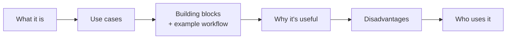
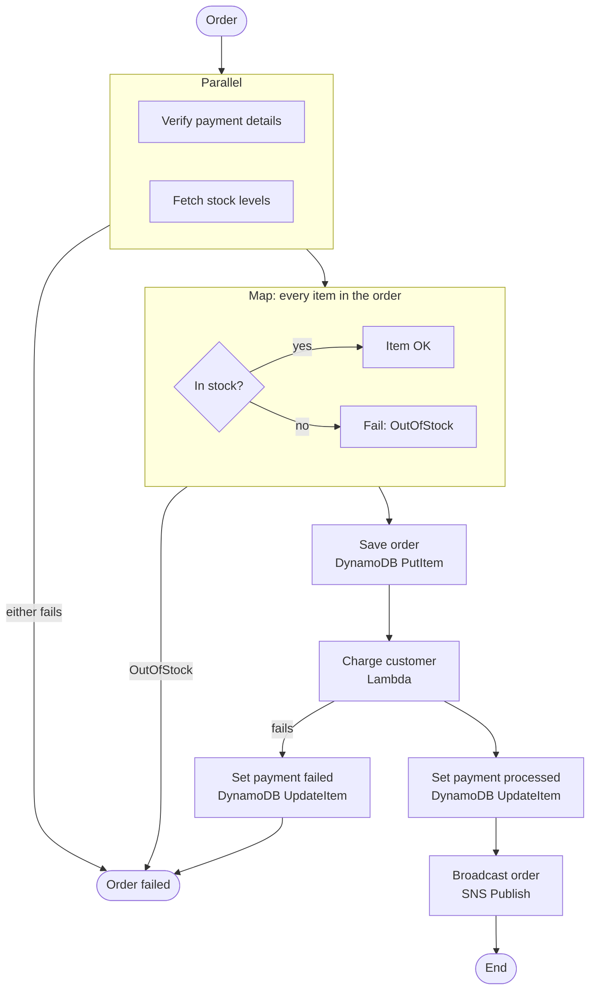

# AWS Step Functions Introduction (Course Lesson): Study Notes

Source: [AWS Step Functions Introduction - What is it and Why is it Useful? (AWS Simplified)](https://youtu.be/QXh2WF1EJvs?list=PL9nWRykSBSFgQrO66TmO1vHFP6yuPF5G-), about 19 minutes. It's the first lesson of the presenter's "AWS Step Functions Masterclass" course.

A slide-based overview:
- what Step Functions is;
- what it's used for, and its main building blocks;
- an order-processing workflow the course builds later;
- the advantages, the **disadvantages**, and which companies use it.

### How this relates to notes 01

[Notes 01](01_AWS_Step_Functions_Overview_Study_Notes.md) covers an older overview video: the basic vocabulary, five benefits, pricing, and a credit card example in ASL. These notes don't repeat that. They focus on what this lesson adds:

| New in this lesson | Section |
|---|---|
| "Orchestration with centralized state", explained | 3 |
| Use cases: microservices, big data, ML, human review | 5 |
| A full order workflow: Parallel, Map, Choice, DynamoDB, Lambda, SNS (rebuilt and tested here) | 7 |
| **Disadvantages** and when not to use Step Functions | 9 |
| Who uses it | 10 |
| Today's alternatives (not in the video) | 11 |

What was checked:
- The order workflow was rebuilt from the slide description. It passed `ValidateStateMachineDefinition` (`OK`), and its Parallel, Choice, Map and Catch paths were run through `TestState` with mocked results.
- Service-integration counts and the comparison with Lambda durable functions come from current AWS docs.
- The company examples are the presenter's; they weren't checked independently.

---

## Contents

1. [Corrected terms](#1-corrected-terms)
2. [Lesson map](#2-lesson-map)
3. [What Step Functions is](#3-what-step-functions-is)
4. [What sets it apart](#4-what-sets-it-apart)
5. [Use cases](#5-use-cases)
6. [The building blocks the lesson highlights](#6-the-building-blocks-the-lesson-highlights)
7. [The course's order-processing workflow](#7-the-courses-order-processing-workflow)
8. [Why people like it](#8-why-people-like-it)
9. [Disadvantages, and when not to use it](#9-disadvantages-and-when-not-to-use-it)
10. [Who uses it](#10-who-uses-it)
11. [Beyond the video: the alternatives today](#11-beyond-the-video-the-alternatives-today)
12. [Common misconceptions](#12-common-misconceptions)
13. [What has changed since the video](#13-what-has-changed-since-the-video)
14. [Cheat sheet](#14-cheat-sheet)
15. [Review questions](#15-review-questions)

---

## 1. Corrected terms

| Caption says | Actually means |
|---|---|
| Apache airf flow | **Apache Airflow** |
| server espresso | **Serverlesspresso**, AWS's serverless coffee bar demo |
| sag maker | Amazon **SageMaker** |
| seep functions / that functions | **Step Functions** |
| Thompson Rutters | **Thomson Reuters** |
| air handling | **Error** handling |
| typ function | **Step Function** |

---

## 2. Lesson map



---

## 3. What Step Functions is

The lesson's definition (01:01): **"a managed workflow or orchestration service with centralized state".**

| Part | Meaning |
|---|---|
| **Managed** | AWS runs it: no servers, clusters or queues to operate |
| **Workflow / orchestration** | You describe a **sequence of tasks in a set order**, with retries and conditional logic built in. One central definition directs the other services. |
| **Centralized state** | Step Functions stores **where each run is**: which step it's on, what came before, what's next, and every input and output. Your code doesn't have to track any of it. |

"State" here means **the progress of a run**, not application data. Your order data still lives in DynamoDB or wherever you put it. Step Functions remembers that this order's run is "at the payment step, with this input".

### Two ways to build

| Way | Lesson's advice |
|---|---|
| **Workflow Studio** (drag and drop in the console; notes 10) | Recommended when you're new. "Very intuitive." |
| **Infrastructure as code** (CDK, CloudFormation, SAM, Terraform) | Move here once you're comfortable. The course covers it later; `02_terraform` in this repo is an example. |

---

## 4. What sets it apart

| Claim (lesson) | Detail |
|---|---|
| **Direct integration with AWS services** (03:03) | "Over 200 AWS services" and "thousands of APIs", called "without having to write a single line of code". The 2021 launch of AWS SDK integrations took it from 46 API actions to over 9,000. AWS now cites **220+** services. You provide the inputs and say what to do with the result (notes 03 to 05). |
| **Distributed and reliable** (03:40) | Runs across multiple machines and **Availability Zones**. If one zone fails, others take over. You don't manage any of it. |
| **Monitoring and debugging** (04:13) | Inspect running and finished executions, each state's input and output, and a full audit trail of what happened (notes 02, 12, 13) |

The lesson names **Apache Airflow** as the obvious alternative and says the AWS integrations are what make Step Functions special (03:05). Airflow is code-first (Python DAGs) and needs a running environment (AWS offers it as **Amazon MWAA**); Step Functions is serverless and calls AWS APIs directly. Section 11 compares the options in use today.

---

## 5. Use cases

| Use case | Lesson's example | Related notes |
|---|---|---|
| **Microservice coordination** | Run API steps in order: fetch, process, enrich. **Serverlesspresso**, AWS's coffee bar at re:Invent: you order on a kiosk, a Step Functions workflow coordinates the order and the barista's steps. | 02, 06, 12, 13 |
| **Large-scale data processing** | ETL; "hundreds of thousands, if not millions of records", with "tens of thousands of records at the same time" (Distributed Map) | 07, 15 |
| **Machine learning pipelines** | Gather, enrich and aggregate data, then trigger SageMaker | (SageMaker has optimized integrations) |
| **Anything with steps, retries and branching** | "The limit is really just what you can come up with" | |

---

## 6. The building blocks the lesson highlights

| Feature | What it does | Where these notes cover it |
|---|---|---|
| **Chaining**, with a fallback | Do A, then B, then C; on an error, go to plan B | Catch: notes 12 |
| **Choice** ("glorified if-else blocks") | Branch on the data flowing through | Notes 02, 10, 13 |
| **Map** ("like a for loop") | Run the same steps for each item | Notes 07, 15 |
| **Parallel** | Run several branches at once and join their results | Notes 14 (child workflow), section 7 below |
| **Human interaction** | Pause until a person acts, then resume | Notes 16 |
| **Retries and error handling** | Retry with backoff; route errors to other states | Notes 05, 12 |

The lesson's human-interaction example (08:03): a **fraud detection** service flags a suspicious order. The workflow pauses and emails a customer service agent. The agent either resumes it (approve) or cancels the execution (fraud). Notes 16 builds exactly this kind of pause.

---

## 7. The course's order-processing workflow

The lesson shows the workflow the course builds later, created "entirely in Workflow Studio" (09:12). Rebuilt here from its description.



### Definition (reconstructed, validated: `OK`)

```json
{
  "Comment": "Order processing workflow from the course introduction (reconstructed)",
  "StartAt": "Verify payment and fetch stock",
  "States": {
    "Verify payment and fetch stock": {
      "Type": "Parallel",
      "Branches": [
        {
          "StartAt": "Verify payment details",
          "States": {
            "Verify payment details": {
              "Type": "Task",
              "Resource": "arn:aws:states:::lambda:invoke",
              "OutputPath": "$.Payload",
              "Parameters": {
                "FunctionName": "arn:aws:lambda:us-east-1:123456789012:function:VerifyPaymentDetails",
                "Payload.$": "$"
              },
              "End": true
            }
          }
        },
        {
          "StartAt": "Fetch stock levels",
          "States": {
            "Fetch stock levels": {
              "Type": "Task",
              "Resource": "arn:aws:states:::lambda:invoke",
              "OutputPath": "$.Payload",
              "Parameters": {
                "FunctionName": "arn:aws:lambda:us-east-1:123456789012:function:FetchStockLevels",
                "Payload.$": "$"
              },
              "End": true
            }
          }
        }
      ],
      "ResultSelector": { "payment.$": "$[0]", "stock.$": "$[1]" },
      "ResultPath": "$.checks",
      "Catch": [ { "ErrorEquals": ["States.ALL"], "ResultPath": "$.error", "Next": "Order failed" } ],
      "Next": "Check every item is in stock"
    },
    "Check every item is in stock": {
      "Type": "Map",
      "ItemsPath": "$.checks.stock.items",
      "ItemProcessor": {
        "ProcessorConfig": { "Mode": "INLINE" },
        "StartAt": "In stock?",
        "States": {
          "In stock?": {
            "Type": "Choice",
            "Choices": [
              { "Variable": "$.available", "NumericGreaterThanEqualsPath": "$.quantity", "Next": "Item OK" }
            ],
            "Default": "Out of stock"
          },
          "Item OK": { "Type": "Pass", "End": true },
          "Out of stock": { "Type": "Fail", "Error": "OutOfStock", "Cause": "Not enough stock for an item" }
        }
      },
      "ResultPath": null,
      "Catch": [ { "ErrorEquals": ["OutOfStock"], "ResultPath": "$.error", "Next": "Order failed" } ],
      "Next": "Save order"
    },
    "Save order": {
      "Type": "Task",
      "Resource": "arn:aws:states:::dynamodb:putItem",
      "Parameters": {
        "TableName": "Orders",
        "Item": { "orderId": { "S.$": "$.orderId" }, "orderStatus": { "S": "PENDING" } }
      },
      "ResultPath": null,
      "Next": "Charge customer"
    },
    "Charge customer": {
      "Type": "Task",
      "Resource": "arn:aws:states:::lambda:invoke",
      "Parameters": {
        "FunctionName": "arn:aws:lambda:us-east-1:123456789012:function:ChargeCustomer",
        "Payload.$": "$"
      },
      "ResultSelector": { "chargeId.$": "$.Payload.chargeId" },
      "ResultPath": "$.charge",
      "Catch": [ { "ErrorEquals": ["States.ALL"], "ResultPath": "$.error", "Next": "Set payment failed" } ],
      "Next": "Set payment processed"
    },
    "Set payment failed": {
      "Type": "Task",
      "Resource": "arn:aws:states:::dynamodb:updateItem",
      "Parameters": {
        "TableName": "Orders",
        "Key": { "orderId": { "S.$": "$.orderId" } },
        "UpdateExpression": "SET orderStatus = :s",
        "ExpressionAttributeValues": { ":s": { "S": "PAYMENT_FAILED" } }
      },
      "ResultPath": null,
      "Next": "Order failed"
    },
    "Set payment processed": {
      "Type": "Task",
      "Resource": "arn:aws:states:::dynamodb:updateItem",
      "Parameters": {
        "TableName": "Orders",
        "Key": { "orderId": { "S.$": "$.orderId" } },
        "UpdateExpression": "SET orderStatus = :s",
        "ExpressionAttributeValues": { ":s": { "S": "PAID" } }
      },
      "ResultPath": null,
      "Next": "Broadcast order"
    },
    "Broadcast order": {
      "Type": "Task",
      "Resource": "arn:aws:states:::sns:publish",
      "Parameters": {
        "TopicArn": "arn:aws:sns:us-east-1:123456789012:OrderEvents",
        "Message": { "orderId.$": "$.orderId", "status": "PAID" }
      },
      "ResultPath": null,
      "End": true
    },
    "Order failed": { "Type": "Fail", "Error": "OrderFailed", "CausePath": "$.error.Cause" }
  }
}
```

### How each part maps to the lesson

| Lesson (09:25 to 10:40) | State | Technique |
|---|---|---|
| Verify payment details **and** fetch stock levels, at the same time | `Verify payment and fetch stock` (Parallel) | Parallel output is an array; `ResultSelector` names the two results |
| "If either of these calls fail, then we want to immediately abort" | Its `Catch` → `Order failed` | One catcher on the Parallel covers both branches |
| Check every item's stock | `Check every item is in stock` (Map) with `In stock?` (Choice) | Map over the items; a Fail state inside an iteration fails the Map with `OutOfStock` |
| Save the order entry to DynamoDB | `Save order` | Notes 05 |
| Charge the customer; if it fails, set "payment failed" | `Charge customer` → `Set payment failed` | Catch + compensating status update (notes 12) |
| Otherwise "payment is processed", then broadcast | `Set payment processed` → `Broadcast order` | DynamoDB UpdateItem, SNS publish (notes 04) |

### TestState results

| Test | Result |
|---|---|
| Parallel succeeds (mocked: payment `{"valid": true}`, stock with two items) | Output adds `"checks": {"payment": {"valid": true}, "stock": {"items": [...]}}`; next `Check every item is in stock` |
| `Verify payment details` fails (`CardInvalid`) | `CAUGHT_ERROR` → `Order failed`, with `error` added |
| `In stock?` with `quantity 1, available 1` | → `Item OK` |
| `In stock?` with `quantity 3, available 2` | → `Out of stock` |
| An item is out of stock (mocked `OutOfStock` from inside the Map) | `CAUGHT_ERROR` → `Order failed` |
| `Charge customer` fails (`PaymentDeclined`) | `CAUGHT_ERROR` → `Set payment failed` |

### A small correction

The lesson's check is that each item's stock is "greater than one" (09:50). That would reject an order for 1 item when exactly 1 is in stock. The rebuilt rule compares stock with the **ordered quantity**: `NumericGreaterThanEqualsPath` (available ≥ quantity). That's the case tested above with 1 and 1.

---

## 8. Why people like it

The lesson's list (11:14 to 14:52), with notes:

| Benefit | In practice |
|---|---|
| **Workflows instead of code** | The "do A, then B; if B fails do C" logic lives in the definition, not in nested `try`/`except` blocks |
| **Easy to understand when switching context** | A graph is quicker to re-learn than code you haven't read in months. The lesson's favorite benefit. |
| **Faster to build** | Workflow Studio, plus no glue code for AWS calls |
| **Integrations** | 220+ services without Lambda glue |
| **Serverless** | No Lambda, EC2 or Kubernetes cluster to host the orchestration itself |
| **Built-in resilience** | Retries with backoff, catchers and alternate paths are configuration (notes 05, 12) |
| **Monitoring and debugging at no extra cost** | The execution view and history come with every Standard execution (notes 09) |

The lesson's debugging argument (14:20): someone without background on a system, such as a DevOps engineer, can look at the graph and see where a run failed, instead of digging through logs.

---

## 9. Disadvantages, and when not to use it

The lesson's three (15:14):

| Disadvantage | Detail | What to do |
|---|---|---|
| **Learning curve** | ASL, data flow (notes 11), integration patterns and error semantics all take time, "especially if you're going to operate them at scale" | Start in Workflow Studio; test states with TestState |
| **Cost** | "On the more expensive side." Standard bills per state transition, Express by duration and memory. | Choose the type carefully (notes 09 section 7). Batch work in Distributed Map (notes 15). Avoid polling loops (notes 08). |
| **Centralized ownership** | In a company where teams own separate services, one workflow that spans them raises the question "who owns this workflow?" | Agree on ownership. Let each team own a child workflow (notes 14). Or use event-driven choreography instead (section 11). |

### More limits worth knowing

| Limit | Impact |
|---|---|
| **256 KiB** of data per state | Large payloads must go to S3, passing only a pointer through the workflow |
| Latency per step | Each transition adds some overhead. For a single request needing very low latency, a plain function call can be faster. |
| Express can run steps twice | Async Express is at-least-once (notes 09) |
| ASL is AWS-specific | Workflows don't move to other clouds as they are |
| Quotas | State transitions and starts are throttled per account and region (notes 09 section 3) |

### When not to use it

- **One simple step**: a single Lambda function or a direct integration is enough.
- **Very high-volume, tiny tasks**, where per-transition cost adds up and Express's semantics don't fit.
- **Loosely coupled teams that react to each other's events**: EventBridge choreography may fit better than one central workflow.
- **Code-first teams** whose logic all lives inside Lambda: consider Lambda durable functions (section 11).

---

## 10. Who uses it

The presenter's examples (17:08). They weren't checked independently.

| Company | Use, per the lesson |
|---|---|
| **Coinbase** | Deployment orchestration: deploying dozens of serverless applications that work as a unit |
| **Yelp** | Subscription billing, using the built-in retries for failed payment calls |
| **Thomson Reuters** | Video encoding: processing news clips into many formats |
| **Coca-Cola** | Updating nutritional labels across many products in one coordinated run |
| **Amazon / AWS** | "A land rush towards using Step Functions" across many teams. The presenter is a senior software engineer at Amazon. |

---

## 11. Beyond the video: the alternatives today

| Option | Style | Pick it when |
|---|---|---|
| **AWS Step Functions** | Graph-based (ASL), visual designer, 220+ native service integrations | You want visual workflows, cross-team visibility, direct AWS calls, zero infrastructure |
| **Lambda durable functions** | Code-first workflows inside Lambda, with checkpointing and automatic retries | Workflow logic is tightly coupled to application code and the team prefers writing it in a programming language |
| **Amazon MWAA** (managed Apache Airflow) | Python DAGs on a managed Airflow environment | Data-engineering teams already standardized on Airflow and its operators |
| **EventBridge** (choreography) | Services publish events; others react. No central workflow. | Loose coupling between teams matters more than a single picture of the flow |
| **SQS / SNS chains** | Queues and topics between functions | Simple, linear handoffs with buffering |

AWS's own comparison of the first two:
- Durable functions "run within Lambda, use standard programming languages".
- Step Functions is a "standalone service, graph-based DSL or visual designer, fully managed".
- AWS adds that many applications use both.

**Orchestration vs choreography:**
- In **orchestration** (Step Functions), one workflow tells each service what to do and tracks the state.
- In **choreography** (EventBridge, SNS), each service reacts to events with no central coordinator.

The lesson's "centralized ownership" disadvantage is the price of orchestration; choreography's price is that no single place shows the whole flow.

---

## 12. Common misconceptions

1. **"Centralized state" means Step Functions stores my business data.** It stores each run's progress and the data passed between steps (up to 256 KiB), not a database.
2. **"No code at all."** Integrations remove glue code. Business logic still lives in Lambda functions or other services.
3. **"Exactly-once everywhere."** Only Standard, and your own retries can still repeat a step (notes 09 section 5).
4. **"Retries make everything safe."** Retrying a non-idempotent call can duplicate it (notes 12 section 14).
5. **"Monitoring is free, so logging is too."** The execution view is free for Standard; CloudWatch Logs costs money, and it's required to see Express runs.
6. **"Inline Map handles big data."** Large datasets need Distributed Map (notes 07, 15).

---

## 13. What has changed since the video

| Then (video) | Now |
|---|---|
| "Over 200 services", "thousands of APIs" | **220+** services cited by AWS |
| Distributed Map "just released" | Mature, with JSONL, Parquet and manifest readers, and `LOAD_AND_FLATTEN` (notes 15) |
| JSONPath only | **JSONata** and **variables** (`Assign`) |
| Failed runs restarted from scratch | **Redrive** from the failed state (notes 18) |
| Test by running | **TestState** with mocks |
| Main alternatives: code, Airflow | Also **Lambda durable functions** for code-first workflows |

---

## 14. Cheat sheet

```
Definition      : managed workflow/orchestration service with centralized state (run progress, I/O)
Build           : Workflow Studio (start here) -> infrastructure as code later
Flow states     : Choice (if/else), Map (for each), Parallel (fan out + join), Wait, Pass, Succeed, Fail
Task states     : call 220+ AWS services directly; Lambda for custom logic
Human step      : .waitForTaskToken (pause until SendTaskSuccess/Failure)
Use cases       : microservice coordination, ETL / big data (Distributed Map), ML pipelines, approvals
Benefits        : workflow not code, visual, fast to build, integrations, serverless, retries/catch, monitoring
Disadvantages   : learning curve, cost, who owns a cross-team workflow, 256 KiB data, AWS-specific ASL
Alternatives    : Lambda durable functions (code-first), MWAA/Airflow, EventBridge choreography, SQS/SNS
Orchestration   : one workflow directs services (Step Functions)
Choreography    : services react to events (EventBridge, SNS)
```

---

## 15. Review questions

<details>
<summary>1. What does "orchestration service with centralized state" mean?</summary>

One workflow definition directs a sequence of tasks (orchestration), and Step Functions itself keeps track of each run's progress: which step it's on, what came before, and every input and output (centralized state). Your code doesn't track it.
</details>

<details>
<summary>2. What does the lesson name as Step Functions' main advantage over Apache Airflow?</summary>

Direct integration with 200+ AWS services (220+ today) and thousands of API actions, called without writing code. Step Functions is also serverless, while Airflow runs as an environment (MWAA on AWS).
</details>

<details>
<summary>3. Give three use cases from the lesson.</summary>

Microservice coordination (for example Serverlesspresso), large-scale data processing and ETL (Distributed Map), and preparing data and triggering machine learning jobs (SageMaker). Human approval steps are a fourth.
</details>

<details>
<summary>4. In the course's order workflow, why use a Parallel state for payment verification and stock lookup?</summary>

They don't depend on each other, so running them at the same time saves time. One Catch on the Parallel aborts the order if either fails.
</details>

<details>
<summary>5. How does the order workflow fail the whole Map when one item is out of stock?</summary>

Inside the Map, a Choice sends a short item to a Fail state with error `OutOfStock`. In an inline Map, one failed iteration fails the Map with that error, and a Catch on the Map for `OutOfStock` routes to `Order failed`.
</details>

<details>
<summary>6. What's wrong with checking "stock greater than one"?</summary>

An order for 1 item with exactly 1 in stock would be rejected. Compare the available stock with the ordered quantity (available ≥ quantity).
</details>

<details>
<summary>7. Name the lesson's three disadvantages of Step Functions.</summary>

The learning curve, the cost (it's "on the more expensive side"), and centralized ownership: a workflow spanning several teams' services raises the question of who owns it.
</details>

<details>
<summary>8. What's the difference between orchestration and choreography?</summary>

Orchestration: a central workflow tells each service what to do and tracks state (Step Functions). Choreography: services publish and react to events, with no central coordinator (EventBridge, SNS).
</details>

<details>
<summary>9. When would you choose Lambda durable functions over Step Functions?</summary>

When the workflow is tightly coupled with application code and the team prefers writing it in a programming language inside Lambda. Step Functions fits better for visual, cross-team workflows that call many AWS services directly.
</details>

<details>
<summary>10. Does "centralized state" mean you no longer need a database?</summary>

No. Step Functions keeps each run's progress and the data passed between steps (up to 256 KiB per state). Business data, like orders, still belongs in a database such as DynamoDB.
</details>

<details>
<summary>11. Why does the lesson value the visual graph so much?</summary>

It's quicker to understand than code you haven't read in a while, and people without background on the system can see where a run failed without digging through logs.
</details>
