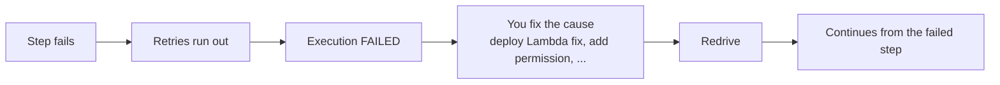
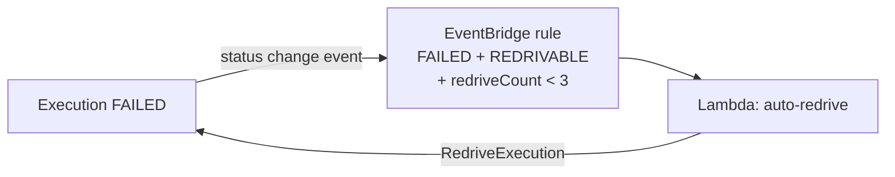

# Resuming a Failed Step Function with Redrive: Study Notes

Source: [How To Resume a Step Function From a Failed State **NEW FEATURE** (AWS Simplified)](https://youtu.be/RlG0xaSlxpc?list=PL9nWRykSBSFgQrO66TmO1vHFP6yuPF5G-), about 6 minutes.

**Redrive** (November 2023) restarts a failed Standard execution **from the step that failed**, instead of from the beginning. Steps that already succeeded aren't run again.

The video's workflow:
1. A DynamoDB `PutItem`.
2. A Lambda function that fails half the time.

Starting over would write the item again. Redrive only re-runs the Lambda.

The video also shows:
- the **ExecutionRedriven** event in the history;
- that executions from before the feature existed can't be redriven;
- that a successfully redriven execution counts as **Succeeded**.

Related notes:
- Notes 12 built a failing order workflow, and notes 09 listed redrive as Standard-only.
- Notes 15 mentioned Map Run redrive.
- Notes 05, 07 and 12 covered **retries**, which are a different thing (section 3).

Code marked **reconstructed** was rebuilt from what the video describes.

What was checked:
- Eligibility rules, per-state behavior, resets and IAM come from the current "Restarting state machine executions with redrive" page and AWS's launch post.
- The video's workflow and an improved version passed `ValidateStateMachineDefinition` (`OK`). `$$.Execution.RedriveCount` was resolved through `TestState`.
- An EventBridge rule pattern for automatic redrive was tested with EventBridge's `TestEventPattern` API against seven sample events. Nothing was created.
- The flaky Lambda and an auto-redrive Lambda were run locally (`uv run`, with a stubbed Step Functions client).

---

## Contents

1. [Corrected terms](#1-corrected-terms)
2. [The problem redrive solves](#2-the-problem-redrive-solves)
3. [Redrive vs retry](#3-redrive-vs-retry)
4. [The demo workflow](#4-the-demo-workflow)
5. [Redriving in the console](#5-redriving-in-the-console)
6. [Which executions can be redriven](#6-which-executions-can-be-redriven)
7. [What redrive does, state by state](#7-what-redrive-does-state-by-state)
8. [Redrive from the CLI and API](#8-redrive-from-the-cli-and-api)
9. [Handled vs unhandled failures](#9-handled-vs-unhandled-failures)
10. [Beyond the video: automatic redrive with EventBridge](#10-beyond-the-video-automatic-redrive-with-eventbridge)
11. [Beyond the video: redriving Map Runs](#11-beyond-the-video-redriving-map-runs)
12. [Gotchas](#12-gotchas)
13. [What has changed since the video](#13-what-has-changed-since-the-video)
14. [Cheat sheet](#14-cheat-sheet)
15. [Review questions](#15-review-questions)

---

## 1. Corrected terms

| Caption says | Actually means |
|---|---|
| Dynamo Tob / Dynamo to be | **DynamoDB** |
| Apache airf flow | **Apache Airflow** |
| red driving / red drove | **Redriving** / **redrove** |
| task history (for the new event) | A new **history event** type, `ExecutionRedriven` |

---

## 2. The problem redrive solves

### Before November 2023

When an execution failed at step 5 of 6, your options were:
1. **Start a new execution**, which re-runs steps 1 to 4. In the video's workflow, that means calling `PutItem` again, which "can lead to a state where you have multiple items in your DynamoDB table when you only intended there to be one" (00:28).
2. **Write workaround logic**: AWS's suggested approach was to restart the workflow and have it skip steps that already ran. The video calls it "complete nonsense", and "very difficult for people to implement" (00:44).

The video adds that this was "one of the reasons that a lot of people wanted to go with something like Apache Airflow", which can re-run from a particular task (00:51).

### Now

**Redrive** continues the **same execution**, with the **same execution ARN**, from the step that failed, using that step's original input. Earlier successful steps keep their results and aren't run again.

---

## 3. Redrive vs retry

The video stresses that these are different (01:11):

| | **Retry** (`Retry` field) | **Redrive** |
|---|---|---|
| When | **During** the execution, automatically, right after a step fails | **After** the execution has failed, timed out or been aborted |
| Who starts it | Step Functions, per your definition | You (console, CLI, API) or automation (section 10) |
| Typical gap | Seconds | Minutes to days (up to 14 days) |
| Good for | Temporary errors: throttling, a brief outage | Errors that need a fix first: a bug in a Lambda function, a missing permission, a dependency that was down for an hour |
| Defined in | The state machine definition | Nothing to define; it's an operation on an execution |

The video's advice: keep using retries as a best practice. Redrive is for what's left "after all of your retries have been exhausted" (01:23).

A typical incident:



---

## 4. The demo workflow

### Definition (reconstructed, validated: `OK`)

```json
{
  "Comment": "PutItem, then a Lambda that fails half the time",
  "StartAt": "DynamoDB PutItem",
  "States": {
    "DynamoDB PutItem": {
      "Type": "Task",
      "Resource": "arn:aws:states:::dynamodb:putItem",
      "Parameters": {
        "TableName": "RedriveDemoTable",
        "Item": { "id": { "S.$": "$.id" } }
      },
      "ResultPath": null,
      "Next": "Lambda Invoke"
    },
    "Lambda Invoke": {
      "Type": "Task",
      "Resource": "arn:aws:states:::lambda:invoke",
      "OutputPath": "$.Payload",
      "Parameters": {
        "FunctionName": "arn:aws:lambda:us-east-1:123456789012:function:FlakyFunction:$LATEST",
        "Payload.$": "$"
      },
      "End": true
    }
  }
}
```

The video's state machine has no retrier on the Lambda, which makes failures easy to produce.

### The flaky function (reconstructed)

```python
import random


class DependencyUnavailable(Exception):
    pass


def lambda_handler(event, context):
    # Fails about half the time, like the video's demo function.
    if random.random() < 0.5:
        raise DependencyUnavailable("random failure for the demo")
    return {"ok": True, "id": event.get("id")}
```

Ten local calls with a fixed random seed: `fail, fail, ok, fail, ok, fail, fail, ok, fail, fail`. That's why the video's first redrive also fails (03:07): "it's 50% of the time".

---

## 5. Redriving in the console

### Starting it (02:00)

On the failed execution's page, the top shows the error: the failing state (`Lambda Invoke`) and its cause. Then:
1. Choose **Recover**. It has two options:

   | Option | What it does |
   |---|---|
   | **Redrive from failure** | Continue **this** execution from the failed state |
   | **New execution** | Start a **new** execution from the beginning, with the same input |

2. Pick **Redrive from failure**. The confirmation dialog shows:
   - the state machine;
   - the execution name;
   - the **state to redrive from**;
   - the note "Redrive will continue the same execution from the step at which it was terminated".
3. Confirm with **Redrive execution**.

You can also use **Actions > Redrive**, or **Redrive** on the state machine's execution list.

### What the history shows (03:24)

The new events are **appended** to the original history:

```
ExecutionStarted
TaskStateEntered         DynamoDB PutItem
...TaskSucceeded / TaskStateExited
TaskStateEntered         Lambda Invoke
TaskFailed
ExecutionFailed                              <- first attempt ends
ExecutionRedriven        redriveCount: 1     <- redrive #1
TaskStateEntered         Lambda Invoke
TaskFailed
ExecutionFailed                              <- failed again (50%)
ExecutionRedriven        redriveCount: 2     <- redrive #2
TaskStateEntered         Lambda Invoke
TaskSucceeded / TaskStateExited
ExecutionSucceeded
```

- `PutItem` appears **once**: it wasn't re-run.
- `ExecutionRedriven` carries the **redrive count**, the number of redrives so far.
- The execution summary shows **Redrive count** too.

### The execution's status (04:54)

After a successful redrive, the execution's status is **Succeeded**, in the execution list too. It's the same execution, so it no longer counts as a failure.

---

## 6. Which executions can be redriven

From the docs:

| Condition | Detail |
|---|---|
| Started on or after **November 15, 2023** | Older executions show as not redrivable. The video's months-old DynamoDB failures show "Execution non-redrivable" (04:35). |
| Status isn't `SUCCEEDED` | Failed, aborted and timed-out executions qualify |
| Within **14 days** of the execution ending | The "redrivable period" |
| Within the **1-year** maximum execution time | Counted from the original start |
| Fewer than **24,999** history events | Redrives append events, so there must be room for `ExecutionRedriven` plus at least one more |
| **Standard** workflow | Express executions can't be redriven on their own (but see section 11) |

`DescribeExecution` tells you directly:

| Field | Values |
|---|---|
| `redriveStatus` | `REDRIVABLE`, `NOT_REDRIVABLE`, `REDRIVABLE_BY_MAP_RUN` |
| `redriveStatusReason` | Why not, when it isn't redrivable |
| `redriveCount` | How many times it has been redriven |
| `redriveDate` | When it was last redriven |

---

## 7. What redrive does, state by state

| State that failed | On redrive |
|---|---|
| **Task** | Scheduled and run again. Its `TimeoutSeconds` starts over. |
| **Choice** | Its rules are evaluated again |
| **Pass** | Not run again if it was the step being exited when things failed |
| **Wait** | A `Timestamp` in the past ends the wait right away |
| **Parallel** | Only the **failed or aborted branches** run again |
| **Inline Map** | Only the **failed or aborted iterations** run again |
| **Distributed Map** | Only the **unsuccessful child executions** in the Map Run run again |
| **Fail** | Re-entered, so it **fails again** (section 9) |
| **Succeed** | Executions that reached Succeed can't be redriven |

Exception: if a Parallel or Map failed with `States.DataLimitExceeded` (too much data), the whole state reruns, successful parts included.

### What resets and what doesn't

| Thing | On redrive |
|---|---|
| Retry counters on the rerun Task, Parallel or inline Map | **Reset to 0**, so the full number of retries is available again |
| The rerun Task's `TimeoutSeconds` | Reset |
| The state machine's own `TimeoutSeconds` | Reset |
| State machine definition | **The original one.** Changes you made since don't apply; start a new execution to use them. |
| Version or alias | Same as the original execution, even if the alias now points elsewhere |
| Execution ARN and name | Same |
| Input to the failed step | Same as in the original attempt |
| Context object | `$$.Execution.RedriveCount` gives the current redrive count |

Redrive is for fixes **outside** the definition: a Lambda function's code, a permission, a downstream service. A bug in the definition itself needs a new execution.

### Billing

The redriven part is billed like any execution: its state transitions count.

---

## 8. Redrive from the CLI and API

```bash
# Is it redrivable, and why not?
aws stepfunctions describe-execution --execution-arn "$EXEC" \
  --query '{status: status, redriveStatus: redriveStatus, reason: redriveStatusReason, count: redriveCount}'

# Redrive it
aws stepfunctions redrive-execution --execution-arn "$EXEC"

# The redrive events
aws stepfunctions get-execution-history --execution-arn "$EXEC" \
  --query 'events[?type==`ExecutionRedriven`].[timestamp, executionRedrivenEventDetails.redriveCount]' \
  --output table

# Failed executions that have already been redriven at least once (NOT_REDRIVEN for the rest)
aws stepfunctions list-executions --state-machine-arn "$SM_ARN" --status-filter FAILED \
  --redrive-filter REDRIVEN --query 'executions[].[name, redriveCount]'
```

IAM permission for whoever redrives, on execution ARNs:

```json
{
  "Version": "2012-10-17",
  "Statement": [
    {
      "Effect": "Allow",
      "Action": "states:RedriveExecution",
      "Resource": "arn:aws:states:us-east-1:123456789012:execution:RedriveDemo:*"
    }
  ]
}
```

`RedriveExecution` also takes an optional `clientToken`. Repeating a call with the same token doesn't redrive twice (section 10).

### Reproduce the video

`state-machine.json` is section 4; the function is `flaky.py`. Use a role from notes 12 section 13 (`PutItem` on the table, invoke on the function).

```bash
aws dynamodb create-table --table-name RedriveDemoTable \
  --attribute-definitions AttributeName=id,AttributeType=S \
  --key-schema AttributeName=id,KeyType=HASH --billing-mode PAY_PER_REQUEST

# Run until one fails (about every other run)
EXEC=$(aws stepfunctions start-execution --state-machine-arn "$SM_ARN" \
  --input '{"id": "r-1"}' --query executionArn --output text)
aws stepfunctions describe-execution --execution-arn "$EXEC" --query status

# Redrive until it succeeds; PutItem is not repeated
aws stepfunctions redrive-execution --execution-arn "$EXEC"
```

---

## 9. Handled vs unhandled failures

Redrive picks up from **the state where the execution ended**. That matters if your workflow already handles errors:

| How the execution ended | Redrive |
|---|---|
| A Task failed with no Catch (unhandled) | Reruns that Task. This is what redrive is for. |
| A Catch sent the flow to a **Fail** state | Reruns the **Fail state**, which fails again |
| A Catch sent the flow to a compensation and then Succeed | Status is Succeeded: nothing to redrive |
| It timed out or was stopped | Reruns the state that was running |

AWS's launch post puts it directly: redrive is for **unhandled and unexpected** errors. If you catch an error and route it to a Fail state, redrive can't help that execution.

Design choice:
- For errors you expect and **can** fix later (a dependency outage), let them **fail unhandled** after retries, so the execution stays redrivable.
- For errors that are final business outcomes (a declined card), **catch** them and end with a clear Fail state (notes 12). Redriving those makes no sense anyway.

### Idempotency still matters

Redrive reruns the failed step itself. If a Lambda did half its work before failing (charged a card, then crashed), rerunning it repeats that half. Make rerunnable steps idempotent: an idempotency key, or a conditional write.

The improved definition, validated `OK`, makes the `PutItem` conditional and passes the redrive count to the function:

```json
"DynamoDB PutItem": {
  "Type": "Task",
  "Resource": "arn:aws:states:::dynamodb:putItem",
  "Parameters": {
    "TableName": "RedriveDemoTable",
    "Item": { "id": { "S.$": "$.id" } },
    "ConditionExpression": "attribute_not_exists(id)"
  },
  "ResultPath": null,
  "Next": "Lambda Invoke"
},
"Lambda Invoke": {
  "Type": "Task",
  "Resource": "arn:aws:states:::lambda:invoke",
  "OutputPath": "$.Payload",
  "Parameters": {
    "FunctionName": "arn:aws:lambda:us-east-1:123456789012:function:FlakyFunction:$LATEST",
    "Payload": { "id.$": "$.id", "attempt.$": "$$.Execution.RedriveCount" }
  },
  "Retry": [
    {
      "ErrorEquals": ["Lambda.ServiceException", "Lambda.AWSLambdaException",
                      "Lambda.SdkClientException", "Lambda.TooManyRequestsException"],
      "IntervalSeconds": 1, "MaxAttempts": 3, "BackoffRate": 2, "JitterStrategy": "FULL"
    },
    { "ErrorEquals": ["DependencyUnavailable"], "IntervalSeconds": 2, "MaxAttempts": 2, "BackoffRate": 2 }
  ],
  "End": true
}
```

TestState with a Context object setting `RedriveCount` to 2 sends `"Payload": {"id": "r-1", "attempt": 2}`, so the function can log or act on which redrive it's in.

---

## 10. Beyond the video: automatic redrive with EventBridge

Every Standard execution status change is published to EventBridge's default bus as a **"Step Functions Execution Status Change"** event. Since redrive launched, the event includes `redriveCount`, `redriveDate`, `redriveStatus` and `redriveStatusReason`. A rule can react to failures and redrive them, up to a limit.



### The rule's event pattern

```json
{
  "source": ["aws.states"],
  "detail-type": ["Step Functions Execution Status Change"],
  "detail": {
    "stateMachineArn": ["arn:aws:states:us-east-1:123456789012:stateMachine:RedriveDemo"],
    "status": ["FAILED", "TIMED_OUT"],
    "redriveStatus": ["REDRIVABLE"],
    "redriveCount": [{ "numeric": ["<", 3] }]
  }
}
```

Tested with EventBridge's `TestEventPattern`:

| Sample event | Matches? |
|---|---|
| FAILED, REDRIVABLE, redriveCount 0 | **yes** |
| FAILED, REDRIVABLE, redriveCount 2 | **yes** |
| FAILED, REDRIVABLE, redriveCount 3 | no (the limit) |
| TIMED_OUT, REDRIVABLE | **yes** |
| SUCCEEDED | no |
| FAILED, NOT_REDRIVABLE | no |
| FAILED, from a different state machine | no |

### The auto-redrive function (tested locally)

```python
import boto3

sfn = boto3.client("stepfunctions")
MAX_REDRIVES = 3


def lambda_handler(event, context):
    # Target of an EventBridge rule on "Step Functions Execution Status Change".
    detail = event["detail"]
    arn = detail["executionArn"]
    if detail.get("redriveStatus") != "REDRIVABLE" or detail.get("redriveCount", 0) >= MAX_REDRIVES:
        return {"executionArn": arn, "redriven": False, "reason": "not redrivable or limit reached"}
    try:
        # The EventBridge event id is stable if EventBridge retries this target,
        # so it makes a good idempotency token: a repeat won't redrive twice.
        resp = sfn.redrive_execution(executionArn=arn, clientToken=event["id"])
    except sfn.exceptions.ExecutionNotRedrivable as e:
        return {"executionArn": arn, "redriven": False, "reason": str(e)}
    return {"executionArn": arn, "redriven": True, "redriveDate": resp["redriveDate"].isoformat()}
```

Stubbed runs:

| Event | Result |
|---|---|
| First failure, REDRIVABLE | `RedriveExecution` called with the execution ARN and the event ID as `clientToken`; `redriven: True` |
| redriveCount 3 | Not called; "limit reached" |
| NOT_REDRIVABLE | Not called |
| API answers `ExecutionNotRedrivable` | Handled; `redriven: False` with the reason |

The rule's pattern and the function both check the limit, so the function is safe even if the rule changes.

**Careful:** automatic redrive only makes sense for **temporary** failures. If a bug fails the step every time, auto-redrive just burns the redrive limit. Add an alarm on failures that still fail after the last redrive.

The function's role needs `states:RedriveExecution` on the state machine's executions (section 8).

---

## 11. Beyond the video: redriving Map Runs

Redrive also works for **Distributed Map** (notes 15):
- Redriving the parent execution reruns only the **failed or unfinished child executions** of the Map Run, not the successful ones.
- **Standard** child executions are redriven from their own failed step.
- **Express** child executions are restarted from the beginning of the child workflow (Express has no saved progress).
- Child executions of a Map Run report `redriveStatus` `REDRIVABLE_BY_MAP_RUN`: you redrive them through the parent execution (its Map Run), not one by one.

For a big file where 3 of 10,000 rows failed because of a temporary problem, this reruns 3 children instead of 10,000.

---

## 12. Gotchas

1. **Redrive isn't retry.** Keep `Retry` for temporary errors; redrive is for after the execution has failed.
2. **Same definition.** Fixing the state machine definition doesn't help a redrive; start a new execution. Fixing a Lambda function, permission or downstream service does help.
3. **14 days.** After that, redrive is no longer possible.
4. **Executions started before November 15, 2023** can never be redriven.
5. **Standard only** (plus child executions through Map Run redrive).
6. **Caught-and-failed executions re-fail.** Redriving an execution that ended in a Fail state reruns the Fail state.
7. **The failed step reruns.** Make it idempotent.
8. **Retry counters and timeouts reset** on the rerun state, so a step can retry again in full.
9. **History grows.** Each redrive appends events; there must be room under 25,000.
10. **Redriven transitions are billed.**
11. **Successful redrives turn the execution Succeeded.** Failure metrics and dashboards that counted it as failed may now disagree with the execution list.
12. **Auto-redrive needs a limit**: `redriveCount` in the rule pattern and the function.
13. **Use `clientToken`** for programmatic redrives, so duplicate deliveries don't redrive twice.

---

## 13. What has changed since the video

| Then (video) | Now |
|---|---|
| A "brand new feature" | Standard part of the console (**Recover** menu) and API |
| History shows `ExecutionRedriven` | Also a **Retries & redrives** tab per state, showing each retry and redrive attempt |
| Manual redrives | Common pattern: EventBridge rule on status change + `RedriveExecution` (section 10) |
| `$$.Execution.RedriveCount` new | Available to definitions, and settable in TestState's Context object for tests |
| Redrive for Standard executions | Also for Distributed Map runs (failed children only) |

---

## 14. Cheat sheet

```
What           : continue a failed/aborted/timed-out STANDARD execution from the failed step
Same           : execution ARN, definition, version/alias, failed step's input
Reset          : retry counters and TimeoutSeconds of the rerun state; state machine TimeoutSeconds
Not rerun      : steps that already succeeded (Parallel/Map: only failed branches/iterations/children)
Eligible       : started >= 2023-11-15, not SUCCEEDED, <= 14 days after end, < 1 year open,
                 < 24,999 history events, Standard
Fail state     : re-entered -> fails again (caught errors routed to Fail aren't usefully redrivable)
Console        : execution page -> Recover -> Redrive from failure | New execution
CLI            : aws stepfunctions redrive-execution --execution-arn ARN [--client-token T]
Status fields  : describe-execution -> redriveStatus (REDRIVABLE | NOT_REDRIVABLE | REDRIVABLE_BY_MAP_RUN),
                 redriveStatusReason, redriveCount, redriveDate
History        : ExecutionRedriven (executionRedrivenEventDetails.redriveCount)
Context        : $$.Execution.RedriveCount
IAM            : states:RedriveExecution on arn:aws:states:...:execution:<state machine>:*
Auto-redrive   : EventBridge "Step Functions Execution Status Change", status FAILED, redriveStatus REDRIVABLE,
                 redriveCount numeric < N -> Lambda -> RedriveExecution(clientToken = event id)
Retry vs redrive: retry = automatic, in-flight, seconds;  redrive = after failure, after a fix, days
```

---

## 15. Review questions

<details>
<summary>1. What does redrive do, and how is it different from starting a new execution?</summary>

Redrive continues the same execution (same ARN) from the step that failed, with that step's original input, without rerunning steps that already succeeded. A new execution starts from the first step and reruns everything, including side effects like the video's `PutItem`.
</details>

<details>
<summary>2. How is redrive different from <code>Retry</code>?</summary>

`Retry` happens automatically during the execution, seconds after a step fails, as defined in the state machine. Redrive happens after the execution has already failed (or timed out or been aborted), usually after you fix the cause, and is started by you or by automation.
</details>

<details>
<summary>3. List the conditions for an execution to be redrivable.</summary>

Standard workflow; started on or after November 15, 2023; status not `SUCCEEDED`; no more than 14 days since it ended; within the 1-year maximum execution time; fewer than 24,999 history events.
</details>

<details>
<summary>4. You fix a bug in the state machine definition. Can you redrive the failed execution to use the fix?</summary>

No. A redriven execution uses the original definition (and version or alias). Start a new execution to use the updated definition. Redrive is for fixes outside the definition, such as Lambda code or permissions.
</details>

<details>
<summary>5. A Parallel state failed because one of three branches failed. What does redrive rerun?</summary>

Only the failed or aborted branch. Successful branches keep their results, unless the failure was `States.DataLimitExceeded`, in which case the whole Parallel reruns.
</details>

<details>
<summary>6. The failing Task had <code>MaxAttempts: 3</code> and used them all. On redrive, how many retries does it get?</summary>

All 3 again: retry counters for the rerun state are reset to 0.
</details>

<details>
<summary>7. An execution caught an error and ended in a Fail state. What happens if you redrive it?</summary>

Redrive re-enters the Fail state, which fails again. Redrive helps with unhandled failures, not with errors the workflow already routed to Fail.
</details>

<details>
<summary>8. What new history event does a redrive add, and what does it record?</summary>

`ExecutionRedriven`, with the redrive count: how many times the execution has been redriven so far.
</details>

<details>
<summary>9. After a successful redrive, what status does the execution have?</summary>

`SUCCEEDED`. It's the same execution, now finished successfully.
</details>

<details>
<summary>10. How can you redrive failed executions automatically, and what keeps it from looping forever?</summary>

An EventBridge rule on "Step Functions Execution Status Change" events with status FAILED, `redriveStatus` REDRIVABLE, and `redriveCount` below a limit, targeting a function that calls `RedriveExecution`. The `redriveCount` condition (checked in the rule and the function) caps the attempts.
</details>

<details>
<summary>11. Why pass a <code>clientToken</code> to <code>RedriveExecution</code> from an EventBridge-triggered function?</summary>

EventBridge can deliver the same event more than once. Using the event ID as the idempotency token means a duplicate delivery doesn't trigger a second redrive.
</details>

<details>
<summary>12. A Distributed Map processed 10,000 rows and 3 child executions failed. What does redriving the parent do?</summary>

It reruns only the 3 unsuccessful child executions: Standard children from their failed step, Express children from the start of the child workflow.
</details>
