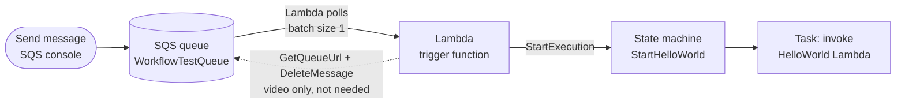
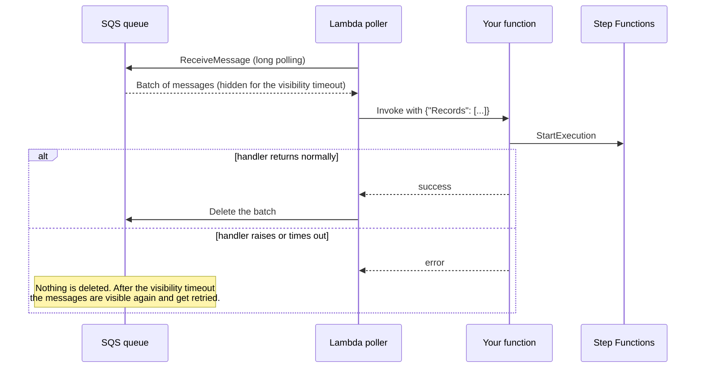
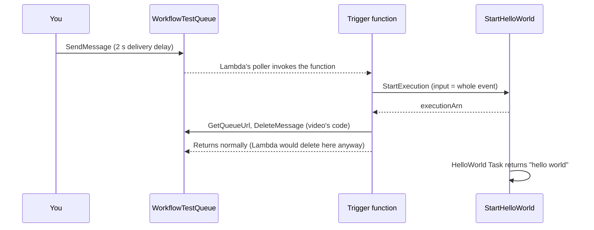
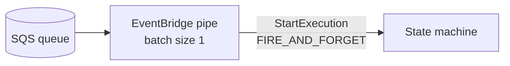

# Triggering a Step Function from an SQS Message: Study Notes

Source: [Trigger Step Function From SQS Message (DataEng Uncomplicated)](https://youtu.be/EKuj52flqVM), about 10 minutes, April 2022. This is an extra video from another channel, not part of the AWS Simplified playlist that notes 01 to 18 follow.

A message lands in an SQS queue, and a Lambda function starts a state machine execution for it. The video connects the queue to the function as a **trigger**, then writes Python that starts the execution and **deletes the message by hand**.

| Notes | Direction | What happens |
|---|---|---|
| [03](03_AWS_Step_Functions_with_SQS_Study_Notes.md) | Step Functions → SQS | A Task sends a message |
| [06](06_AWS_Step_Functions_Start_Execution_from_Lambda_Study_Notes.md) | Lambda → Step Functions | Code calls `StartExecution` |
| **19 (this)** | **SQS → Lambda → Step Functions** | Each message on the queue starts an execution |

The most important correction: **you don't need to delete the message yourself.** When a function triggered by SQS returns without an error, Lambda deletes the messages it was given. Section 7 explains, and section 10 has a shorter handler that relies on that.

The video's code is in the channel's repo: [`lambda/execute_stepfunction_from_sqs.py`](https://github.com/AdrianoNicolucci/dataenguncomplicated/blob/main/lambda/execute_stepfunction_from_sqs.py) (GPL-3.0, committed the day the video came out). Short excerpts are quoted below. The names `WorkflowTestQueue` (queue) and `StartHelloWorld` (state machine) come from garbled captions, so treat them as close guesses. The `HelloWorld` function and its state machine definition are **reconstructed**.

What was checked:
- The video's code was read from the repo. The problems listed in section 6 come from reading it. It wasn't run here.
- The improved handler (section 10) was run locally against a **stubbed** Step Functions client (botocore's `Stubber`), so no AWS calls. The results shown are real.
- Every state machine definition passed `ValidateStateMachineDefinition` (`OK`, no diagnostics). The Pass states in sections 9 and 12 were run with the `TestState` API, and the outputs shown are real.
- The least-privilege policy was checked with IAM's policy simulator (`SimulateCustomPolicy`). The contents of `AWSLambdaSQSQueueExecutionRole` were read from IAM.
- The request shapes for `create-event-source-mapping` and `create-pipe` were checked against botocore's service model. Trigger and Pipes behavior comes from the Lambda and EventBridge docs. Nothing was deployed.

---

## Contents

1. [Corrected terms](#1-corrected-terms)
2. [What you build](#2-what-you-build)
3. [How the SQS trigger works](#3-how-the-sqs-trigger-works)
4. [Step 1: The queue and the state machine](#4-step-1-the-queue-and-the-state-machine)
5. [Step 2: The function, its permissions and the trigger](#5-step-2-the-function-its-permissions-and-the-trigger)
6. [Step 3: The code](#6-step-3-the-code)
7. [Do you have to delete the message yourself?](#7-do-you-have-to-delete-the-message-yourself)
8. [Step 4: Send a message and check the execution](#8-step-4-send-a-message-and-check-the-execution)
9. [Same setup with the AWS CLI](#9-same-setup-with-the-aws-cli)
10. [Beyond the video: a better handler](#10-beyond-the-video-a-better-handler)
11. [Beyond the video: test the handler without AWS](#11-beyond-the-video-test-the-handler-without-aws)
12. [Beyond the video: no Lambda, with EventBridge Pipes](#12-beyond-the-video-no-lambda-with-eventbridge-pipes)
13. [Gotchas](#13-gotchas)
14. [What has changed since the video](#14-what-has-changed-since-the-video)
15. [Cheat sheet](#15-cheat-sheet)
16. [Review questions](#16-review-questions)

---

## 1. Corrected terms

| Caption says | Actually means |
|---|---|
| sqsq / cue / susq | SQS **queue** |
| lan the function | **Lambda function** |
| moto 3 | **boto3**, the AWS SDK for Python |
| lambda roll / lambda rule | The function's **execution role** |
| aws lambda sqsq execution role | **`AWSLambdaSQSQueueExecutionRole`**, an AWS managed **policy**, not a role |
| get q url | **`sqs:GetQueueUrl`** |
| stick to json | **`dict_to_json`**, the helper's name in the repo |
| sql source ar into cue url / sqsq source arn2 cues url | **`sqs_source_arn_to_QueueUrl`** |
| count number | **account number** |
| workflowtestq | The queue's name, written `WorkflowTestQueue` here |
| start hello world | The state machine's name, written `StartHelloWorld` here |
| data engine uncomplicated | **DataEng Uncomplicated**, the channel |

---

## 2. What you build

### Architecture



1. You send a message to the queue.
2. Lambda's poller picks it up and invokes the function with it.
3. The function calls `StartExecution`, passing the message as the input.
4. The video's code then deletes the message itself. Lambda would have done that anyway (section 7).
5. The execution runs the `HelloWorld` function, which returns `hello world`.

### Who does what

| Part | Run by | Job |
|---|---|---|
| Trigger (an **event source mapping**) | The Lambda service, using the function's role | Polls the queue, invokes the function with a batch, deletes the batch when the function succeeds |
| Function code | You | Starts one execution per message |
| State machine | Step Functions, using its own role | The actual workflow |

SQS doesn't push messages anywhere. "Trigger" here means Lambda's poller reading the queue for you. That's why the function's role needs permission to **receive and delete** messages, even if your code never calls SQS.

---

## 3. How the SQS trigger works

From the Lambda docs: "If your function successfully processes all messages in the batch, Lambda deletes the messages from the queue."



- The poller invokes the function **synchronously** and waits for the result.
- **Success** means the handler returned without raising. Lambda then deletes the whole batch.
- **Failure** (an exception or a timeout) leaves the batch in the queue. Each message becomes visible again after the visibility timeout, and its receive count goes up.
- After `maxReceiveCount` receives, the queue's redrive policy moves the message to a **dead-letter queue**, if there is one. Without one, it keeps coming back until the retention period ends (4 days by default).
- Delivery is **at least once**. The same message can reach the function twice, so starting an execution has to be safe to repeat (section 10).

### The event your function receives

```json
{
  "Records": [
    {
      "messageId": "059f36b4-87a3-44ab-83d2-661975830a7d",
      "receiptHandle": "AQEBwJnKyrHigUMZj6rYigCgxlaS3SLy0a...",
      "body": "hello from DataEng Uncomplicated",
      "attributes": {
        "ApproximateReceiveCount": "1",
        "SentTimestamp": "1650253560000",
        "SenderId": "AIDAEXAMPLE",
        "ApproximateFirstReceiveTimestamp": "1650253562000"
      },
      "messageAttributes": {},
      "md5OfBody": "0123456789abcdef0123456789abcdef",
      "eventSource": "aws:sqs",
      "eventSourceARN": "arn:aws:sqs:us-east-1:123456789012:WorkflowTestQueue",
      "awsRegion": "us-east-1"
    }
  ]
}
```

| Field | Meaning |
|---|---|
| `messageId` | Set when the message is sent. **Stays the same** every time the message is received again. |
| `receiptHandle` | Identifies one particular receive. **New on every receive.** `DeleteMessage` needs it. |
| `body` | The message text, always a **string**. A JSON body arrives as JSON text that you parse yourself. |
| `attributes.ApproximateReceiveCount` | How many times this message has been received. Above 1 means it's a retry. |
| `eventSourceARN` | The queue's ARN. The video parses the queue name and account out of it. |

### Trigger settings

| Setting | Video | What it does | Notes |
|---|---|---|---|
| Batch size | 1 | Most messages per invocation | Default 10. Above 10 needs a batch window of at least 1 second. Up to 10,000 for standard queues, 10 for FIFO. |
| Batch window | 1 second | Longest Lambda waits to fill a batch | Default 0. With batch size 1 it changes nothing: the batch is full as soon as one message arrives. |
| Report batch item failures | not used | Lets the function return which messages failed | Section 10 |

At 01:37 the video sets the window to 1 second "because we're not waiting for other records". That's backwards: the window is how long Lambda **does** wait, and 0 is the no-wait setting. With a batch size of 1, either value behaves the same.

---

## 4. Step 1: The queue and the state machine

The video starts with both already built (00:48 and 01:03).

### The queue

A standard queue with default settings. Two settings matter once a Lambda reads from it:

- **Visibility timeout** (default 30 seconds) must be at least the function's timeout. Lambda checks this when you create the trigger and refuses if the function's timeout is longer. AWS recommends **6 times** the function timeout, so a retry after throttling still fits.
- **Dead-letter queue**: not in the video. Add one with a `maxReceiveCount` of at least 5 (AWS's recommendation), so a message that always fails ends up somewhere you can inspect.

The default 3-second function timeout and 30-second visibility timeout pass the check.

### The state machine (reconstructed, validated: `OK`)

A single Task that invokes a function returning "hello world":

```json
{
  "Comment": "Invoke a Lambda function that returns hello world",
  "StartAt": "HelloWorld",
  "States": {
    "HelloWorld": {
      "Type": "Task",
      "Resource": "arn:aws:states:::lambda:invoke",
      "Parameters": {
        "FunctionName": "arn:aws:lambda:us-east-1:123456789012:function:HelloWorld",
        "Payload.$": "$"
      },
      "End": true
    }
  }
}
```

```python
def lambda_handler(event, context):
    return "hello world"
```

At 09:42 the Task's output shows the payload `hello world`. `Payload` is the field the `lambda:invoke` integration puts the function's return value in (notes 02). The state machine's role needs `lambda:InvokeFunction` on `HelloWorld`. Notes 02 shows how to build all of this.

---

## 5. Step 2: The function, its permissions and the trigger

### Console steps (as in the video)

1. **Lambda > Create function**, author from scratch. The video uses **Python 3.9** (01:11). Lambda deprecated it on Dec 15, 2025, so pick a current runtime such as Python 3.13.
2. Open the function's role in IAM and give it the permissions below (01:55 to 02:35).
3. Back in the function, **Add trigger** (01:29) > **SQS** > choose `WorkflowTestQueue`.
4. **Batch size** 1 and **Batch window** 1, as discussed in section 3 (01:37).
5. **Add**. The trigger shows as **Enabled** (02:35).

The console checks the role when you add the trigger. If the role can't read from the queue, the trigger isn't created and you get an error naming the missing SQS permission. So set up the role first.

### What the managed policy contains

The video starts the role from `AWSLambdaSQSQueueExecutionRole`. Read from IAM (version `v1`):

```json
{
  "Version": "2012-10-17",
  "Statement": [
    {
      "Effect": "Allow",
      "Action": [
        "sqs:ReceiveMessage",
        "sqs:DeleteMessage",
        "sqs:GetQueueAttributes",
        "logs:CreateLogGroup",
        "logs:CreateLogStream",
        "logs:PutLogEvents"
      ],
      "Resource": "*"
    }
  ]
}
```

- It's a **policy**, not a role. You attach it to the function's role.
- It has the three SQS actions the trigger needs, plus CloudWatch Logs.
- `"Resource": "*"` means every queue in the account.
- It has no `sqs:GetQueueUrl`. The video adds that (02:04) because its code calls `get_queue_url`. Without the manual delete, nothing needs it.

### Every permission, and who uses it

| Permission | Used by | Needed? |
|---|---|---|
| `sqs:ReceiveMessage`, `sqs:GetQueueAttributes` | The trigger (Lambda's poller) | Yes |
| `sqs:DeleteMessage` | The trigger, after a successful invocation | Yes |
| `states:StartExecution` on the state machine | Your code (02:27) | Yes |
| `logs:CreateLogGroup`, `logs:CreateLogStream`, `logs:PutLogEvents` | The Lambda runtime, for your logs | Yes |
| `sqs:GetQueueUrl` | The video's code only | No (section 7) |
| `kms:Decrypt` on the queue's key | The trigger | Only if the queue uses a customer managed KMS key |
| `lambda:InvokeFunction` on `HelloWorld` | The **state machine's** role, not this one | Not on this role |

### Least privilege

```json
{
  "Version": "2012-10-17",
  "Statement": [
    {
      "Sid": "ReadQueue",
      "Effect": "Allow",
      "Action": ["sqs:ReceiveMessage", "sqs:DeleteMessage", "sqs:GetQueueAttributes"],
      "Resource": "arn:aws:sqs:us-east-1:123456789012:WorkflowTestQueue"
    },
    {
      "Sid": "StartWorkflow",
      "Effect": "Allow",
      "Action": "states:StartExecution",
      "Resource": "arn:aws:states:us-east-1:123456789012:stateMachine:StartHelloWorld"
    }
  ]
}
```

Plus `AWSLambdaBasicExecutionRole` for logs. Results from `SimulateCustomPolicy` for this policy:

| Action | Resource | Decision |
|---|---|---|
| `sqs:ReceiveMessage` | `WorkflowTestQueue` | **allowed** |
| `sqs:DeleteMessage` | `WorkflowTestQueue` | **allowed** |
| `sqs:GetQueueAttributes` | `WorkflowTestQueue` | **allowed** |
| `sqs:ReceiveMessage` | `SomeOtherQueue` | implicitDeny |
| `sqs:GetQueueUrl` | `WorkflowTestQueue` | implicitDeny |
| `sqs:SendMessage` | `WorkflowTestQueue` | implicitDeny |
| `states:StartExecution` | `stateMachine:StartHelloWorld` | **allowed** |
| `states:StartExecution` | `stateMachine:SomethingElse` | implicitDeny |

---

## 6. Step 3: The code

The repo's file has four helper functions and a handler:

| Function | What it does | Video |
|---|---|---|
| `dict_to_json(d)` | `json.dumps(d)` | 03:46 |
| `start_state_machine(arn, msg)` | `start_execution(stateMachineArn=arn, input=msg)` | 04:11 |
| `sqs_source_arn_to_QueueUrl(arn)` | Splits the queue ARN on `:`, takes the name (index 5) and account (index 4), calls `get_queue_url` | 05:01 |
| `delete_sqs_message(url, handle)` | Calls `delete_message` | 05:51 |
| `lambda_handler(event, context)` | Ties them together | 06:32 |

At module level it sets logging to INFO and reads three environment variables, `acc_num`, `state_machine` and `region`, which the handler uses to build the state machine ARN.

### The handler (from the repo)

```python
def lambda_handler(event, context):

    record = event['Records'][0]
    receiptHandle = record['receiptHandle']  # name of the ReceiptHandle provided by SQS Function
    logging.info(f"the receiptHandle= {receiptHandle}")
    eventSource = record['eventSourceARN']  # name of the event source
    logging.info(f"the eventSource = eventSource")
    sqs_message = dict_to_json(event)
    start_state_machine(f"arn:aws:states:{aws_region}:{account_number}:stateMachine:{statemachine_name}", sqs_message)
    QueueUrl = sqs_source_arn_to_QueueUrl(eventSource)
    delete_sqs_message(QueueUrl, receiptHandle)
```

### The delete helper (from the repo)

```python
def delete_sqs_message(QueueUrl:str, ReceiptHandle:str):
    """deletes a message from a SQS Queue
    :param QueueUrl: the url of the queue
    :param ReceiptHandle: ReceiptHandle passed by the sqs message"""
    client = boto3.client('sqs')
    try:
        response = client.delete_message(
            QueueUrl=QueueUrl,
            ReceiptHandle=ReceiptHandle)
    except:
        logging.error("failed to do delete message from the queue")
    logging.info("message deleted succesfully from the queue")
```

### What the code really does (from reading the source)

| # | Code | What happens | Fix |
|---|---|---|---|
| 1 | `dict_to_json(event)` | The **whole event** becomes the execution input: `{"Records": [{...}]}`, with the receipt handle, MD5, attributes and ARN. The message text sits at `$.Records[0].body`. That's why the input at 09:18 shows the message "being passed in the body". | Pass only the body and the message ID |
| 2 | `event['Records'][0]` | Only the first message is handled. Fine with batch size 1. With a bigger batch, Lambda **deletes the others without a workflow ever starting for them**. | Loop over `event["Records"]` |
| 3 | No `name=` in `start_execution` | Step Functions makes up a name, so a redelivered message starts a **second** execution. | `name=record["messageId"]` |
| 4 | Bare `except:` in `delete_sqs_message` | Any error is logged and swallowed. The next line then logs "message deleted succesfully" anyway, so a failed delete logs both lines. | Drop the manual delete |
| 5 | `f"the eventSource = eventSource"` | The braces are missing, so it logs that literal text instead of the ARN. | `{eventSource}` |
| 6 | `boto3.client(...)` inside each helper | A new client on every call. | Create clients once, at module level (notes 06) |
| 7 | Three environment variables to build one ARN | More settings to get wrong. Lambda already sets `AWS_REGION`. | One `STATE_MACHINE_ARN` variable |
| 8 | `get_queue_url` + `delete_message` | Two extra API calls per message, and an extra permission, for something Lambda already does. | Remove (section 7) |

One part is right: if `start_execution` raises, the handler stops before the delete, Lambda sees an error, and the message comes back for another try.

---

## 7. Do you have to delete the message yourself?

**Not with a Lambda trigger.** The video says (02:12 and 07:47) that without the delete, the message would go back to the queue and start the state machine "over and over again". With a trigger, that doesn't happen: Lambda deletes the batch as soon as the function returns successfully.

What really causes repeats:
- **The function fails or times out after `StartExecution` succeeded.** The batch returns to the queue, and the next attempt starts another execution. The manual delete doesn't help here, because it's the last line and never runs.
- **At-least-once delivery.** SQS can occasionally deliver the same message twice.

The fix for both is a start that's safe to repeat: use the message ID as the execution name (section 10).

When deleting by hand does make sense:

| Situation | Why |
|---|---|
| Your own consumer calls `ReceiveMessage` (no trigger), like the worker in notes 03 section 9 | Nothing else deletes the message |
| A batch trigger **without** partial batch responses | Deleting each message as it succeeds stops a later failure in the batch from sending the good ones back. AWS mentions this option, but `ReportBatchItemFailures` (section 10) is simpler. |

If you ever need a queue URL from an ARN, you don't need an API call: `arn:aws:sqs:us-east-1:123456789012:WorkflowTestQueue` becomes `https://sqs.us-east-1.amazonaws.com/123456789012/WorkflowTestQueue`.

---

## 8. Step 4: Send a message and check the execution

### Environment variables and deploy

1. **Deploy** the code (08:03).
2. **Configuration > Environment variables** (08:10): `acc_num`, `region` and `state_machine`, the names the repo's code reads.

### Send a message (08:36)

1. **SQS > WorkflowTestQueue > Send and receive messages**.
2. Body: `hello from DataEng Uncomplicated`.
3. **Delivery delay**: the video uses 2 seconds. The message stays hidden for that long after it's sent (0 to 900 seconds, 0 by default).
4. **Send message**.

### Check the execution (09:01)

1. **Step Functions > StartHelloWorld > Executions**. A new execution appears a few seconds after the send.
2. Its **input** is the whole Lambda event, from `json.dumps(event)`:

```json
{
  "Records": [
    {
      "messageId": "059f36b4-87a3-44ab-83d2-661975830a7d",
      "receiptHandle": "AQEBwJnKyrHigUMZj6rYigCgxlaS3SLy0a...",
      "body": "hello from DataEng Uncomplicated",
      "attributes": { "ApproximateReceiveCount": "1", "...": "..." },
      "messageAttributes": {},
      "md5OfBody": "0123456789abcdef0123456789abcdef",
      "eventSource": "aws:sqs",
      "eventSourceARN": "arn:aws:sqs:us-east-1:123456789012:WorkflowTestQueue",
      "awsRegion": "us-east-1"
    }
  ]
}
```

3. The `HelloWorld` Task's output has the payload `hello world` (09:42).
4. Back in SQS, the queue is empty.

### Lifecycle



---

## 9. Same setup with the AWS CLI

This builds the improved version: the handler from section 10 (saved as `lambda_function.py`), a dead-letter queue, and least-privilege roles. The state machine is a single Pass state standing in for the video's hello world workflow, so there's no second function to deploy. To use the real `HelloWorld` function, see notes 02.

`statemachine.json` (validated: `OK`):

```json
{
  "Comment": "Stand-in for the video's hello world workflow",
  "StartAt": "SayHello",
  "States": {
    "SayHello": {
      "Type": "Pass",
      "Parameters": { "greeting": "hello world", "received.$": "$" },
      "End": true
    }
  }
}
```

`TestState` run of `SayHello` with the input the handler sends for a JSON body:

```json
{"greeting":"hello world","received":{"messageId":"11111111-1111-4111-8111-111111111111","body":{"orderId":42}}}
```

```bash
ACCOUNT_ID=$(aws sts get-caller-identity --query Account --output text)

# --- Queues: the dead-letter queue first, then the main queue ---
DLQ_URL=$(aws sqs create-queue --queue-name WorkflowTestQueue-dlq \
  --query QueueUrl --output text)
DLQ_ARN=$(aws sqs get-queue-attributes --queue-url "$DLQ_URL" \
  --attribute-names QueueArn --query Attributes.QueueArn --output text)

# Visibility timeout 180 s = 6 x the function's 30 s timeout. After 5 failed receives -> DLQ.
cat > queue-attributes.json <<EOF
{
  "VisibilityTimeout": "180",
  "RedrivePolicy": "{\"deadLetterTargetArn\":\"$DLQ_ARN\",\"maxReceiveCount\":\"5\"}"
}
EOF
QUEUE_URL=$(aws sqs create-queue --queue-name WorkflowTestQueue \
  --attributes file://queue-attributes.json --query QueueUrl --output text)
QUEUE_ARN=$(aws sqs get-queue-attributes --queue-url "$QUEUE_URL" \
  --attribute-names QueueArn --query Attributes.QueueArn --output text)

# --- State machine (a Pass state calls nothing, so its role has no policies) ---
cat > sfn-trust.json <<EOF
{
  "Version": "2012-10-17",
  "Statement": [{
    "Effect": "Allow",
    "Principal": { "Service": "states.amazonaws.com" },
    "Action": "sts:AssumeRole",
    "Condition": { "StringEquals": { "aws:SourceAccount": "$ACCOUNT_ID" } }
  }]
}
EOF
aws iam create-role --role-name StartHelloWorldRole \
  --assume-role-policy-document file://sfn-trust.json
SM_ARN=$(aws stepfunctions create-state-machine --name StartHelloWorld \
  --definition file://statemachine.json \
  --role-arn "arn:aws:iam::${ACCOUNT_ID}:role/StartHelloWorldRole" \
  --query stateMachineArn --output text)

# --- Trigger function's role ---
cat > lambda-trust.json <<EOF
{
  "Version": "2012-10-17",
  "Statement": [{
    "Effect": "Allow",
    "Principal": { "Service": "lambda.amazonaws.com" },
    "Action": "sts:AssumeRole"
  }]
}
EOF
aws iam create-role --role-name SqsToSfnTriggerRole \
  --assume-role-policy-document file://lambda-trust.json
aws iam attach-role-policy --role-name SqsToSfnTriggerRole \
  --policy-arn arn:aws:iam::aws:policy/service-role/AWSLambdaBasicExecutionRole

cat > trigger-policy.json <<EOF
{
  "Version": "2012-10-17",
  "Statement": [
    {
      "Effect": "Allow",
      "Action": ["sqs:ReceiveMessage", "sqs:DeleteMessage", "sqs:GetQueueAttributes"],
      "Resource": "$QUEUE_ARN"
    },
    { "Effect": "Allow", "Action": "states:StartExecution", "Resource": "$SM_ARN" }
  ]
}
EOF
aws iam put-role-policy --role-name SqsToSfnTriggerRole \
  --policy-name ReadQueueStartWorkflow --policy-document file://trigger-policy.json

# --- Function ---
zip function.zip lambda_function.py
# Right after creating a role, this can fail for a few seconds while IAM catches up.
aws lambda create-function --function-name SqsToStepFunction \
  --runtime python3.13 --handler lambda_function.lambda_handler \
  --role "arn:aws:iam::${ACCOUNT_ID}:role/SqsToSfnTriggerRole" \
  --zip-file fileb://function.zip --timeout 30 \
  --environment "Variables={STATE_MACHINE_ARN=$SM_ARN}"
aws lambda wait function-active-v2 --function-name SqsToStepFunction

# --- Trigger: up to 10 messages per invocation, failures reported per message ---
ESM_UUID=$(aws lambda create-event-source-mapping --function-name SqsToStepFunction \
  --event-source-arn "$QUEUE_ARN" --batch-size 10 \
  --function-response-types ReportBatchItemFailures \
  --query UUID --output text)
aws lambda get-event-source-mapping --uuid "$ESM_UUID" --query State   # wait for "Enabled"

# --- Send two messages; note the message IDs ---
aws sqs send-message --queue-url "$QUEUE_URL" \
  --message-body 'hello from DataEng Uncomplicated' --query MessageId --output text
aws sqs send-message --queue-url "$QUEUE_URL" \
  --message-body '{"orderId": 42}' --query MessageId --output text

# --- One execution per message, named after its message ID ---
aws stepfunctions list-executions --state-machine-arn "$SM_ARN" \
  --query 'executions[].[name, status]' --output table
EXEC_ARN=$(aws stepfunctions list-executions --state-machine-arn "$SM_ARN" \
  --query 'executions[0].executionArn' --output text)
aws stepfunctions describe-execution --execution-arn "$EXEC_ARN" \
  --query '{input: input, output: output}'

# --- The queue is empty: Lambda deleted both messages ---
aws sqs get-queue-attributes --queue-url "$QUEUE_URL" \
  --attribute-names ApproximateNumberOfMessages ApproximateNumberOfMessagesNotVisible

# --- Clean up (if you built the pipe in section 12, remove it first) ---
aws lambda delete-event-source-mapping --uuid "$ESM_UUID"
aws lambda delete-function --function-name SqsToStepFunction
aws iam delete-role-policy --role-name SqsToSfnTriggerRole --policy-name ReadQueueStartWorkflow
aws iam detach-role-policy --role-name SqsToSfnTriggerRole \
  --policy-arn arn:aws:iam::aws:policy/service-role/AWSLambdaBasicExecutionRole
aws iam delete-role --role-name SqsToSfnTriggerRole
aws logs delete-log-group --log-group-name /aws/lambda/SqsToStepFunction
aws stepfunctions delete-state-machine --state-machine-arn "$SM_ARN"
aws iam delete-role --role-name StartHelloWorldRole
aws sqs delete-queue --queue-url "$QUEUE_URL"
aws sqs delete-queue --queue-url "$DLQ_URL"
```

Notes:

- In the unquoted heredoc, `\"` stays as typed and `$DLQ_ARN` gets filled in. So `RedrivePolicy` ends up as a JSON string inside the JSON, which is the form SQS expects.
- If the function's timeout were longer than the queue's 180-second visibility timeout, `create-event-source-mapping` would fail.
- The trigger is deleted before the function. Delete it explicitly rather than counting on the function's deletion to clean it up.

---

## 10. Beyond the video: a better handler

```python
import json
import logging
import os

import boto3
from botocore.exceptions import BotoCoreError, ClientError

logger = logging.getLogger()
logger.setLevel(logging.INFO)

sfn = boto3.client("stepfunctions")
STATE_MACHINE_ARN = os.environ["STATE_MACHINE_ARN"]


def to_input(record):
    """Execution input: the message ID plus the body, parsed when it is a JSON object or array."""
    body = record["body"]
    try:
        parsed = json.loads(body)
        if isinstance(parsed, (dict, list)):
            body = parsed
    except json.JSONDecodeError:
        pass
    return json.dumps({"messageId": record["messageId"], "body": body})


def lambda_handler(event, context):
    failures = []
    for record in event["Records"]:
        message_id = record["messageId"]
        try:
            sfn.start_execution(
                stateMachineArn=STATE_MACHINE_ARN,
                name=message_id,  # a redelivered message has the same ID, so it can't start a second run
                input=to_input(record),
            )
            logger.info("Started execution for message %s", message_id)
        except sfn.exceptions.ExecutionAlreadyExists:
            logger.info("Execution for message %s already exists", message_id)
        except (ClientError, BotoCoreError):
            logger.exception("Could not start execution for message %s", message_id)
            failures.append({"itemIdentifier": message_id})
    # Needs ReportBatchItemFailures on the trigger. Lambda then deletes every
    # message in the batch except these, which go back to the queue.
    return {"batchItemFailures": failures}
```

| Change | Why |
|---|---|
| Loops over every record | Works with any batch size, so one invocation can start up to 10 executions |
| Input is `{"messageId", "body"}` | The workflow gets the message, not SQS bookkeeping. JSON bodies arrive already parsed. |
| `name=message_id` | A redelivered message can't start a second execution (below) |
| Catches `ExecutionAlreadyExists` | That message was already handled, so let Lambda delete it |
| Returns `batchItemFailures` | Only the messages that failed go back to the queue |
| No SQS calls at all | Lambda deletes the messages. No `GetQueueUrl`, no `DeleteMessage` in the code. |
| One `STATE_MACHINE_ARN` variable | Instead of building the ARN from three |
| Client created once, at module level | Warm invocations reuse it |

### Why the message ID as the execution name

From notes 06 section 3, on a **Standard** state machine:

| Situation | Result |
|---|---|
| Same name, same input, first execution still running | Returns the original execution. Nothing new starts. |
| Same name, first execution finished (or different input) | `ExecutionAlreadyExists` |

A redelivered message has the same `messageId` and the same body, so it produces the same name and the same input. Either way, you get **one execution per message**. A name becomes reusable 90 days after its execution closes, which is longer than any message can stay in a queue (14 days at most). Message IDs are 36-character UUIDs, which fit the name rules.

This doesn't work for **Express** workflows: their names aren't checked for uniqueness, so a duplicate message starts a duplicate execution.

### Turn on ReportBatchItemFailures

The returned `batchItemFailures` list only counts if the trigger has **ReportBatchItemFailures** turned on (`--function-response-types ReportBatchItemFailures`, or the checkbox in the trigger's settings). Without it, Lambda ignores the return value. The invocation succeeded, so **the whole batch is deleted**, including the messages that failed.

### Why `NaN` stays a string

`json.loads("NaN")` returns a Python float, and `json.dumps` would write it back as `NaN`, which isn't valid JSON, so Step Functions would reject the input. The `isinstance` check only accepts objects and arrays, so bodies like `NaN`, `42` or plain text stay strings.

---

## 11. Beyond the video: test the handler without AWS

The same approach as notes 06 section 11: botocore's `Stubber` replaces the API responses and checks the parameters the code sends. No queue, no state machine, no credentials.

`test_handler.py`, next to `lambda_function.py`:

```python
# /// script
# dependencies = ["boto3"]
# ///
"""Unit test for lambda_function.py with a stubbed Step Functions client. No AWS calls are made."""
import datetime
import json
import os
import sys

os.environ.setdefault("AWS_DEFAULT_REGION", "us-east-1")
os.environ["STATE_MACHINE_ARN"] = "arn:aws:states:us-east-1:123456789012:stateMachine:StartHelloWorld"
sys.path.insert(0, os.path.dirname(os.path.abspath(__file__)))

from botocore.stub import Stubber

import lambda_function as fn

SM = os.environ["STATE_MACHINE_ARN"]


def record(message_id, body):
    return {"messageId": message_id, "receiptHandle": f"AQEB-{message_id}", "body": body,
            "eventSource": "aws:sqs", "eventSourceARN": "arn:aws:sqs:us-east-1:123456789012:WorkflowTestQueue"}


def started(name):
    return {"executionArn": SM.replace(":stateMachine:", ":execution:") + f":{name}",
            "startDate": datetime.datetime.now(datetime.timezone.utc)}


def main() -> int:
    ids = ["11111111-1111-4111-8111-111111111111",
           "22222222-2222-4222-8222-222222222222",
           "33333333-3333-4333-8333-333333333333"]
    event = {"Records": [
        record(ids[0], "hello from DataEng Uncomplicated"),
        record(ids[1], '{"orderId": 42}'),
        record(ids[2], "NaN"),
    ]}
    with Stubber(fn.sfn) as stub:
        stub.add_response("start_execution", started(ids[0]), {
            "stateMachineArn": SM, "name": ids[0],
            "input": json.dumps({"messageId": ids[0], "body": "hello from DataEng Uncomplicated"})})
        stub.add_client_error("start_execution", service_error_code="ExecutionAlreadyExists", http_status_code=400,
                              expected_params={"stateMachineArn": SM, "name": ids[1],
                                               "input": json.dumps({"messageId": ids[1], "body": {"orderId": 42}})})
        stub.add_client_error("start_execution", service_error_code="ThrottlingException", http_status_code=400,
                              expected_params={"stateMachineArn": SM, "name": ids[2],
                                               "input": json.dumps({"messageId": ids[2], "body": "NaN"})})
        result = fn.lambda_handler(event, None)
        stub.assert_no_pending_responses()
    print(json.dumps(result))
    assert result == {"batchItemFailures": [{"itemIdentifier": ids[2]}]}, result

    # A dict input is rejected by boto3 before any request is sent.
    try:
        fn.sfn.start_execution(stateMachineArn=SM, name="x", input={"a": 1})
    except Exception as e:  # ParamValidationError
        print(type(e).__name__)
    print("OK")
    return 0


if __name__ == "__main__":
    sys.exit(main())
```

Run it with `uv run test_handler.py`. Real output (after the traceback that `logger.exception` logs for the throttled message):

```
{"batchItemFailures": [{"itemIdentifier": "33333333-3333-4333-8333-333333333333"}]}
ParamValidationError
OK
```

| Message | Body | Stubbed response | Input sent | Outcome |
|---|---|---|---|---|
| `1111…` | `hello from DataEng Uncomplicated` | Started | `{"messageId": "1111…", "body": "hello from DataEng Uncomplicated"}` | Deleted by Lambda |
| `2222…` | `{"orderId": 42}` | `ExecutionAlreadyExists` | `{"messageId": "2222…", "body": {"orderId": 42}}` | Treated as done, deleted |
| `3333…` | `NaN` | `ThrottlingException` | `{"messageId": "3333…", "body": "NaN"}` | Listed in `batchItemFailures`, goes back to the queue |

Each `expected_params` must match exactly, so the test also proves the names and inputs the handler sends.

---

## 12. Beyond the video: no Lambda, with EventBridge Pipes

**EventBridge Pipes** (launched December 2022, after the video) connects a source to a target with no code. SQS to Step Functions is one of the combinations it supports.



### How it compares

| | Lambda trigger (video) | EventBridge pipe |
|---|---|---|
| Code to maintain | A handler | None |
| Who deletes the message | Lambda, after the function returns | The pipe, after `StartExecution` succeeds |
| Execution input | Whatever your code builds | A **JSON array** of SQS records (one element with batch size 1) |
| Execution name | Your choice, such as the message ID | Generated. The target's only setting is `InvocationType`. |
| Duplicate deliveries | Absorbed by `name=messageId` | Each one starts its own execution |
| Standard workflows | `StartExecution` | `FIRE_AND_FORGET` only. `REQUEST_RESPONSE` (`StartSyncExecution`) is for Express only. |
| Batch of N messages | Your loop starts N executions | **One** execution gets the whole array |

In both setups, **once the execution has started, the message is gone.** If the workflow fails later, the message doesn't come back. Handle that inside the workflow with `Retry` and `Catch` (notes 05 and 12), or redrive the execution (notes 18).

### A state machine for a pipe (validated: `OK`)

```json
{
  "Comment": "Started by an EventBridge pipe: the input is an array of SQS messages",
  "StartAt": "UnwrapMessage",
  "States": {
    "UnwrapMessage": {
      "Type": "Pass",
      "Parameters": {
        "messageId.$": "$[0].messageId",
        "body.$": "$[0].body"
      },
      "Next": "HelloWorld"
    },
    "HelloWorld": {
      "Type": "Task",
      "Resource": "arn:aws:states:::lambda:invoke",
      "Parameters": {
        "FunctionName": "arn:aws:lambda:us-east-1:123456789012:function:HelloWorld",
        "Payload.$": "$"
      },
      "End": true
    }
  }
}
```

`TestState` results for `UnwrapMessage` with a one-element array as input:

| Body | `body.$` | Result |
|---|---|---|
| `hello from DataEng Uncomplicated` | `$[0].body` | `{"messageId": "1111…", "body": "hello from DataEng Uncomplicated"}` |
| `{"orderId": 42}` | `States.StringToJson($[0].body)` | `{"messageId": "1111…", "body": {"orderId": 42}}` |
| `hello from DataEng Uncomplicated` | `States.StringToJson($[0].body)` | **Fails**: `States.Runtime`, "Cannot convert String to Json in States.StringToJson" |

So use `States.StringToJson` only if every message is JSON. For batches larger than 1, use a Map state over `$` instead of reading `$[0]`.

### With the CLI

This reuses the queue and the Pass state machine from section 9 (whose output will show the array under `received`). Disable the Lambda trigger first. Otherwise both read from the same queue and each message goes to whichever one gets it first.

```bash
aws lambda update-event-source-mapping --uuid "$ESM_UUID" --no-enabled
REGION=$(echo "$QUEUE_ARN" | cut -d: -f4)

# --- Pipe role, limited to this account and this pipe ---
cat > pipe-trust.json <<EOF
{
  "Version": "2012-10-17",
  "Statement": [{
    "Effect": "Allow",
    "Principal": { "Service": "pipes.amazonaws.com" },
    "Action": "sts:AssumeRole",
    "Condition": {
      "StringEquals": { "aws:SourceAccount": "$ACCOUNT_ID" },
      "ArnLike": { "aws:SourceArn": "arn:aws:pipes:${REGION}:${ACCOUNT_ID}:pipe/WorkflowTestQueueToStepFunction" }
    }
  }]
}
EOF
aws iam create-role --role-name SqsToSfnPipeRole \
  --assume-role-policy-document file://pipe-trust.json

cat > pipe-policy.json <<EOF
{
  "Version": "2012-10-17",
  "Statement": [
    {
      "Effect": "Allow",
      "Action": ["sqs:ReceiveMessage", "sqs:DeleteMessage", "sqs:GetQueueAttributes"],
      "Resource": "$QUEUE_ARN"
    },
    { "Effect": "Allow", "Action": "states:StartExecution", "Resource": "$SM_ARN" }
  ]
}
EOF
aws iam put-role-policy --role-name SqsToSfnPipeRole \
  --policy-name ReadQueueStartWorkflow --policy-document file://pipe-policy.json

# --- The pipe ---
aws pipes create-pipe --name WorkflowTestQueueToStepFunction \
  --role-arn "arn:aws:iam::${ACCOUNT_ID}:role/SqsToSfnPipeRole" \
  --source "$QUEUE_ARN" \
  --source-parameters '{"SqsQueueParameters": {"BatchSize": 1}}' \
  --target "$SM_ARN" \
  --target-parameters '{"StepFunctionStateMachineParameters": {"InvocationType": "FIRE_AND_FORGET"}}'
aws pipes describe-pipe --name WorkflowTestQueueToStepFunction --query CurrentState   # wait for RUNNING

# --- Try it: the new execution has a generated name and an array as input ---
aws sqs send-message --queue-url "$QUEUE_URL" --message-body 'hello from a pipe'
aws stepfunctions list-executions --state-machine-arn "$SM_ARN" \
  --query 'executions[].[name, status]' --output table

# --- Clean up the pipe, then run the cleanup from section 9 ---
aws pipes delete-pipe --name WorkflowTestQueueToStepFunction
aws iam delete-role-policy --role-name SqsToSfnPipeRole --policy-name ReadQueueStartWorkflow
aws iam delete-role --role-name SqsToSfnPipeRole
```

### Which one to use

- The function only forwards the message: use a **pipe**. There's no code to maintain.
- You need one execution per message even when SQS delivers twice, a custom execution name, or some logic before starting: use the **Lambda trigger** with the section 10 handler.

---

## 13. Gotchas

1. **Lambda deletes the messages** when the handler returns normally. Deleting them yourself is redundant (section 7).
2. **`Records[0]` handles one message.** With a batch size above 1, Lambda deletes the rest even though no workflow started for them.
3. **`batchItemFailures` needs `ReportBatchItemFailures` on the trigger.** Without it, the return value is ignored and failed messages are deleted along with the rest.
4. **Duplicates happen.** SQS delivers at least once, and a function that fails after starting an execution gets the message again. Name the execution after `messageId` (Standard workflows only).
5. **`messageId` stays the same on redelivery; `receiptHandle` doesn't.** Use the first as the execution name. The second is only for deleting or changing visibility.
6. **Function timeout must not exceed the queue's visibility timeout.** Lambda checks this when you create or update the trigger, not when you raise the function's timeout later. Raise the visibility timeout first. Aim for 6 times the function timeout.
7. **Add a dead-letter queue** with `maxReceiveCount` of at least 5. Without one, a message that always fails comes back until its retention period runs out.
8. **Size.** SQS takes messages up to 1 MiB, but execution input is capped at 256 KiB. The video passes the whole event, which is even bigger than the body. An oversized message fails every time until it reaches the dead-letter queue, if there is one.
9. **A failed workflow doesn't return the message.** The message is deleted as soon as the execution starts. Handle failures in the workflow, or redrive (notes 18).
10. **`AWSLambdaSQSQueueExecutionRole` is a policy, on `"Resource": "*"`.** It has no `sqs:GetQueueUrl`. Scope your own policy to the one queue.
11. **Encrypted queues.** With a customer managed KMS key, the role also needs `kms:Decrypt`.
12. **Batch window.** It's how long Lambda waits to fill a batch. It makes no difference with batch size 1, and must be at least 1 second for batch sizes above 10.
13. **Bare `except:`** in the video's delete helper hides every error, and the next line logs success anyway.
14. **Pipes can't set the execution name,** pass the batch as a JSON array, and only support `FIRE_AND_FORGET` for Standard workflows.
15. **Two consumers on one queue compete.** A Lambda trigger and a pipe on the same queue each get some of the messages, not all of them.
16. **`States.StringToJson` fails on plain text.** Only use it when every message body is JSON.
17. **Python 3.9 is deprecated** (section 14).

---

## 14. What has changed since the video

| Then (April 2022) | Now |
|---|---|
| Python 3.9 runtime | Deprecated Dec 15, 2025. Creating new `python3.9` functions is blocked from Jul 29, 2027, and updating them from Aug 31, 2027. Use a current runtime such as 3.13. |
| A Lambda in between was the usual way from SQS to Step Functions | **EventBridge Pipes** (December 2022) starts executions straight from a queue, with no code (section 12) |
| SQS messages up to 256 KiB | Up to **1 MiB** since August 2025. Execution input is still capped at 256 KiB. |
| Test by sending a real message | Unit test the handler with `Stubber` (section 11), and the workflow's states with `TestState` |

---

## 15. Cheat sheet

```
Trigger         : SQS -> Lambda event source mapping (Lambda polls; SQS doesn't push)
Event           : {"Records": [{messageId, receiptHandle, body (string), attributes, eventSourceARN, ...}]}
IDs             : messageId same on every redelivery | receiptHandle new on every receive
Success         : handler returns -> Lambda deletes the whole batch (no DeleteMessage in your code)
Failure         : raise / timeout -> visible again after the visibility timeout -> retry -> DLQ after maxReceiveCount
Partial batch   : --function-response-types ReportBatchItemFailures
                  return {"batchItemFailures": [{"itemIdentifier": messageId}]}
                  without the setting the return value is ignored and the whole batch is deleted
Batch size      : default 10; above 10 needs a batch window >= 1 s; max 10,000
Batch window    : default 0 (don't wait); no effect with batch size 1
Timeouts        : function timeout <= visibility timeout (checked on trigger create/update); aim for 6x
DLQ             : redrive policy on the source queue, maxReceiveCount >= 5

Function role   : sqs:ReceiveMessage, sqs:DeleteMessage, sqs:GetQueueAttributes on the queue (+ kms:Decrypt for a CMK)
                  states:StartExecution on the state machine; AWSLambdaBasicExecutionRole for logs
                  AWSLambdaSQSQueueExecutionRole = those 3 SQS actions + logs, on "*" (a policy, not a role)
Start           : sfn.start_execution(stateMachineArn=ARN, name=messageId, input=json.dumps({...}))
Idempotent      : name=messageId (Standard): still running -> original returned; finished -> ExecutionAlreadyExists
Size            : SQS message up to 1 MiB; execution input up to 256 KiB
Queue URL       : arn:aws:sqs:<region>:<acct>:<name> -> https://sqs.<region>.amazonaws.com/<acct>/<name>

No code         : EventBridge Pipes, SQS source -> Step Functions target
                  Standard: FIRE_AND_FORGET only; input = JSON array of records; execution name can't be set
                  role trusts pipes.amazonaws.com; SQS receive/delete/attributes + states:StartExecution
```

---

## 16. Review questions

<details>
<summary>1. A function triggered by SQS returns without an error. What happens to the message, and does the code need to call <code>DeleteMessage</code>?</summary>

Lambda deletes it. When the handler returns normally, the trigger deletes every message in the batch. The code doesn't need `DeleteMessage`, `GetQueueUrl` or the permissions for them.
</details>

<details>
<summary>2. The handler never calls SQS. Why does its role still need <code>sqs:ReceiveMessage</code>, <code>sqs:DeleteMessage</code> and <code>sqs:GetQueueAttributes</code>?</summary>

The trigger (the event source mapping) polls the queue and deletes messages using the **function's** role. Without those permissions, the console won't even create the trigger.
</details>

<details>
<summary>3. Is <code>AWSLambdaSQSQueueExecutionRole</code> a role? What does it allow, and what is missing for the video's code?</summary>

It's an AWS managed **policy**. It allows `sqs:ReceiveMessage`, `sqs:DeleteMessage`, `sqs:GetQueueAttributes` and the three CloudWatch Logs actions, on `"*"`. The video's code also calls `get_queue_url`, which needs `sqs:GetQueueUrl`, so the video adds it.
</details>

<details>
<summary>4. Someone raises the trigger's batch size to 10 but keeps the video's handler. What goes wrong?</summary>

The handler only reads `event['Records'][0]`. It starts one execution, returns normally, and Lambda deletes all 10 messages. Nine messages are lost without a workflow ever starting for them.
</details>

<details>
<summary>5. The function starts the execution and then times out. What happens next, and how do you avoid a second execution?</summary>

The invocation failed, so nothing is deleted. After the visibility timeout the message is received again, and the video's code starts a second execution. Using `name=messageId` prevents this: the retry sends the same name and input, so Step Functions returns the running execution or raises `ExecutionAlreadyExists`, which the handler treats as done.
</details>

<details>
<summary>6. Why is <code>messageId</code> a good execution name, and <code>receiptHandle</code> a bad one?</summary>

`messageId` stays the same on every redelivery of the message, so repeats map to one name. `receiptHandle` is new on every receive, so it would give each delivery a different name. It's also far longer than the 80-character name limit.
</details>

<details>
<summary>7. The handler returns <code>batchItemFailures</code> for one message, but the trigger doesn't have <code>ReportBatchItemFailures</code> turned on. What happens to that message?</summary>

It's deleted. Without the setting, Lambda ignores the return value. The invocation succeeded, so the whole batch is deleted, including the message that failed.
</details>

<details>
<summary>8. With batch size 1, what's the difference between a batch window of 1 second and 0?</summary>

None. Lambda invokes as soon as the batch is full, and a batch of 1 is full when the first message arrives. The window only matters when batches can hold more than one message.
</details>

<details>
<summary>9. The function's timeout is 5 minutes and the queue's visibility timeout is the default 30 seconds. What happens when you add the trigger? And if you raise the function's timeout after the trigger exists?</summary>

Creating the trigger fails: the function's timeout must not exceed the visibility timeout. Lambda doesn't check when you change the function's timeout later, so then messages can become visible again while still being processed, and get processed twice. Raise the visibility timeout first, ideally to 6 times the function timeout.
</details>

<details>
<summary>10. A 600 KiB message arrives. What happens with the video's code?</summary>

`StartExecution` fails, because execution input is capped at 256 KiB (and the video sends the whole event, which is even bigger). The handler raises, the message comes back, and it fails again every time until it reaches the dead-letter queue. Without a dead-letter queue, it keeps retrying until its retention period ends. Put large payloads in S3 and send the key.
</details>

<details>
<summary>11. The execution starts fine but fails 10 minutes later. Does the message go back to the queue?</summary>

No. It was deleted as soon as the function returned. Handle failures inside the workflow with `Retry` and `Catch`, or redrive the failed execution (notes 18).
</details>

<details>
<summary>12. In the video, what is the execution input, and how would a state read the message text?</summary>

The whole Lambda event, `{"Records": [{...}]}`, because the handler calls `dict_to_json(event)`. A state reads the text at `$.Records[0].body`.
</details>

<details>
<summary>13. An EventBridge pipe starts a Standard state machine from SQS. Which invocation type, what does the input look like, and can you set the execution name?</summary>

`FIRE_AND_FORGET` (`REQUEST_RESPONSE` is for Express only). The input is a JSON array of SQS records, one per message in the batch. The name can't be set: `InvocationType` is the target's only setting, so duplicate deliveries start duplicate executions.
</details>

<details>
<summary>14. When does it make sense to delete a message yourself?</summary>

When your own code polls with `ReceiveMessage` and no trigger is involved, as in notes 03's worker. Or in a batch trigger without partial batch responses, to stop a later failure from sending messages that already succeeded back to the queue (though `ReportBatchItemFailures` is the simpler fix).
</details>

<details>
<summary>15. Why does <code>States.StringToJson($[0].body)</code> fail for the video's message?</summary>

The body `hello from DataEng Uncomplicated` isn't JSON. `TestState` fails with `States.Runtime`: "Cannot convert String to Json in States.StringToJson". Use it only when every body is JSON, and pass `$[0].body` as a string otherwise.
</details>
