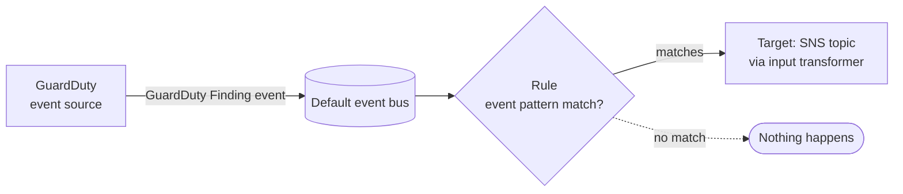
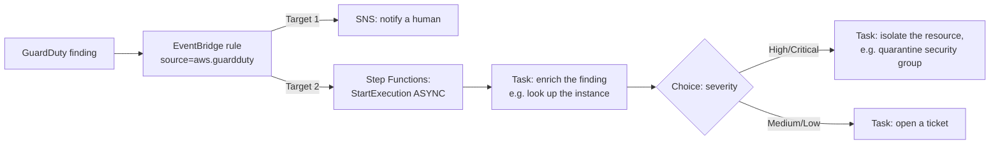

# Amazon EventBridge Overview (with GuardDuty Finding Notifications): Study Notes

Source: [Amazon EventBridge](https://youtu.be/_0ZHsClx9wc), a lesson from an AWS Certified Security – Specialty (SCS-C03) exam-prep course (confirmed from the video page's title), about 9 minutes. It follows directly from a prior lesson that enabled Amazon GuardDuty, and uses GuardDuty as its running example of EventBridge.

This replaces an earlier version of note 20 that covered EventBridge via a different, non-security video (EC2 state changes → SNS). That video is superseded by this one: same core EventBridge concepts, but a security-relevant example (GuardDuty finding → EventBridge → SNS) that matches this repo's existing GuardDuty-adjacent material better, and — unlike the previous source — this lesson's own AWS documentation explicitly lists **Step Functions state machines** as a supported EventBridge/GuardDuty target type (section 9), making the tie-in to this repo real rather than speculative.

The video has two halves:
1. A short explanation of EventBridge's five main features (event buses, pipes, rules, schedules, schema registries), focused on buses, pipes and rules.
2. A console lab: GuardDuty findings are routed through an EventBridge rule to an SNS topic, with an **input transformer** reformatting the raw JSON into a readable email.

What was checked:
- EventBridge's feature list and core concepts (event bus, rule, target, pipe) were checked against the current [Amazon EventBridge User Guide](https://docs.aws.amazon.com/eventbridge/latest/userguide/eb-what-is.html).
- The GuardDuty event schema, the exact input transformer JSON and template, the CLI procedure, and the list of supported target types (including Step Functions) come from AWS's own [Processing GuardDuty findings with Amazon EventBridge](https://docs.aws.amazon.com/guardduty/latest/ug/guardduty_findings_cloudwatch.html) page — this is almost certainly the page the course lesson's "copy and paste this" step is sourced from.
- GuardDuty severity ranges come from [Severity levels of GuardDuty findings](https://docs.aws.amazon.com/guardduty/latest/ug/guardduty_findings-severity.html).
- The `create-sample-findings` CLI syntax and the `Backdoor:EC2/Spambot` finding type (used in the video's demo) were checked against the [CLI reference](https://docs.aws.amazon.com/cli/latest/reference/guardduty/create-sample-findings.html) and the [GuardDuty finding types table](https://docs.aws.amazon.com/guardduty/latest/ug/guardduty_finding-types-active.html).
- Nothing was run against a live AWS account; GuardDuty and SNS both cost money to run even briefly, and this note's job is to verify the lesson's claims against current docs, not to re-run the lab.

---

## Contents

1. [Corrected terms](#1-corrected-terms)
2. [What EventBridge is, and why "event-driven security"](#2-what-eventbridge-is-and-why-event-driven-security)
3. [EventBridge's five features](#3-eventbridges-five-features)
4. [Why GuardDuty specifically pairs with EventBridge](#4-why-guardduty-specifically-pairs-with-eventbridge)
5. [The core workflow: source, event, bus, rule, target](#5-the-core-workflow-source-event-bus-rule-target)
6. [The lab: GuardDuty finding to an SNS email](#6-the-lab-guardduty-finding-to-an-sns-email)
7. [The input transformer, verified against AWS's own example](#7-the-input-transformer-verified-against-awss-own-example)
8. [Same setup with the AWS CLI](#8-same-setup-with-the-aws-cli)
9. [Beyond the video: Step Functions as the target instead of SNS](#9-beyond-the-video-step-functions-as-the-target-instead-of-sns)
10. [Gotchas](#10-gotchas)
11. [What has changed / numbers worth double-checking](#11-what-has-changed--numbers-worth-double-checking)
12. [Cheat sheet](#12-cheat-sheet)
13. [Review questions](#13-review-questions)

---

## 1. Corrected terms

| Caption/video says | Actually means |
|---|---|
| "Guard Duty" (two words, throughout) | **GuardDuty** — one word, the product name |
| "d-finding-ashtypes" | `--finding-types`, the CLI flag for `create-sample-findings` |
| "a backdoor spam bot for an EC2 instance" | The real finding type is **`Backdoor:EC2/Spambot`** (capital S, lowercase "pambot"), Medium severity, sourced from VPC flow logs |

---

## 2. What EventBridge is, and why "event-driven security"

The video's definition (00:26): "EventBridge is a serverless service for building event-driven applications." It adds a framing the earlier EC2/SNS-focused video didn't: EventBridge "is not just a service designed for security, but it enables **event-driven security**" — one thing emits an event (a finding, a config change, an API call), something else automatically reacts to it, without a human watching a dashboard or a Lambda polling on a schedule.

This matters for a security course specifically because it's the mechanism that turns a detective control (GuardDuty finding something) into a responsive one (notify someone, or act automatically) with no extra polling infrastructure.

---

## 3. EventBridge's five features

The video names five (00:46), then focuses on three for this lesson:

| Feature | Covered here? | One-line description |
|---|---|---|
| **Event buses** | Yes | Routers: many sources in, zero to many targets out, with optional transformation in between |
| **Pipes** | Yes (briefly) | Point-to-point: one source, one target, no pattern-matching rule in between |
| **Rules** | Yes | The event pattern + target binding that lives on a bus |
| **Schedules** | Named, not demoed | EventBridge Scheduler: cron/rate/one-time invocations, independent of any incoming event |
| **Schema registries** | Named, not demoed | Stores event shapes for generating typed code bindings; doesn't route or filter anything |

### Buses vs. pipes, as the video states them

- **Event bus**: many sources, zero to many targets, can transform an event in transit. Every account gets a **default event bus** automatically; any AWS service event in that account lands there with no setup.
- **Pipes**: one source, one target, point-to-point. A pipe can itself target a bus, and the bus then fans that event out to multiple targets — the two features compose.

---

## 4. Why GuardDuty specifically pairs with EventBridge

GuardDuty findings are useless sitting in the console if nobody's looking. AWS's own GuardDuty docs make the same point the video does: GuardDuty "automatically publishes (sends) findings as events to Amazon EventBridge," and this is what lets you react to a finding — notify a person, open a ticket, or trigger an automated remediation — instead of needing someone to check the GuardDuty console.

A detail the video doesn't mention but is useful context: GuardDuty findings are also **aggregated**. A brand-new finding (a never-before-seen finding ID) is sent to EventBridge in near real time; subsequent occurrences of that *same* finding are batched and sent on an interval (6 hours by default, configurable down to 15 minutes by a delegated administrator account). This is why the lab generates a **sample** finding rather than waiting for repeat traffic to accumulate — a sample finding always has a fresh ID.

---

## 5. The core workflow: source, event, bus, rule, target



| Step | In this lesson's example |
|---|---|
| **Event source** | GuardDuty, emitting a finding |
| **Event** | A JSON document with `source: "aws.guardduty"`, `detail-type: "GuardDuty Finding"`, and the full finding under `detail` |
| **Event bus** | The account's default bus — GuardDuty findings land there automatically, same as any other AWS service event |
| **Rule** | Matches on `source`/`detail-type` (optionally narrowed by `detail.severity`, `detail.accountId`, etc.) |
| **Target** | The SNS topic, reshaped first by an input transformer (section 7) |

AWS's documented event envelope for a GuardDuty finding, confirming the shape above:

```json
{
  "version": "0",
  "id": "cd2d702e-ab31-411b-9344-793ce56b1bc7",
  "detail-type": "GuardDuty Finding",
  "source": "aws.guardduty",
  "account": "111122223333",
  "time": "1970-01-01T00:00:00Z",
  "region": "us-east-1",
  "resources": [],
  "detail": { "...": "the full GuardDuty finding JSON" }
}
```

Note that `region` and `account` live on the **envelope**, not inside `detail` — this matters for the input transformer in section 7.

---

## 6. The lab: GuardDuty finding to an SNS email

### Step 1: SNS topic and subscription (02:32)

1. **SNS > Topics > Create topic** — Standard type, name `guardduty`.
2. **Create subscription** — protocol **Email**, your email address.
3. Confirm the subscription from the email SNS sends. Until confirmed, no notifications arrive.

### Step 2: the EventBridge rule (03:13)

1. **EventBridge > Rules > Create rule.** Name: `guardduty-threats`.
2. **Event bus**: default (every account has one automatically). Rule type: **Rule with an event pattern** (not the **schedule** rule type, which runs on a cron-like interval independent of any event).
3. **Event source**: AWS events or EventBridge partner events. Optionally inspect the **GuardDuty Finding** sample event to see the shape before building the pattern.
4. **Event pattern** (pattern form): event source **AWS services** → **GuardDuty** → event type **GuardDuty Finding**. This generates:

```json
{
  "source": ["aws.guardduty"],
  "detail-type": ["GuardDuty Finding"]
}
```

5. **Target**: AWS service → SNS topic → the `guardduty` topic.

### Step 3: reformat the email with an input transformer (05:25)

Raw GuardDuty finding JSON is long and not meant for humans to read in an email. The lesson expands **Additional settings > Configure target input > Input transformer** to cut it down to five fields: severity, finding ID, finding type, region, and description. Section 7 has the verified JSON.

### Step 4: trigger it and check the inbox (06:46)

Rather than waiting for a real threat (or flooding the inbox with every finding type GuardDuty can generate), the lesson uses GuardDuty's **sample findings** feature from CloudShell:

```bash
# Find your detector ID (one per account per Region)
aws guardduty list-detectors

# Generate one sample finding of a chosen type, in the SAME Region as that detector
aws guardduty create-sample-findings \
  --detector-id <detector-id> \
  --finding-types Backdoor:EC2/Spambot
```

Within roughly a minute, the SNS subscription should receive the formatted email, with a link straight into the GuardDuty console for that specific finding ID.

---

## 7. The input transformer, verified against AWS's own example

The lesson describes copying and pasting two blocks — an **input path map** and a **template** — without showing their exact contents on screen. AWS's own GuardDuty documentation publishes precisely this pair for exactly this scenario (GuardDuty finding → EventBridge rule → SNS), which is almost certainly its source:

**Input paths map** (maps names you'll use in the template to JSON paths in the raw event):

```json
{
  "severity": "$.detail.severity",
  "Account_ID": "$.detail.accountId",
  "Finding_ID": "$.detail.id",
  "Finding_Type": "$.detail.type",
  "region": "$.region",
  "Finding_Description": "$.detail.description"
}
```

**Template** (the final message, referencing those names in `< >`):

```json
{"message":"You have a severity <severity> GuardDuty finding type <Finding_Type> in the <region> Region.\n\nFinding Description:\n<Finding_Description>\n\nFor more details open the GuardDuty console at https://console.aws.amazon.com/guardduty/home?region=<region>#/findings?search=id%3D<Finding_ID>"}
```

The lesson's five fields (severity, finding ID, finding type, region, description) are a subset of AWS's six (it skips `Account_ID`) — a reasonable simplification for a single-account demo.

### Two correctness traps AWS's own docs call out explicitly

| Trap | Why it breaks |
|---|---|
| **The template must be single-line JSON**, with the message wrapped in a key like `"message"` | A bare quoted string, or a multi-line template using separate quoted strings per line, can produce invalid JSON once GuardDuty's `description` field (which can itself contain raw newlines and control characters) is substituted in. EventBridge then rejects the event and the notification never arrives. |
| **Email subscriptions render the template output as-is** | The subscriber sees the literal `{"message": "..."}` JSON object, with `\n` shown as two characters, not an actual line break. For a nicely formatted message, AWS recommends delivering to Amazon Q Developer in chat applications (Slack/Chime) or a Lambda target instead of a raw email subscription. |

The second point means the lesson's own demo likely shows a slightly awkward-looking plain-text email (JSON wrapper and literal `\n`s) rather than a cleanly formatted message — this is a property of SNS email delivery, not a mistake in the input transformer.

---

## 8. Same setup with the AWS CLI

Adapted from AWS's own documented CLI procedure for this exact rule, with the Lambda target swapped for SNS (per this lesson) and the `--source-arn` scoping flagged explicitly. Not run against a live account.

```bash
ACCOUNT_ID=$(aws sts get-caller-identity --query Account --output text)
REGION=$(aws configure get region)

# --- SNS topic and subscription ---
TOPIC_ARN=$(aws sns create-topic --name guardduty --query TopicArn --output text)
aws sns subscribe --topic-arn "$TOPIC_ARN" --protocol email --notification-endpoint "you@example.com"
# Confirm the subscription from the email before continuing.

# --- The rule: all GuardDuty findings (AWS's minimal example) ---
aws events put-rule --name guardduty-threats \
  --event-pattern '{"source":["aws.guardduty"],"detail-type":["GuardDuty Finding"]}'
RULE_ARN=$(aws events describe-rule --name guardduty-threats --query Arn --output text)

# --- Resource-based policy: lets *this rule only* publish to the topic ---
cat > sns-policy-statement.json <<EOF
{
  "Sid": "AllowEventBridgeToPublish",
  "Effect": "Allow",
  "Principal": { "Service": "events.amazonaws.com" },
  "Action": "sns:Publish",
  "Resource": "$TOPIC_ARN",
  "Condition": { "ArnEquals": { "aws:SourceArn": "$RULE_ARN" } }
}
EOF
EXISTING_POLICY=$(aws sns get-topic-attributes --topic-arn "$TOPIC_ARN" \
  --query 'Attributes.Policy' --output text)
MERGED_POLICY=$(python3 -c "
import json, sys
policy = json.loads(sys.argv[1])
policy['Statement'].append(json.loads(sys.argv[2]))
print(json.dumps(policy))
" "$EXISTING_POLICY" "$(cat sns-policy-statement.json)")
aws sns set-topic-attributes --topic-arn "$TOPIC_ARN" \
  --attribute-name Policy --attribute-value "$MERGED_POLICY"

# --- Target, with the input transformer from section 7 ---
cat > targets.json <<EOF
[{
  "Id": "1",
  "Arn": "$TOPIC_ARN",
  "InputTransformer": {
    "InputPathsMap": {
      "severity": "\$.detail.severity",
      "Account_ID": "\$.detail.accountId",
      "Finding_ID": "\$.detail.id",
      "Finding_Type": "\$.detail.type",
      "region": "\$.region",
      "Finding_Description": "\$.detail.description"
    },
    "InputTemplate": "{\"message\":\"You have a severity <severity> GuardDuty finding type <Finding_Type> in the <region> Region.\\n\\nFinding Description:\\n<Finding_Description>\\n\\nFor more details open the GuardDuty console at https://console.aws.amazon.com/guardduty/home?region=<region>#/findings?search=id%3D<Finding_ID>\"}"
  }
}]
EOF
aws events put-targets --rule guardduty-threats --targets file://targets.json

# --- Try it: one sample finding, same Region as the GuardDuty detector ---
DETECTOR_ID=$(aws guardduty list-detectors --query 'DetectorIds[0]' --output text)
aws guardduty create-sample-findings --detector-id "$DETECTOR_ID" \
  --finding-types Backdoor:EC2/Spambot

# --- Clean up ---
aws events remove-targets --rule guardduty-threats --ids 1
aws events delete-rule --name guardduty-threats
aws sns delete-topic --topic-arn "$TOPIC_ARN"
```

This follows the same least-privilege SNS policy pattern used for the EC2/SNS example in [notes 19](19_AWS_Step_Functions_Trigger_from_SQS_Study_Notes.md): `ArnEquals` on `aws:SourceArn` scopes the publish permission to this one rule, which AWS's own narrative example for SNS targets omits (its narrative shows the console path, which wires this automatically).

---

## 9. Beyond the video: Step Functions as the target instead of SNS

The video never mentions Step Functions, but AWS's own GuardDuty/EventBridge documentation states it directly, in a side note about target types: **"GuardDuty and EventBridge support the following target types - Amazon EC2 instances, Amazon Kinesis streams, Amazon ECS tasks, AWS Step Functions state machines, the `run` command, and built-in targets."**

That means the rule built in section 6 could target a state machine instead of (or in addition to — up to 5 targets per rule) the SNS topic, with no Lambda glue in between:



Why a state machine earns its keep here, instead of a single Lambda function reacting to the same rule:

| What a plain Lambda target gives you | What Step Functions adds |
|---|---|
| Runs your remediation code once, on invocation | **Retry**/**Catch** around each remediation step, as already built in [notes 05](05_AWS_Step_Functions_with_DynamoDB_Study_Notes.md) and [notes 12](12_AWS_Step_Functions_Serverless_Order_Workflow_Study_Notes.md) |
| One function does everything, or calls out to other functions itself | **Choice** branching on `detail.severity` — a Critical finding can isolate a resource immediately, while a Low one only logs |
| No built-in record of "what did we do about this finding" | The execution history is a free audit trail per finding ID — valuable for a security course specifically, since "what automated action was taken, and when" is often itself an audit requirement |

This is this repo's own addition, not something the video builds — included because it's a directly documented AWS capability, not a stretch.

---

## 10. Gotchas

1. **"Guard Duty" is "GuardDuty."** Spelling it as two words doesn't affect the CLI (service name is `guardduty`), but it's worth not perpetuating in your own notes/exam answers.
2. **Sample findings still need a real detector.** `create-sample-findings` requires GuardDuty to already be enabled in that account/Region; it doesn't work against a Region where GuardDuty was never turned on.
3. **Run the CLI commands in the same Region as the GuardDuty detector**, or `create-sample-findings` targets the wrong (or no) detector.
4. **A brand-new finding fires once in near real time; repeats of the same finding ID are batched** (6-hour default interval, only a delegated admin account can shorten it to as little as 15 minutes). A sample finding sidesteps this by always generating a fresh finding ID.
5. **Input transformer templates must be single-line JSON.** A multi-line or bare-string template can break once GuardDuty's `description` field injects raw newlines/control characters, silently dropping the notification.
6. **SNS email delivery shows the transformer's raw JSON output**, literal `\n` included — not a formatting bug, just what email subscriptions do. Use chat integrations or Lambda for a cleanly formatted message.
7. **`region` and `accountId` live in different places**: `region` is on the EventBridge envelope (`$.region`), `accountId` is inside the GuardDuty finding itself (`$.detail.accountId`). Mixing these up in an input transformer silently produces empty substitutions, not an error.
8. **The console wires the SNS resource policy automatically; the CLI doesn't** — same gotcha as any EventBridge-to-SNS rule built outside the console.

---

## 11. What has changed / numbers worth double-checking

| Point | Detail |
|---|---|
| EventBridge and CloudWatch Events | AWS states plainly they're "the same underlying service and API" — EventBridge is not a migration away from CloudWatch Events, just an expanded surface (SaaS/custom buses, pipes, schema registry) on the same engine |
| GuardDuty finding retention | GuardDuty itself only stores findings for 90 days; EventBridge is also how you get longer retention by routing findings elsewhere (or use GuardDuty's own S3 export feature) |
| Severity scale | 1.0-3.9 Low, 4.0-6.9 Medium, 7.0-8.9 High, 9.0-10.0 Critical — the "alert on everything except Low" pattern (severity ≥ 4) shown in AWS's docs matches a sensible default notification threshold |

---

## 12. Cheat sheet

```
Definition      : serverless event bus for event-driven apps; same idea applied to security = 
                  "event-driven security" (something emits, something else reacts, no polling)
5 features      : event buses, pipes, rules, schedules (EventBridge Scheduler), schema registries
GuardDuty event : source "aws.guardduty", detail-type "GuardDuty Finding", full finding in detail
Envelope fields : region + account live OUTSIDE detail ($.region, $.account); finding-specific
                  fields (severity, id, type, description, accountId) live INSIDE detail
Severity        : 1.0-3.9 Low | 4.0-6.9 Medium | 7.0-8.9 High | 9.0-10.0 Critical
Finding cadence : new finding ID -> near real time; repeats of same ID -> batched every 6h
                  (admin account can shorten to 15 min; members can't change it themselves)
Sample findings : aws guardduty list-detectors
                  aws guardduty create-sample-findings --detector-id <id> --finding-types <type>
                  (same Region as the detector; always gets a fresh finding ID)
Targets         : SNS (this lesson), Lambda, EC2, Kinesis, ECS tasks, Step Functions state
                  machines (ASYNC), Run Command, built-in -- up to 5 targets per rule
Input transform : InputPathsMap {name: "$.path"} + InputTemplate referencing <name>
                  MUST be single-line JSON; description can contain raw newlines that break a
                  bare-string or multi-line template
Email caveat    : SNS email shows the raw transformer JSON output, literal \n and all
```

---

## 13. Review questions

<details>
<summary>1. What does "event-driven security" mean, as the lesson frames it?</summary>

One thing (e.g. GuardDuty) emits an event when something happens, and something else (e.g. SNS, a Lambda function, a state machine) automatically reacts to it — no dashboard-watching or polling required.
</details>

<details>
<summary>2. Name EventBridge's five main features, and which three this lesson focuses on.</summary>

Event buses, pipes, rules, schedules, and schema registries. The lesson focuses on buses, pipes, and rules.
</details>

<details>
<summary>3. What's the `source` and `detail-type` for a GuardDuty finding event in EventBridge?</summary>

`source: "aws.guardduty"`, `detail-type: "GuardDuty Finding"`.
</details>

<details>
<summary>4. Where do you find the finding's region in the raw event: inside `detail`, or elsewhere?</summary>

On the event envelope itself, at `$.region` — not inside `detail`. The finding's `accountId`, by contrast, is inside `detail` (`$.detail.accountId`).
</details>

<details>
<summary>5. Why does the lesson generate a sample finding instead of waiting for a real one, or triggering the same finding type repeatedly?</summary>

Repeated occurrences of the *same* finding ID are aggregated and only delivered to EventBridge on an interval (6 hours by default), not in real time. A sample finding always gets a fresh finding ID, so it's delivered immediately and predictably for a demo.
</details>

<details>
<summary>6. What two things can silently break an EventBridge input transformer's email notification?</summary>

A template that isn't single-line JSON (a bare quoted string or separate multi-line quoted strings), which can become invalid JSON once a field containing raw newlines (like GuardDuty's `description`) is substituted in — EventBridge then rejects the event and the notification never sends. Separately, mixing up which fields live in `detail` vs. the envelope produces silent empty substitutions rather than an error.
</details>

<details>
<summary>7. The input transformer's template includes `\n` for line breaks. Will an email subscriber see actual line breaks?</summary>

No. SNS email subscriptions show the transformer's output as-is — the literal `{"message": "..."}` JSON text, with `\n` appearing as two characters, not a line break. For readable formatting, use a chat integration (Slack/Chime via Amazon Q Developer in chat applications) or a Lambda target instead.
</details>

<details>
<summary>8. Besides SNS and Lambda, name a documented EventBridge/GuardDuty target type that connects directly to this repo's subject.</summary>

AWS Step Functions state machines (invoked asynchronously) — listed explicitly among GuardDuty/EventBridge's supported target types, alongside EC2 instances, Kinesis streams, ECS tasks, and Run Command.
</details>

<details>
<summary>9. Why might a Step Functions state machine be a better target than a single Lambda function for automated GuardDuty remediation?</summary>

It adds built-in Retry/Catch around each remediation step, Choice branching on finding severity to route Critical findings differently from Low ones, and a free, per-execution audit trail of exactly what automated action was taken for a given finding — valuable for a security team's own audit requirements.
</details>

<details>
<summary>10. A rule matches GuardDuty findings with `detail.severity` values 4 through 10. What severity levels does this include, and which does it exclude?</summary>

It includes Medium (4.0-6.9), High (7.0-8.9), and Critical (9.0-10.0). It excludes Low (1.0-3.9) — attempted-but-unsuccessful activity, like a port scan, that didn't compromise anything.
</details>
