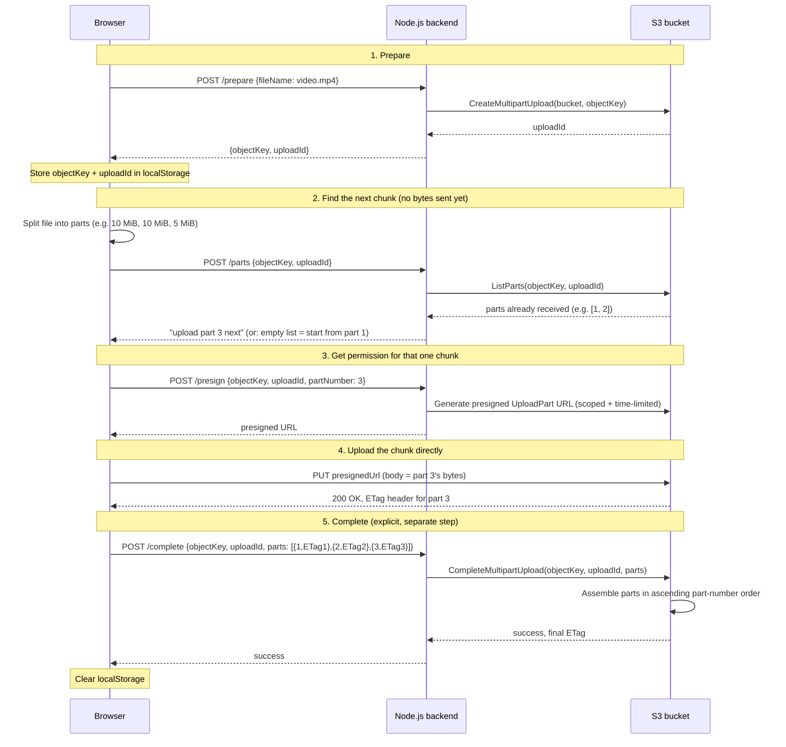
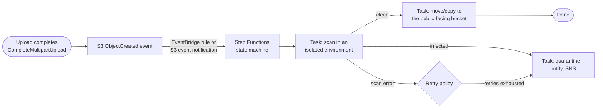

# S3 Multipart Upload and Presigned URLs (Resumable Uploads): Study Notes

Source: [S3 Multipart Upload & Presigned URLs Explained | Resumable Uploads](https://youtu.be/jePr5-vxj2k), presenter Rahul Saxena, about 13 minutes.

This is a general system-design video, not an AWS Step Functions video, and it never mentions Step Functions or EventBridge. It's included here only loosely, as background: the video's own closing trade-off — uploading straight from the browser to S3 means **no inline virus/content scan** — is exactly the kind of multi-step, retryable post-processing problem Step Functions is built for (section 8 sketches it). The video itself frames the design as cloud-agnostic ("I'm pretty sure we will be having similar things for Azure as well as GCP"); these notes stick to the S3-specific details it demonstrates.

What the video covers:
1. Why large uploads use **multipart upload**: chunk a big file, upload chunks independently, resume only the missing ones instead of restarting.
2. A six-step design: prepare the upload, figure out which chunk is next, get a **pre-signed URL** for that chunk, upload it, **explicitly complete** the upload, and resume a dropped upload later using browser local storage plus a query to S3.
3. One trade-off: bypassing the backend for the heavy transfer also bypasses any backend-side file scanning.

What was checked:
- S3 multipart upload's numeric limits, API flow (`CreateMultipartUpload`, `UploadPart`, `ListParts`, `CompleteMultipartUpload`), ETag behavior, and billing of incomplete uploads were checked against the current [Multipart upload limits](https://docs.aws.amazon.com/AmazonS3/latest/userguide/qfacts.html) and [multipart upload overview](https://docs.aws.amazon.com/AmazonS3/latest/userguide/mpuoverview.html) pages in the Amazon S3 User Guide.
- Presigned URL mechanics and expiration limits come from [Sharing objects with presigned URLs](https://docs.aws.amazon.com/AmazonS3/latest/userguide/ShareObjectPreSignedURL.html).
- The CORS requirement for a browser to call S3 directly, and the `ExposeHeaders` mechanism, come from [Using CORS](https://docs.aws.amazon.com/AmazonS3/latest/userguide/cors.html) and [Elements of a CORS configuration](https://docs.aws.amazon.com/AmazonS3/latest/userguide/ManageCorsUsing.md). The specific claim that `ETag` isn't on the browser's default cross-origin response-header safelist is general Fetch/XHR CORS behavior (not an AWS-specific document), included here because it's the single most common real-world bug in this exact architecture.
- The Step Functions tie-in in section 8 is this repo's own addition, not from the video; it reuses patterns already built and validated in [notes 05](05_AWS_Step_Functions_with_DynamoDB_Study_Notes.md) (retries) and [notes 12](12_AWS_Step_Functions_Serverless_Order_Workflow_Study_Notes.md) (Parallel/Catch), and the EventBridge-as-trigger material in [notes 20](20_Amazon_EventBridge_Overview_Study_Notes.md).
- Part numbering with checksums comes from [Checking object integrity](https://docs.aws.amazon.com/AmazonS3/latest/userguide/checking-object-integrity-upload.html). That `aws s3 presign` makes only `GET` URLs comes from its [CLI reference](https://docs.aws.amazon.com/cli/latest/reference/s3/presign.html).
- No code from the video was available to run; nothing here was executed against a real AWS account. Section 7's script was run against a local S3 mock, with a stand-in for the `aws` command.

---

## Contents

1. [The problem and the idea](#1-the-problem-and-the-idea)
2. [The six-step design](#2-the-six-step-design)
3. [Mapping the design onto real S3 APIs](#3-mapping-the-design-onto-real-s3-apis)
4. [ETag: what it actually is](#4-etag-what-it-actually-is)
5. [Hard limits](#5-hard-limits)
6. [What the video leaves out](#6-what-the-video-leaves-out)
7. [Same idea with the AWS CLI](#7-same-idea-with-the-aws-cli)
8. [Beyond the video: orchestrating the missing scan step with Step Functions](#8-beyond-the-video-orchestrating-the-missing-scan-step-with-step-functions)
9. [Gotchas](#9-gotchas)
10. [What has changed / numbers worth double-checking](#10-what-has-changed--numbers-worth-double-checking)
11. [Cheat sheet](#11-cheat-sheet)
12. [Review questions](#12-review-questions)

---

## 1. The problem and the idea

The video's opening scenario (00:03): a 100 GB upload is 95% done and the connection drops. Starting over wastes the 95% that already succeeded.

The fix is **multipart upload**: don't send the file as one request. Break it into smaller parts, upload each independently, and if the connection drops, only the parts that didn't finish need to be resent.

A second, separate design choice the video makes: upload **directly from the browser to S3**, not through the backend.

| Design | Why |
|---|---|
| Chunk the file | A dropped connection only costs you the in-flight chunk, not the whole file |
| Browser uploads straight to S3 (backend only hands out permissions) | A 100 GB transfer would otherwise tie up a backend connection and its bandwidth for the entire upload, for no reason — the backend doesn't need to see the bytes to authorize the upload |

---

## 2. The six-step design



| Step | Who does it | What's being decided |
|---|---|---|
| 1. Prepare | Backend | Create the upload, hand the browser an `uploadId` to remember |
| 2. Find the chunk | Backend, asking S3 | Which part number comes next — or "none yet" for a brand-new upload |
| 3. Get permission | Backend | A time-limited URL for exactly that one part. It can be reused until it expires |
| 4. Upload the chunk | Browser directly to S3 | The only step that moves the actual file bytes; the backend never sees them |
| 5. Complete | Backend | Tell S3 "these are all the parts, assemble the object" — **required even after every part has uploaded** |
| 6. Resume | Browser + backend + S3 | After a dropped connection, re-derive "which part is next" instead of restarting |

### Step 6 in detail: resuming without starting over

1. The browser re-selects the same file (same name and size) — nothing server-side triggers this; it's the user picking the file again.
2. The browser checks its own `localStorage` for a matching `objectKey`/`uploadId`, recognizing this as a resume rather than a new upload.
3. It re-runs step 2 (find the chunk): ask the backend, which asks S3 via `ListParts`, "which parts do you already have for this `uploadId`?"
4. Only the missing parts are chunked and uploaded; already-received parts are skipped entirely.

Two separate facts make this possible, and the video is explicit about both: **local storage** tells the browser this is a resume rather than a fresh upload, and a **query to S3** (not to local storage) is the source of truth for exactly which parts actually arrived.

---

## 3. Mapping the design onto real S3 APIs

The video never names the S3 API actions directly; here's the mapping used in the diagram above, which matches AWS's documented three-step process (initiate, upload parts, complete) plus the listing and abort operations AWS adds around it:

| Video's step | Real S3 API action | Notes |
|---|---|---|
| "Create a multipart upload request" | [`CreateMultipartUpload`](https://docs.aws.amazon.com/AmazonS3/latest/API/API_CreateMultipartUpload.html) | Returns the `UploadId`. Anonymous users can't call this. |
| "Ask which parts are already received" | [`ListParts`](https://docs.aws.amazon.com/AmazonS3/latest/API/API_ListParts.html) | Up to 1,000 parts per response; paginate for more. AWS's own docs warn: **don't** use this listing's output to build the `CompleteMultipartUpload` request — keep your own record of part numbers and ETags instead, since a listing in progress can miss parts that haven't finished uploading. |
| "Get the URL to upload a chunk" | A [presigned URL](https://docs.aws.amazon.com/AmazonS3/latest/userguide/ShareObjectPreSignedURL.html) for [`UploadPart`](https://docs.aws.amazon.com/AmazonS3/latest/API/API_UploadPart.html) | The URL is generated with the backend's own AWS credentials; the browser never holds any AWS credentials |
| "Upload the part" | `PUT` to that presigned URL | This *is* the `UploadPart` call, just issued straight from the browser |
| "Complete the upload" | [`CompleteMultipartUpload`](https://docs.aws.amazon.com/AmazonS3/latest/API/API_CompleteMultipartUpload.html) | Must include every part's number and ETag. S3 then concatenates the parts **in ascending part-number order**, regardless of the order they appear in this request. |
| (not in the video) | [`AbortMultipartUpload`](https://docs.aws.amazon.com/AmazonS3/latest/API/API_AbortMultipartUpload.html) | Needed to free storage and stop billing for an upload that will never be resumed (section 6) |

---

## 4. ETag: what it actually is

The video's description (05:13-ish): "ETag is nothing but a sort of a receipt... it will have nothing but the part number and a very specific ID." That's close enough to use as a mental model, but it blurs two different ETags:

| ETag | What it is |
|---|---|
| **Per-part ETag**, returned by `UploadPart` | A checksum of that one part's bytes. You must record each part's number and its ETag yourself — they're required, together, in the `CompleteMultipartUpload` request. |
| **Final object's ETag**, returned by `CompleteMultipartUpload` | AWS's own docs: "This ETag is not necessarily an MD5 hash of the object data." It's derived from the part ETags (classically, an MD5-of-the-concatenated-part-MD5s, suffixed with the part count), not a plain hash of the reassembled file. **Don't use it to verify the final file's contents the way you might treat a single-upload object's ETag as an MD5.** |

If you need an end-to-end integrity check instead, use S3's additional checksums feature (`x-amz-checksum-*`), which validates server-side and can produce a true full-object checksum — see the note on part numbering in section 6.

---

## 5. Hard limits

The video's own example (25 MiB split into 10 + 10 + 5 MiB) respects these without saying so:

| Limit | Value |
|---|---|
| Part size | 5 MiB to 5 GiB — **except the last part**, which has no minimum |
| Part numbers | 1 to 10,000 |
| Max parts per upload | 10,000 |
| Max object size via multipart upload | 48.8 TiB (5 GiB max part × 10,000 max parts) |
| `ListParts` / `ListMultipartUploads` page size | 1,000 per response |
| Recommended threshold to use multipart upload at all | ~100 MB+ (AWS's own recommendation) |

The video's 10 + 10 + 5 MiB split is valid because every part is at least 5 MiB, and the 5 MiB final part doesn't need to meet that minimum anyway, since it's last.

---

## 6. What the video leaves out

| Gap | Why it matters | What to do instead |
|---|---|---|
| **No CORS configuration mentioned** | A browser `PUT` straight to an S3 URL from a web app's own origin is a cross-origin request. Without a CORS rule on the bucket allowing `PUT` from that origin, the browser blocks the request before it even reaches S3 — this whole design silently fails without it. | Configure a bucket CORS rule with `AllowedMethods: ["PUT"]`, `AllowedOrigins` set to your app's origin, `AllowedHeaders` covering what your SDK sends (e.g. `Content-Type`) |
| **The video's "S3 sends an ETag in the header" step glosses over a very common bug** | `ETag` is not one of the response headers browsers expose to JavaScript by default on a cross-origin request (the Fetch/XHR safelist doesn't include it). Reading `response.headers.get('ETag')` after the `PUT` will return `null` unless the bucket's CORS rule explicitly exposes it. | Add `"ExposeHeaders": ["ETag"]` to the bucket's CORS configuration |
| **No mention of cleaning up abandoned uploads** | A multipart upload "has no expiry; you must explicitly complete or stop" it. If a user never resumes (closes the tab for good), S3 keeps billing for the uploaded parts' storage indefinitely. | Add an `AbortIncompleteMultipartUpload` S3 Lifecycle rule (e.g. abort anything incomplete after 1-7 days); stopping an upload has no early-delete fee |
| **Part numbers implied as strictly sequential** | In general, part numbers don't need to be consecutive — you can upload 1, 5, 14 and fill gaps later, and re-uploading a part number overwrites it | Uploads that use additional checksums need consecutive part numbers starting at 1. AWS states this for [composite (part-level) checksums](https://docs.aws.amazon.com/AmazonS3/latest/userguide/checking-object-integrity-upload.html), and the [multipart overview](https://docs.aws.amazon.com/AmazonS3/latest/userguide/mpuoverview.html) states it for checksums generally. Numbering 1, 2, 3 is safe in every case |
| **Pre-signed URL's permission scope implied as baked into the URL's "details"** | What a presigned URL authorizes is bounded by the IAM permissions of **whoever generated it** (the backend's own credentials/role) at the moment it was signed — it's a signed request, not a separate access grant | Give the backend's role only `s3:PutObject` scoped to the relevant key pattern, not broad bucket access |
| **"No inline scan" is stated as a trade-off, with no concrete fix** | The architecture genuinely has no place to intercept the bytes before they land in S3 | See section 8 |

---

## 7. Same idea with the AWS CLI

The video's six steps, as CLI calls, to see the real request/response shapes. Not run against a live account here.

```bash
BUCKET=my-uploads-bucket
KEY=video.mp4

# --- Step 1: prepare ---
UPLOAD_ID=$(aws s3api create-multipart-upload --bucket "$BUCKET" --key "$KEY" \
  --query UploadId --output text)

# --- Step 2: find the next chunk (empty on a brand-new upload) ---
aws s3api list-parts --bucket "$BUCKET" --key "$KEY" --upload-id "$UPLOAD_ID"

# --- Step 3: "permission" -- here, a presigned PUT URL for part 1 ---
# `aws s3 presign` can't do this: it only makes GET URLs. Sign UploadPart with an SDK.
# boto3 takes the Region from your profile or AWS_DEFAULT_REGION (it ignores AWS_REGION);
# it must be the bucket's Region.
PRESIGNED_URL=$(uv run --no-project --with boto3 python - "$BUCKET" "$KEY" "$UPLOAD_ID" <<'PY'
import sys

import boto3
from botocore.config import Config

bucket, key, upload_id = sys.argv[1:]
# SigV4, with the bucket name in the host so the URL targets the bucket's Region
config = Config(signature_version="s3v4", s3={"addressing_style": "virtual"})
print(boto3.client("s3", config=config).generate_presigned_url(
    "upload_part",
    Params={"Bucket": bucket, "Key": key, "UploadId": upload_id, "PartNumber": 1},
    ExpiresIn=900,
))
PY
)

# --- Step 4: upload the part (what the browser's PUT becomes) ---
ETAG=$(curl -sS -X PUT -T part1.bin "$PRESIGNED_URL" -D - -o /dev/null \
  | grep -i '^ETag:' | cut -d' ' -f2 | tr -d '\r')

# --- Step 5: complete, with every part's number and ETag ---
cat > parts.json <<EOF
{"Parts": [{"ETag": $ETAG, "PartNumber": 1}]}
EOF
aws s3api complete-multipart-upload --bucket "$BUCKET" --key "$KEY" \
  --upload-id "$UPLOAD_ID" --multipart-upload file://parts.json

# --- Abandoning instead: free the storage and stop billing for it ---
aws s3api abort-multipart-upload --bucket "$BUCKET" --key "$KEY" --upload-id "$UPLOAD_ID"

# --- The safety net the video doesn't mention: auto-abort stale uploads ---
cat > lifecycle.json <<'EOF'
{
  "Rules": [{
    "ID": "AbortStaleMultipartUploads",
    "Status": "Enabled",
    "Filter": {},
    "AbortIncompleteMultipartUpload": { "DaysAfterInitiation": 3 }
  }]
}
EOF
aws s3api put-bucket-lifecycle-configuration --bucket "$BUCKET" \
  --lifecycle-configuration file://lifecycle.json
```

---

## 8. Beyond the video: orchestrating the missing scan step with Step Functions

The video names its own gap directly (11:37): no inline scan, so "if you're dealing with such cases where you might get a file with a bug... you have to pass the file to an isolated environment, scan that particular file, and then pass it to the S3 bucket." That's naturally a multi-step, retryable workflow — the thing this repo's other notes build repeatedly.



| Piece | How this repo's existing notes already cover it |
|---|---|
| Trigger the workflow when the upload completes | An EventBridge rule matching S3's `Object Created` event, targeting the state machine directly — exactly the rule → target pattern in [notes 20](20_Amazon_EventBridge_Overview_Study_Notes.md#5-the-core-workflow-source-event-bus-rule-target), just with S3 instead of EC2 as the source |
| Retry a flaky scan a few times before giving up | `Retry` with backoff, as built in [notes 05](05_AWS_Step_Functions_with_DynamoDB_Study_Notes.md) |
| Route "infected" vs "clean" vs "scan failed" down different paths | `Choice`/`Catch`, as built in [notes 12](12_AWS_Step_Functions_Serverless_Order_Workflow_Study_Notes.md) |
| See exactly which uploads are stuck mid-scan, without digging through logs | The execution history view, same benefit [notes 17](17_AWS_Step_Functions_Introduction_Study_Notes.md#8-why-people-like-it) describes for any Step Functions workflow |

This isn't something the source video builds or claims — it's this repo's own answer to the trade-off the video raises, included to make the note useful here rather than a pure tangent.

---

## 9. Gotchas

1. **Completing the upload is a separate, required step.** Every part succeeding doesn't finish the upload — S3 still needs an explicit `CompleteMultipartUpload` call, or the object never appears.
2. **An abandoned multipart upload bills forever**, until it's completed or aborted. Pair this design with an `AbortIncompleteMultipartUpload` lifecycle rule.
3. **CORS, not AWS IAM, is usually the first thing that breaks** this exact architecture: a missing `AllowedMethods: PUT` or missing `AllowedOrigins` entry blocks the browser's request before S3 ever evaluates permissions.
4. **`ETag` must be in `ExposeHeaders`**, or the browser's JavaScript can't read it from the `PUT` response at all, even though the network tab shows it arriving.
5. **The final object's ETag is not a trustworthy whole-file MD5** for a multipart upload. Don't build integrity checks on that assumption; use S3's checksum feature instead.
6. **`ListParts` output isn't for building the completion request.** Track part numbers and ETags yourself as you upload; only use `ListParts` to resume or to verify.
7. **Re-uploading a part number silently overwrites the previous one.** There's no conflict error — useful for "retry this one chunk," risky if a stale retry races a newer one.
8. **A presigned URL is bounded by the signer's own IAM permissions**, not some independent capability baked into the URL string itself.

---

## 10. What has changed / numbers worth double-checking

| Older/commonly-cited figure | Current AWS docs |
|---|---|
| Max object size via multipart upload often cited as "5 TB" | Current docs state **48.8 TiB** (= 5 GiB max part size × 10,000 max parts) |
| Multipart ETag as "MD5 of concatenated part MD5s, suffixed with part count" | Still true for the classic MD5 checksum path, but newer default checksum algorithms (e.g. CRC-64/NVME) mean AWS now states plainly the final ETag "is not necessarily an MD5 hash of the object data" |
| Part numbers assumed sequential | Still arbitrary (1 to 10,000, any order, gaps allowed) **unless** the upload uses additional checksums (AWS names composite ones), which require consecutive numbering from 1 |

---

## 11. Cheat sheet

```
Idea            : chunk the file, upload parts independently, resume only the missing ones,
                  skip the backend for the heavy bytes
Six steps       : prepare (CreateMultipartUpload) -> find next chunk (ListParts)
                  -> get permission (presigned UploadPart URL) -> upload (PUT to that URL)
                  -> complete (CompleteMultipartUpload, every {PartNumber, ETag})
                  -> resume (localStorage says "old upload" + ListParts says "which parts")
Limits          : parts 5 MiB-5 GiB (no min on the last part), 1-10,000 parts,
                  max object 48.8 TiB, list responses capped at 1,000
ETag (part)     : checksum of that one part; required for CompleteMultipartUpload
ETag (object)   : NOT a trustworthy plain MD5 of the final file
Assembly order  : S3 concatenates by ascending PartNumber, regardless of request list order
Never forget    : CORS AllowedMethods=PUT + AllowedOrigins=<app origin>
                  CORS ExposeHeaders=["ETag"] or the browser can't read it back
                  Lifecycle rule AbortIncompleteMultipartUpload, or zombie uploads bill forever
Missing scan    : no backend in the path = no inline virus/content scan;
                  orchestrate it after the fact with S3 event -> EventBridge -> Step Functions
```

---

## 12. Review questions

<details>
<summary>1. Why chunk the file instead of uploading it as one request?</summary>

If the connection drops partway through, only the in-flight chunk is lost. The already-uploaded chunks stay accepted by S3, so resuming only requires re-sending the missing chunks, not the whole file.
</details>

<details>
<summary>2. Why does the design upload directly from the browser to S3 instead of routing the file through the backend?</summary>

Routing a very large file through the backend would consume a lot of backend bandwidth and tie up a connection for the whole transfer. The backend only needs to authorize the upload (via a presigned URL), not see the bytes.
</details>

<details>
<summary>3. All parts finish uploading. Is the object available in S3 yet?</summary>

No. `CompleteMultipartUpload` must still be called explicitly, with every part's number and ETag. Until then, the parts exist but the final object doesn't.
</details>

<details>
<summary>4. A user refreshes the browser mid-upload. How does the app know this is a resume, not a new upload?</summary>

The browser checks `localStorage` for a stored `uploadId`/object key matching the selected file's name and size. If found, it treats this as a resume and asks the backend (which calls `ListParts`) which parts are already uploaded, rather than starting from part 1.
</details>

<details>
<summary>5. Is the final object's ETag a reliable MD5 checksum of the whole file?</summary>

No. AWS's own documentation states the final ETag "is not necessarily an MD5 hash of the object data." Use S3's additional checksum feature if you need a verifiable whole-object checksum.
</details>

<details>
<summary>6. Name two things missing from the video's design that would make a real browser implementation fail or silently misbehave.</summary>

No CORS configuration on the bucket (the browser would block the cross-origin `PUT` outright), and no `ExposeHeaders: ["ETag"]` in that CORS configuration (the `PUT` would succeed, but the browser's JavaScript couldn't read the `ETag` response header needed for the completion step).
</details>

<details>
<summary>7. A user starts an upload, uploads two of three parts, and then abandons the tab forever. What happens to those two parts in S3, and how do you prevent it from costing money indefinitely?</summary>

The uploaded parts remain stored and billed, because a multipart upload never expires on its own — it must be explicitly completed or aborted. An `AbortIncompleteMultipartUpload` S3 Lifecycle rule automatically aborts (and stops billing) uploads left incomplete past a set number of days.
</details>

<details>
<summary>8. Must part numbers be uploaded in strict sequential order?</summary>

No, not for plain multipart upload — part numbers from 1 to 10,000 can be uploaded in any order with gaps, and re-using a part number overwrites the earlier upload of that part. Consecutive numbering starting at 1 is required when the upload uses S3's additional checksums (AWS states this for composite, or part-level, checksums).
</details>

<details>
<summary>9. What determines what a presigned URL is allowed to do?</summary>

The IAM permissions of whoever (or whatever backend role) generated it at signing time, plus the specific action, resource, and parameters it was signed for, and its expiration. It isn't an independent grant of access baked into the URL string.
</details>

<details>
<summary>10. The video names "no inline scan" as a trade-off of uploading straight to S3. How could you add scanning back without routing every byte through the backend during the upload itself?</summary>

Scan after the fact: have S3 (or an EventBridge rule) fire an event when the object is created, and run the scan asynchronously — for example, a Step Functions workflow with a scan Task, Retry for transient failures, and a Choice/Catch that routes clean files one way and infected/failed ones to quarantine and notification.
</details>
